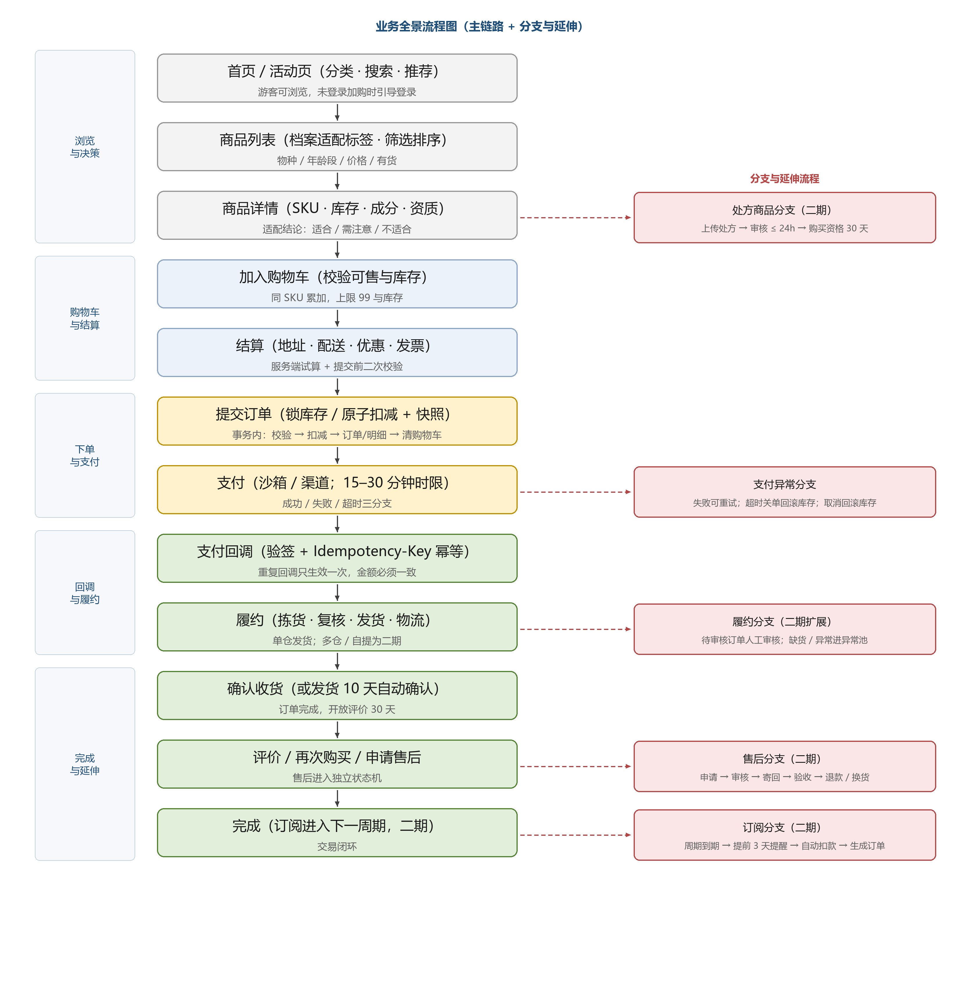
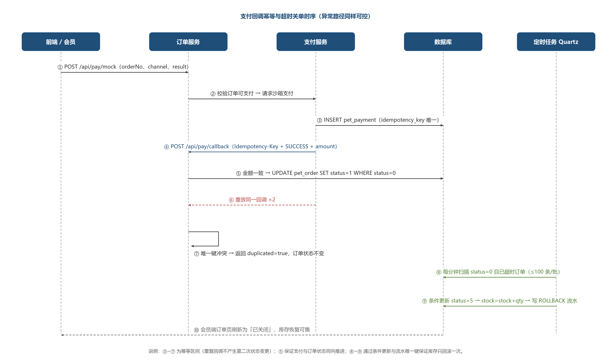
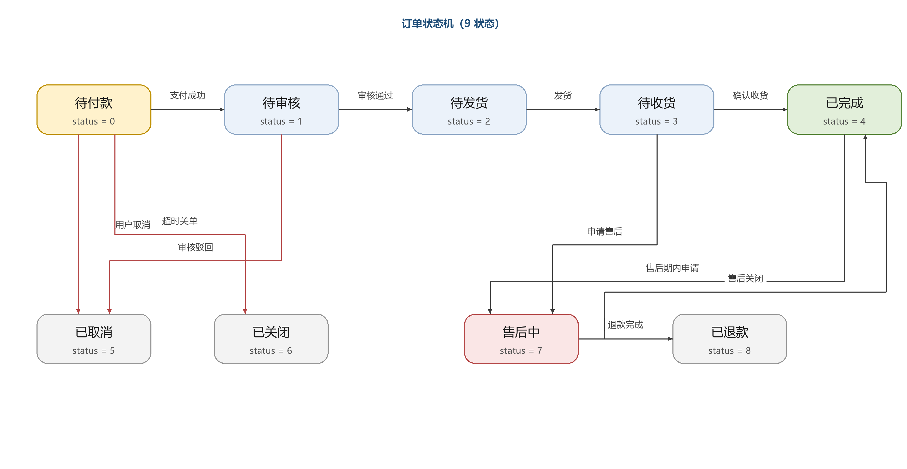
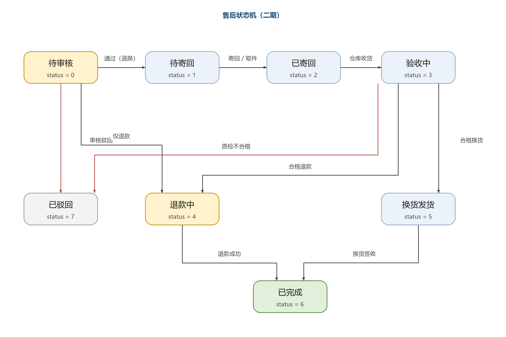
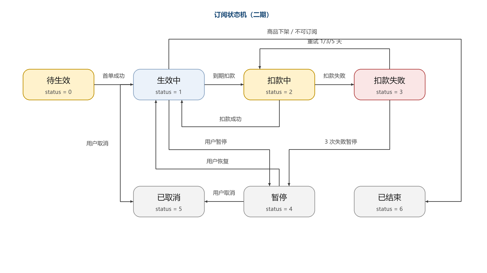
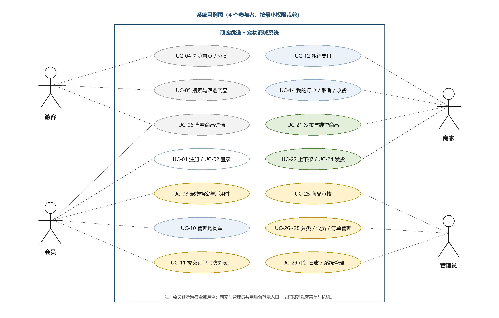
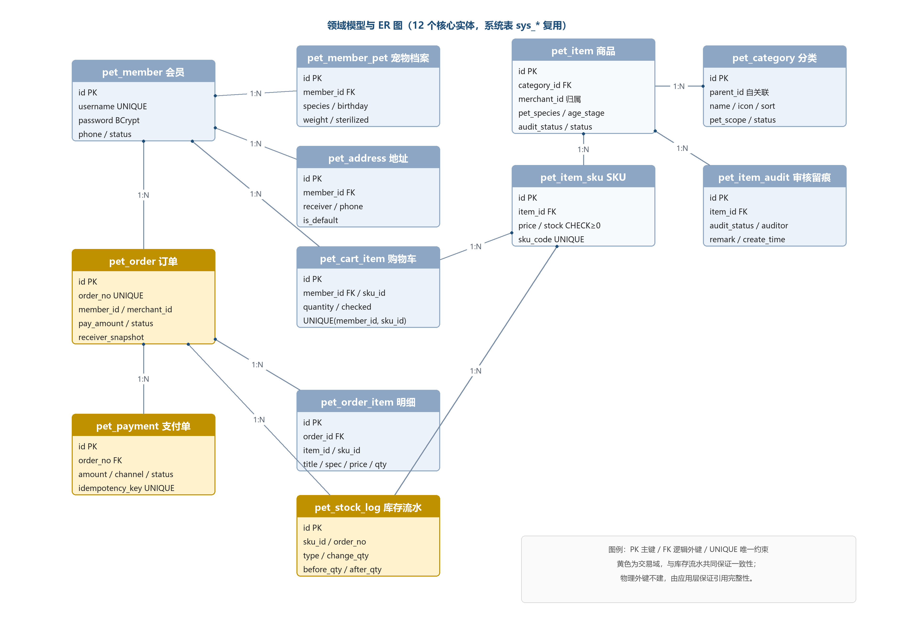

<!-- COVER -->
萌宠优选 · 宠物商城系统
企业级需求文档（Software Requirements Specification）

文档编号 PET-MALL-SRS-002　｜　版本 V2.0　｜　状态 已冻结　｜　编制日期 2026-10-19

| 项目 | 内容 |
|---|---|
| 项目名称 | 萌宠优选 · 宠物商城系统（Pet Mall） |
| 文档名称 | 企业级需求文档（SRS） |
| 文档编号 | PET-MALL-SRS-002 |
| 当前版本 | V2.0（需求基线，冻结于 D3） |
| 所属课程 | AI 辅助软件开发 · 实验四「企业级应用开发」 |
| 参照案例 | 教材第九章「社区超市商城系统」 |
| 团队规模 | 4 人小组|
| 技术基座 | RuoYi 3.9.2 + Vue3 + MySQL 8.0 + Redis 7 |
| 交付形态 | 源码 + SQL + 脚本 + 三文档 + PPT + 录屏 |
| 编写人 | 项目组（A 架构/交易，B 会员/安全） |
| 审核人 | 指导教师 / 组内交叉评审 |
| 密级 | 内部（课程交付物） |

**修订历史**

| 版本 | 日期 | 修订人 | 修订说明 |
|---|---|---|---|
| V1.0 | 2026-10-19 | 项目组 | 初稿：范围、角色、用例、功能清单、非功能需求、追溯矩阵 |
| V1.5 | 2026-10-19 | 项目组 | 补充业务规则、状态机、数据模型、接口规范与合规要求 |
| V2.0 | 2026-10-19 | 项目组 | 需求基线冻结：确认批次划分、验收标准与需求追溯矩阵 |

> 说明：本文件为实验四交付的「需求文档」，定义产品目标态与本期交付基线的需求内容。设计文档（架构、选型、物理表设计、ADR）与测试报告为独立文件，本文只在必要处引用。
<!-- /COVER -->

<!-- TOC -->
目录
<!-- /TOC -->

# 1 文档说明

## 1.1 编写目的

本文档定义「萌宠优选 · 宠物商城系统」的企业级需求基线，回答四个问题：**为谁做、做什么、做到什么程度、如何验收**。具体用途：

1. **统一认知**：在 4 人小组、19 个工作日的约束下冻结范围，避免中途加需求导致主闭环延期。
2. **指导开发**：为设计文档、数据库设计、接口定义与前后端并行开发提供唯一输入；契约冻结后只增不改。
3. **支撑测试**：每条需求带可验证的验收要点，测试用例可追溯到需求编号。
4. **支撑评审**：覆盖实验四对需求文档的硬性要求——用例图、业务流程图、领域模型、ER 图、API 清单、可验证的非功能需求。
5. **留痕与可复现**：需求编号贯穿设计、代码、测试与演示视频，"做了什么、为什么做、证据在哪"可逐项核对。

## 1.2 文档范围与产品范围

| 维度 | 本文档覆盖 | 不在本文档内 |
|---|---|---|
| 内容 | 业务背景、用户与角色、业务流程、状态机、功能需求、业务规则、数据需求、接口需求、非功能需求、验收与追溯、范围与计划、风险 | 物理表 DDL 与索引细节、技术选型论证与 ADR、测试执行数据、运维操作手册 |
| 产品 | 宠物用品垂直商城的完整业务域（用户端、运营后台、基础能力） | 活体交易、在线诊疗、保险理赔、跨境、自建物流、线下门店 |
| 交付 | 一期（19 天课程交付）与二期（产品化）的需求边界 | 预算、报价、商务合同 |

## 1.3 优先级与批次定义

需求采用双维度标注：**产品优先级**回答"对业务有多重要"，**交付批次**回答"什么时候做"。

| 标注 | 取值 | 判定规则 |
|---|---|---|
| 产品优先级 | P0 | 缺失则无法营业：主链路或合规硬要求 |
|  | P1 | 提升转化与运营效率，有明确业务收益 |
|  | P2 | 增强体验与差异化 |
| 交付批次 | 一期 | 本期 19 天交付范围，证明企业级能力所必需的最小集 |
|  | 二期 | 产品化阶段，需真实商户资质、人力与资金 |
|  | 后续 | 演进方向，架构预留，不排期 |

**统一口径**：标注"二期"的 P0 条目表示**产品必须具备、本期以简化形态或人工替代**，并在对应位置说明替代方案；标注"后续"的条目不进入任何排期。凡未特别说明的验收标准，均以"一期"为验收对象。

## 1.4 读者指引

| 读者 | 重点章节 | 使用方式 |
|---|---|---|
| 开发人员 | 4、5、6、7、8 | 以功能编号与接口清单为契约编码，D3 后只增不改 |
| 前端开发 | 4.1、5.1–5.14、8.1–8.3 | 按页面行为与接口并行开发，避免等待后端 |
| 测试人员 | 5、6、9、10、附录 B | 由验收要点与验收用例派生测试用例，用编号回填报告 |
| 指导教师 / 评审 | 2、3、4、9、10、11 | 判断业务完整性、企业级能力与真实性 |
| 产品 / 运营 | 2、5.10–5.12、6、附录 A/B | 作为产品化与运营配置的输入 |
| 法务 / 合规 | 6.6、7.8、9.3 | 处方、广告、隐私、资质核对 |

## 1.5 术语与缩略语

| 术语 | 含义 | 本文使用约定 |
|---|---|---|
| SPU / SKU | 标准产品单元 / 最小库存单元 | 一期以 `pet_item` / `pet_item_sku` 承载，二期演进为 SPU/SKU 分层 |
| 宠物档案 | 用户维护的宠物个体信息（物种/品种/生日/体重/绝育/过敏史等） | 驱动筛选、适配提示、喂食量、复购提醒 |
| 订阅定期购 | 按周期自动下单扣款并配送（Autoship 模式） | 二期；一期仅预留商品属性与接口占位 |
| 处方粮/处方药 | 需凭执业兽医处方销售的商品 | 二期；一期不售卖此类目，仅保留标记位 |
| 效期 | 食品/保健品剩余保质期 | 发货剩余保质期 ≥ 总保质期 2/3 |
| 锁库存 | 下单时占用库存、支付后转为扣减 | 产品目标态两段式；一期用"下单即扣减 + 失败回滚" |
| 价保 | 降价后对期限内已购用户补差 | 二期 |
| 幂等 | 同一请求重复执行效果等于一次 | 支付回调、退款、订阅扣款必须实现 |
| RBAC | 基于角色的访问控制 | 复用 RuoYi 权限码体系 |
| RTM | 需求追溯矩阵 | 见 10.3 |
| DoD | 完成定义 | 见 10.4 |
| RER / MER | 静息能量需求 / 维持能量需求 | 喂食量计算（附录 C） |
| GMV | 商品交易总额 | 报表口径需注明是否含退款 |
| LCP / P95 | 最大内容绘制 / 95 分位响应时间 | 性能验收口径 |
| 越权 | 低权限主体访问高权限资源或他人数据 | 重点演示点 |

## 1.6 参考文档

| 编号 | 名称 | 用途 |
|---|---|---|
| R1 | 《实验报告（四）AI 辅助软件开发》 | 实验目的、交付物与评分导向的原始要求 |
| R2 | 教材第九章「社区超市商城系统」 | 业务与实现参照基线、差异化对比对象 |
| R3 | 《宠物商城系统 · 项目初步规划》2026-10-19 | 范围、技术方案、里程碑的直接上游 |
| R4 | 《宠物用品网上购物系统 · 功能需求文档》 | 业务域与运营玩法的参考输入 |
| R5 | RuoYi 3.9.2 文档；Spring Boot 4.1；MySQL 8.0；Redis 7 | 基座能力与实现约束 |
| R6 | 《电子商务法》《消费者权益保护法》《个人信息保护法》《网络安全法》《兽药管理条例》《广告法》《价格法》 | 合规依据（二期为主，一期适用项见 9.3） |

# 2 项目背景与产品定位

## 2.1 行业与机会

宠物消费具备「高频刚需 + 强复购 + 强决策依赖」三重特征：主粮、猫砂、驱虫属于周期性消耗品，用户一旦建立信任便长期复购；而选品又高度依赖宠物个体信息（种类、年龄、体重、健康状况、过敏史）。综合电商的商品信息与宠物个体需求脱节，用户需自行判断，决策成本高、买错风险大，由此产生三个可被系统化解决的痛点：**买错（适配）、忘买（复购）、不敢买（信任）**。

头部平台的实践也印证这三条路径：以订阅锁定复购、以兽医与处方体系建立专业信任、以结构化信息与评论降低决策成本、以时效与售后确定性降低风险。本项目的差异不在"更便宜"或"品类更多"，而在**是否真正认识用户家里的那只宠物**。

## 2.2 竞品参考

| 能力域 | 行业通行做法 | 本系统设计要点 | 对应章节 |
|---|---|---|---|
| 商品决策 | 结构化成分与适用信息、评论与问答 | 「适用物种/阶段/体重段/过敏原/成分表」+ 档案匹配结论 | 5.4、6.1 |
| 复购 | 订阅定期购、复购提醒、组合套餐 | 订阅周期 2/4/6/8/12 周，可跳过/暂停/换品；到期提醒 | 5.11、6.9 |
| 专业信任 | 在线客服、养护内容、处方审核 | 内容中心 + 工单客服 + 处方合规流程（二期） | 5.13、6.6 |
| 价格促销 | 券、满减、秒杀、预售、价保 | 统一优惠计算引擎 + 叠加矩阵 + 价保（二期） | 5.10、6.3、6.4 |
| 履约 | 时效标签、多仓就近、门店自提 | 时效标签、单仓发货；多仓/自提列为二期 | 5.8、5.15.2 |
| 会员 | 成长会员与付费会员 | 成长型会员（一期简化）+ 积分（二期） | 5.10 |
| 社区 | 晒单、问答、话题 | 评价 + 问大家（二期），社区后续 | 5.12 |
| 合规 | 资质公示、处方审核、禁售管控 | 禁售清单、广告法词库、资质校验 | 6.6、9.3 |

## 2.3 产品定位与命名

- **正式名称**：萌宠优选 · 宠物商城系统（Pet Mall）
- **一句话立意**：以宠物档案为中枢、以订阅复购为增长引擎、以专业信息与合规服务建立信任的**垂直宠物用品商城**，并具备企业级交易闭环与可复现交付能力。
- **产品形态**：一期为前后端分离 Web（客户前台 + 管理后台）；目标态扩展 H5 与微信小程序；后台含商品、库存、订单、售后、用户、营销、内容、数据、系统九大中心。
- **定位**：不做"更便宜的综合商城"，而是"更懂你家宠物的专业补给站"。

## 2.4 目标与指标

### 2.4.1 产品目标（目标态）

| 维度 | 目标 | 衡量指标（上线 6 个月参考值） |
|---|---|---|
| 业务 | 跑通浏览—下单—支付—履约—售后全链路 | 支付成功率 ≥ 95%，履约及时率 ≥ 98% |
| 增长 | 订阅与会员驱动复购 | 订阅渗透率 ≥ 15%，90 天复购率 ≥ 35% |
| 体验 | 降低买错概率与决策成本 | 商品页到加购转化率 ≥ 8%，退货率 ≤ 5% |
| 效率 | 运营后台可零代码完成日常配置 | 活动上线 ≤ 30 分钟，日常运营 0 代码 |
| 合规 | 处方/食品/兽药可审计 | 合规检查项 100% 覆盖，审计可追溯 |

> 上述数值为产品目标值，不作为本期验收依据；本期验收依据见 2.4.2 与第 10 章。

### 2.4.2 本期交付目标与可验证指标

| 编号 | 目标 | 可验证标准 | 验证方式 |
|---|---|---|---|
| KPI-01 | 主闭环可用 | 登录→建档→搜索→加购→下单→支付→发货→收货 成功率 100%（演示 20 次无阻塞缺陷） | 演示录屏 + 缺陷记录 |
| KPI-02 | 零超卖 | 库存 1，20 并发下单，成功 1 单，超卖 0 | 并发测试输出 + DB 断言 |
| KPI-03 | 支付幂等 | 同一幂等键重放 3 次，支付记录 1 条，状态只变一次 | 幂等测试 + 数据查询 |
| KPI-04 | 超时关单回滚 | 超时订单关闭，库存回滚且流水新增 ROLLBACK | 定时任务演示 + 库存对比 |
| KPI-05 | 鉴权有效 | 未授权访问 100% 401/403 且留痕 | 安全测试清单 + 截图 |
| KPI-06 | 性能达标 | 首页 P95 ≤ 500ms（缓存后 ≤ 200ms）、列表 ≤ 300ms、下单 ≤ 800ms | k6 报告 |
| KPI-07 | 可复现 | 全新目录按 README 一次启动成功并完成下单 | 复现录屏 |

## 2.5 范围

### 2.5.1 产品目标态范围

- 用户端：首页与内容、类目与列表、搜索、商品详情、宠物档案、购物车、结算支付、订单中心、售后、会员营销、订阅定期购、评价与问答、客服消息、个人中心。
- 运营后台：商品中心、库存与仓储、订单履约、售后管理、用户与会员、营销中心、内容运营、数据报表、系统权限审计、财务发票、供应商协同。
- 基础能力：商品/库存/价格/促销计算引擎、订单/支付/履约/售后状态机、消息中心、搜索与推荐、文件/日志/监控/风控。
- 多端：Web + H5 + 小程序；支付接入微信与支付宝。

### 2.5.2 本期交付范围

- 自营单商家零售：首页、分类、搜索、商品列表/详情、购物车、地址、下单、沙箱支付、订单六状态页签、取消/确认收货、商品审核、上下架、会员与宠物档案、后台商品/订单/会员/分类/审计。
- 企业级能力：原子扣减防超卖、支付回调幂等、超时关单回滚、RBAC 双端、资源归属校验、审计日志、限流、脱敏、缓存、健康检查、一键启动与换机复现、测试证据链。
- 本期不做：处方商品、订阅扣款、真实支付、售后工单、优惠券/秒杀、多仓、发票、多商家、小程序、社区（见 11.5）。

### 2.5.3 明确不做（产品级）

活体宠物交易（合规与伦理风险）、在线诊疗开方、宠物保险理赔主体、跨境保税、自建物流、线下门店 POS 与美容寄养、多商家入驻与分账（后续评估）。

## 2.6 差异化设计矩阵

| 能力域 | 行业通用做法 | 本系统设计 | 差异化价值 | 批次 |
|---|---|---|---|---|
| 选购决策 | 分类 + 关键词 | 档案驱动：适配结论 + 冲突二次确认 + 按宠物筛选 | 直观降低买错率，演示效果强 | 一期 |
| 商品信息 | 标题 + 图文详情 | 结构化属性模板（物种/阶段/体重段/成分/过敏原/资质） | 可计算、可筛选、可校验 | 一期（资质二期） |
| 复购 | 手动复购 | 订阅定期购 + 到期提醒 + 一键再次购买 | 提升复购与可预期收入 | 二期（再次购买一期） |
| 交易一致性 | 简单改状态 | 原子扣减 + 幂等 + 超时关单 + 库存流水对账 | 可被并发测试证伪 | 一期 |
| 信任 | 好评展示 | 评价/问大家 + 成分与检测报告 + 服务承诺 | 降低决策成本 | 二期/后续 |
| 合规 | 类目资质 | 禁售词库 + 处方流程 + 效期规则 + 广告法词库 | 可审计、可追溯 | 一期（禁售词）/二期（处方） |

## 2.7 现有资产与环境前提

| 项 | 现状 | 对需求的影响 |
|---|---|---|
| MySQL 8.0.46 | 服务运行中，`shop` 库有若依 31 张表 | 直接复用 `shop` 库，在其上新增 14 张 `pet_*` 业务表；不重建若依表 |
| Redis 7 | 二进制在 `dev-redis/`，未注册服务 | 启动脚本自动拉起并校验 `PING` |
| 后端 RuoYi 3.9.2 | 已编译（target 17），无产物 jar | 需 JDK 21 与 Maven 构建 |
| 管理前端 RuoYi-Vue3 | 依赖已装（Vue3 + Vite6 + Element Plus） | 复用，端口 80 |
| Node 24 / npm | `npm.ps1` 被执行策略拦截 | 统一 `npm.cmd` |
| Maven / Docker | 均未安装 | D1 补 Maven；部署以 PowerShell 脚本为主 |
| JDK | 25（默认）+ 21 | 编译 target 17、运行统一 JDK 21 |

## 2.8 产品边界

本期交付的是**可交付、可运维、可复现的教学级企业商城**，不是**可商用的宠物电商平台**；两者差距以"批次"列显性化，避免把未实现项当作已满足。

# 3 用户、角色与权限

## 3.1 用户画像

| 画像 | 特征 | 核心诉求 | 关键功能 | 批次 |
|---|---|---|---|---|
| 新手养宠人（20–30 岁） | 刚接宠物回家，不懂选品 | 不知道买什么、怕买错伤宠物 | 建档引导、适配提示、喂食量建议、成分说明 | 一期（喂食量二期） |
| 忙碌上班族 | 复购为主、时间碎片化 | 快速复购、可预测配送、状态可追踪 | 搜索、再次购买、订阅、订单页签 | 一期（订阅二期） |
| 多宠家庭 | 猫狗同养或 2 只以上 | 一单多宠、按宠物管理、健康记录 | 多档案、购物车宠物标签、按宠物筛选 | 一期 |
| 谨慎型用户 | 看重成分、评价、资质 | 买前确认安全性与真实性 | 成分表、检测报告、评价、问大家、服务承诺 | 二期 |
| 价格敏感型 | 关注促销与到手价 | 优惠清晰、不套路 | 优惠券、满减、秒杀、价保、到手价试算 | 二期 |
| 平台运营者 | 商家/运营/仓储/客服/财务 | 高效上架、履约、处理售后、可审计 | 商品审核、订单发货、工单、报表、审计 | 一期（审核/发货/审计） |

## 3.2 用户故事

| 编号 | 用户故事 | 对应需求 |
|---|---|---|
| US-01 | 作为养猫新手，我希望输入猫咪年龄、体重和是否绝育后，系统推荐合适主粮并给出每日喂食量，避免买错 | C-04-06、C-05-06 |
| US-02 | 作为多宠家庭，我希望为每只宠物分别建档，并在下单时标记商品属于哪只宠物，方便复购与健康记录 | C-05-04、C-05-05、C-06-07 |
| US-03 | 作为忙碌上班族，我希望猫砂和主粮每 4 周自动送到家，可随时暂停或跳过一期 | C-11-01～C-11-08 |
| US-04 | 作为谨慎型用户，我希望看到成分表、适用阶段、过敏原提示、真实晒单和问大家，再决定购买 | C-04-07、C-04-09、C-12-04、C-12-08 |
| US-05 | 作为售后用户，我希望未开封食品 7 天内可退，并能选择上门取件、进度实时可见 | C-09-01～C-09-09 |
| US-06 | 作为运营人员，我希望不写代码就能配置首页楼层、优惠券与秒杀，并实时看到转化数据 | A-06、A-07、A-08 |
| US-07 | 作为商家，我只能维护自己的商品与订单，不能看到或改动他人数据 | 3.5、FR-SEC-04 |
| US-08 | 作为管理员，我需要审核新品、处置异常会员、追溯每一条敏感操作 | C-14-03、A-01-07、A-09-04 |
| US-09 | 作为仓库人员，我希望按订单拣货、复核、打印面单，重复点击不会重复发货 | A-02-05、A-03-06 |
| US-10 | 作为财务，我需要退款金额可追溯、对账差异可定位到具体订单 | A-10-01、A-10-02 |
| US-11 | 作为客服，我需要查看脱敏订单与售后凭证，并在授权范围内发放补偿券 | C-13-01、A-04-02、A-04-06 |
| US-12 | 作为游客，我希望不注册也能浏览比价，加购后登录能合并购物车 | C-06-08、C-14-01 |

## 3.3 角色清单与本期映射

| 角色码 | 角色 | 核心职责 | 关键权限 | 本期映射 |
|---|---|---|---|---|
| GUEST | 游客 | 浏览、比价、看评价 | 浏览/搜索/本地购物车 | ✔ 游客 |
| MEMBER | 会员 | 下单、支付、订单、档案、地址、评价、售后 | 本人数据全部权限 | ✔ 会员 |
| FAMILY | 家庭共享成员 | 共用档案与地址，可下单 | 由主账号邀请，只读/可下单/可管理 | ✘ 二期 |
| MERCHANT | 商家 | 发布/维护本人商品、处理本人订单 | 商品/订单（按 merchant_id 隔离） | ✔ 商家 |
| ADMIN | 管理员 | 审核、类目、会员、订单、审计、系统配置 | 全平台数据 | ✔ 管理员 |
| OPERATION | 商品/营销运营 | 建品、定价、活动、内容、装修 | 商品/营销/内容中心 | ◐ 并入管理员权限码 |
| CS | 客服 | 咨询、工单、售后审核、补偿 | 订单只读（脱敏）、工单、券发放（限额） | ◐ 并入管理员 + 权限码 |
| WMS | 仓储/履约 | 拣货、打包、发货、退货入库 | 履约中心、库存操作（本仓） | ◐ 并入商家发货 |
| FINANCE | 财务 | 对账、退款审核、发票 | 财务中心（只读）、退款审批 | ✘ 二期 |
| SYSADMIN | 超级管理员 | 账号、权限、参数、审计 | 全部 + 系统管理 | ✔ 管理员（admin） |

> 本期取舍：**不建 10 套后台，只用 RBAC 权限码 + 数据范围区分**上述 10 类角色；`reviewer` 账号演示"仅审核权限"的最小权限原则。

## 3.4 功能权限矩阵（本期）

图例：**✓** 完整；**△** 受限（仅本人/只读/需审核）；**—** 无权限。

| 功能模块 | 功能点 | 游客 | 会员 | 商家 | 管理员 |
|---|---|---|---|---|---|
| 会员 | 注册 / 登录 | ✓ | — | — | — |
| 会员 | 查看/修改本人资料 | — | ✓ | — | △ 只读查看 |
| 会员 | 会员列表、禁用/启用 | — | — | — | ✓ |
| 宠物档案 | 新增/编辑/删除本人档案 | — | ✓ | — | — |
| 宠物档案 | 查看他人档案 | — | — | — | △ 脱敏只读 |
| 地址 | 新增/编辑/删除/设默认 | — | ✓ | — | — |
| 分类 | 浏览分类树 | ✓ | ✓ | ✓ | ✓ |
| 分类 | 新增/编辑/删除 | — | — | — | ✓ |
| 商品 | 浏览列表/搜索/详情 | ✓ | ✓ | ✓ | ✓ |
| 商品 | 发布/编辑本人商品 | — | — | ✓ | ✓ |
| 商品 | 上下架本人商品 | — | — | ✓ | ✓ |
| 商品 | 修改他人商品 | — | — | △ 403 | ✓ |
| 商品 | 审核通过/驳回（含理由） | — | — | — | ✓ |
| 商品 | 查看审核记录 | — | — | △ 本人商品 | ✓ |
| 购物车 | 加购/改量/删除/勾选 | — | ✓ | — | — |
| 订单 | 提交订单 | — | ✓ | — | — |
| 订单 | 查看本人订单（六页签） | — | ✓ | △ 本人商品相关 | ✓ 全量 |
| 订单 | 取消（仅待付款） | — | ✓ | — | △ 协助取消 |
| 订单 | 发货 | — | — | ✓ | ✓ |
| 订单 | 确认收货 | — | ✓ | — | — |
| 订单 | 修改金额/状态 | — | — | — | △ 仅按状态机 |
| 支付 | 模拟支付 | — | ✓ 本人订单 | — | ✓ |
| 首页 | 推荐位、热销榜 | ✓ | ✓ | ✓ | ✓ |
| 后台 | 数据概览 | — | — | △ 本人数据 | ✓ |
| 安全 | 审计日志查询 | — | — | — | ✓ |
| 安全 | 用户/角色/菜单管理 | — | — | — | ✓ |
| 运维 | 健康检查/指标端点 | — | — | — | △ 需授权 |
| 运维 | 手动触发关单扫描 | — | — | — | △ 测试环境 |
| 售后（二期） | 申请/审核/退款 | — | ✓ 本人 | — | ✓ |
| 订阅（二期） | 开通/跳过/暂停/取消 | — | ✓ 本人 | — | △ 协助处理 |

## 3.5 数据权限与资源归属规则

| 编号 | 规则 | 实现要点 | 违反结果 |
|---|---|---|---|
| DP-01 | 会员仅读写本人数据 | 拦截器解析 Token 得 `memberId` 写上下文；SQL 强制归属条件 | 403 + `PET-2003` |
| DP-02 | 商家仅操作本人商品与相关订单 | Service 层统一校验归属，禁止仅靠前端隐藏 | 403 + `PET-2003` |
| DP-03 | 商家查看订单仅返回其商品明细 | 联表按 `merchant_id` 过滤；手机号/地址脱敏 | 数据脱敏展示 |
| DP-04 | 管理员全量数据，但关键操作必须留痕 | 写操作 `@Log` 落 `sys_oper_log` | 缺日志即缺陷 |
| DP-05 | 匿名仅可见已上架且审核通过商品 | 固定 `status=1 AND audit_status=2` | 详情 404 |
| DP-06 | 订单归属以主表 `member_id` 为准 | 明细接口由订单号反查归属 | 403 |
| DP-07 | 收货信息下单快照 | 冗余 `receiver_snapshot` | 改地址不影响历史订单 |
| DP-08 | 前台/后台 Token 互不通用 | Redis 前缀 `admin:` / `member:` | 401/403 |
| DP-09 | 后台按数据范围过滤（全量/本类目/本人） | 角色绑定 `data_scope` | 越界数据不可见 |
| DP-10 | 家庭共享成员权限可配置（二期） | 主账号签发成员关系与权限等级 | 越权 403 |
| DP-11 | 宠物档案属个人信息，默认仅本人可见 | 客服/运营查看需授权并留审计 | 无授权不可见 |
| DP-12 | 审计日志不可删除、不可篡改 | 只增不改；导出需审批 | 操作被拒绝并记录 |

## 3.6 认证、鉴权与账号生命周期

| 编号 | 需求 | 说明 | 批次 |
|---|---|---|---|
| SEC-AUTH-01 | 会员注册登录 | 用户名唯一、BCrypt、手机号校验；登录返回 Token（Redis，7 天） | 一期 |
| SEC-AUTH-02 | 会员鉴权拦截 | `@MemberLogin` + 拦截器，未登录 401 | 一期 |
| SEC-AUTH-03 | 后台鉴权 | RuoYi JWT + Redis；`@PreAuthorize` 权限码 | 一期 |
| SEC-AUTH-04 | 按钮级权限 | `v-hasPermi` 显隐 + 后端二次校验 | 一期 |
| SEC-AUTH-05 | 资源归属校验 | 见 DP-01/DP-02 | 一期 |
| SEC-AUTH-06 | 双域隔离 | 前台/后台 Token key 分离 | 一期 |
| SEC-AUTH-07 | 登录失败限制 | 连续 5 次锁定 10 分钟或验证码 | 一期 |
| SEC-AUTH-08 | Token 续期与登出 | 剩余有效期不足一半可续期；登出删 Redis | 一期 |
| SEC-AUTH-09 | 后台多因子认证 | 短信/OTP，敏感操作二次验证 | 二期 |
| SEC-AUTH-10 | 第三方登录 | 微信授权登录、UnionID 打通 | 二期 |
| SEC-AUTH-11 | 账号注销 | 冷静期 7 天，校验无进行中订单与售后，注销后匿名化 | 二期 |
| SEC-AUTH-12 | 家庭共享 | 主账号邀请成员，权限三级可配 | 二期 |
| SEC-AUTH-13 | 登录设备管理 | 查看/踢出已登录设备 | 二期 |

## 3.7 演示账号与凭证

| 账号 | 角色 | 用途 | 初始密码 | 备注 |
|---|---|---|---|---|
| admin | 管理员 | 后台全量 | admin123 | 交付前提示修改 |
| merchant1 | 商家 | 商家演示 | merchant123 | 绑定 `merchant_id`，仅 2 件商品 |
| member1 | 会员 | 主演示 | member123 | 预置 2 个档案、1 个默认地址 |
| member2 | 会员 | 越权隔离演示 | member123 | 预置 1 个档案 |
| reviewer | 只读审核 | 最小权限演示 | reviewer123 | 仅 `mall:item:audit` |

约束：凭证不得硬编码；数据库密码用 `${DB_PASSWORD:...}` 占位；`.env` 不入库并附 `.env.example`；文档内密码仅限演示环境。

# 4 业务流程与状态机

## 4.1 业务全景

系统有两条主链与三条延伸链。**交易链**：浏览 → 决策（档案适配）→ 加购 → 结算 → 下单 → 支付 → 履约 → 确认收货。**治理链**：商家发布 → 审核 → 上架 → 订单发货 → 审计。**延伸链**：订阅（周期扣款生成订单）、售后（申请—审核—寄回—验收—退款）、内容与客服（评价、问大家、工单）。



一期落地的是**交易链主干 + 治理链最小闭环 + 三条延伸链的入口占位**：订阅、售后、处方仅保留数据字段与页面入口，不做完整流程，理由与替代方案见 11.5。

## 4.2 核心流程

### 4.2.1 购物主流程

1. 游客进入首页/活动页，通过类目、搜索、推荐触达商品列表。
2. 列表按宠物属性（物种/阶段/体重段）、品牌、价格、功效筛选，已建档用户可见适配标签。
3. 进入详情页：查看 SKU、库存、成分与资质；若商品为处方商品（二期），须先上传处方并通过审核获得购买资格。
4. 加入购物车（校验可售与库存）；未登录先登录，本地购物车合并。
5. 结算：选择地址、配送方式；系统试算价格、优惠、运费、发票，并**二次校验库存与价格**。
6. 提交订单：服务端重算金额 → 锁库存（产品态）/ 原子扣减（一期）→ 生成订单与明细快照 → 清购物车。
7. 支付：拉起渠道支付；回调验签 + 幂等落库 → 订单进入待审核或待发货。
8. 履约：仓库/商家拣货发货 → 物流跟踪 → 确认收货（或超时自动确认）。
9. 完成：评价、再次购买、申请售后；订阅商品进入下一周期。

### 4.2.2 订阅定期购流程（二期）

```text
选择"支持订阅"商品 → 选规格/数量/周期(2/4/6/8/12周)/首配日期
  → 签署《订阅服务协议》→ 首单支付成功 → 订阅生效
  → 每次扣款前 3 天提醒（站内信 + 短信/推送）
     ├─ 跳过：本期顺延，不扣款不发货
     ├─ 修改：换 SKU / 改周期 / 改地址 / 改支付方式
     ├─ 暂停/取消：停止扣款
     └─ 无操作：到期日自动扣款成功 → 生成订单 → 正常履约
  → 扣款失败：第 1/3/5 天重试 3 次 → 仍失败自动暂停并通知
```

关键约束：扣款幂等（同一 `subscription_id + cycle_no` 唯一）、涨价需提前 ≥ 15 天通知、扣款前校验库存不足则不扣款并顺延。

### 4.2.3 售后流程（二期）

```text
用户发起售后（仅退款 / 退货退款 / 换货 / 补发）
  → 资格校验（签收时间、商品类型、是否开封、是否处方/临期）
  → 审核（小额自动通过，其余人工 ≤ 24h）
     ├─ 仅退款：审核通过 → 发起退款 → 原路退回
     └─ 退货/换货：审核通过 → 用户寄回或上门取件 → 仓库验收
           ├─ 合格 → 退款 / 换货发货 → 完成
           └─ 不合格 → 驳回并回寄（附证据）
  → 通知（每个节点站内信 + 短信）
```

### 4.2.4 库存原则：锁定、扣减与释放

| 环节 | 产品目标态（二期/生产） | 一期实现 | 说明 |
|---|---|---|---|
| 下单 | 锁定库存，默认 30 分钟 | **原子扣减**（`UPDATE ... WHERE stock >= qty`） | 一期把"锁"与"扣"合并为一次扣减，等价避免超卖 |
| 支付成功 | 锁定转扣减，写流水 `DEDUCT` | 无需二次操作 | 一期的扣减已包含支付前的占用 |
| 取消/超时 | 释放锁定库存 | **回滚库存** `stock = stock + qty`，写流水 `ROLLBACK` | 效果等价，语义更简洁 |
| 发货 | 按仓库扣减实物库存 | 单仓，无仓维度 | 多仓二期 |
| 退货入库 | 质检合格回补可售库存 | 不做 | 售后二期 |

> 关键定义：**支付时限**与**库存占用时长**是两个独立参数。产品态：库存在下单时锁定 30 分钟、支付时限默认 30 分钟；一期：库存占用 = 订单生命期，支付时限参数化 `pay_timeout_minutes`，默认 15 分钟（便于演示，可配置为 30）。二者在 6.1.1 参数表中统一管理。

### 4.2.5 支付回调与幂等



1. 渠道携带 `Idempotency-Key`、订单号、金额、渠道、结果回调。
2. 服务端校验来源与必填参数（沙箱以内部令牌模拟签名；生产验签）。
3. 以幂等键插入支付记录；唯一键冲突即重放，**直接返回成功且不改订单状态**。
4. 校验金额与订单应付一致（不一致拒绝并记录风险日志）。
5. 成功：按状态机推进（0 → 1 待审核 或 0 → 2 待发货）；失败：仅记录支付失败，订单保持待付款。
6. 记录操作日志并应答。

### 4.2.6 超时关单与库存回滚

1. 定时任务每分钟扫描 `status = 0 AND create_time < now() - pay_timeout`（单批 ≤ 100，走 `(status, create_time)` 索引）。
2. 条件更新 `UPDATE pet_order SET status = 6 WHERE id = ? AND status = 0`；影响 0 行则跳过（已被支付或取消）。
3. 逐条回滚库存并写 `ROLLBACK` 流水；流水唯一键冲突视为已回滚，跳过。
4. 支付单置 TIMEOUT，记录关闭时间与原因，写任务执行日志。
5. 单条失败不影响整批；任务可重跑且幂等。

### 4.2.7 促销计算流程（二期，一期预留引擎）

1. 确定基准价：活动价/会员价/订阅价取适用最低价。
2. 计算商品行小计（含宠物标记）。
3. 应用满减/满赠（按活动规则与阶梯）。
4. 应用优惠券（默认最优组合，用户可手动切换）。
5. 计算运费（包邮门槛、地区、重量体积、冷链）。
6. 应用积分抵扣（不超过应付的 50%）。
7. 得到应付金额；优惠金额按商品实付比例**分摊到行**（用于退款计算）。
8. 保存优惠快照（活动 ID、券 ID、规则版本），保证可解释、可复算。

### 4.2.8 商品审核与订单审核

- **商品审核**：商家创建（待审）→ 管理员查看资质与属性 → 通过（可上架）或驳回（理由必填）→ 商家修改后重提，历史留痕 `pet_item_audit`。
- **订单审核（二期）**：命中风控/大额/处方订单进入待审核 → 人工审核通过进入仓库，驳回则取消并退款。

### 4.2.9 越权拦截

| 类型 | 示例 | 拦截层 | 结果 |
|---|---|---|---|
| 水平越权 | 会员改他人地址；商家改他人商品 | Service 归属校验 | 403 + `PET-2003` + 审计 |
| 垂直越权 | 会员 Token 调 `/api/admin/**` | 后台鉴权拦截器 | 401/403 + 审计 |
| 未认证 | 无 Token 访问购物车 | `@MemberLogin` | 401 + `PET-2001` |
| 权限缺失 | 商家账号调审核接口 | `@PreAuthorize` | 403 + `PET-2003` |
| 数据越界 | 仓库角色查看全仓库存 | 数据范围过滤 | 仅本仓数据 |

## 4.3 状态机

### 4.3.1 订单状态机



| 状态码 | 名称 | 语义 | 终态 | 允许后续动作 |
|---|---|---|---|---|
| 0 | 待付款 | 已创建、库存已占用 | 否 | 支付、取消、超时关闭 |
| 1 | 待审核 | 已支付，等待风控/处方/大额审核（二期） | 否 | 审核通过、驳回退款 |
| 2 | 待发货 | 已支付（或审核通过），等待发货 | 否 | 发货、协商取消 |
| 3 | 待收货 | 已发货 | 否 | 确认收货、申请售后 |
| 4 | 已完成 | 已收货，交易结束 | 是 | 评价、售后（时效内） |
| 5 | 已取消 | 用户取消或审核驳回 | 是 | 无 |
| 6 | 已关闭 | 超时未支付自动关闭 | 是 | 无 |
| 7 | 售后中 | 存在进行中的售后单 | 否 | 售后完成/关闭 |
| 8 | 已退款 | 退款完成 | 是 | 无 |

| 当前 | 目标 | 触发 | 角色 | 前置校验 | 副作用 |
|---|---|---|---|---|---|
| — | 0 | 提交订单 | 会员 | 库存充足、地址有效、金额一致 | 扣/锁库存、写快照、DEDUCT 流水、清购物车 |
| 0 | 1 | 支付成功（需审核） | 系统 | 幂等键未用、金额一致、状态为 0 | 写支付记录、支付时间 |
| 0 | 2 | 支付成功（自动审核） | 系统 | 同上 | 同上 |
| 0 | 5 | 用户取消 | 会员 | 状态为 0、归属正确 | 回滚库存 + ROLLBACK 流水 |
| 0 | 6 | 超时关单 | 系统 | `create_time < now - timeout` | 回滚库存、支付单 TIMEOUT |
| 1 | 2 | 审核通过 | 管理员 | 资质有效、风控通过 | 记录审核人、审核时间 |
| 1 | 5 | 审核驳回 | 管理员 | 已支付 | 触发退款、回滚库存 |
| 2 | 3 | 发货 | 商家/管理员 | 状态为 2、含本人商品 | 记录发货时间、物流单号 |
| 3 | 4 | 确认收货 | 会员 | 状态为 3、归属正确 | 记录收货时间、可评价 |
| 3 | 7 | 申请售后 | 会员 | 售后期内、商品类型允许 | 生成售后单、冻结部分金额 |
| 4 | 7 | 售后期内申请 | 会员 | 时效内 | 同上 |
| 7 | 4 | 售后关闭/驳回 | 系统/管理员 | 售后单终结 | 解除冻结、恢复订单 |
| 7 | 8 | 退款完成 | 系统 | 退款成功 | 回补库存、回退券/积分、同步财务 |
| 任意 | 非法目标 | 任意非法操作 | 任意 | — | 抛 `PET-3002`，状态不变 |

### 4.3.2 售后状态机（二期）



| 状态 | 名称 | 允许动作 | 说明 |
|---|---|---|---|
| 0 | 待审核 | 撤销、审核通过/驳回 | 用户可撤销 |
| 1 | 待寄回 | 填写运单/预约取件 | 退货/换货场景 |
| 2 | 已寄回 | 仓库收货 | 上传运单号 |
| 3 | 验收中 | 质检合格/不合格 | 记录质检结论 |
| 4 | 退款中 | 退款成功/失败重试 | 原路退回 |
| 5 | 换货发货 | 签收完成 | 生成换货单占用库存 |
| 6 | 已完成 | — | 终态 |
| 7 | 已驳回 | — | 终态，附理由与证据 |
| 8 | 已撤销 | — | 终态 |

### 4.3.3 订阅状态机（二期）



| 状态 | 名称 | 允许动作 | 说明 |
|---|---|---|---|
| 0 | 待生效 | 支付首单、取消 | 首单未付 |
| 1 | 生效中 | 到期扣款、跳过、暂停、取消 | 正常期 |
| 2 | 扣款中 | 成功→生效中；失败→扣款失败 | 同一周期幂等 |
| 3 | 扣款失败 | 重试（第 1/3/5 天）、暂停 | 3 次失败自动暂停 |
| 4 | 暂停 | 恢复、取消 | 不扣款 |
| 5 | 已取消 | — | 终态，已生成订单不受影响 |
| 6 | 已结束 | — | 商品下架或不可订阅 |

订阅周期状态：待提醒 → 已提醒 → 待扣款 → 扣款中 → 已扣款/扣款失败 → 已跳过/已取消。每周期生成唯一 `cycle_no`，`(subscription_id, cycle_no)` 唯一索引保证幂等。

### 4.3.4 状态不变量

| 编号 | 不变量 | 校验方式 |
|---|---|---|
| INV-01 | 任意 SKU `stock >= 0` | CHECK 约束 + 原子扣减条件 |
| INV-02 | 订单金额 = Σ明细金额 + 运费 − 优惠 | 服务端计算 + 测试断言 |
| INV-03 | 状态 1/2/3/4/8 的订单必有支付记录且金额一致 | 联表校验 + 集成测试 |
| INV-04 | Σ(DEDUCT) − Σ(ROLLBACK) − Σ(ADJUST) = 当前库存变化量 | 对账 SQL |
| INV-05 | 状态只能沿迁移表前向流转或进入终态 5/6/8 | 状态机断言 + 审计日志 |
| INV-06 | 可售 + 锁定 + 残次 = 实物库存（多仓目标态） | 日终对账（二期） |
| INV-07 | 订阅同一周期只产生一张订单 | 唯一索引 + 重试测试（二期） |
| INV-08 | 退款金额 ≤ 明细实付分摊金额 | 退款计算 + 断言 |

## 4.4 用例模型

### 4.4.1 参与者与边界

系统边界为"萌宠优选商城"。一期参与者为**游客、会员、商家、管理员**四类（后台细分角色以 RBAC 权限码体现）；二期扩展家庭共享成员、客服、运营、仓储、财务。外部系统以"支付沙箱 / 物流查询 / 短信"形式出现，不单列为参与者。



### 4.4.2 参与者—用例关系

| 参与者 | 主要用例 | 说明 |
|---|---|---|
| 游客 | UC-01 注册、UC-02 登录、UC-04 浏览、UC-05 搜索、UC-06 详情 | 未登录可浏览；加购/下单需登录后回跳 |
| 会员 | 游客全部 + UC-07 建档、UC-09 加购、UC-11 下单、UC-12 支付、UC-14 订单、UC-16 取消、UC-17 收货、UC-19 地址、UC-20 评价 | 均含"仅本人"约束 |
| 商家 | UC-02 登录、UC-21 发布、UC-22 上下架、UC-24 发货、UC-23 我的商品 | 与管理员共用入口，按权限码裁剪菜单 |
| 管理员 | UC-02 登录、UC-25 审核、UC-26 分类、UC-27 会员、UC-28 订单、UC-29 审计、UC-30 系统 | 全量数据，敏感操作留痕 |
| 系统 | UC-18 超时关单、UC-31 订阅扣款（二期） | 定时触发，幂等可重跑 |

### 4.4.3 用例清单

| 编号 | 用例名称 | 参与者 | 前置 | 成功结果 | 优先级 | 批次 | 关联需求 |
|---|---|---|---|---|---|---|---|
| UC-01 | 注册会员 | 游客 | 用户名未占用 | 创建账号并登录 | P0 | 一期 | C-10-01 |
| UC-02 | 登录 | 全部 | 账号未禁用 | 获得对应域 Token | P0 | 一期 | C-10-01、SEC-AUTH |
| UC-03 | 登出 | 已登录 | — | Token 失效 | P1 | 一期 | C-14-09 |
| UC-04 | 浏览首页/分类 | 游客/会员 | — | 展示分类与推荐楼层 | P0 | 一期 | C-01、C-02 |
| UC-05 | 搜索与筛选 | 游客/会员 | — | 返回符合条件结果 | P0 | 一期 | C-02、C-03 |
| UC-06 | 查看商品详情 | 游客/会员 | 商品可售 | SKU、库存、适配提示、成分资质 | P0 | 一期 | C-04 |
| UC-07 | 维护宠物档案 | 会员 | 已登录 | 增删改查成功 | P0 | 一期 | C-05 |
| UC-08 | 查看适配结论 | 会员 | 已建档 | 适合/需注意/不适合 + 冲突原因 | P0 | 一期 | C-04-06 |
| UC-09 | 加入购物车 | 会员 | 商品可售 | 新增或累加 | P0 | 一期 | C-06 |
| UC-10 | 管理购物车 | 会员 | 已登录 | 数量/勾选/删除/合计更新 | P0 | 一期 | C-06 |
| UC-11 | 提交订单 | 会员 | 有勾选项、有效地址 | 生成订单并占用库存 | P0 | 一期 | C-07、6.1 |
| UC-12 | 沙箱支付 | 会员 | 订单待付款 | 支付记录落库，订单推进 | P0 | 一期 | C-07 |
| UC-13 | 接收支付回调 | 系统 | 参数合法 | 幂等落库并推进 | P0 | 一期 | C-07、6.1 |
| UC-14 | 查看我的订单 | 会员 | 已登录 | 六状态页签列表 | P0 | 一期 | C-08 |
| UC-15 | 查看订单详情 | 会员 | 归属本人 | 明细快照与时间线 | P0 | 一期 | C-08 |
| UC-16 | 取消订单 | 会员 | 待付款 | 取消并回滚库存 | P0 | 一期 | C-07、6.1 |
| UC-17 | 确认收货 | 会员 | 待收货 | 订单完成 | P0 | 一期 | C-08 |
| UC-18 | 超时关单 | 系统 | 存在超时单 | 关闭并回滚 | P0 | 一期 | C-07、6.1 |
| UC-19 | 维护收货地址 | 会员 | 已登录 | 增删改、设默认 | P0 | 一期 | C-07 |
| UC-20 | 评价订单 | 会员 | 已完成 | 评价展示 | P1 | 二期 | C-12 |
| UC-21 | 发布/编辑商品 | 商家 | 有权限码 | 进入待审 | P0 | 一期 | A-01 |
| UC-22 | 上下架商品 | 商家/管理员 | 审核通过 | 可售/不可售 | P0 | 一期 | A-01 |
| UC-23 | 查看我的商品 | 商家 | 已登录 | 仅本人商品 | P0 | 一期 | A-01 |
| UC-24 | 商家发货 | 商家 | 待发货且含本人商品 | 订单进入待收货 | P0 | 一期 | A-03 |
| UC-25 | 商品审核 | 管理员 | 待审 | 通过/驳回（理由） | P0 | 一期 | A-01 |
| UC-26 | 分类管理 | 管理员 | 已登录 | 增删改、排序 | P0 | 一期 | A-01 |
| UC-27 | 会员管理 | 管理员 | 已登录 | 查看、禁用/启用 | P0 | 一期 | A-05 |
| UC-28 | 订单管理 | 管理员 | 已登录 | 全量订单查询、协助处理 | P0 | 一期 | A-03 |
| UC-29 | 审计日志查询 | 管理员 | 已登录 | 按条件检索 | P0 | 一期 | A-09 |
| UC-30 | 系统管理 | 管理员 | 已登录 | 用户/角色/菜单/参数 | P0 | 一期 | A-09 |
| UC-31 | 订阅扣款 | 系统 | 到期订阅 | 生成周期订单 | P0 | 二期 | C-11 |
| UC-32 | 申请售后 | 会员 | 订单可售后 | 生成售后单 | P0 | 二期 | C-09 |
| UC-33 | 售后审核 | 客服/管理员 | 待审核 | 通过/驳回 | P0 | 二期 | C-09 |
| UC-34 | 退货验收与退款 | 仓储/财务 | 已寄回 | 退款完成 | P0 | 二期 | C-09 |
| UC-35 | 领券与用券 | 会员 | 券有库存 | 结算抵扣 | P1 | 二期 | C-10 |
| UC-36 | 秒杀下单 | 会员 | 活动进行中 | 活动价下单不超卖 | P1 | 二期 | C-10 |
| UC-37 | 商品对比 | 游客/会员 | 已选 2–4 件 | 参数对比 | P2 | 二期 | C-02 |
| UC-38 | 在线客服 | 会员 | 已登录 | 会话建立 | P1 | 二期 | C-13 |
| UC-39 | 首页装修 | 运营 | 有权限码 | 楼层发布生效 | P1 | 二期 | A-07 |
| UC-40 | 实时看板 | 管理员/运营 | 已登录 | 指标展示 | P1 | 二期 | A-08 |

## 4.5 关键用例详述

### 4.5.1 UC-11 提交订单

| 项目 | 内容 |
|---|---|
| 用例编号 | UC-11 |
| 参与者 | 会员（主）、库存（被操作） |
| 触发 | 结算页点击"提交订单" |
| 前置 | 已登录；购物车有勾选行；有本人有效地址；商品可售 |
| 后置 | 成功：生成待付款订单、占用库存、写快照与流水、清购物车；失败：无数据变更 |
| 关联需求 | C-07-04～C-07-13、6.1、6.3 |

**主成功场景**：选择地址 → 校验登录/归属/可售/库存 → 服务端重算金额（优惠、运费、积分）→ 创建订单（0 待付款）+ 固化收货与优惠快照 → 原子扣减每个 SKU 并写 DEDUCT 流水 → 删除已结算购物车行 → 提交事务 → 返回订单号、应付金额与支付截止时间。

**扩展流**

| 编号 | 条件 | 处理 |
|---|---|---|
| E1 | 未登录/地址不属于本人 | 401 / 403，引导登录或重选地址 |
| E2 | 任一 SKU 库存不足 | 整单回滚，`PET-3001` 并列出缺货 SKU |
| E3 | 商品下架或审核未通过 | 整单回滚，`PET-1001`，提示刷新购物车 |
| E4 | 同一 `clientToken` 重复提交 | 返回已存在订单，不重复占用库存 |
| E5 | 金额与前端展示不一致 | 以服务端为准，提示用户确认后重新提交 |
| E6 | 数据库异常/超时 | 事务回滚，返回系统繁忙，可重试且无脏数据 |

### 4.5.2 UC-13 接收支付回调

| 项目 | 内容 |
|---|---|
| 用例编号 | UC-13 |
| 参与者 | 支付渠道（主）、系统 |
| 前置 | 存在待付款订单；回调携带 `Idempotency-Key` |
| 后置 | 支付单落库一次；订单状态最多推进一次 |
| 关联需求 | C-07-10～C-07-12、6.1、9.2 |

**主成功场景**：接收回调 → 验签与参数校验 → 幂等插入支付记录 → 金额一致性校验 → 结果成功则推进订单（0→1/2）→ 写日志 → 返回成功。

**扩展流**：幂等键已存在（返回成功、状态不变）；金额不一致（拒绝并记录风险日志）；订单不存在（返回失败）；订单已关闭/取消（记录异常，人工处理）；唯一键并发冲突（捕获后按已完成返回）。

### 4.5.3 UC-32 申请售后（二期）

| 项目 | 内容 |
|---|---|
| 用例编号 | UC-32 |
| 参与者 | 会员（主）、客服/仓储（参与） |
| 前置 | 订单已签收且在售后时效内；商品类型允许 |
| 后置 | 生成售后单，进入待审核；订单转售后中 |
| 关联需求 | C-09-01～C-09-04、6.8 |

**主成功场景**：选择订单与商品行 → 选择售后类型与原因 → 上传凭证（≤ 9 张）→ 系统校验资格并试算可退金额 → 生成售后单 → 通知客服 → 展示进度页。

**扩展流**：超出时效（提示规则并引导联系客服）；商品不可无理由退（提示法定/类目除外情形）；同订单同商品已有进行中售后（拒绝重复申请）；金额试算失败（阻止提交并提示）。

### 4.5.4 UC-31 订阅扣款（二期）

| 项目 | 内容 |
|---|---|
| 用例编号 | UC-31 |
| 参与者 | 定时任务（主）、会员、支付渠道 |
| 前置 | 订阅生效且到期；库存充足 |
| 后置 | 生成当期订单；订阅进入下一周期或扣款失败态 |
| 关联需求 | C-11-03～C-11-07、6.9 |

**主成功场景**：扫描到期订阅 → 校验库存与价格 → 生成 `cycle_no` 并写周期单（唯一索引）→ 调用支付扣款 → 成功生成订单 → 通知用户 → 推进下次扣款日。

**扩展流**：库存不足（不扣款，通知顺延）；扣款失败（第 1/3/5 天重试，3 次失败暂停）；重复执行（唯一索引拦截，不重复扣款）；涨价未满通知期（跳过本期并告警）。

## 4.6 业务规则索引

完整规则见第 6 章：库存（6.1）、价格（6.2）、优惠叠加与计算顺序（6.3）、运费与价保（6.4）、积分与会员（6.5）、处方与合规（6.6）、效期与临期（6.7）、售后（6.8）、订阅（6.9）、发票与税务（6.10）。规则编号 `BR-01`～`BR-48`，功能需求通过编号引用，不得在页面层重写规则。

# 5 功能需求

## 5.0 编制说明

- **编号规则**：`C-xx-yy` 用户端（Customer）、`A-xx-yy` 运营后台（Admin）、`B-xx-yy` 基础能力（Base）。编号一经冻结只增不改。
- **列含义**：优先级取 P0/P1/P2（产品）；批次取一期/二期/后续（交付）；"说明与验收要点"同时给出关键交互与可观察的验收条件。
- **一期范围**：标"一期"的条目必须落地；标"二期"的条目保留字段、接口与页面入口，流程可不实现（见 11.5 未做清单）。
- **验收方式**：每章的验收要点为最低要求；第 10 章给出跨模块的 Given/When/Then 验收用例与追溯矩阵。

## 5.1 C-01 首页与内容

| 编号 | 功能点 | 优先级 | 批次 | 说明与验收要点 |
|---|---|---|---|---|
| C-01-01 | 全局顶部导航 | P0 | 一期 | Logo、类目入口、搜索框、消息、购物车角标、登录/头像；移动端吸顶；角标实时同步 |
| C-01-02 | Banner 轮播 | P0 | 一期 | 后台配置图片/标题/跳转类型/生效时间/排序/启用；支持按端差异化；点击埋点 |
| C-01-03 | 快捷类目入口 | P0 | 一期 | 犬/猫/小宠/水族/鸟/医疗/清洁/玩具；图标+文字，后台可配排序 |
| C-01-04 | 个性化推荐楼层 | P1 | 二期 | 已建档展示"为 {宠物名} 推荐"，按物种/年龄/体重/过敏史过滤；未登录展示热销 |
| C-01-05 | 营销楼层 | P1 | 二期 | 新人礼、限时秒杀（倒计时）、订阅专区、临期特惠、满减会场；售罄置灰、未开始预告 |
| C-01-06 | 养宠知识内容 | P1 | 后续 | 图文/视频卡片，可关联商品；后台配置楼层 |
| C-01-07 | 服务承诺区 | P0 | 一期 | 正品保障、7 天无理由（特殊除外）、效期保障、破损包赔、专业客服；文案可配 |
| C-01-08 | 底部导航/悬浮客服 | P0 | 一期 | 首页/分类/购物车/我的；客服悬浮入口；移动端安全区适配 |
| C-01-09 | 空态与异常态 | P0 | 一期 | 接口失败可重试；图片加载失败占位；楼层无数据自动隐藏 |

## 5.2 C-02 类目与商品列表

| 编号 | 功能点 | 优先级 | 批次 | 说明与验收要点 |
|---|---|---|---|---|
| C-02-01 | 多级类目导航 | P0 | 一期 | 一期两级、目标态三级；左侧一级、右侧子级；图标排序可配；类目页 URL 可收录 |
| C-02-02 | 品牌墙 | P1 | 二期 | 按首字母/热度排序；品牌页展示品牌故事与全部商品 |
| C-02-03 | 筛选条件 | P0 | 一期 | 一期：物种、年龄段、价格区间、分类、有货；二期：品牌、体重段、功效、口味、规格、是否处方、时效、评分、促销类型 |
| C-02-04 | 排序 | P0 | 一期 | 综合、销量、价格升降、上新；默认综合（销量+上新权重） |
| C-02-05 | 商品卡片 | P0 | 一期 | 主图、标题、卖点、售价、划线价、评分、销量、包邮/时效标签、库存状态；整卡可点 |
| C-02-06 | 档案匹配标签 | P1 | 一期 | 已建档展示"适合 3 岁英短/不符合：含鸡肉（过敏）"；不匹配醒目提示但不强制拦截 |
| C-02-07 | 分页/加载更多 | P0 | 一期 | 移动端滚动加载、Web 分页；骨架屏；返回保留筛选与滚动位置 |
| C-02-08 | 商品对比 | P2 | 后续 | 最多 4 件，对比价格/规格/成分/阶段/评分 |
| C-02-09 | 空结果处理 | P0 | 一期 | 提示未找到 + 推荐同类热销 + 清空筛选；记录搜索词供运营分析 |

## 5.3 C-03 搜索

| 编号 | 功能点 | 优先级 | 批次 | 说明与验收要点 |
|---|---|---|---|---|
| C-03-01 | 搜索入口与热词 | P0 | 一期 | 顶部搜索框；首页展示默认热词；语音输入后续 |
| C-03-02 | 搜索联想 | P1 | 二期 | 输入 ≥ 1 字展示商品词/类目词/品牌词；300ms 防抖；键盘上下选择 |
| C-03-03 | 纠错与同义词 | P1 | 二期 | 错别字/拼音纠错、同义词扩展（猫主粮→猫粮）、品牌别名；提示"已为你搜索：猫粮" |
| C-03-04 | 搜索历史 | P1 | 一期 | 本地保存最近 10 条，可删除/清空；登录后可同步 |
| C-03-05 | 搜索结果页 | P0 | 一期 | 商品结果 + 类目/品牌聚合；复用筛选排序；显示结果数；支持"仅看有货" |
| C-03-06 | 无结果推荐 | P1 | 二期 | 相近词、热门商品、客服入口；记录无结果词报表 |
| C-03-07 | 搜索埋点与风控 | P0 | 一期 | 记录搜索词/点击/加购/下单；禁售词与敏感词过滤（活体、野生动物制品、人用药品） |
| C-03-08 | 个性化排序 | P2 | 后续 | 结合档案与历史行为；提供销量/价格兜底 |

## 5.4 C-04 商品详情

| 编号 | 功能点 | 优先级 | 批次 | 说明与验收要点 |
|---|---|---|---|---|
| C-04-01 | 媒体展示 | P0 | 一期 | 主图 5–9 张、主图视频、图文详情；放大镜/手势缩放；懒加载 |
| C-04-02 | 价格与优惠 | P0 | 一期 | 售价、划线价、会员价/订阅价（二期）、到手价预估、可领券；金额精度到分；划线价需有依据 |
| C-04-03 | SKU 选择 | P0 | 一期 | 规格矩阵，售罄组合置灰；切换联动价格/库存/图片/限购；展示单位价格（元/kg） |
| C-04-04 | 库存与限购 | P0 | 一期 | 有货/仅剩 N 件/缺货；缺货可到货提醒；限购展示上限；预售展示发货时间 |
| C-04-05 | 配送与服务 | P0 | 一期 | 按地址预估送达与运费、是否包邮；服务标签（正品、7 天无理由、破损包赔、效期保障） |
| C-04-06 | 宠物适配提示 | P0 | 一期 | 展示适合/需注意/不适合及理由（物种、年龄、体重、过敏原）；冲突时加购二次确认 |
| C-04-07 | 成分与营养信息 | P1 | 二期 | 成分表、营养分析保证值、喂食量建议、换粮过渡、储存、禁忌 |
| C-04-08 | 规格参数与资质 | P1 | 二期 | 品牌、产地、净含量、保质期、适用阶段、许可证编号、检测报告、报关信息 |
| C-04-09 | 处方商品流程 | P0 | 二期 | 标记处方商品；购买前上传处方或填写兽医信息；审核通过后获购买资格（30 天）；未通过不可加购 |
| C-04-10 | 评价与问答摘要 | P1 | 二期 | 评分、好评率、TOP 标签、带图评价前 3 条、问大家入口 |
| C-04-11 | 推荐与搭配 | P1 | 二期 | 相似商品、同品牌、常一起购买、订阅省更多；搭配一键加购 |
| C-04-12 | 购买操作 | P0 | 一期 | 加购、立即购买、订阅购买（二期）、收藏、分享、对比；未登录先登录并回跳 |
| C-04-13 | 降价/到货提醒 | P1 | 二期 | 订阅提醒后价格低于阈值或补货时通知；每人每商品限 1 条 |
| C-04-14 | 异常与合规 | P0 | 一期 | 下架商品展示"已下架"+相似推荐；禁售商品 404；功效宣称走词库校验 |

## 5.5 C-05 宠物档案

| 编号 | 功能点 | 优先级 | 批次 | 说明与验收要点 |
|---|---|---|---|---|
| C-05-01 | 建档引导 | P0 | 一期 | 首次注册、首次加购宠物商品、首次进入"我的宠物"时引导；可跳过不再强制；流程 ≤ 3 步 |
| C-05-02 | 基础信息 | P0 | 一期 | 物种（犬/猫/小宠）、昵称、品种、性别、生日或年龄、体重、绝育、体型、活动量、头像 |
| C-05-03 | 健康信息 | P1 | 二期 | 过敏源（多选+自定义）、疾病史、当前主粮、疫苗日期、驱虫日期、备注 |
| C-05-04 | 多宠管理 | P0 | 一期 | 单账号最多 10 只（本期 5 只）；卡片切换；编辑/归档/删除；归档不影响历史订单 |
| C-05-05 | 档案与购物联动 | P0 | 一期 | 列表/详情适配标签；按宠物筛选；加购可选"为哪只宠物购买"；下单写入宠物快照 |
| C-05-06 | 喂食量计算器 | P1 | 二期 | 输入体重/年龄/活动量/绝育，按 RER/MER 估算每日热量与克数，与商品建议对照；展示免责声明 |
| C-05-07 | 体重记录 | P2 | 后续 | 记录日期与体重，趋势曲线，异常波动提示，目标体重 |
| C-05-08 | 疫苗/驱虫/复购提醒 | P1 | 二期 | 按档案日期生成提醒；站内信/短信/推送可分别开关；可跳转相关商品 |
| C-05-09 | 家庭共享 | P2 | 二期 | 主账号邀请成员共管档案与地址；权限只读/可下单/可管理 |
| C-05-10 | 隐私与数据权利 | P0 | 一期 | 档案仅本人与授权成员可见；支持导出与删除；删除后 15 天内匿名化；客服查看需授权脱敏 |
| C-05-11 | 建档激励 | P2 | 后续 | 完善档案奖励积分/券；规则可配；防刷（同宠物/设备限制） |
| C-05-12 | 运营分群标签 | P1 | 二期 | 按物种/年龄/体重/过敏源/复购周期分群；导出脱敏 |

## 5.6 C-06 购物车

| 编号 | 功能点 | 优先级 | 批次 | 说明与验收要点 |
|---|---|---|---|---|
| C-06-01 | 加入购物车 | P0 | 一期 | 详情/列表加购；必须选规格；数量 ≤ 库存与限购；成功轻提示并可去结算 |
| C-06-02 | 购物车列表 | P0 | 一期 | 商品图、标题、规格、单价、数量、小计、库存状态、促销标签；单选/全选 |
| C-06-03 | 数量与删除 | P0 | 一期 | 步进器 1–99 且 ≤ 可售库存；删除二次确认或撤销；批量删除、移入收藏（二期） |
| C-06-04 | 实时计价 | P0 | 一期 | 小计、优惠预估、运费、应付合计实时算；价格/库存变化顶部提示 |
| C-06-05 | 失效商品 | P0 | 一期 | 下架/售罄/超范围商品置入"失效"，不可勾选，一键清理；恢复上架自动回有效区 |
| C-06-06 | 优惠与凑单 | P1 | 二期 | 展示可用券与满减门槛，提供去凑单推荐；选择结果带入结算 |
| C-06-07 | 宠物维度 | P1 | 一期 | 商品行标记"给 {宠物名}"；可按宠物筛选；结算写入订单明细快照 |
| C-06-08 | 多端同步 | P0 | 一期 | 游客本地购物车登录后合并（同 SKU 数量相加）；Web/H5 登录态共享（二期） |
| C-06-09 | 猜你喜欢 | P2 | 后续 | 底部推荐常一起购买商品；不阻塞主流程 |
| C-06-10 | 容量与性能 | P0 | 一期 | 单用户最多 200 个 SKU；列表 P95 ≤ 500ms；结算只校验选中项 |

## 5.7 C-07 结算与支付

| 编号 | 功能点 | 优先级 | 批次 | 说明与验收要点 |
|---|---|---|---|---|
| C-07-01 | 收货地址 | P0 | 一期 | 列表、增删改、设默认；字段含收货人/手机号/省市区/详细地址；手机号与地址校验 |
| C-07-02 | 配送范围与运费 | P0 | 二期 | 按地址判断可配送；满 X 包邮、偏远加价、大件/冷链单独规则；不支持区域明确提示 |
| C-07-03 | 配送方式与时效 | P1 | 二期 | 普通快递/次日达/同城；展示预计送达；门店自提后续 |
| C-07-04 | 订单商品确认 | P0 | 一期 | 展示选中商品、规格、数量、宠物标记、单价、小计；返回购物车可改；提交前再校验 |
| C-07-05 | 优惠计算 | P0 | 二期 | 自动算最优组合（券/满减/会员价/订阅价/积分），展示明细与不可用原因；可手动切换 |
| C-07-06 | 积分抵扣 | P1 | 二期 | 展示可用积分、可抵金额、上限；勾选实时重算；取消退回 |
| C-07-07 | 发票 | P1 | 二期 | 不开发票/电子普票/增值税专票；企业抬头需税号；状态可查 |
| C-07-08 | 订单备注 | P1 | 一期 | ≤ 200 字；敏感词过滤；备注展示给仓储，不影响时效承诺 |
| C-07-09 | 金额明细 | P0 | 一期 | 商品总额、运费、优惠、积分抵扣、应付；金额以分计算，两位小数展示；优惠分摊到行 |
| C-07-10 | 支付方式 | P0 | 一期 | 一期沙箱（微信/支付宝/余额模拟）；二期接真实渠道；支付倒计时；支付中防重复点击 |
| C-07-11 | 提交订单风控 | P0 | 一期 | 接口幂等（`clientToken`）、限购校验、禁售商品校验、单笔金额上限（可配） |
| C-07-12 | 支付结果 | P0 | 一期 | 成功页展示订单号、金额、预计发货、查看订单；以服务端回调为准，前端查询兜底 |
| C-07-13 | 超时与取消 | P0 | 一期 | 未支付超时自动取消并释放库存；主动取消立即释放；已支付取消走退款（二期） |
| C-07-14 | 价格一致性与价保 | P1 | 二期 | 结算价与支付价一致；签收后 7 天内同 SKU 降价可申请价保（每单 1 次） |

## 5.8 C-08 订单中心

| 编号 | 功能点 | 优先级 | 批次 | 说明与验收要点 |
|---|---|---|---|---|
| C-08-01 | 订单列表 | P0 | 一期 | 全部/待付款/待发货/待收货/已完成/已取消；可按订单号、商品名搜索；分页 |
| C-08-02 | 订单卡片 | P0 | 一期 | 订单号、下单时间、状态、商品缩略图与数量、实付金额、可用操作；订阅单带标识（二期） |
| C-08-03 | 订单详情 | P0 | 一期 | 状态进度、明细（含宠物标记）、金额明细、收货地址、物流、支付信息、备注、操作日志（脱敏） |
| C-08-04 | 订单操作 | P0 | 一期 | 取消、去支付、催发货（二期）、改地址（未发货）、确认收货、再次购买、申请售后（二期）、下载发票（二期） |
| C-08-05 | 物流跟踪 | P1 | 二期 | 对接物流查询，展示承运商、运单号、节点；多包裹分别展示；超 48h 无更新提示 |
| C-08-06 | 拆单与合单 | P1 | 二期 | 多仓发货生成父子订单/多包裹；合单发货展示合并说明 |
| C-08-07 | 自动流转 | P0 | 一期 | 支付后自动进入待发货；发货后待收货；发货 10 天未确认自动确认（可配）；完成后 30 天内可评价 |
| C-08-08 | 评价入口 | P1 | 二期 | 已完成订单展示评价入口，支持评分/文字/图片/视频、宠物信息、追评 |
| C-08-09 | 售后入口 | P1 | 二期 | 订单详情/列表可申请售后；已退款/售后中不允许重复申请同类 |
| C-08-10 | 消息通知 | P0 | 一期 | 支付成功、发货、签收、退款、订阅扣款前提醒；站内信 + 可选短信/推送 |

## 5.9 C-09 售后服务（二期）

| 编号 | 功能点 | 优先级 | 批次 | 说明与验收要点 |
|---|---|---|---|---|
| C-09-01 | 售后申请 | P0 | 二期 | 支持仅退款/退货退款/换货/补发；选原因、填说明、上传凭证（≤9 张）；同订单同商品不可重复申请 |
| C-09-02 | 售后资格校验 | P0 | 二期 | 按签收时间、商品类型、是否开封、是否处方/临期判断可申请类型；不符合时展示具体规则 |
| C-09-03 | 退款金额计算 | P0 | 二期 | 按商品实付（含优惠分摊）计算；券/积分按规则退回；运费按责任方承担；支持部分退款 |
| C-09-04 | 审核流程 | P0 | 二期 | 小额低风险自动通过；其余人工审核 SLA ≤ 24h；结果通知；驳回需理由 |
| C-09-05 | 退货方式 | P0 | 二期 | 上门取件（对接快递）或自行寄回；展示退货地址与时效；填写退货运单号 |
| C-09-06 | 仓库验收 | P0 | 二期 | 收货并质检（完好/破损/少件/影响二次销售）；结果回传；不合格可驳回附证据 |
| C-09-07 | 退款执行 | P0 | 二期 | 原路退回；渠道 1–7 工作日到账；退款单号可查；失败自动告警转人工 |
| C-09-08 | 换货/补发 | P1 | 二期 | 同 SKU 换货生成换货单；换其他 SKU 补差/退差；补发针对少件破损 |
| C-09-09 | 进度与撤销 | P0 | 二期 | 展示申请—审核—寄回—验收—退款进度；未审核前可撤销，已寄回不可撤销 |
| C-09-10 | 价保申请 | P1 | 二期 | 签收后 7 天内同 SKU 降价可申请补差；每单 1 次；排除秒杀/临期/清仓 |
| C-09-11 | 纠纷与客服介入 | P1 | 二期 | 用户可申请客服介入；客服查看凭证与沟通记录；处理结果留痕 |
| C-09-12 | 防滥用 | P1 | 二期 | 高频售后、异常凭证、恶意退款进风控名单，限制自助售后转人工 |
| C-09-13 | 售后通知 | P0 | 二期 | 审核通过、需寄回、验收完成、退款到账节点通知；订阅订单规则单独说明 |

## 5.10 C-10 会员与营销

| 编号 | 功能点 | 优先级 | 批次 | 说明与验收要点 |
|---|---|---|---|---|
| C-10-01 | 注册登录 | P0 | 一期 | 一期账号密码 + 图形校验（可选）；二期手机号验证码、微信授权；首登勾选协议；支持注销（二期） |
| C-10-02 | 会员等级 | P1 | 二期 | 按成长值划分普通/银/金/黑卡；权益含折扣、包邮券、生日礼、专属客服；升降级规则明确 |
| C-10-03 | 付费会员 | P2 | 后续 | 年费会员权益与自动续费；续费需显著提示且可随时关闭 |
| C-10-04 | 积分体系 | P1 | 二期 | 消费/评价/签到/完善档案得积分；100 积分抵 1 元，单笔抵扣 ≤ 50%；有效期 12 个月；明细可查 |
| C-10-05 | 优惠券 | P0 | 二期 | 券中心/商品页/活动/客服补偿；满减/折扣/免邮/品类券；展示门槛、有效期、范围与不可用原因 |
| C-10-06 | 新人礼包 | P1 | 二期 | 新注册发放组合券，限领 1 次；防刷（设备/手机号/地址） |
| C-10-07 | 满减/满赠 | P0 | 二期 | 满 X 减 Y、满 X 赠品；支持阶梯；赠品库存不足替换或提示；范围可配 |
| C-10-08 | 限时秒杀 | P1 | 二期 | 场次配置、倒计时、每人限购、独立库存；未开始可提醒；售罄置灰；防超卖 |
| C-10-09 | 拼团 | P2 | 后续 | 2–3 人成团，24 小时有效；未成团自动退款；叠加规则明确 |
| C-10-10 | 预售 | P1 | 二期 | 全款/定金预售；定金膨胀；尾款时间窗；超时未付定金不退（显著提示） |
| C-10-11 | 签到与任务 | P2 | 后续 | 每日签到得积分；评价/晒单/邀请任务奖励；防刷 |
| C-10-12 | 邀请有礼 | P2 | 后续 | 邀请码/海报；被邀请人首单后双方得券；关系绑定与反作弊 |
| C-10-13 | 收藏与浏览历史 | P1 | 二期 | 商品收藏、浏览足迹；批量删除；降价提醒入口 |
| C-10-14 | 活动页装修 | P1 | 二期 | 落地页楼层配置；自定义主题与分享配置 |

## 5.11 C-11 订阅定期购（二期）

| 编号 | 功能点 | 优先级 | 批次 | 说明与验收要点 |
|---|---|---|---|---|
| C-11-01 | 订阅开通 | P0 | 二期 | 商品标记"支持订阅"；选规格/数量/周期（2/4/6/8/12 周，可配）/首配日期；签署订阅协议 |
| C-11-02 | 订阅价格 | P0 | 二期 | 展示订阅价与节省金额；首单折扣 + 续订折扣；叠加规则页面明示 |
| C-11-03 | 扣款前提醒 | P0 | 二期 | 扣款前 3 天站内信 + 短信/推送，含日期、金额、商品、地址；可一键跳过/修改/取消 |
| C-11-04 | 自动扣款 | P0 | 二期 | 到期按默认支付方式扣款；时间窗可配；扣款幂等（同周期仅 1 单） |
| C-11-05 | 扣款失败处理 | P0 | 二期 | 第 1/3/5 天重试共 3 次；每次通知；全部失败自动暂停并保留恢复入口 |
| C-11-06 | 订阅管理 | P0 | 二期 | 列表展示下次扣款日、商品、周期、地址、支付方式、状态；支持跳过/修改/暂停/恢复/取消 |
| C-11-07 | 跳过与顺延 | P0 | 二期 | 跳过一期后日期顺延，不扣款不发货；同周期不可重复跳过；记操作日志 |
| C-11-08 | 暂停与取消 | P0 | 二期 | 暂停需选原因与恢复日期；取消立即生效，已生成订单不受影响 |
| C-11-09 | 换品与加购 | P1 | 二期 | 同商品换规格；可添加关联商品；换品后按新 SKU 重算并需确认 |
| C-11-10 | 合并发货 | P1 | 二期 | 同用户同日多笔订阅合并一个订单发货，共享包邮门槛，仍可分别管理 |
| C-11-11 | 库存不足处理 | P0 | 二期 | 扣款前校验库存，不足则提前通知、暂停本期、推荐替代或顺延，不扣款 |
| C-11-12 | 价格变动通知 | P0 | 二期 | 涨价提前 ≥ 15 天通知，可取消；降价按新价执行 |
| C-11-13 | 订阅订单与售后 | P0 | 二期 | 订阅订单带标识；售后规则同普通订单；退货后订阅继续并提示 |
| C-11-14 | 订阅协议与数据 | P0 | 二期 | 开通展示协议并保存版本与勾选时间；后台可看订阅数/跳过率/取消率/续订率/订阅 GMV |

## 5.12 C-12 评价与社区

| 编号 | 功能点 | 优先级 | 批次 | 说明与验收要点 |
|---|---|---|---|---|
| C-12-01 | 发表评价 | P0 | 二期 | 已完成订单可评；星级 1–5，文字 10–1000 字，图片 ≤ 9，视频 ≤ 1；可匿名；可关联宠物 |
| C-12-02 | 分维度评分 | P1 | 二期 | 商品质量/描述相符/物流速度/服务态度分别评分并汇总 |
| C-12-03 | 追评 | P1 | 二期 | 首评后 30 天内可追评 1 次，不可修改，带"追评"标识 |
| C-12-04 | 评价展示 | P0 | 二期 | 好评率、评分分布、TOP 标签、带图筛选、按时间/有用排序；关联 SKU 与购买时间 |
| C-12-05 | 评价激励 | P1 | 二期 | 评价/晒单奖励积分，图片视频额外奖励；同订单只奖励一次，审核后发放 |
| C-12-06 | 内容审核 | P0 | 二期 | 文本敏感词、广告、联系方式过滤；图片视频机审 + 人审；违规不展示并通知，支持申诉 |
| C-12-07 | 运营回复 | P1 | 二期 | 每评可公开回复 1 次，回复需审核；差评 24h 内响应提醒 |
| C-12-08 | 问大家 | P1 | 二期 | 用户提问（关联商品/SKU），已购用户回答；匿名提问；禁止商家伪装买家 |
| C-12-09 | 晒单社区 | P2 | 后续 | 话题、图文视频、点赞评论关注；内容审核；关联商品；举报入口 |
| C-12-10 | 举报与风控 | P1 | 后续 | 举报评价/社区内容；刷评与水军识别；设备/账号频控 |
| C-12-11 | 版权与授权 | P1 | 后续 | 发布前原创授权；平台可引用；侵权投诉与下架流程 |

## 5.13 C-13 客服与消息

| 编号 | 功能点 | 优先级 | 批次 | 说明与验收要点 |
|---|---|---|---|---|
| C-13-01 | 在线客服 | P1 | 二期 | 支持文本、图片、订单卡片、商品卡片；展示在线状态与工作时间；离线可留言 |
| C-13-02 | 智能客服 | P1 | 后续 | 常见问题自动回复（物流/退换/优惠/处方），关键词与菜单；无法解决转人工 |
| C-13-03 | 排队与转接 | P2 | 后续 | 排队人数与预计等待；转接保留上下文；历史会话可查 |
| C-13-04 | 消息中心 | P0 | 一期 | 系统/订单/售后/促销分类；未读角标；全部已读；可跳转对应页面 |
| C-13-05 | 通知偏好 | P1 | 一期 | 分别开关短信/推送/站内信；交易类必要通知不可关闭 |
| C-13-06 | 帮助中心 | P1 | 后续 | FAQ 分类与搜索、自助工具；内容后台可维护 |
| C-13-07 | 投诉与建议 | P1 | 后续 | 投诉类型/描述/凭证；生成工单号；进度可查；SLA 与升级 |
| C-13-08 | 服务评价 | P2 | 后续 | 会话结束邀请评价；低分自动触发主管回访 |

## 5.14 C-14 个人中心

| 编号 | 功能点 | 优先级 | 批次 | 说明与验收要点 |
|---|---|---|---|---|
| C-14-01 | 个人资料 | P0 | 一期 | 头像、昵称、性别、生日、手机号（脱敏）；修改昵称头像；换绑手机号（二期） |
| C-14-02 | 我的宠物 | P0 | 一期 | 档案入口，宠物卡片与提醒；无档案引导创建 |
| C-14-03 | 我的订单/售后 | P0 | 一期 | 各状态角标；快捷进入列表与详情；售后入口（二期） |
| C-14-04 | 我的订阅 | P1 | 二期 | 订阅概览（下次扣款日、状态）与快捷管理 |
| C-14-05 | 优惠券/积分/会员 | P1 | 二期 | 券数量、积分余额、会员等级与权益入口 |
| C-14-06 | 收藏与足迹 | P1 | 二期 | 商品收藏、浏览历史，批量管理 |
| C-14-07 | 收货地址 | P0 | 一期 | 最多 20 个；增删改设默认；省市区级联；默认地址唯一 |
| C-14-08 | 发票抬头 | P1 | 二期 | 个人/企业抬头管理；企业税号校验；默认抬头 |
| C-14-09 | 账号安全 | P0 | 一期 | 修改密码、退出登录、登录设备（二期）、第三方绑定（二期）、注销（二期） |
| C-14-10 | 隐私与协议 | P0 | 一期 | 查看用户协议/隐私政策/订阅协议；隐私开关（个性化推荐、营销短信） |
| C-14-11 | 关于与客服 | P1 | 一期 | 版本号、客服入口、意见反馈、营业执照与许可证公示 |

## 5.15 A 域 运营后台功能需求

### 5.15.1 A-01 商品中心

| 编号 | 功能点 | 优先级 | 批次 | 说明与验收要点 |
|---|---|---|---|---|
| A-01-01 | SPU 管理 | P0 | 一期 | 新建/编辑/上下架/软删；标题、卖点、品牌、类目、主图、详情、视频、适用宠物、阶段、过敏原、功效标签 |
| A-01-02 | SKU 管理 | P0 | 一期 | 规格组合、编码、条码、售价、成本价、划线价、重量体积、保质期、是否处方、是否支持订阅 |
| A-01-03 | 类目与属性 | P0 | 一期 | 一期两级（目标三级）；属性模板（必填/选填、枚举/文本）；类目绑定属性；改类目需校验商品 |
| A-01-04 | 品牌管理 | P1 | 二期 | 品牌中英文名、Logo、故事、授权资质；品牌与类目关联 |
| A-01-05 | 商品资质 | P1 | 二期 | 许可证、批准文号、检测报告、报关、授权书；到期提醒；缺失资质不可上架 |
| A-01-06 | 批量操作 | P1 | 二期 | 批量上下架、改价（比例/固定额）、改库存、打标签；二次确认并生成日志 |
| A-01-07 | 商品审核 | P0 | 一期 | 新建/关键字段变更后进入审核；通过才生效；违禁词与功效宣称校验 |
| A-01-08 | 关联与推荐 | P1 | 二期 | 搭配购、相似、常一起购买、替代商品配置；推荐位人工干预 |
| A-01-09 | 导入导出 | P1 | 二期 | Excel 模板导入导出；错误行反馈；异步任务进度可查 |
| A-01-10 | 商品诊断 | P2 | 后续 | 缺图、缺属性、低转化、高退货商品列表与优化建议 |

### 5.15.2 A-02 库存与仓储

| 编号 | 功能点 | 优先级 | 批次 | 说明与验收要点 |
|---|---|---|---|---|
| A-02-01 | 仓库管理 | P1 | 二期 | 多仓配置（名称、地址、联系人、配送范围、优先级、启用）；前置仓/中心仓 |
| A-02-02 | 库存总览 | P0 | 一期 | 按 SKU（一期单仓）展示可售、锁定、在途、残次、安全库存；低库存预警 |
| A-02-03 | 库存流水 | P0 | 一期 | 每笔入库/出库/锁定/释放/调整记录来源单据、操作人、时间、前后值；不可删除 |
| A-02-04 | 入库管理 | P1 | 二期 | 采购/退货/调拨入库；批次与效期录入；质检不合格入残次库 |
| A-02-05 | 出库管理 | P1 | 二期 | 分配仓库、拣货、复核、打包、称重、发货；波次拣货 |
| A-02-06 | 库存调整与盘点 | P1 | 二期 | 人工调整需原因与审批；盘点单全盘/抽盘，差异生成调整单 |
| A-02-07 | 调拨 | P1 | 二期 | 仓库间调拨申请、出库、在途、入库闭环 |
| A-02-08 | 效期与批次 | P1 | 二期 | 批次管理、临期预警（< 1/3）、先进先出、临期专区 |
| A-02-09 | 库存同步与防超卖 | P0 | 一期 | 前台准实时同步；原子扣减 + 条件更新；超卖订单进异常池（二期） |
| A-02-10 | 库存权限 | P1 | 二期 | 仓库人员仅操作本仓；导出需审批；操作可审计 |

### 5.15.3 A-03 订单履约

| 编号 | 功能点 | 优先级 | 批次 | 说明与验收要点 |
|---|---|---|---|---|
| A-03-01 | 订单列表 | P0 | 一期 | 多条件筛选（状态/时间/订单号/会员/金额/商家）；导出需权限 |
| A-03-02 | 订单详情 | P0 | 一期 | 商品、金额、优惠分摊（二期）、支付流水、地址、物流、备注、售后记录、操作日志 |
| A-03-03 | 订单审核 | P1 | 二期 | 风控/大额/处方订单人工审核；驳回需原因并通知 |
| A-03-04 | 订单修改 | P1 | 二期 | 未发货可改地址（校验配送范围）；改价需审批并留痕 |
| A-03-05 | 拆单合单 | P1 | 二期 | 按仓库/商品类型拆单；同用户同地址可合单；父子单关系清晰 |
| A-03-06 | 发货管理 | P0 | 一期 | 运单号录入/导入、物流公司配置；发货幂等；回传单号并通知 |
| A-03-07 | 异常订单 | P1 | 二期 | 缺货、超时未发货、物流停滞、地址异常进异常池；处理动作与 SLA 可配 |
| A-03-08 | 取消与退款 | P1 | 二期 | 未发货整单取消原路退款；部分取消重算优惠分摊；需权限与二次确认 |
| A-03-09 | 履约看板 | P1 | 二期 | 待发货量、平均发货时长、超时率、物流异常率 |

### 5.15.4 A-04 售后管理（二期）

| 编号 | 功能点 | 优先级 | 批次 | 说明与验收要点 |
|---|---|---|---|---|
| A-04-01 | 售后单列表 | P0 | 二期 | 按类型/状态/时间/订单号/用户/商品筛选；超时预警；导出受控 |
| A-04-02 | 审核处理 | P0 | 二期 | 查看订单、凭证、历史售后、用户信用；通过/驳回/补充凭证；驳回需模板+自定义理由 |
| A-04-03 | 收货与质检 | P0 | 二期 | 登记收货、质检结果、入库批次；不合格驳回并上传证据；支持部分收货 |
| A-04-04 | 退款处理 | P0 | 二期 | 原路退款、金额校验、失败重试；线下退款需审批与凭证；同步财务 |
| A-04-05 | 换货补发 | P1 | 二期 | 生成换货/补发单，占用库存，重新发货并关联原售后单 |
| A-04-06 | 客服介入与赔付 | P1 | 二期 | 升级工单、主管审批、赔付额度分级授权 |
| A-04-07 | 规则配置 | P0 | 二期 | 自动审核阈值、无理由时效、不可退类目、运费责任、退款时效文案 |
| A-04-08 | 售后报表与风控 | P1 | 二期 | 售后率、退款率、原因分布、处理效率、赔付金额；异常用户识别 |

### 5.15.5 A-05 用户与会员

| 编号 | 功能点 | 优先级 | 批次 | 说明与验收要点 |
|---|---|---|---|---|
| A-05-01 | 用户列表 | P0 | 一期 | 按手机号/昵称/注册时间/状态筛选；手机号脱敏；导出需审批（二期） |
| A-05-02 | 用户详情 | P0 | 一期 | 基础资料、订单、地址（脱敏）、登录日志；会员档案查看需授权 |
| A-05-03 | 会员等级配置 | P1 | 二期 | 门槛、折扣、包邮、生日礼、专属客服；规则变更需预告 |
| A-05-04 | 成长值与积分 | P1 | 二期 | 获取/消耗规则配置；人工调整需审批并填原因；流水可查 |
| A-05-05 | 用户标签与分群 | P1 | 二期 | 手动标签 + 规则标签（宠物类型/复购周期/客单价/流失风险） |
| A-05-06 | 用户触达 | P1 | 二期 | 站内信、短信、模板消息；模板审核、频控、退订管理、发送统计 |
| A-05-07 | 黑名单与风控 | P1 | 二期 | 恶意退款/刷单/辱骂客服入黑名单；限制下单/评价/售后；支持申诉 |
| A-05-08 | 账号与隐私 | P0 | 一期 | 冻结/解冻、注销处理、数据导出与删除请求处理；操作审计 |

### 5.15.6 A-06 营销中心（二期）

| 编号 | 功能点 | 优先级 | 批次 | 说明与验收要点 |
|---|---|---|---|---|
| A-06-01 | 优惠券管理 | P0 | 二期 | 满减/折扣/免邮/品类券；面额、门槛、范围、总量、限领、有效期、预算；定向发放 |
| A-06-02 | 满减满赠 | P0 | 二期 | 阶梯满减、满赠；范围、时间、渠道；赠品库存与替换规则 |
| A-06-03 | 秒杀 | P1 | 二期 | 场次、活动价、独立库存、限购、预热提醒；防超卖与防刷 |
| A-06-04 | 拼团 | P2 | 后续 | 成团人数、有效期、拼团价、库存；未成团自动退款 |
| A-06-05 | 预售 | P1 | 二期 | 定金/尾款、膨胀规则、发货时间、尾款提醒；违约规则明示 |
| A-06-06 | 套餐/搭配购 | P1 | 二期 | 固定组合价、可选组合；库存按子商品校验；拆单发货规则 |
| A-06-07 | 新人礼/邀请礼 | P1 | 二期 | 礼包内容、领取条件、防刷；邀请关系与奖励结算 |
| A-06-08 | 促销优先级与试算 | P0 | 二期 | 配置叠加/互斥与计算顺序；提供试算工具；页面明示 |
| A-06-09 | 活动审核与排期 | P0 | 二期 | 创建后审核；日历视图查看排期与冲突；开始/结束自动执行 |
| A-06-10 | 效果分析与防刷 | P1 | 二期 | 领券率、用券率、活动 GMV、客单价、ROI；单用户/设备/手机号限制，预算耗尽自动停 |

### 5.15.7 A-07 内容运营

| 编号 | 功能点 | 优先级 | 批次 | 说明与验收要点 |
|---|---|---|---|---|
| A-07-01 | 首页装修 | P1 | 二期 | 可视化楼层编辑（Banner/图标/商品组/活动/内容）；拖拽排序；多端预览；定时发布与回滚 |
| A-07-02 | 活动页搭建 | P1 | 二期 | 落地页模板；组件化配置；自定义分享；发布前预览 |
| A-07-03 | 内容 CMS | P1 | 后续 | 文章分类/标签/作者/封面/富文本/视频；关联商品；SEO；定时发布 |
| A-07-04 | 推荐位管理 | P1 | 二期 | 热词、榜单（热销/新品/好评）、人工置顶、黑名单；按端/人群差异化 |
| A-07-05 | 消息模板 | P0 | 一期 | 站内信/短信/推送模板；变量占位；频控；审核与版本管理 |
| A-07-06 | 素材库 | P1 | 二期 | 图片视频上传、尺寸校验、压缩、分组；引用关系可查 |
| A-07-07 | 内容审核 | P0 | 一期 | 医疗功效、绝对化用语、违禁词校验；人工审核队列；发布后巡检与下架 |

### 5.15.8 A-08 数据报表

| 编号 | 功能点 | 优先级 | 批次 | 说明与验收要点 |
|---|---|---|---|---|
| A-08-01 | 实时看板 | P1 | 二期 | 今日 GMV、支付订单数、客单价、支付成功率、待发货、售后中、库存预警；5 分钟刷新 |
| A-08-02 | 销售报表 | P1 | 二期 | 按日/周/月、类目、品牌、SPU/SKU 统计销量、GMV、退款、毛利；同比环比 |
| A-08-03 | 流量与转化漏斗 | P1 | 二期 | UV/PV、来源、曝光→点击→详情→加购→结算→支付转化率；按端/活动拆分 |
| A-08-04 | 用户报表 | P1 | 二期 | 新老客、复购率、留存、RFM 分层、会员等级与宠物类型分布 |
| A-08-05 | 商品报表 | P1 | 二期 | 动销率、售罄率、转化率、退货率、评分、周转；滞销与临期预警 |
| A-08-06 | 履约与售后报表 | P1 | 二期 | 发货时效、签收时效、物流异常率、售后率、退款率、原因分布 |
| A-08-07 | 数据口径管理 | P0 | 二期 | 指标字典（GMV 是否含退款、订单数口径）；报表页展示口径与更新时间 |
| A-08-08 | 自定义导出 | P2 | 后续 | 选维度指标生成报表；异步导出；权限与下载审计 |

### 5.15.9 A-09 系统、权限与审计

| 编号 | 功能点 | 优先级 | 批次 | 说明与验收要点 |
|---|---|---|---|---|
| A-09-01 | 账号管理 | P0 | 一期 | 后台账号创建/禁用/重置密码；绑定手机号；SSO 后续 |
| A-09-02 | 角色与权限 | P0 | 一期 | RBAC 菜单/按钮/接口/数据范围（全部/本类目/本人）；最小权限 |
| A-09-03 | 登录安全 | P0 | 一期 | 密码复杂度、失败锁定、登录日志；多因子二期 |
| A-09-04 | 操作审计 | P0 | 一期 | 记录操作人、IP、时间、对象、前后值；不可篡改；支持检索与导出 |
| A-09-05 | 审批流 | P1 | 二期 | 改价、退款、库存调整、积分调整、大额赔付、数据导出走审批 |
| A-09-06 | 系统参数 | P0 | 一期 | 运费、限购、库存占用时长、支付超时、自动确认收货天数等可配；变更留痕 |
| A-09-07 | 第三方配置 | P1 | 二期 | 支付、短信、物流、对象存储、地图密钥；加密存储、脱敏展示、轮换 |
| A-09-08 | 定时任务 | P0 | 一期 | 任务列表、执行日志、失败重试、告警；手动触发需权限 |
| A-09-09 | 数据脱敏与导出 | P0 | 一期 | 手机号/地址/证件脱敏；导出审批、加密、有效期与下载审计 |
| A-09-10 | 告警与消息 | P1 | 二期 | 系统异常、库存同步失败、支付回调失败、任务堆积告警 |

### 5.15.10 A-10 财务与发票（二期）

| 编号 | 功能点 | 优先级 | 批次 | 说明与验收要点 |
|---|---|---|---|---|
| A-10-01 | 收款对账 | P1 | 二期 | 对接渠道账单 T+1 对账；差异单生成待处理任务 |
| A-10-02 | 退款对账 | P1 | 二期 | 退款流水与售后单、渠道一致；失败退款重试与人工处理 |
| A-10-03 | 发票管理 | P1 | 二期 | 开票申请、审核、开具、红冲、重开；状态回传 |
| A-10-04 | 成本与毛利 | P2 | 后续 | 录入采购与运费成本；按 SKU 计算毛利；变更留痕 |
| A-10-05 | 结算单 | P2 | 后续 | 供应商结算（后续）；平台佣金与技术服务费 |

### 5.15.11 A-11 供应商协同（后续）

| 编号 | 功能点 | 优先级 | 批次 | 说明与验收要点 |
|---|---|---|---|---|
| A-11-01 | 供应商入驻与供货 | P2 | 后续 | 资质审核、合同、保证金；供货价、可供库存、发货时效 |
| A-11-02 | 订单分派与结算 | P2 | 后续 | 按供应商拆单、发货回传；周期结算、退货扣减、发票与付款 |
| A-11-03 | 考核评分 | P2 | 后续 | 发货时效、缺货率、售后率、评分；与流量挂钩 |

## 5.16 B 域 基础能力

| 编号 | 功能点 | 优先级 | 批次 | 说明与验收要点 |
|---|---|---|---|---|
| B-01-01 | 价格与优惠计算引擎 | P0 | 一期 | 统一入口计算基准价、行小计、优惠、运费、积分；规则可配；保存快照；一期实现运费与总额，优惠规则预留 |
| B-01-02 | 库存计算与流水 | P0 | 一期 | 原子扣减、回滚、调整；流水不可删；对账 SQL |
| B-01-03 | 促销规则引擎 | P1 | 二期 | 券/满减/秒杀/预售规则 DSL 或配置化；试算接口；规则版本化 |
| B-01-04 | 订阅周期引擎 | P1 | 二期 | 周期生成、幂等键、重试策略、时区统一 |
| B-02-01 | 订单/售后/订阅状态机 | P0 | 一期 | 状态与迁移集中定义；非法迁移拒绝；每次流转写日志 |
| B-02-02 | 幂等与重试框架 | P0 | 一期 | 幂等键唯一索引；定时任务重试；失败告警 |
| B-02-03 | 事务与一致性 | P0 | 一期 | 本地事务 + 补偿任务 + 对账；跨服务最终一致（二期） |
| B-03-01 | 消息中心 | P1 | 一期 | 站内信落库、未读、跳转；短信/推送异步（二期） |
| B-03-02 | 消息模板与频控 | P1 | 一期 | 模板变量、频控、退订、发送结果统计 |
| B-03-03 | 事件总线 | P2 | 二期 | 业务事件（支付成功/发货/退款）解耦；MQ 后续 |
| B-04-01 | 搜索能力 | P0 | 一期 | 一期数据库 LIKE + 索引；二期云搜索 + 同义词/纠错 |
| B-04-02 | 推荐能力 | P1 | 二期 | 规则推荐（热销/档案匹配）；二期个性化 |
| B-04-03 | 埋点与数据采集 | P1 | 二期 | 事件规范、上报 SDK、敏感信息禁采 |
| B-05-01 | 文件与对象存储 | P0 | 一期 | 图片上传校验（类型/大小/魔数）；私有读 + 签名 URL（二期） |
| B-05-02 | 日志与 traceId | P0 | 一期 | 结构化日志、MDC、脱敏、保留 180 天 |
| B-05-03 | 监控与告警 | P1 | 一期 | Actuator/Prometheus 指标；异常与任务告警（二期完善） |
| B-05-04 | 风控基础 | P2 | 二期 | 限流、黑名单、设备指纹、异常行为识别 |

## 5.17 需求统计与一期交付映射

| 域 | 条目 | P0 | P1 | P2 | 一期 | 二期 | 后续 |
|---|---|---|---|---|---|---|---|
| C-01～C-08（浏览/交易主链路） | 86 | 51 | 29 | 6 | 52 | 28 | 6 |
| C-09～C-14（售后/营销/订阅/评价/客服/个人中心） | 71 | 34 | 30 | 7 | 10 | 49 | 12 |
| A-01～A-11（运营后台） | 88 | 32 | 48 | 8 | 22 | 57 | 9 |
| B-01～B-05（基础能力） | 17 | 8 | 7 | 2 | 11 | 6 | 0 |
| **合计** | **262** | **125** | **114** | **23** | **95** | **140** | **27** |

> 计数口径：以功能点条目为单位，按主要批次计一次；同一域内的入口/占位条目计入一期。全部 95 条一期需求由 10.4 的 M1–M12 完成定义覆盖，并由 10.2 的验收用例验证。

**一期与课程里程碑映射**

| 里程碑 | 覆盖功能条目 | 验收证据 |
|---|---|---|
| P0 工程化 | B-05-02/03、A-09-06 | 统一返回/异常/分页/traceId、启动脚本 |
| P1 数据与契约 | A-01-03、A-09-02 | 建库建表、ER 与 API 冻结、seed |
| P2 会员与商品 | C-01-01～09、C-02、C-04、C-05、C-10-01、A-01、A-05、A-09 | 注册登录、档案、列表详情、审核 |
| P3 购物车与下单 | C-06、C-07-01/04/08/09/11、C-08、B-01-01/02 | 下单事务、防超卖测试 |
| P4 支付与履约 | C-07-10/12/13、C-08-07、A-03-06、B-02-01 | 支付三分支、幂等、关单、发货收货 |
| P5 企业级加固 | A-09-03/04/09、B-05-02、C-05-10 | 越权 403、审计、限流、脱敏、缓存 |
| P6 测试与部署 | 全部 B-02、B-05 | 覆盖率、k6 报告、一键启动、换机复现 |
| P7 交付收尾 | 文档、PPT、视频、AI 日志 | 清单全过 |

# 6 业务规则

规则共 51 条，编号 `BR-01`～`BR-51`。功能需求只引用编号，不在页面层重复定义；规则变更须走变更控制（11.6）。

## 6.1 库存规则

| 编号 | 规则名称 | 规则内容 | 校验点 | 批次 |
|---|---|---|---|---|
| BR-01 | 可售库存 | 可售 = 实物库存 − 锁定库存 − 残次/冻结库存（一期无仓维度，可售 = `stock`） | 列表/详情/加购/下单 | 一期 |
| BR-02 | 下单占用库存 | 产品态：下单锁定 30 分钟、支付转扣减；一期：下单即原子扣减 | 下单事务 | 一期 |
| BR-03 | 原子扣减 | `UPDATE pet_item_sku SET stock = stock - qty WHERE id = ? AND stock >= qty`，影响行数 0 即失败并整单回滚 | 下单事务 | 一期 |
| BR-04 | 释放与回滚 | 取消/超时关闭时 `stock = stock + qty`，写 `ROLLBACK` 流水；流水唯一键防重复回滚 | 取消、关单 | 一期 |
| BR-05 | 超卖处理 | 高并发下仍出现超卖时，订单进异常池人工处理（一期以 CHECK 约束 + 条件更新保证不发生） | 压测与并发测试 | 一期 |
| BR-06 | 多仓分配 | 按收货地址、仓库优先级、库存满足率、运费成本选择仓库；拆单需告知用户 | 下单、拆单 | 二期 |
| BR-07 | 安全库存与盘点 | SKU 可设阈值触发补货提醒；盘点期间冻结相关 SKU，差异需审批调整 | 库存管理 | 二期 |
| BR-08 | 库存展示一致性 | 前台展示允许缓存延迟（≤ 10s），结算以服务端实时校验为准 | 结算、下单 | 一期 |

### 6.1.1 关键参数（系统参数可配，变更留痕）

| 参数 | 默认值 | 说明 | 范围 |
|---|---|---|---|
| `pay_timeout_minutes` | 15（一期演示）/ 30（产品） | 待付款订单自动关闭时限 | 5–60 |
| `stock_lock_minutes` | 30（二期） | 锁库存时长；一期不启用 | ≥ 支付时限 |
| `auto_confirm_days` | 10 | 发货后自动确认收货天数 | 3–30 |
| `cart_max_sku` | 200 | 单用户购物车最大 SKU 数 | 50–500 |
| `address_max` | 20 | 单用户最大地址数 | 5–50 |
| `pet_max` | 5（一期）/ 10（产品） | 单账号宠物档案上限 | 3–20 |
| `buy_limit_default` | 99 | 单 SKU 单次限购上限 | 1–999 |
| `review_window_days` | 30 | 完成后可评价天数 | 7–90 |

## 6.2 价格规则

| 编号 | 规则名称 | 规则内容 | 校验点 | 批次 |
|---|---|---|---|---|
| BR-09 | 价格类型 | 日售价/划线价/活动价/会员价/订阅价/到手价六类，见 6.2.1 | 全链路 | 一期（前三类） |
| BR-10 | 金额精度 | 统一 `DECIMAL(10,2)` 存储与计算，禁止浮点；舍入 `HALF_UP`；展示两位小数 | 全部金额字段 | 一期 |
| BR-11 | 服务端计价 | 所有价格与优惠以服务端计算为准，前端金额仅展示；下单重算并校验一致 | 结算、下单 | 一期 |
| BR-12 | 价格变更留痕 | 改价记录操作人、时间、前后值；批量改价走审批（二期） | 商品管理 | 一期 |
| BR-13 | 划线价合规 | 划线价须有真实依据（建议零售价/历史最低价），禁止虚构原价 | 商品审核、巡检 | 二期 |
| BR-14 | 价格一致性 | 详情、购物车、结算、支付、订单各页金额一致；不一致时以结算重算结果为准并提示 | AC-01、AC-03 | 一期 |

### 6.2.1 价格类型与优惠关系

| 价格类型 | 说明 | 与其他优惠关系 | 批次 |
|---|---|---|---|
| 日常售价 | SKU 基础售价 | 可叠加券/满减/积分 | 一期 |
| 划线价 | 建议零售价/历史最低价 | 仅展示，不参与计算 | 二期 |
| 活动价 | 秒杀/预售/拼团价 | 通常不与券叠加，页面明示 | 二期 |
| 会员价 | 按等级折扣价 | 与活动价取低，不重复打折 | 二期 |
| 订阅价 | 首单折扣 + 续订折扣 | 不与秒杀/拼团叠加；是否可用券需配置并明示 | 二期 |
| 到手价 | 售价 − 优惠 − 积分抵扣 | 仅作预估，结算页为准 | 二期 |

## 6.3 优惠叠加与计算顺序

| 编号 | 规则名称 | 规则内容 | 校验点 | 批次 |
|---|---|---|---|---|
| BR-15 | 叠加矩阵 | 按 6.3.1 矩阵执行；后台可配置但**页面必须明示** | 结算页、活动页 | 二期 |
| BR-16 | 计算顺序 | 基准价 → 行小计 → 满减/满赠 → 优惠券 → 运费 → 积分 → 应付，顺序不可颠倒 | 计价引擎 | 二期 |
| BR-17 | 优惠分摊 | 优惠金额按商品实付比例分摊到行，用于退款计算；分摊尾差按最大金额行调整 | 订单、售后 | 二期 |
| BR-18 | 可解释可复算 | 保存优惠快照（活动 ID、券 ID、规则版本），订单页可逐项展开 | 订单详情 | 二期 |
| BR-19 | 预算与库存兜底 | 券预算耗尽或活动库存不足自动停止，不产生负金额 | 领券、下单 | 二期 |
| BR-20 | 优惠回退 | 取消/退款时按行分摊金额回退；券是否退回按券规则（全额退款且未过期可退） | 取消、售后 | 二期 |

### 6.3.1 叠加矩阵（默认）

| 组合 | 是否可叠加 | 说明 |
|---|---|---|
| 平台券 + 满减 | 是 | 按门槛分别校验，优惠分摊到行 |
| 品类券 + 平台券 | 是（默认） | 同一商品最多 1 张平台券 + 1 张品类券 |
| 秒杀价 + 优惠券 | 否 | 秒杀商品不参与用券 |
| 会员价 + 优惠券 | 是 | 会员价与活动价取低后再用券 |
| 订阅价 + 优惠券 | 可配置（默认否） | 开通页与结算页需明确 |
| 积分抵扣 + 其他优惠 | 是 | 基于优惠后金额，抵扣上限 50% |
| 价保 + 其他优惠 | 否 | 价保补差后不再享其他补偿 |

## 6.4 运费、包邮与价保

| 编号 | 规则名称 | 规则内容 | 校验点 | 批次 |
|---|---|---|---|---|
| BR-21 | 包邮门槛 | 默认满 99 元包邮，可配置；会员/订阅可享额外包邮权益 | 结算 | 一期 |
| BR-22 | 运费计算 | 按重量/体积/地区计费；偏远地区加价；大件（猫砂、猫爬架）单独规则 | 结算 | 二期 |
| BR-23 | 冷链与特殊商品 | 需冷链商品单独运费与配送范围；不支持区域明确提示 | 结算 | 后续 |
| BR-24 | 订阅合并运费 | 同日扣款多笔订阅合并计算包邮门槛 | 订阅结算 | 二期 |
| BR-25 | 价保 | 签收后 7 天内同 SKU 实际售价下降可补差；每单 1 次；排除秒杀/临期/清仓/用券差价 | 售后 | 二期 |

## 6.5 积分与会员

| 编号 | 规则名称 | 规则内容 | 校验点 | 批次 |
|---|---|---|---|---|
| BR-26 | 积分获取 | 实付每 1 元得 1 积分（运费、礼卡不计）；评价/晒单/完善档案额外奖励 | 支付成功、评价 | 二期 |
| BR-27 | 积分消耗 | 100 积分抵 1 元，单笔抵扣 ≤ 应付 50%；不可提现、不可转让 | 结算 | 二期 |
| BR-28 | 积分有效期 | 自获得起 12 个月，过期清零，提前 30 天提醒 | 定时任务 | 二期 |
| BR-29 | 积分回退 | 退款按比例退回已抵扣积分，已发放消费积分按比例扣回；允许记负 | 取消、售后 | 二期 |
| BR-30 | 会员成长 | 成长值 = 消费金额 + 互动行为；等级有效期与降级规则需预告 | 会员中心 | 二期 |

## 6.6 处方商品与合规

| 编号 | 规则名称 | 规则内容 | 校验点 | 批次 |
|---|---|---|---|---|
| BR-31 | 处方商品范围 | 处方粮、处方药、兽用处方药由类目与商品标记双重控制 | 商品审核 | 二期 |
| BR-32 | 购买流程 | 上传处方（宠物名、诊断、药品、执业兽医签名/医院章）→ 审核 ≤ 24h → 购买资格 30 天 | 详情、加购、下单 | 二期 |
| BR-33 | 审核要求 | 审核人需兽医/药学背景或认证；记录留存 ≥ 3 年 | 售后/合规审计 | 二期 |
| BR-34 | 销售限制 | 未通过审核不可加购/下单；单次购买量不超处方用量；处方药不得跨类混售 | 加购、下单 | 二期 |
| BR-35 | 页面提示 | 显著展示"须凭执业兽医处方购买""请遵医嘱使用"；禁止功效承诺 | 详情页 | 二期 |
| BR-36 | 禁售清单 | 活体动物、野生动物制品、人用药品、无批准文号兽药、违规添加剂、毒性物质 | 发布、搜索、审核 | 一期（词库校验） |
| BR-37 | 广告与资质 | 禁用"治疗/根治/100% 有效"等断言；营业执照、食品经营/兽药经营许可证依规公示 | 发布、巡检 | 二期 |

## 6.7 效期与临期

| 编号 | 规则名称 | 规则内容 | 校验点 | 批次 |
|---|---|---|---|---|
| BR-38 | 批次与效期 | 食品/保健品录入生产日期与保质期，按批次管理 | 入库、出库 | 二期 |
| BR-39 | 发货效期 | 发货商品剩余保质期 ≥ 总保质期的 2/3（另有约定除外） | 拣货、发货 | 二期 |
| BR-40 | 临期处理 | 剩余 < 1/3 进临期专区，显著标注"临期特价"，不参与普通活动，不支持无理由退货；过期立即下架冻结 | 商品状态、结算 | 二期 |

## 6.8 售后规则

| 编号 | 规则名称 | 规则内容 | 校验点 | 批次 |
|---|---|---|---|---|
| BR-41 | 7 天无理由 | 签收次日起 7 天内、商品完好不影响二次销售可退；运费用户承担（有运费险除外） | 售后申请 | 二期 |
| BR-42 | 类目限制 | 食品/保健品未开封可无理由退，已开封不支持（质量问题除外）；处方/定制/临期/清仓页面明示不支持 | 售后申请 | 二期 |
| BR-43 | 质量与破损 | 质量问题签收后 15 天内可退换，运费商家承担；破损少件 48 小时内申请并提供开箱凭证 | 售后审核 | 二期 |
| BR-44 | 退款时效与上限 | 审核通过后 1–3 个工作日发起，渠道 1–7 日到账；退款金额 ≤ 明细实付分摊金额 | 退款执行 | 二期 |

## 6.9 订阅规则

| 编号 | 规则名称 | 规则内容 | 校验点 | 批次 |
|---|---|---|---|---|
| BR-45 | 周期与首配 | 周期 2/4/6/8/12 周可配；首次配送最早 T+1 | 开通 | 二期 |
| BR-46 | 扣款提醒与幂等 | 扣款前 3 天提醒；同一 `subscription_id + cycle_no` 唯一；重复执行不重复扣款 | 定时任务 | 二期 |
| BR-47 | 失败重试 | 第 1/3/5 天重试共 3 次；全部失败自动暂停并通知 | 扣款任务 | 二期 |
| BR-48 | 涨价与库存 | 涨价提前 ≥ 15 天通知；库存不足不扣款并顺延或推荐替代 | 扣款前校验 | 二期 |

## 6.10 发票与税务（二期）

| 编号 | 规则名称 | 规则内容 | 校验点 | 批次 |
|---|---|---|---|---|
| BR-49 | 发票类型 | 默认电子普票；企业可申请增值税专票（需资质审核） | 开票申请 | 二期 |
| BR-50 | 开票合规 | 内容按类目合规开具，不得变更品名；金额 ≤ 订单实付；运费按税法处理 | 开票、审核 | 二期 |
| BR-51 | 红冲 | 退款按规则红冲，部分退款按分摊金额红冲 | 退款、发票 | 二期 |

# 7 数据需求

## 7.1 设计原则

1. **交易数据只增不改**：订单、明细、支付、库存流水、售后、发票不物理删除；主数据软删。
2. **快照优先**：商品标题/规格/价格、收货信息、优惠规则、宠物昵称在下单时快照，历史订单不受主数据变更影响。
3. **唯一索引即业务约束**：幂等键、订单号、订阅周期号、库存流水组合键必须落库，不能只靠代码判断。
4. **金额用定点数**：`DECIMAL(10,2)` 或整数分；禁止浮点参与计算。
5. **一切可追溯**：状态流转、库存变动、敏感操作均有日志表，且日志不可删除。

## 7.2 逻辑实体清单

| 编号 | 实体 | 说明 | 关键约束 | 批次 |
|---|---|---|---|---|
| E01 | 会员 | 账号、密码哈希、昵称、手机号、状态 | 用户名/手机号唯一 | 一期 |
| E02 | 宠物档案 | 物种、品种、生日、体重、绝育、过敏史 | `member_id` 索引 | 一期 |
| E03 | 收货地址 | 收货人、电话、省市区、详细地址、默认标记 | `member_id` 索引；默认唯一（业务） | 一期 |
| E04 | 分类 | 两级分类、图标、排序、适用物种 | 自关联 | 一期 |
| E05 | 商品（SPU） | 标题、主图、品牌、宠物属性、审核/上下架、销量 | `(status, audit_status)` 索引 | 一期 |
| E06 | SKU | 规格名、价格、库存、编码、图片 | `CHECK (stock >= 0)`；编码唯一 | 一期 |
| E07 | 商品图片 | URL、排序 | `item_id` 索引 | 一期 |
| E08 | 购物车行 | 会员、SKU、数量、勾选、宠物标记 | 唯一 `(member_id, sku_id)` | 一期 |
| E09 | 订单 | 订单号、会员、商家、金额、状态、收货快照、时间点、幂等 Token | 订单号唯一；`(member_id,status)` | 一期 |
| E10 | 订单明细 | 商品/SKU 快照、单价、数量、金额、宠物快照 | `order_id` 索引 | 一期 |
| E11 | 支付记录 | 支付单号、订单号、金额、渠道、状态、幂等键 | `idempotency_key` 唯一 | 一期 |
| E12 | 库存流水 | SKU、订单号、类型、变更前后数量 | 唯一 `(sku_id, order_no, type)` | 一期 |
| E13 | 商品审核留痕 | 结论、审核人、理由、时间 | `item_id` 索引 | 一期 |
| E14 | 品牌 | 中英文名、Logo、故事、资质 | 名称唯一 | 二期 |
| E15 | 仓库 | 名称、地址、配送范围、优先级 | 编码唯一 | 二期 |
| E16 | 库存（仓维度） | SKU+仓的可售/锁定/残次/安全库存 | 唯一 `(sku_id, warehouse_id)` | 二期 |
| E17 | 库存批次 | 批次号、生产日期、到期日、数量 | 效期索引 | 二期 |
| E18 | 物流单 | 订单、承运商、运单号、状态、发货时间 | 运单号唯一 | 二期 |
| E19 | 售后单 | 类型、原因、金额、状态、凭证、运单、质检人 | 售后单号唯一 | 二期 |
| E20 | 订阅 | SKU、周期、价格快照、下次扣款日、状态、地址 | `(status, next_charge_date)` 索引 | 二期 |
| E21 | 订阅周期 | 周期号、计划日、状态、订单号 | 唯一 `(subscription_id, cycle_no)` | 二期 |
| E22 | 优惠券模板 | 类型、面额、门槛、范围、总量、限领、有效期、预算 | 活动时间索引 | 二期 |
| E23 | 券实例 | 券、用户、状态、领取/使用时间、订单号 | `(user_id, status)` 索引 | 二期 |
| E24 | 促销活动 | 类型、规则 JSON、范围、起止时间、状态、版本 | 时间索引 | 二期 |
| E25 | 评价 | 订单明细、用户、星级、内容、图片、匿名、宠物快照 | 每明细 1 条首评 | 二期 |
| E26 | 问答 | SKU、问题、回答、回答人、状态 | `sku_id` 索引 | 二期 |
| E27 | 发票 | 订单、类型、抬头、税号、金额、状态、发票号 | 订单关联 | 二期 |
| E28 | 会员标签 | 标签、规则、人群 | — | 二期 |
| E29 | 消息 | 用户、类型、标题、内容、已读、跳转 | `(user_id, read_flag)` | 一期 |
| E30 | 操作审计 | 操作人、动作、对象、前后值、IP、时间 | 不可删除 | 一期 |

> 一期落地物理表 14 张（E01～E13 + E30 复用若依 `sys_oper_log`），二期扩展 16 张。命名沿用 `pet_` 前缀，与若依 `sys_*`/`qrtz_*` 并存。

## 7.3 概念 ER 图



关系要点：会员 1:N 档案/地址/购物车/订单；分类 1:N 商品；商品 1:N SKU/图片/审核；订单 1:N 明细/支付/库存流水；SKU 1:N 购物车行/库存流水。二期新增订阅（1:N 周期 1:1 订单）、售后（1:N 订单）、券实例（1:N 订单）、库存（SKU×仓 1:N 批次）。

## 7.4 一期核心表字段字典

### 7.4.1 `pet_member` 会员

| 字段 | 类型 | 约束 | 说明 |
|---|---|---|---|
| id | BIGINT | PK | 会员 ID |
| username | VARCHAR(30) | UNIQUE, NOT NULL | 登录名 4–20 位 |
| password | VARCHAR(100) | NOT NULL | BCrypt 哈希 |
| nickname | VARCHAR(30) | NOT NULL | 昵称 |
| phone | VARCHAR(20) | UNIQUE | 手机号（接口脱敏） |
| avatar | VARCHAR(255) | NULL | 头像 |
| status | TINYINT | DEFAULT 0 | 0 正常 / 1 禁用 |
| del_flag | CHAR(1) | DEFAULT '0' | 逻辑删除 |
| create_time / update_time | DATETIME | — | 时间戳 |

### 7.4.2 `pet_member_pet` 宠物档案

| 字段 | 类型 | 约束 | 说明 |
|---|---|---|---|
| id | BIGINT | PK | 档案 ID |
| member_id | BIGINT | NOT NULL, INDEX | 归属会员 |
| name | VARCHAR(30) | NOT NULL | 宠物名 |
| species | CHAR(2) | NOT NULL | CAT / DOG / SMALL |
| breed | VARCHAR(50) | NULL | 品种 |
| birthday | DATE | NULL | 生日（推算月龄） |
| weight | DECIMAL(5,2) | NULL | 体重 kg（0.1–100） |
| sterilized | TINYINT | DEFAULT 0 | 是否绝育 |
| allergy_note | VARCHAR(200) | NULL | 过敏源/忌口 |
| status | TINYINT | DEFAULT 0 | 0 正常 / 1 归档 |
| create_time / update_time | DATETIME | — | 时间戳 |

### 7.4.3 `pet_item` 商品

| 字段 | 类型 | 约束 | 说明 |
|---|---|---|---|
| id | BIGINT | PK | 商品 ID |
| category_id | BIGINT | NOT NULL, INDEX | 二级分类 |
| merchant_id | BIGINT | NOT NULL, INDEX | 归属商家 |
| title | VARCHAR(100) | NOT NULL | 标题 |
| subtitle | VARCHAR(200) | NULL | 卖点 |
| main_image | VARCHAR(255) | NOT NULL | 主图 |
| brand | VARCHAR(50) | NULL | 品牌（二期独立实体） |
| pet_species | VARCHAR(20) | NOT NULL | CAT/DOG/SMALL/ALL |
| age_stage | VARCHAR(20) | NOT NULL | JUNIOR/ADULT/SENIOR/ALL |
| weight_range | VARCHAR(20) | NULL | 适用体重段 |
| price_min | DECIMAL(10,2) | NOT NULL | 最低 SKU 价（冗余） |
| detail | TEXT | NULL | 详情富文本（XSS 过滤） |
| audit_status | TINYINT | DEFAULT 0 | 0 待审 / 1 驳回 / 2 通过 |
| status | TINYINT | DEFAULT 0 | 0 下架 / 1 上架 |
| sales | INT | DEFAULT 0 | 累计销量 |
| del_flag | CHAR(1) | DEFAULT '0' | 逻辑删除 |
| create_time / update_time | DATETIME | — | 时间戳 |

### 7.4.4 `pet_item_sku` 规格

| 字段 | 类型 | 约束 | 说明 |
|---|---|---|---|
| id | BIGINT | PK | SKU ID |
| item_id | BIGINT | NOT NULL, INDEX | 所属商品 |
| spec_name | VARCHAR(50) | NOT NULL | 规格名（2kg 装） |
| price | DECIMAL(10,2) | CHECK > 0 | 售价 |
| stock | INT | DEFAULT 0, **CHECK (stock >= 0)** | 可售库存 |
| sku_code | VARCHAR(50) | UNIQUE | SKU 编码 |
| image | VARCHAR(255) | NULL | 规格图 |
| status | TINYINT | DEFAULT 1 | 0 停用 / 1 启用 |

### 7.4.5 `pet_order` 订单

| 字段 | 类型 | 约束 | 说明 |
|---|---|---|---|
| id | BIGINT | PK | 订单 ID |
| order_no | VARCHAR(32) | UNIQUE | `PET` + 时间戳 + 4 位随机 |
| member_id | BIGINT | NOT NULL | 下单会员 |
| merchant_id | BIGINT | NOT NULL | 商家 |
| total_amount | DECIMAL(10,2) | NOT NULL | 商品总额 |
| discount_amount | DECIMAL(10,2) | DEFAULT 0 | 优惠总额（二期） |
| freight | DECIMAL(10,2) | DEFAULT 0 | 运费 |
| pay_amount | DECIMAL(10,2) | NOT NULL | 应付 = 总额 + 运费 − 优惠 |
| status | TINYINT | DEFAULT 0 | 0–8（见 4.3.1） |
| receiver_snapshot | VARCHAR(500) | NOT NULL | 收货快照 JSON |
| pet_snapshot | VARCHAR(500) | NULL | 宠物标记快照 |
| client_token | VARCHAR(64) | UNIQUE | 前端幂等键 |
| pay_time / ship_time / receive_time / close_time | DATETIME | NULL | 关键时间点 |
| cancel_reason | VARCHAR(200) | NULL | 取消/关闭原因 |
| create_time / update_time | DATETIME | — | 时间戳 |

### 7.4.6 `pet_payment` 支付记录

| 字段 | 类型 | 约束 | 说明 |
|---|---|---|---|
| id | BIGINT | PK | 主键 |
| payment_no | VARCHAR(32) | UNIQUE | 支付单号 |
| order_no | VARCHAR(32) | NOT NULL, INDEX | 订单号 |
| amount | DECIMAL(10,2) | NOT NULL | 支付金额（须等于应付） |
| channel | VARCHAR(20) | NOT NULL | WECHAT/ALIPAY/BALANCE |
| status | VARCHAR(20) | NOT NULL | SUCCESS/FAIL/TIMEOUT |
| idempotency_key | VARCHAR(64) | **NOT NULL, UNIQUE** | 幂等键 |
| callback_time | DATETIME | NULL | 回调时间 |
| create_time | DATETIME | — | 创建时间 |

### 7.4.7 `pet_stock_log` 库存流水

| 字段 | 类型 | 约束 | 说明 |
|---|---|---|---|
| id | BIGINT | PK | 主键 |
| sku_id | BIGINT | NOT NULL | SKU |
| order_no | VARCHAR(32) | NULL | 关联订单 |
| type | VARCHAR(20) | NOT NULL | DEDUCT/ROLLBACK/ADJUST |
| change_qty | INT | NOT NULL | 变更量（扣减为负） |
| before_qty / after_qty | INT | NOT NULL | 变更前后库存 |
| operator | VARCHAR(50) | NULL | 操作人（自动任务为 system） |
| create_time | DATETIME | — | 时间 |
| 组合唯一 | — | UNIQUE `(sku_id, order_no, type)` | 防重复扣减/回滚 |

### 7.4.8 其余表（概要）

| 表 | 关键字段 | 说明 |
|---|---|---|
| pet_address | id、member_id、receiver、phone、province/city/district、detail、is_default | 默认地址唯一（业务保证） |
| pet_category | id、parent_id、name、icon、sort、pet_scope、status | 两级分类 |
| pet_item_image | id、item_id、url、sort | 商品图 |
| pet_cart_item | id、member_id、item_id、sku_id、quantity、checked、pet_id | 唯一 `(member_id, sku_id)` |
| pet_order_item | id、order_id、item_id、sku_id、title、spec、price、quantity、amount、image、pet_snapshot | 下单快照，不可改 |
| pet_item_audit | id、item_id、audit_status、auditor、remark、create_time | 审核留痕 |
| sys_oper_log（若依） | oper_name、oper_url、business_type、status、oper_ip、oper_time、oper_param | 审计日志，只增不改 |

## 7.5 数据设计约定

| 编号 | 约定 | 说明 |
|---|---|---|
| DG-01 | 命名 | 表 `pet_` 前缀 + 下划线；索引 `idx_`、唯一键 `uk_` |
| DG-02 | 字符集 | `utf8mb4` + InnoDB，支持 emoji 昵称 |
| DG-03 | 时间 | 服务端生成 `create_time`/`update_time`；时区统一 Asia/Shanghai |
| DG-04 | 金额 | `DECIMAL(10,2)`；Java 用 `BigDecimal`；禁止 float/double |
| DG-05 | 删除 | 主数据逻辑删除；交易数据只增不删 |
| DG-06 | 索引 | `order(member_id,status)`、`order(status,create_time)`、`sku(item_id)`、`cart(member_id)`、`item(category_id,status)` |
| DG-07 | 外键 | 不建物理外键，由应用层保证引用完整性（便于演进），文档给出引用关系 |
| DG-08 | 快照 | 订单商品、收货、优惠、宠物均存快照 |
| DG-09 | 乐观锁 | 库存与状态更新使用条件更新；二期可加 `version` 字段 |
| DG-10 | 脚本拆分 | `01_base.sql`、`02_pet_mall.sql`、`03_seed.sql`、`rollback.sql` |
| DG-11 | 数据保留 | 交易数据 ≥ 3 年；审计日志 ≥ 3 年；个人信息超出必要期限删除/匿名化 |
| DG-12 | 敏感字段 | 手机号/地址加密或脱敏；生产环境不用明文索引查询手机号（二期用哈希列） |

## 7.6 一致性与完整性规则

| 编号 | 规则 | 保障手段 | 验证 |
|---|---|---|---|
| DR-01 | 库存不为负 | 条件扣减 + CHECK | 并发测试 |
| DR-02 | 支付回调唯一 | 幂等键唯一索引 | 重放测试 |
| DR-03 | 库存流水唯一 | `(sku_id, order_no, type)` | 重复回滚测试 |
| DR-04 | 订单金额自洽 | 服务端计算 + 断言 | 集成测试 |
| DR-05 | 已支付必有支付记录 | 状态推进顺序保证 | 对账 SQL |
| DR-06 | 状态迁移合法 | 状态机服务统一校验 | 状态机单测 |
| DR-07 | 收货快照不变 | 下单固化 | 改地址后查历史订单 |
| DR-08 | 默认地址唯一 | 事务内清除其他默认 | 重复设置测试 |
| DR-09 | 购物车 SKU 唯一 | 唯一索引 + 累加逻辑 | 重复加购测试 |
| DR-10 | 商家数据隔离 | 查询强制 `merchant_id` | 越权测试 |
| DR-11 | 已删商品不可下单 | 可售判定含 `del_flag` | 删除后下单 |
| DR-12 | 库存可对账 | `Σchange_qty = 当前库存 − 初始库存` | 对账脚本 |
| DR-13 | 订阅周期唯一（二期） | `(subscription_id, cycle_no)` | 重试测试 |
| DR-14 | 退款不超实付（二期） | 分摊金额校验 | 售后用例 |

## 7.7 初始化数据要求

| 数据 | 数量 | 要求 |
|---|---|---|
| 账号 | 5 个 | admin / merchant1 / member1 / member2 / reviewer，密码 BCrypt |
| 分类 | 8 个（4 父 + 4 子） | 猫粮、狗粮、零食、用品、医疗保健等，含图标与排序 |
| 商品 | 12 个 | 覆盖猫/犬/小宠、幼年/成体/老年、不同价格段；至少 1 个待审、1 个驳回 |
| SKU | 24 个 | 每商品 1–3 规格；至少 1 个库存 1（防超卖演示）、1 个库存 0（售罄演示） |
| 宠物档案 | 3 个 | member1 两个（幼猫/成犬）、member2 一个（成猫） |
| 地址 | 3 个 | member1 两个（含默认）、member2 一个 |
| 演示订单 | 2 个 | 1 个待付款（关单演示）、1 个已完成（详情/评价演示） |
| 权限角色 | 商家角色 + 权限码 | `mall:item:*`、`mall:order:ship`、`mall:audit:list` 等 |

## 7.8 数据安全、隐私与备份

| 编号 | 要求 | 说明 |
|---|---|---|
| DS-01 | 密码不可逆 | BCrypt；日志与响应中永不出现密码 |
| DS-02 | 脱敏 | 手机号前 3 后 4；地址非必要只到区级 |
| DS-03 | 隐私最小化 | 只收集业务必需字段；宠物档案属个人信息，默认仅本人可见 |
| DS-04 | 数据权利 | 支持导出与删除；删除后 15 天内匿名化（二期） |
| DS-05 | 备份 | 每日逻辑备份；交付前完整备份；备份文件不入 Git |
| DS-06 | 可重置 | 提供 seed 与重置脚本，演示前可恢复初始状态 |
| DS-07 | 凭证管理 | 密码用环境变量占位；`.env` 不入库，附 `.env.example` |

# 8 接口需求

## 8.1 接口规范

| 编号 | 规范 | 内容 |
|---|---|---|
| API-01 | 风格 | RESTful + JSON；`Content-Type: application/json;charset=UTF-8` |
| API-02 | 路径 | 前台 `/api/**`；商家 `/api/merchant/**`；管理 `/api/admin/**`；回调 `/api/pay/callback` |
| API-03 | 统一返回 | `{code, message, data, traceId}`，`code=200` 为成功 |
| API-04 | 分页 | 入参 `pageNum`（默认 1）、`pageSize`（默认 10，最大 100）；出参 `{pageNum,pageSize,total,list}` |
| API-05 | 鉴权 | `Authorization: Bearer <token>`；前台 `@MemberLogin`，后台 Spring Security + `@PreAuthorize` |
| API-06 | 幂等 | 写接口支持 `Idempotency-Key`；下单支持 `clientToken`；回调必填幂等键 |
| API-07 | 错误语义 | 400/401/403/404/409/429/500 与业务码并用 |
| API-08 | 时间 | `yyyy-MM-dd HH:mm:ss`；日期 `yyyy-MM-dd` |
| API-09 | 金额 | 字符串两位小数或数值，字段以 `Amount` 结尾 |
| API-10 | 版本 | 路径 `/api/v1`（二期起强制）；一期为兼容基座可不带版本，但 OpenAPI 中标注版本 |
| API-11 | 文档 | Springdoc OpenAPI 3，暴露 `/v3/api-docs` 与 `/swagger-ui.html` |
| API-12 | 超时与重试 | 前端 15s；非幂等接口禁止自动重试；回调由服务方按幂等重试 |
| API-13 | 限流 | 登录 5 次/分钟；下单 10 次/分钟；返回 429 与 `Retry-After` |
| API-14 | 验签 | 生产渠道回调验签（二期）；开放接口 HMAC-SHA256 + 时间戳 + nonce |

## 8.2 接口清单

### 8.2.1 用户端

| 模块 | 方法 | 路径 | 说明 | 鉴权 | 批次 |
|---|---|---|---|---|---|
| 会员 | POST | `/api/member/register` | 注册 | 匿名 | 一期 |
| 会员 | POST | `/api/member/login` | 登录（限流） | 匿名 | 一期 |
| 会员 | POST | `/api/member/logout` | 登出 | 会员 | 一期 |
| 会员 | GET/PUT | `/api/member/me` | 当前会员信息/修改 | 会员 | 一期 |
| 档案 | GET/POST | `/api/member/pets` | 档案列表/新增 | 会员 | 一期 |
| 档案 | PUT/DELETE | `/api/member/pets/{id}` | 编辑/删除 | 会员 | 一期 |
| 地址 | GET/POST | `/api/member/addresses` | 地址列表/新增 | 会员 | 一期 |
| 地址 | PUT/DELETE | `/api/member/addresses/{id}` | 编辑/删除 | 会员 | 一期 |
| 地址 | PUT | `/api/member/addresses/{id}/default` | 设默认 | 会员 | 一期 |
| 首页 | GET | `/api/home/categories` | 分类树（缓存 30min） | 匿名 | 一期 |
| 首页 | GET | `/api/home/recommend` | 推荐（缓存 10min） | 匿名 | 一期 |
| 商品 | GET | `/api/items` | 搜索/筛选/排序分页 | 匿名 | 一期 |
| 商品 | GET | `/api/items/{id}` | 详情 + SKU + 适配提示 | 匿名/会员 | 一期 |
| 购物车 | GET | `/api/cart` | 列表 + 合计 | 会员 | 一期 |
| 购物车 | POST | `/api/cart/items` | 加购 | 会员 | 一期 |
| 购物车 | PUT/DELETE | `/api/cart/items/{id}` | 改量/删除 | 会员 | 一期 |
| 结算 | POST | `/api/checkout/preview` | 试算（价格/优惠/运费/库存） | 会员 | 一期 |
| 订单 | POST | `/api/orders` | 提交订单（幂等） | 会员 | 一期 |
| 订单 | GET | `/api/orders?status=` | 订单列表 | 会员 | 一期 |
| 订单 | GET | `/api/orders/{orderNo}` | 详情 | 会员 | 一期 |
| 订单 | POST | `/api/orders/{orderNo}/cancel` | 取消 | 会员 | 一期 |
| 订单 | POST | `/api/orders/{orderNo}/confirm` | 确认收货 | 会员 | 一期 |
| 支付 | POST | `/api/pay/mock` | 沙箱支付（成功/失败/超时） | 会员 | 一期 |
| 支付 | POST | `/api/pay/callback` | 支付回调（幂等） | 内部令牌 | 一期 |
| 支付 | GET | `/api/pay/{orderNo}` | 支付记录 | 会员 | 一期 |
| 测评 | POST | `/api/reviews` | 发表评价 | 会员 | 二期 |
| 售后 | POST | `/api/after-sales` | 申请售后 | 会员 | 二期 |
| 售后 | GET | `/api/after-sales/{no}` | 售后进度 | 会员 | 二期 |
| 订阅 | POST | `/api/subscriptions` | 开通订阅 | 会员 | 二期 |
| 订阅 | PUT | `/api/subscriptions/{id}` | 修改/暂停/恢复/取消 | 会员 | 二期 |
| 订阅 | POST | `/api/subscriptions/{id}/skip` | 跳过一期 | 会员 | 二期 |
| 优惠券 | GET/POST | `/api/coupons`、`/api/coupons/{id}/claim` | 券中心/领取 | 会员 | 二期 |
| 客服 | POST | `/api/support/sessions` | 创建会话 | 会员 | 二期 |

### 8.2.2 商家端与管理后台

| 方法 | 路径 | 说明 | 权限码 | 批次 |
|---|---|---|---|---|
| GET | `/api/merchant/items` | 我的商品 | `mall:merchant:item:list` | 一期 |
| POST | `/api/merchant/items` | 发布商品 | `mall:merchant:item:add` | 一期 |
| PUT | `/api/merchant/items/{id}` | 编辑本人商品 | `mall:merchant:item:edit` | 一期 |
| PUT | `/api/merchant/items/{id}/status` | 上下架 | `mall:merchant:item:status` | 一期 |
| GET | `/api/merchant/orders?status=` | 我的订单 | `mall:merchant:order:list` | 一期 |
| PUT | `/api/merchant/orders/{orderNo}/ship` | 发货（幂等） | `mall:merchant:order:ship` | 一期 |
| GET | `/api/admin/items` | 商品列表 | `mall:item:list` | 一期 |
| PUT | `/api/admin/items/{id}/audit` | 审核 | `mall:item:audit` | 一期 |
| PUT | `/api/admin/items/{id}/status` | 上下架 | `mall:item:status` | 一期 |
| CRUD | `/api/admin/categories` | 分类管理 | `mall:category:*` | 一期 |
| GET | `/api/admin/members` | 会员列表 | `mall:member:list` | 一期 |
| PUT | `/api/admin/members/{id}/status` | 禁用/启用 | `mall:member:status` | 一期 |
| GET | `/api/admin/orders` | 订单列表 | `mall:order:list` | 一期 |
| PUT | `/api/admin/orders/{orderNo}/ship` | 管理员发货 | `mall:order:ship` | 一期 |
| GET | `/api/admin/audit-logs` | 审计日志 | `mall:audit:list` | 一期 |
| GET | `/api/admin/dashboard/summary` | 数据概览 | `mall:dashboard:view` | 二期 |
| POST | `/api/admin/jobs/close-timeout-orders` | 手动触发关单 | `mall:job:trigger` | 一期 |
| POST | `/api/admin/products` | 创建商品（后台） | `mall:item:add` | 一期 |
| POST | `/api/admin/after-sales/{no}/approve` | 售后审核 | `mall:aftersale:audit` | 二期 |
| GET | `/api/admin/dashboard/realtime` | 实时看板 | `mall:dashboard:view` | 二期 |

## 8.3 典型接口定义

### 8.3.1 登录

```json
// 请求
{ "username": "member1", "password": "member123" }

// 响应 data
{
  "token": "eyJhbGciOiJIUzI1NiJ9...",
  "expiresIn": 604800,
  "member": { "id": 1001, "nickname": "铲屎官小李", "phone": "138****8000" }
}
```

### 8.3.2 提交订单

```json
// 请求
{
  "addressId": 2001,
  "clientToken": "c-8f3a1b2e-20261020-0001",
  "items": [ { "skuId": 3001, "quantity": 2, "petId": 4001 } ]
}

// 响应 data
{
  "orderNo": "PET202610201930120001",
  "payAmount": "128.00",
  "freight": "0.00",
  "status": 0,
  "expireAt": "2026-10-20 19:45:12"
}
```

### 8.3.3 支付回调

```json
// 请求头
Authorization: Bearer <sandbox-internal-token>
Idempotency-Key: pay-20261020193012-0001

// 请求体
{ "orderNo": "PET202610201930120001", "amount": "128.00", "channel": "WECHAT", "result": "SUCCESS" }

// 响应
{ "code": 200, "message": "success", "data": { "duplicated": false }, "traceId": "..." }
```

### 8.3.4 商品列表

```
GET /api/items?keyword=幼猫粮&categoryId=12&species=CAT&ageStage=JUNIOR&priceMin=10&priceMax=200&sort=sales_desc&pageNum=1&pageSize=10
```

```json
{
  "code": 200, "message": "操作成功", "traceId": "...",
  "data": {
    "pageNum": 1, "pageSize": 10, "total": 3,
    "list": [ { "id": 5001, "title": "离乳期幼猫粮 2kg", "mainImage": "...",
                "priceMin": "89.00", "sales": 320, "petSpecies": "CAT", "ageStage": "JUNIOR" } ]
  }
}
```

## 8.4 错误码表

| 错误码 | HTTP | 含义 | 典型触发 |
|---|---|---|---|
| PET-1001 | 400 | 参数校验失败 | 必填缺失、格式错误、区间非法 |
| PET-1002 | 400 | 唯一性冲突 | 用户名/手机号/SKU 编码已存在 |
| PET-1003 | 400 | 数据被引用不可删除 | 删除有商品的分类、有订单的商品 |
| PET-1004 | 400 | 超出数量或长度限制 | 档案超限、地址超限、数量 > 99 |
| PET-1005 | 400 | 请求来源或签名校验失败 | 回调凭证缺失、非法渠道 |
| PET-2001 | 401 | 未登录或 Token 失效 | 无 Token、过期、已登出 |
| PET-2002 | 401 | 账号或密码错误 | 登录失败 |
| PET-2003 | 403 | 无权限或越权访问 | 会员访问后台、改他人数据 |
| PET-2004 | 403 | 账号已被禁用 | 禁用会员操作 |
| PET-3001 | 409 | 库存不足 | 下单/加购库存不足 |
| PET-3002 | 409 | 当前状态不允许该操作 | 非待付款取消、重复发货、非法迁移 |
| PET-3003 | 400 | 商品不可售 | 下架、审核未通过、已删除 |
| PET-3004 | 400 | 收货地址无效 | 不属于本人、已删除 |
| PET-3005 | 400 | 超出限购数量 | 限购商品超额 |
| PET-4001 | 200 | 重复请求（返回原结果） | 同一 clientToken 重复下单 |
| PET-4002 | 400 | 支付金额与订单不一致 | 回调金额篡改或计算错误 |
| PET-4003 | 404 | 支付订单不存在 | 回调订单号非法 |
| PET-4004 | 409 | 售后条件不满足 | 超时效、类目不支持、重复申请 |
| PET-4005 | 409 | 退款金额超出可退上限 | 分摊金额异常 |
| PET-4290 | 429 | 请求过于频繁 | 登录/下单/领券限流 |
| PET-5000 | 500 | 系统内部错误 | 未捕获异常（不暴露堆栈） |
| PET-5001 | 500 | 数据库操作异常 | 连接失败、死锁重试失败 |
| PET-5002 | 503 | 缓存服务不可用 | Redis 宕机且关键路径依赖 |
| PET-6001 | 400 | 文件类型或大小不支持 | 上传非图片、超过 5MB |
| PET-7001 | 400 | 禁售/违禁词命中 | 商品标题或搜索词命中词库（二期） |
| PET-7002 | 403 | 处方资格无效或过期 | 未审核通过/超过 30 天（二期） |

## 8.5 回调与消息机制

| 事件 | 处理链路 | 幂等与重试 |
|---|---|---|
| 支付回调 | 验签 → 幂等校验 → 更新支付单 → 驱动订单状态机 → 返回成功 | 幂等键唯一；失败进重试队列 |
| 退款回调（二期） | 更新退款单 → 更新售后单 → 通知用户 | 重复回调不重复退款 |
| 物流回调（二期） | 更新运单节点 → 触发签收提醒；异常节点告警 | 按运单号 + 节点唯一 |
| 订阅扣款（二期） | 扫描到期 → 生成周期单 → 调用支付 → 成功生成订单 → 失败重试 | `(subscription_id, cycle_no)` 唯一 |
| 站内信/短信 | 业务事件写消息表 → 异步发送 → 记录结果；失败重试降级 | 按消息 ID 去重 |

## 8.6 第三方集成（目标态）

| 类别 | 候选服务 | 用途 | 关键要求 | 批次 |
|---|---|---|---|---|
| 支付 | 微信支付、支付宝 | 支付、退款、对账 | 商户资质、回调验签、幂等、对账单 | 二期 |
| 登录 | 微信开放平台/小程序 | 授权登录、绑定手机号 | UnionID、隐私协议 | 二期 |
| 短信 | 阿里云/腾讯云 | 验证码、订单通知、订阅提醒 | 模板报备、频控、回执 | 二期 |
| 物流 | 快递 100 / 电子面单 | 物流查询、打单、上门取件 | 面单账号、隐私面单 | 二期 |
| 发票 | 第三方电子发票平台 | 开票、红冲 | 税务资质、状态回传 | 二期 |
| 对象存储 | OSS/COS | 图片视频 | 私有读、CDN、图片处理 | 后续 |
| 内容安全 | 阿里云/腾讯云审核 | 文本图片审核 | 涉政涉黄、广告法词库 | 二期 |
| 地图 | 高德/腾讯地图 | 地址解析、配送范围 | 行政区划、逆地理编码 | 后续 |

# 9 非功能需求

非功能需求采用双口径：**本期验收口径**用于课程交付判定，**产品目标口径**用于说明产品化目标。凡未注明者，均以本期验收口径为准。

## 9.1 性能与容量

| 编号 | 指标 | 本期验收口径 | 产品目标口径 | 验证方式 |
|---|---|---|---|---|
| NFR-PERF-01 | 首页接口 | P95 ≤ 500ms；缓存后 ≤ 200ms | P75 ≤ 2.5s（LCP，4G 中端机） | k6 报告 |
| NFR-PERF-02 | 商品列表 | P95 ≤ 300ms | P95 ≤ 500ms（复杂筛选 ≤ 800ms） | k6 报告 |
| NFR-PERF-03 | 商品详情 | P95 ≤ 300ms | P75 ≤ 2.5s（LCP） | k6 报告 |
| NFR-PERF-04 | 购物车/结算试算 | P95 ≤ 500ms | P95 ≤ 500ms（含优惠试算） | k6 报告 |
| NFR-PERF-05 | 提交订单 | P95 ≤ 800ms | P95 ≤ 800ms（不含渠道耗时） | k6 报告 |
| NFR-PERF-06 | 支付回调 | P95 ≤ 500ms | P95 ≤ 2s（异步履约） | 接口压测 |
| NFR-PERF-07 | 登录 | P95 ≤ 500ms（含 BCrypt） | P95 ≤ 500ms | k6 报告 |
| NFR-PERF-08 | 并发浏览 | 200 VU × 1 分钟，错误率 < 1% | 3000 QPS / 500 TPS 下单 | k6 报告 |
| NFR-PERF-09 | 设计容量 | 1 万 SPU、5 万 SKU、10 万订单、1 万会员 | 10 万 SKU、100 万用户、年 500 万订单 | 容量估算说明 |
| NFR-PERF-10 | 缓存命中率 | 分类/推荐 ≥ 80% | ≥ 90% | 监控统计 |
| NFR-PERF-11 | 慢查询 | 压测下无 > 500ms 业务 SQL | 无 > 200ms 慢查询 | 慢查询日志 |
| NFR-PERF-12 | 报表查询 | 不适用 | 常用维度 ≤ 3s，大数据量异步导出 | 报表压测 |

## 9.2 并发与数据一致性

| 编号 | 要求 | 说明 | 验证 |
|---|---|---|---|
| NFR-CONS-01 | 零超卖 | 任意并发下售出 ≤ 可售库存 | 20 线程抢 1 件，成功 1 单 |
| NFR-CONS-02 | 事务原子性 | 订单、明细、流水、库存、购物车同一事务 | 注入异常测试回滚完整性 |
| NFR-CONS-03 | 支付幂等 | 重复回调重复生效次数 = 0 | 重放 3 次测试 |
| NFR-CONS-04 | 关单回滚一次 | 同一订单库存只回滚一次 | 重复关单/取消测试 |
| NFR-CONS-05 | 状态机强校验 | 非法迁移 100% 拒绝 | 状态机单测覆盖全部迁移 |
| NFR-CONS-06 | 金额精度 | 全链路无浮点误差，精确到分 | 0.1 × 3 等边界用例 |
| NFR-CONS-07 | 对账可验证 | 库存流水可与库存字段对账 | 对账 SQL 执行结果 |
| NFR-CONS-08 | 优惠可复算（二期） | 优惠金额可逐项复算一致 | 优惠计算单测 |

## 9.3 安全

| 编号 | 要求 | 实现要点 | 验证 |
|---|---|---|---|
| NFR-SEC-01 | 认证安全 | BCrypt、Token 随机且带 TTL、Redis 存储 | 密码字段检查、Token 伪造测试 |
| NFR-SEC-02 | 授权安全 | RBAC 接口级 + 按钮级 + 资源归属 | 越权测试清单全部 403 |
| NFR-SEC-03 | 注入防护 | MyBatis `#{}` 参数绑定，禁止 `${}` 拼接用户输入 | 注入用例返回参数错误 |
| NFR-SEC-04 | XSS 防护 | 富文本白名单过滤、输出转义 | 提交 `<script>` 被过滤 |
| NFR-SEC-05 | CSRF | 前后端分离，Token 放 Header 而非 Cookie | 设计说明 + 伪造请求测试 |
| NFR-SEC-06 | 限流 | 登录/下单/领券/支付频控，返回 429 + Retry-After | 超限截图 |
| NFR-SEC-07 | 脱敏 | 手机号/地址/密码在接口与日志脱敏 | 响应与日志抽查 |
| NFR-SEC-08 | 审计 | 关键写操作全量留痕（操作人/IP/参数摘要/结果） | `sys_oper_log` 截图 |
| NFR-SEC-09 | 错误信息 | 生产不返回堆栈、SQL、内部路径 | 异常响应检查 |
| NFR-SEC-10 | 凭证管理 | 配置文件密码占位符化，仓库无明文凭证 | 仓库扫描 + `.env.example` |
| NFR-SEC-11 | 文件上传 | 校验类型/大小/魔数；私有读 + 签名 URL（二期） | 上传异常用例 |
| NFR-SEC-12 | 密钥轮换（二期） | 密钥加密存储、脱敏展示、定期轮换 | 配置审查 |

### 9.3.1 合规要求

| 法规/规范 | 对本系统的要求 | 本期适用 |
|---|---|---|
| 《电子商务法》 | 主体资质公示、交易信息保存 ≥ 3 年、保障知情权、不得虚假宣传 | 部分（资质公示文案、交易数据保留） |
| 《消费者权益保护法》 | 7 天无理由退货（法定除外）、明码标价、售后责任 | 规则定义（流程二期） |
| 《个人信息保护法》《数据安全法》 | 最小必要、告知同意、敏感信息单独同意、可撤回/删除/可携带 | 部分（最小化收集、脱敏、删除入口文案） |
| 《网络安全法》 | 等级保护、日志留存 ≥ 6 个月 | 部分（日志留存策略） |
| 《动物防疫法》 | 禁止活体交易违规行为 | 是（禁售清单） |
| 《兽药管理条例》 | 兽用处方药凭处方销售、经营许可、进销存记录 | 否（二期） |
| 《饲料和饲料添加剂管理条例》 | 生产许可与标签合规 | 否（二期） |
| 《广告法》《价格法》 | 禁用绝对化/医疗断言；划线价真实；促销规则清晰 | 部分（词库校验、定价规则） |
| 《发票管理办法》 | 依法开票、红冲规范 | 否（二期） |

合规落地要求：一期实现**禁售词库与商品审核校验**、**隐私政策与用户协议页面**、**资质公示文案**；二期补齐处方审核、发票、广告巡检与等保相关日志要求。

## 9.4 可靠性与可用性

| 编号 | 要求 | 目标/措施 |
|---|---|---|
| NFR-REL-01 | 可用性 | 本期演示环境 ≥ 99%；产品目标 99.95%（月度） |
| NFR-REL-02 | 健康检查 | `/actuator/health` 覆盖数据库与 Redis，异常返回 DOWN |
| NFR-REL-03 | 优雅降级 | Redis 不可用时列表/详情降级查库；登录与鉴权返回 503 并提示 |
| NFR-REL-04 | 统一异常 | 全局异常处理，业务异常与系统异常分级，禁止堆栈外泄 |
| NFR-REL-05 | 定时任务健壮性 | 单条失败不影响整批；任务幂等可重跑；执行结果写日志 |
| NFR-REL-06 | 备份与恢复 | 每日逻辑备份；本期 RPO ≤ 24h、RTO ≤ 30 分钟；产品目标 RPO ≤ 5 分钟 |
| NFR-REL-07 | 回滚能力 | Git tag 回退 + `db/rollback.sql` 回退业务表；演练一次留证 |
| NFR-REL-08 | 消息可靠性（二期） | 至少一次投递 + 消费幂等 + 死信队列与人工补偿 |

## 9.5 可观测性与运维

| 编号 | 要求 | 说明 |
|---|---|---|
| NFR-OBS-01 | 结构化日志 | 请求日志含 traceId、memberId、URI、耗时、结果码 |
| NFR-OBS-02 | 链路标识 | 响应体返回 traceId，便于按请求定位 |
| NFR-OBS-03 | 指标暴露 | `/actuator/prometheus` 暴露 HTTP、JVM、连接池、缓存指标 |
| NFR-OBS-04 | 审计可查 | 后台审计日志查询页面 |
| NFR-OBS-05 | 关键事件日志 | 支付回调、关单、越权、限流单独记录并标注业务键 |
| NFR-OBS-06 | 告警（二期） | 分级告警（P0–P3）、值班与升级机制，P0 5 分钟响应 |
| NFR-OBS-07 | 压测与容量证据 | k6 报告含 QPS、平均 RT、P95、错误率，随测试报告交付 |

## 9.6 可维护性与代码质量

| 编号 | 要求 | 目标 |
|---|---|---|
| NFR-MNT-01 | 分层与模块化 | Controller → Service → Mapper；业务集中于 `ruoyi-mall` 或 `com.ruoyi.mall` |
| NFR-MNT-02 | 单元测试覆盖率 | 核心 Service（会员、购物车、订单、库存、支付）≥ 60% |
| NFR-MNT-03 | 命名与注释 | 类/方法/表/字段统一命名；复杂业务（防超卖、幂等、关单）必须注释 |
| NFR-MNT-04 | 接口文档 | 关键接口 100% OpenAPI 注解与示例 |
| NFR-MNT-05 | 配置分离 | dev/test/prod 三套；敏感配置占位符化 |
| NFR-MNT-06 | 提交规范 | `feat/fix/test/docs/refactor: 说明`；每日合入 develop |
| NFR-MNT-07 | 静态检查（可选） | 统一代码风格；必要时引入基础静态检查并记录结论 |

## 9.7 可扩展性

| 编号 | 要求 | 预留方式 |
|---|---|---|
| NFR-EXT-01 | 业务域可扩展 | 新增业务以独立模块/包组织，不修改基座核心 |
| NFR-EXT-02 | 营销能力扩展 | 优惠券/秒杀作为计价链路扩展点，本期不做但保留金额计算抽象 |
| NFR-EXT-03 | 异步化扩展 | 关单现用 Quartz；预留"延迟消息"接口，后续可换 MQ 而不改语义 |
| NFR-EXT-04 | 多商家与结算 | 订单已冗余 `merchant_id`，后续可拆单与分账 |
| NFR-EXT-05 | 缓存扩展 | 缓存 key 统一前缀与 TTL 策略，后续可换集群或本地缓存 |
| NFR-EXT-06 | 水平扩展约束 | 说明单机假设：多实例部署时 Quartz 与本地缓存需改造（写入设计文档 ADR） |

## 9.8 兼容性与可访问性

| 编号 | 要求 | 目标 |
|---|---|---|
| NFR-COMP-01 | 浏览器 | Chrome / Edge / Safari / Firefox 最近两个大版本；不要求 IE |
| NFR-COMP-02 | 分辨率 | 管理端 ≥ 1366×768；前台 ≥ 1280 宽，兼容 768 宽基本可用；产品态 320–1920px |
| NFR-COMP-03 | 运行环境 | JDK 21（target 17）、Node 24、MySQL 8.0、Redis 7 |
| NFR-COMP-04 | 中文与表情 | `utf8mb4` 支持 emoji；界面无乱码 |
| NFR-COMP-05 | 时区 | 服务端与展示统一 Asia/Shanghai |
| NFR-COMP-06 | 可访问性（产品态） | WCAG 2.1 AA：图片 alt、键盘可操作、对比度 ≥ 4.5:1、表单标签与错误提示 |

## 9.9 部署与可复现

| 编号 | 要求 | 说明 |
|---|---|---|
| NFR-DEP-01 | 一键启动 | `deploy/start-all.ps1` 完成环境检查、Redis 拉起、MySQL 连通性校验、后端启动、前端启动提示 |
| NFR-DEP-02 | 一键停止 | `deploy/stop-all.ps1` 停止后端与 Redis，保留数据 |
| NFR-DEP-03 | 环境说明 | README 含环境要求、建库导入、启动步骤、测试账号、演示路径 |
| NFR-DEP-04 | 换机复现 | 同目录复制到新路径按 README 启动，一次成功并录屏 |
| NFR-DEP-05 | 交付脚本 | 三个 SQL + 回滚脚本 + `.env.example` + 部署脚本齐全 |
| NFR-DEP-06 | Docker（可选） | 环境允许时提供 `docker-compose.yml`（MySQL + Redis + 后端），不承诺必须 |

## 9.10 过程与合规要求

| 编号 | 要求 | 说明 |
|---|---|---|
| NFR-PROC-01 | AI 使用留痕 | AI 编程日志 ≥ 30 条：编号/日期/阶段/工具与模型/Prompt 原文/生成摘要/是否采纳/拒绝或修改理由/人工修改/测试结果/截图路径 |
| NFR-PROC-02 | 证据真实 | 测试数据、压测数据、截图必须可复现，禁止编造 |
| NFR-PROC-03 | 决策留痕 | 架构、数据库、缓存、认证、事务、部署六类关键决策写入设计文档 ADR |
| NFR-PROC-04 | 版权与引用 | 复用 RuoYi 遵守其开源协议；外部资料规范标注 |
| NFR-PROC-05 | 视频证据 | ≤15 分钟录屏含业务闭环、权限、企业级能力、架构、难点、AI 复现、测试部署 |

# 10 验收标准与需求追溯

## 10.1 验收原则

1. **可观察**：验收标准描述系统可被观察的行为，不写"实现良好"等不可判定表述。
2. **可复现**：每项验收都能在干净环境按 README 重跑，附命令或脚本。
3. **可追溯**：验收用例编号回填到测试报告，对应需求编号见 10.3。
4. **双维度**：功能正确性（AC 用例）+ 企业级证据（并发、幂等、越权、压测、复现）。

## 10.2 验收用例（Given / When / Then）

| 编号 | 场景 | 验收用例 | 关联需求 |
|---|---|---|---|
| AC-01 | 正常下单支付 | Given 已登录、商品有库存；When 加购并提交订单、完成支付；Then 订单为待发货、库存扣减、收到通知，各页金额一致 | C-07、C-08、6.1 |
| AC-02 | 库存不足并发 | Given 库存仅 1 件；When 两个用户同时提交订单；Then 仅 1 单成功，另 1 单提示库存不足且不扣款，无超卖 | C-07-11、BR-03 |
| AC-03 | 重复支付回调 | Given 同一支付单；When 渠道重复回调 3 次；Then 仅更新一次、仅发货一次、账目无重复 | C-07-12、BR-15 |
| AC-04 | 超时关单 | Given 待付款订单超过时限；When 定时任务执行；Then 订单关闭、库存回滚、流水新增 ROLLBACK | C-07-13、BR-04 |
| AC-05 | 宠物档案冲突 | Given 档案记录"鸡肉过敏"；When 浏览含鸡肉主粮；Then 展示冲突提示，加购二次确认，确认后可购买并记录 | C-04-06、BR-02 |
| AC-06 | 越权访问 | Given 用户 A 已登录；When 访问用户 B 的订单/地址/档案；Then 返回 403 并记录安全日志 | DP-01、NFR-SEC-02 |
| AC-07 | 后台权限 | Given 仅审核权限账号；When 尝试修改商品价格；Then 无权限入口且接口拒绝，审计日志记录 | A-09-02、DP-09 |
| AC-08 | 商家数据隔离 | Given 商家 A 已登录；When 修改商家 B 的商品；Then 403 并记录审计 | DP-02、BR-36 |
| AC-09 | 金额精度 | Given 单价 0.1 元商品 × 3 件；When 结算；Then 合计 0.30 元，无浮点误差 | BR-10、BR-14 |
| AC-10 | 购物车失效商品 | Given 购物车含已下架商品；When 进入购物车；Then 置入失效区不可勾选，可一键清理 | C-06-05 |
| AC-11 | 重复提交订单 | Given 同一 clientToken；When 连续提交 2 次；Then 只生成 1 张订单，库存只扣一次 | C-07-11、BR-03 |
| AC-12 | 商品审核流转 | Given 商家提交新品；When 管理员驳回后商家修改重提并通过；Then 状态流转正确、审核留痕完整 | A-01-07 |
| AC-13 | 售后退款（二期） | Given 订单签收 3 天、商品未开封；When 申请退货并验收合格；Then 按实付分摊退款、库存回补、券与积分按规则退回 | C-09、BR-44 |
| AC-14 | 订阅扣款与取消（二期） | Given 订阅次日扣款；When 用户当日取消；Then 次日不扣款不生成订单；已生成订单不受影响 | C-11、BR-46 |
| AC-15 | 处方商品合规（二期） | Given 处方商品；When 未上传处方直接加购；Then 禁止加购并提示；审核通过后可购买且不超用量 | C-04-09、BR-34 |
| AC-16 | 压测与缓存 | Given 开启/关闭缓存；When 200 VU 压测首页与列表；Then P95、QPS、错误率达标且缓存后明显改善 | NFR-PERF-01、NFR-PERF-08 |

## 10.3 需求追溯矩阵（RTM）

| 需求编号 | 需求名称 | 用例 | 接口 | 数据表 | 测试用例 | 证据 |
|---|---|---|---|---|---|---|
| C-10-01 | 注册登录 | UC-01、UC-02 | `/api/member/register`、`/login` | pet_member | TC-MEM-01/02 | 接口截图 |
| C-05-01 | 建档引导 | UC-07 | `/api/member/pets` | pet_member_pet | TC-PET-01 | 建档录屏 |
| C-05-05 | 档案联动购物 | UC-08 | `/api/items/{id}` | pet_member_pet、pet_item | TC-PET-06 | 三档案对比截图 |
| C-04-06 | 适配提示 | UC-06、UC-08 | `/api/items/{id}` | pet_item、pet_member_pet | TC-ITEM-06 | 冲突提示截图 |
| C-01-01 | 顶部导航 | UC-04 | `/api/home/*` | pet_category、pet_item | TC-HOME-01 | 首页截图 |
| C-02-03 | 筛选条件 | UC-05 | `/api/items` | pet_item | TC-ITEM-03 | 组合筛选截图 |
| C-02-06 | 档案匹配标签 | UC-05 | `/api/items` | pet_item | TC-ITEM-06 | 标签截图 |
| C-03-07 | 搜索风控 | UC-05 | `/api/items?keyword=` | pet_item | TC-SRC-07 | 禁售词提示 |
| C-04-01 | 媒体展示 | UC-06 | `/api/items/{id}` | pet_item、pet_item_image | TC-ITEM-01 | 详情页截图 |
| C-04-03 | SKU 选择 | UC-06 | `/api/items/{id}` | pet_item_sku | TC-ITEM-03 | SKU 联动截图 |
| C-04-14 | 下架/禁售处理 | UC-06 | `/api/items/{id}` | pet_item | TC-ITEM-14 | 下架页截图 |
| C-06-01 | 加购 | UC-09 | `/api/cart/items` | pet_cart_item | TC-CART-01 | 加购录屏 |
| C-06-04 | 实时计价 | UC-10 | `/api/cart` | pet_cart_item | TC-CART-04 | 合计变化截图 |
| C-06-05 | 失效商品 | UC-10 | `/api/cart` | pet_cart_item、pet_item | TC-CART-05 | 失效区截图 |
| C-07-01 | 收货地址 | UC-19 | `/api/member/addresses` | pet_address | TC-ADDR-01 | 地址管理截图 |
| C-07-04 | 订单确认 | UC-11 | `/api/checkout/preview` | pet_cart_item | TC-ORD-04 | 结算页截图 |
| C-07-09 | 金额明细 | UC-11 | `/api/orders` | pet_order、pet_order_item | TC-ORD-02 | 金额断言 |
| C-07-10 | 沙箱支付 | UC-12 | `/api/pay/mock` | pet_payment | TC-PAY-01 | 三分支录屏 |
| C-07-11 | 下单风控与幂等 | UC-11 | `/api/orders` | pet_order | TC-ORD-11 | 重复提交结果 |
| C-07-12 | 支付回调幂等 | UC-13 | `/api/pay/callback` | pet_payment、pet_order | TC-IDEM-01 | 重放 3 次结果 |
| C-07-13 | 超时与取消 | UC-16、UC-18 | `/api/orders/{no}/cancel` | pet_order、pet_stock_log | TC-CLOSE-01 | 关单录屏 |
| C-08-01 | 订单列表 | UC-14 | `/api/orders?status=` | pet_order | TC-ORD-05 | 六页签截图 |
| C-08-03 | 订单详情 | UC-15 | `/api/orders/{no}` | pet_order、pet_order_item | TC-ORD-07 | 详情截图 |
| C-08-07 | 自动流转 | UC-17、UC-18 | 定时任务 | pet_order | TC-ORD-07 | 状态流转录屏 |
| C-14-01 | 个人资料 | UC-02 | `/api/member/me` | pet_member | TC-MEM-04 | 资料页截图 |
| C-14-10 | 隐私与协议 | UC-02 | 静态页 | — | TC-PRIV-01 | 协议页截图 |
| A-01-01 | 商品维护 | UC-21 | `/api/merchant/items` | pet_item | TC-ITEM-01 | 后台表单截图 |
| A-01-02 | SKU 管理 | UC-21 | `/api/merchant/items` | pet_item_sku | TC-ITEM-02 | SKU 列表截图 |
| A-01-07 | 商品审核 | UC-25 | `/api/admin/items/{id}/audit` | pet_item、pet_item_audit | TC-ITEM-10 | 审核留痕截图 |
| A-02-02 | 库存总览 | UC-28 | `/api/admin/items` | pet_item_sku、pet_stock_log | TC-STOCK-01 | 库存页截图 |
| A-02-03 | 库存流水 | UC-28 | 内部 | pet_stock_log | TC-STOCK-02 | 流水表截图 |
| A-03-06 | 发货 | UC-24 | `/api/merchant/orders/{no}/ship` | pet_order | TC-FUL-01 | 发货录屏 |
| A-05-01 | 用户列表 | UC-27 | `/api/admin/members` | pet_member | TC-MEM-05 | 脱敏列表截图 |
| A-09-02 | 角色权限 | UC-30 | RuoYi 系统 | sys_role、sys_menu | TC-SEC-02 | 角色配置截图 |
| A-09-04 | 操作审计 | UC-29 | `/api/admin/audit-logs` | sys_oper_log | TC-SEC-05 | 审计日志页 |
| A-09-09 | 脱敏与导出 | UC-27、UC-29 | 全局 | 含手机号表 | TC-SEC-08 | 脱敏对比截图 |
| B-01-01 | 计价引擎 | UC-11 | `/api/checkout/preview` | pet_order | TC-PRICE-01 | 算价断言 |
| B-01-02 | 库存计算 | UC-11、UC-16、UC-18 | 内部 | pet_item_sku、pet_stock_log | TC-CONS-01 | 并发测试输出 |
| B-02-01 | 状态机 | UC-11～UC-18 | 内部 | pet_order | TC-STATE-01 | 状态机单测 |
| B-02-02 | 幂等重试 | UC-13、UC-18 | `/api/pay/callback` | pet_payment | TC-IDEM-01 | 重放结果 |
| B-05-02 | 日志 traceId | 全部 | 全局过滤器 | — | TC-OPS-03 | 日志截图 |
| B-05-03 | 健康检查与指标 | 运维 | `/actuator/*` | — | TC-OPS-04 | UP/DOWN 截图 |

## 10.4 完成定义（DoD）

| 编号 | 交付项 | 完成定义（可检查） | 证据 |
|---|---|---|---|
| M1 | 基座跑通 | MySQL + Redis + 后端 + 管理端可登录 | 截图 + 启动日志 |
| M2 | 会员体系 | 注册/登录/Token + `@MemberLogin`；未登录 401 | 接口截图 + 测试 |
| M3 | 宠物档案 | 档案 CRUD + 详情页适配提示 | 三档案对比截图 |
| M4 | 商品域 | 分类、商品、SKU、图片、审核、分页搜索筛选 | 前后台截图 |
| M5 | 购物车 | 加购、改量、删除、勾选、实时合计、库存校验 | 操作录屏 |
| M6 | 下单与防超卖 | 事务 + 原子扣减 + 库存流水；并发 20 抢 1 成功 1 单 | 并发测试 + DB 断言 |
| M7 | 支付与关单 | 三分支 + 回调幂等 + 超时关单回滚 | 幂等测试 + 关单演示 |
| M8 | 订单履约 | 六状态页签 + 取消 + 确认收货 + 发货 | 状态流转录屏 |
| M9 | 权限与安全 | RBAC 双端 + 归属校验 + 审计 + BCrypt + 限流 + 脱敏 | 403/日志/限流截图 |
| M10 | 测试证据 | 单测 + 并发 + 幂等 + 覆盖率 + 压测报告 | 报告文件 + 控制台 |
| M11 | 一键启动与复现 | 脚本 + README + seed + 换目录复现 | 复现录屏 |
| M12 | 交付物 | 源码/SQL/脚本 + 三文档 + PPT + 视频 + AI 日志 ≥30 条 | 清单核对 |

## 10.5 企业级能力演示场景

| 编号 | 场景 | 演示要点 | 对应需求 |
|---|---|---|---|
| DEMO-01 | 主闭环 | 登录 → 建档 → 搜索 → 详情（适配）→ 加购 → 下单 → 支付 → 发货 → 收货；含库存变化 | 全链路一期项 |
| DEMO-02 | 权限拦截 | 会员访问管理接口 403；商家改他人商品 403；审计日志新增；按钮级隐藏 | NFR-SEC-02、A-09-04 |
| DEMO-03 | 防超卖 | 库存 1，20 并发下单仅 1 单成功，库存 0 | NFR-CONS-01、BR-03 |
| DEMO-04 | 幂等与关单 | 回调重放 3 次只生效一次；超时订单关闭并回滚库存 | NFR-CONS-03/04 |
| DEMO-05 | 压测与缓存 | k6 报告（QPS/RT/P95/错误率）+ 缓存前后对比 | NFR-PERF-01/08 |
| DEMO-06 | AI 与复现 | 现场 Prompt → 生成 → 审查修改 → 测试通过；换目录复现启动 | NFR-PROC-01、NFR-DEP-04 |

## 10.6 评分证据对照

| 能力 | 需求落点 | 交付证据 |
|---|---|---|
| 安全 | NFR-SEC、DP 规则 | 403 截图、审计日志、限流截图、脱敏对比、密码哈希截图 |
| 数据一致性 | NFR-CONS、BR-03/04/15 | 并发测试输出、幂等测试、关单录屏、流水表截图、对账 SQL |
| 性能 | NFR-PERF | k6 报告、缓存前后对比、Actuator/Prometheus 截图 |
| 可靠性 | NFR-REL | 健康检查截图、traceId 日志、备份与回滚记录 |
| 工程化 | NFR-MNT、B-02 | 分支截图、覆盖率报告、OpenAPI 截图、一键启动录屏 |
| 运维部署 | NFR-DEP | 部署手册、换目录复现录屏、回滚演练 |
| 差异化 | C-04-06、C-05-05、C-07-11/12/13 | 适配演示、教材做法对比页、并发与幂等证据 |

# 11 范围管理与实施计划

## 11.1 MoSCoW 范围（本期）

| 编号 | Must 范围项 | 验收标准 |
|---|---|---|
| M1 | 基座跑通 | 可登录 `admin/admin123` 并截图 |
| M2 | 会员体系 | 未登录 401；登录返回会员信息 |
| M3 | 宠物档案 + 适配提示 | 建档后详情页显示适合/不适合 |
| M4 | 商品域 | 首页、列表、详情可用；审核通过才上架 |
| M5 | 购物车 | 库存不足禁用结算 |
| M6 | 下单与防超卖 | 20 并发抢 1 成功 1 单 |
| M7 | 支付沙箱与关单 | 重放 3 次只生效一次；超时回滚库存 |
| M8 | 订单履约 | 六页签数据正确 |
| M9 | 权限与安全 | 越权 403；审计新增；限流截图 |
| M10 | 测试证据 | 报告可复现，数字真实 |
| M11 | 一键启动与可复现 | 干净目录按 README 起系统 |
| M12 | 交付物 | 清单全过 |

**Should**：Redis 缓存与前后对比、Actuator 指标、商家发布页、一条主干 E2E、CI 绿标、重复提交防护、物流单号录入。
**Could**：评价（二期实现）、数据概览、订单导出、搜索热词、购物车按宠物分组。
**Won't（本期）**：售后工单与退款对账、订阅扣款、优惠券/秒杀/拼团、多仓 WMS、发票、真实支付、多商家分账、小程序、社区、链路追踪、K8s。

## 11.2 阶段验收门

| 检查点 | 时间 | 通过条件 | 未通过处理 |
|---|---|---|---|
| G1 基座与契约 | D2 | 后端可启动、管理端可登录、Redis 可用、Maven 可用、API 与 ER 初稿冻结 | 顺延 1 天，砍 C 类需求 |
| G2 浏览链路 | D7 | 登录 → 看到商品 → 加购 可演示，无阻塞缺陷 | 砍商家发布页、评价、E2E |
| G3 交易链路 | D12 | 下单 → 支付 → 发货 → 收货 可演示；防超卖/幂等/关单测试通过 | 砍监控大盘、Nginx、CI |
| G4 企业级证据 | D15 | 越权 403、审计、限流、缓存对比、指标端点均有截图 | 只保留 RBAC + 审计 + 缓存 |
| G5 交付验收 | D19 | 三文档、PPT、视频、压缩包、AI 日志、换机复现全部完成 | 不延期，缺项写入未做清单 |

## 11.3 里程碑（19 个工作日）

| 阶段 | 天次 | 目标 | 验收产出 |
|---|---|---|---|
| P0 工程化启动 | D1–D2 | 环境可用、仓库与文档骨架、规范冻结 | Redis/后端/管理端可登录；`Result/异常/分页/traceId` 落地；AI 日志模板与首批 3 条；Maven 可用 |
| P1 数据与契约 | D3–D4 | ER 与 API 冻结、建库建表、seed | `shop` 库 + 14 表 + 种子数据；ER v1；API v1；需求文档 v1 |
| P2 会员与商品 | D5–D8 | 能注册登录、能浏览商品 | 会员与档案、商品列表详情搜索、审核、前台三页 |
| P3 购物车与下单 | D9–D11 | 主交易链路通 | 购物车、地址、下单事务与原子扣减、订单列表详情、并发测试通过 |
| P4 支付与履约 | D12–D13 | 支付与状态机闭环 | 三分支支付、幂等回调、超时关单、发货/收货/取消、六页签 |
| P5 企业级加固 | D14–D15 | 安全、缓存、监控证据 | RBAC 双端与越权 403、审计日志页、限流、脱敏、缓存对比、指标截图 |
| P6 测试与部署 | D16–D17 | 质量报告与一键启动 | 覆盖率 ≥60%、k6 报告、一键启动脚本、README、换目录复现录屏 |
| P7 交付收尾 | D18–D19 | 文档、PPT、视频、打包 | 三文档终稿、PPT、≤15 分钟录屏、压缩包、AI 日志 ≥30 条、检查清单全过 |

> 人力假设：小组共 4 人，本期实际投入 2 人（A 架构/交易、B 会员/安全）；其余成员在后续阶段加入，按 11.1 的 Must/Should 分工扩展，**不因此扩大本期范围**，避免人多了就加需求导致交付失控。

## 11.4 降级策略与红线

| 触发条件 | 降级动作 |
|---|---|
| D7 结束仍跑不通"登录 → 看到商品 → 加购" | 砍商家发布页、评价、Playwright，保主闭环 |
| D10 客户前台完成度不足 | 前端退化为"单工程双布局"（`/mall/*` 与 `/admin/*` 同工程，鉴权收敛到一个 axios 层） |
| D12 结束仍跑不通"下单 → 支付 → 发货 → 收货" | 砍监控大盘、Nginx、CI，保 M6–M10 |
| 时间不足 | 保留一条 E2E 用例或改人工录屏；商家发布降级为"数据库造数据 + 后台审核演示" |
| **任何时候都不可砍** | M6 防超卖、M7 幂等与超时关单、M10 测试证据、M12 文档与视频、AI 日志 |

## 11.5 未做清单与后续规划

| 未实现项 | 原因 | 后续演进 |
|---|---|---|
| 售后工单与退款 | 工期与范围所限 | 增加售后状态机与退款流水，接入渠道退款接口 |
| 订阅定期购 | 无真实支付与商户资质 | 周期引擎 + 支付授权，先做提醒后做扣款 |
| 优惠券/秒杀/预售 | 明确 Won't | 独立营销域，规则引擎 + 独立库存 |
| 处方商品与兽药 | 资质与合规成本高 | 资质就绪后开放，补处方审核工作台 |
| 真实支付 | 无商户资质 | 抽象 `PaymentChannel`，替换沙箱实现 |
| 多仓与 WMS | 无仓储条件 | 库存表增加仓维度，引入分配与调拨 |
| 发票与对账 | 无税务与财务流程 | 对接电子发票平台与渠道对账单 |
| 多商家分账 | 本期单商家 | 订单拆单 + 结算单 + 分账规则 |
| 消息队列异步化 | 单机部署 | 关单改延迟消息，订单事件驱动通知 |
| 链路追踪 | 用 traceId 替代 | 接入 OpenTelemetry |
| 移动端/小程序 | 范围外 | 复用 API 另建端，沿用会员 Token |
| 社区与内容 | 审核人力不足 | 先评价与问答，再社区 |

## 11.6 需求变更控制

| 编号 | 规则 | 说明 |
|---|---|---|
| CHG-01 | 冻结时点 | D3 前冻结 ER 与 API；D4 前冻结 Must 清单；之后只增不改 |
| CHG-02 | 变更入口 | 记入变更单：提出人、原因、影响（工期/测试/文档）、决策 |
| CHG-03 | 决策原则 | 不破坏已验收 Must；不引入新外部依赖；变更后同步 RTM 与测试用例 |
| CHG-04 | 记录 | 追加修订历史，每日联调会同步 |
| CHG-05 | 未实现项 | 所有降级/未实现进入 11.5，评审时主动说明 |

# 12 风险与应对

| 编号 | 风险 | 概率 | 影响 | 应对措施 | 责任人 |
|---|---|---|---|---|---|
| RK-01 | 当前仅 2 人投入、精力不足、范围过大 | 高 | 致命 | 严格执行 11.1/11.4；D7、D12 检查点主动砍范围；其余成员加入后按 11.3 人力假设调整分工 | 全员 |
| RK-02 | 环境问题（无 Maven、无 Docker、JDK 25） | 高 | 中 | D1 装 Maven、固定 JDK 21、部署走脚本 | A |
| RK-03 | 前端两工程成本高 | 中 | 中 | 页面压到 9 + 6；D10 退化为单工程双布局 | A/B |
| RK-04 | 支付/幂等/关单实现超时 | 中 | 高 | Quartz 替代 MQ；先成功/失败，再做超时与幂等；保留手动触发入口 | A |
| RK-05 | AI 日志漏记 | 高 | 中 | 每人每天 2–3 条，D2 建模板；每周检查条数 | 全员 |
| RK-06 | 文档/视频最后没时间 | 中 | 高 | D14 起每 3 天写一节；D16 先录备份视频 | 全员 |
| RK-07 | 演示环境崩溃 | 中 | 高 | 每天 30 秒录屏；交付前换目录复现；准备备份机 | A |
| RK-08 | 被质疑"套模板" | 中 | 中 | 文档列"自研 vs 复用"对照；重点讲防超卖、幂等、关单 | 全员 |
| RK-09 | 接口契约不一致导致返工 | 中 | 中 | D3 冻结契约、OpenAPI 先行、每日联调 | A/B |
| RK-10 | 并发测试数据不真实 | 低 | 高 | 测试脚本入库、可重复执行、保留原始输出 | A |
| RK-11 | 商品/档案数据不合规（禁售词） | 中 | 中 | 词库校验 + 审核驳回理由留痕 | B |
| RK-12 | 资质与合规缺位被质疑 | 中 | 中 | 明确二期范围，一期提供禁售与隐私文案 | B |

# 13 交付物与文档体系

## 13.1 交付物清单

| 类别 | 交付物 | 要求 |
|---|---|---|
| 源码 | `backend/`、`admin-ui/`、`user-ui/` | 可构建、可启动；含 `.gitignore` |
| 数据库 | `db/01_base.sql`、`02_pet_mall.sql`、`03_seed.sql`、`rollback.sql` | 空库可一键导入与回滚 |
| 部署 | `deploy/start-all.ps1`、`stop-all.ps1`、`.env.example`、（可选）`nginx.conf` | 一键启动，换机可复现 |
| 文档 | 需求文档（本文）、设计文档、测试报告 | 编号与版本统一 |
| 过程 | `docs/04-AI日志/AI编程日志.md` + `evidence/` 截图 | ≥ 30 条，可逐条溯源 |
| 演示 | PPT 一份、≤15 分钟录屏 | 含 6 个演示场景 |
| 测试 | 单测、并发/幂等测试、覆盖率报告、k6 脚本与报告 | 可重跑 |

## 13.2 三份文档的边界

| 文档 | 回答的问题 | 与本文关系 |
|---|---|---|
| 需求文档（本文） | 做什么、为谁做、做到什么程度、怎么验收 | 基线；变更以本文修订历史为准 |
| 设计文档 | 怎么实现：架构、选型、库表、时序、方案、ADR | 由本文第 4、6、7、8、9 章推导 |
| 测试报告 | 是否做到：用例、执行、覆盖率、压测、缺陷 | 用例来自本文验收标准与 RTM |

# 14 附录

## 附录 A 页面清单

**用户端（本期 10 页 / 目标态约 36 页）**

| 域 | 本期页面 | 目标态扩展 |
|---|---|---|
| 浏览 | 首页、商品列表、搜索结果、商品详情、登录/注册 | 品牌页、活动页、内容列表/详情 |
| 交易 | 购物车、结算页、支付页、支付结果、订单列表、订单详情 | 物流详情、改地址、催发货、下载发票 |
| 会员 | 个人中心、宠物档案（列表/编辑）、地址管理 | 会员中心、积分明细、券中心、收藏、足迹、家庭共享 |
| 售后 | 售后入口（占位） | 售后申请/列表/详情、退款进度、价保 |
| 订阅 | 订阅入口（占位） | 订阅开通/列表/详情/跳过/取消 |
| 互动 | 消息中心、帮助/协议 | 评价发布/列表、问大家、社区、客服会话 |
| 其他 | 404/500 | 账号安全、隐私设置、发票抬头 |

**运营后台（本期 8 页 / 目标态约 30 页）**

| 域 | 本期页面 | 目标态扩展 |
|---|---|---|
| 工作台 | 登录、首页概览 | 实时看板、待办中心 |
| 商品 | 商品列表/编辑、类目管理、审核队列 | SKU 管理、品牌、属性模板、资质、批量操作 |
| 库存 | 库存总览、库存流水 | 仓库、入库、出库、盘点、调拨、临期预警 |
| 交易 | 订单列表/详情、发货 | 审单、打印、异常订单、退款单、拆合单 |
| 售后 | — | 售后列表/详情、审核、收货质检、规则 |
| 用户 | 会员列表/详情 | 会员等级、积分调整、标签分群、黑名单、触达 |
| 营销 | — | 券、满减、秒杀、预售、拼团、套餐、活动日历 |
| 内容 | 消息模板 | 首页装修、活动页、文章、推荐位、素材库、评价审核 |
| 数据 | — | 销售、流量、用户、商品、营销、履约、财务报表 |
| 系统 | 用户、角色、菜单、参数、定时任务、审计日志 | 审批流、第三方配置、告警 |

## 附录 B 状态码与错误码汇总

**订单状态**：0 待付款、1 待审核、2 待发货、3 待收货、4 已完成、5 已取消、6 已关闭、7 售后中、8 已退款。
**售后状态（二期）**：0 待审核、1 待寄回、2 已寄回、3 验收中、4 退款中、5 换货发货、6 已完成、7 已驳回、8 已撤销。
**订阅状态（二期）**：0 待生效、1 生效中、2 扣款中、3 扣款失败、4 暂停、5 已取消、6 已结束。
**商品审核状态**：0 待审、1 驳回、2 通过。
**业务错误码**：见 8.4，共 26 个，编码规则 `PET-<类别><序号>`：1xxx 参数与数据、2xxx 认证授权、3xxx 业务状态、4xxx 重复与支付校验、4290 限流、5xxx 系统异常、6xxx 文件、7xxx 合规与资质。

## 附录 C 宠物适配判定与喂食量算法

### C.1 适用性判定

判定顺序：**物种 → 年龄 → 体重**，任一项不通过即给出"不适合 + 原因"；字段缺失则给出"信息不足 + 已知项结论"，不阻断购买但提示补充档案。

| 判定项 | 规则 | 结论示例 |
|---|---|---|
| 物种 | 商品 `pet_species` 为 ALL 或等于宠物 `species` | 不适合（物种不符） |
| 年龄 | 由生日推算月龄；JUNIOR ≤ 12、ADULT 13–84、SENIOR ≥ 85；商品为 ALL 则通过 | 不适合（年龄段不符） |
| 体重 | 商品 `weight_range` 为 ALL 或宠物体重落入区间 | 不适合（体重段不符） |
| 过敏 | 商品过敏原与档案过敏备注存在交集 | 需注意（含过敏原，请确认） |
| 全部通过 | 三项均通过且无过敏冲突 | 适合 |

### C.2 喂食量估算（二期）

1. 静息能量 RER = 70 × 体重(kg)^0.75。
2. 维持能量 MER = RER × 系数：幼年 2.5、成体绝育 1.2、成体未绝育 1.4、老年 1.1、减重 0.8（系数可配）。
3. 每日喂食量(g) = MER ÷ 商品代谢能(kcal/100g) × 100。
4. 结果四舍五入到 5g，展示"参考区间"并附免责声明"仅供参考，请遵兽医建议"。

## 附录 D 关键埋点事件

| 事件 | 触发时机 | 关键属性 |
|---|---|---|
| page_view | 页面曝光 | page_id、source、user_id、pet_type、device |
| search | 搜索提交 | keyword、result_count、has_result |
| product_click | 商品卡片点击 | spu_id、position、list_id、match_status |
| add_to_cart | 加购成功 | sku_id、quantity、price、pet_id、from_page |
| checkout_start | 进入结算 | sku_list、amount、coupon_id |
| order_submit | 提交订单 | order_no、pay_amount、item_count |
| payment_success | 支付成功 | order_no、channel、pay_amount、duration |
| pet_create | 创建档案 | pet_type、breed、age_stage、source |
| review_submit | 发表评价 | sku_id、rating、has_image、has_video |
| subscribe_open（二期） | 开通订阅 | sku_id、cycle_weeks、discount、first_date |
| subscribe_skip（二期） | 跳过一期 | subscription_id、cycle_no、reason |
| after_sale_apply（二期） | 申请售后 | after_sale_no、type、reason、amount |

要求：事件命名小写 + 下划线；必须携带 `user_id`（匿名用设备号）、`session_id`、`timestamp`、`app_version`、`platform`；禁止上报手机号、地址等敏感信息。

## 附录 E 待确认问题

| 编号 | 问题 | 影响 | 建议决策 |
|---|---|---|---|
| Q1 | 一期是否售卖处方粮/兽药 | 决定资质与审核人力 | 一期不售卖，二期评估 |
| Q2 | 是否开放多商家 | 影响结算与店铺体系 | 一期自营，架构预留 |
| Q3 | 是否支持门店自提/同城 | 影响履约与库存模型 | 二期评估，一期仅快递 |
| Q4 | 订阅折扣比例与预算 | 影响毛利与渗透率 | 建议首单 8 折（上限 50 元）+ 续订 95 折 |
| Q5 | 会员是否付费 | 影响会员系统复杂度 | 一期成长会员，付费会员二期 |
| Q6 | 包邮门槛、偏远地区运费 | 影响转化与成本 | 待成本模型确定，默认满 99 包邮 |
| Q7 | 是否支持货到付款 | 影响支付与风控 | 一期不支持 |
| Q8 | 客服自研还是采购 | 影响排期与成本 | 一期用后台工单，二期评估 IM |
| Q9 | 搜索自研还是云搜索 | 影响相关度与运维 | 一期数据库检索，二期云搜索 |
| Q10 | 是否开增值税专票 | 影响财务流程 | 支持申请，需企业资质 |
| Q11 | 宠物档案是否强制 | 影响转化与数据完整度 | 不强制，用权益激励 |
| Q12 | 社区是否一期上线 | 影响审核人力 | 一期仅评价入口，社区后续 |
| Q13 | 目标市场是否仅中国大陆 | 影响合规与国际化 | 一期中国大陆，预留 i18n |
| Q14 | 上线时间、预算与首批 SKU 数 | 影响范围与资源 | 项目启动会确认 |
| Q15 | 支付超时时长（15 或 30 分钟） | 影响转化与库存占用 | 默认 15 分钟，可配置 |
| Q16 | 多宠家庭档案上限（5 或 10） | 影响档案与营销策略 | 默认 5，可提额 |

## 附录 F 需求文档自检清单

| 检查项 | 对应章节 | 状态 |
|---|---|---|
| 项目命名、目标用户、用户画像、核心痛点、使用场景 | 2.1–2.6、3.1 | 已完成 |
| 角色与权限矩阵 | 3.3–3.5 | 已完成 |
| 核心业务闭环（浏览/搜索/购物车/下单/支付/库存/履约/售后规划） | 4.1–4.2 | 已完成 |
| 用例图 | 4.4（图 4-5） | 已完成 |
| 业务流程图（主流程/支付/幂等/关单/审核/越权） | 4.2（图 4-1、4-6） | 已完成 |
| 状态机（订单/售后/订阅） | 4.3（图 4-2/4-3/4-4） | 已完成 |
| 领域模型与 ER 图 | 7.3（图 7-1） | 已完成 |
| API 清单（鉴权、幂等、错误码） | 8.1–8.4 | 已完成 |
| 可验证非功能需求（性能/并发/安全/可靠/可维护） | 9.1–9.10 | 已完成 |
| 范围管理（MoSCoW、降级红线、未做清单） | 11.1–11.5 | 已完成 |
| 验收标准与追溯矩阵 | 10.1–10.6 | 已完成 |
| 风险与应对 | 12 | 已完成 |
| 交付物与文档边界 | 13 | 已完成 |
