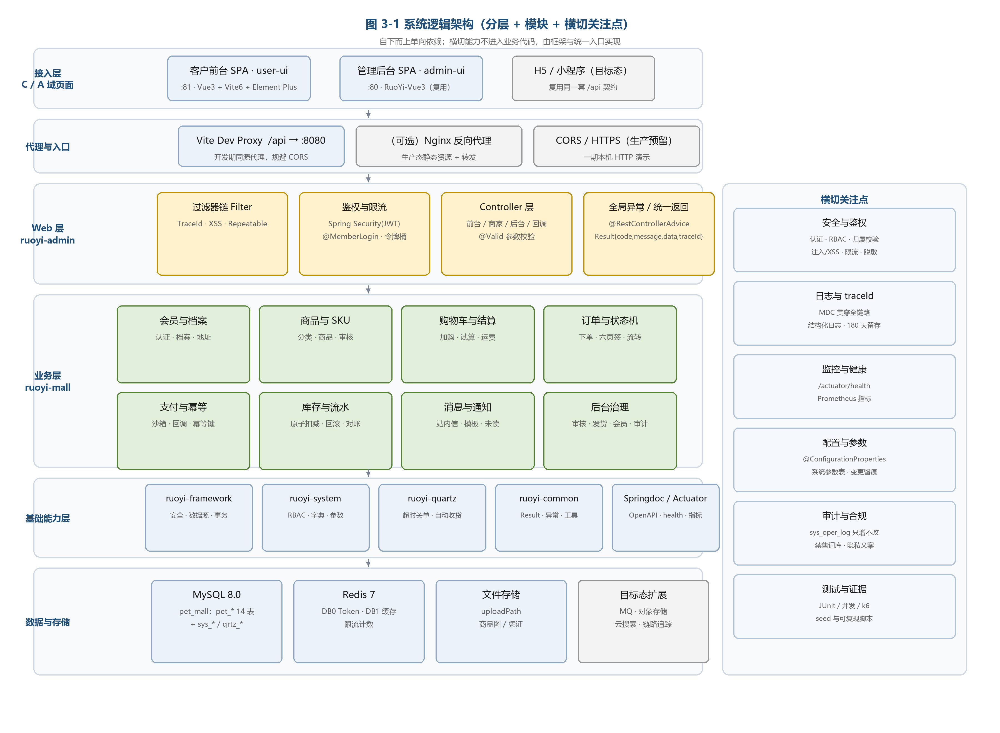
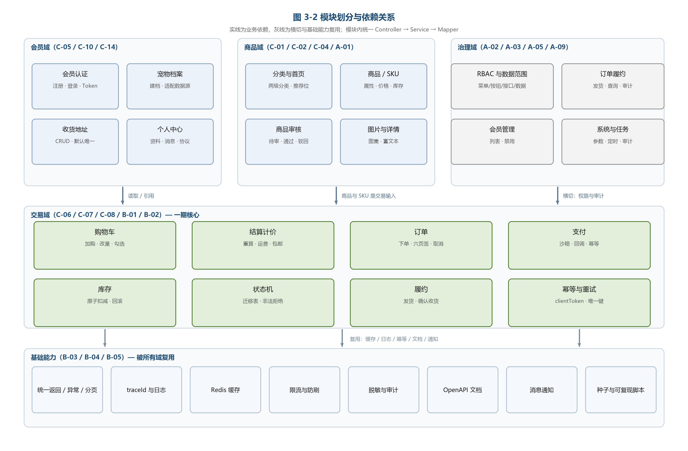
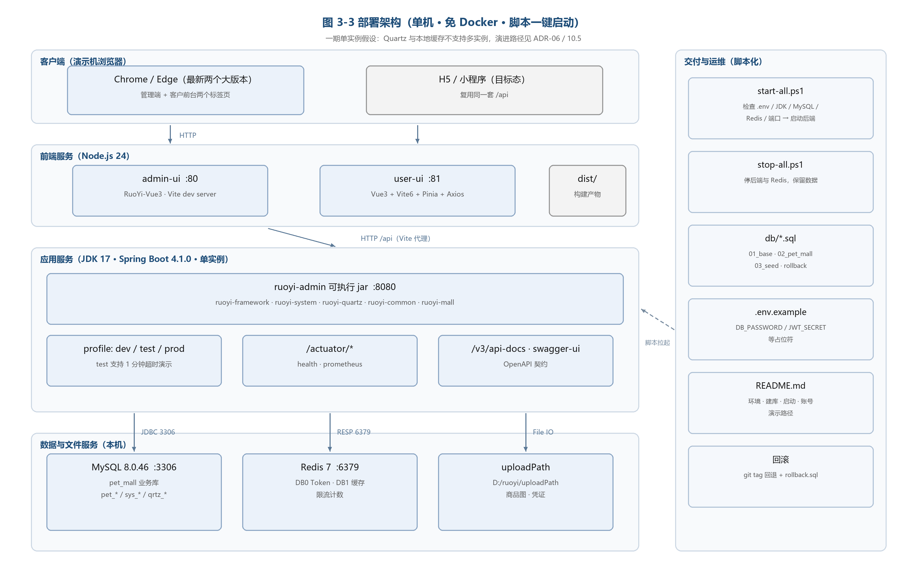
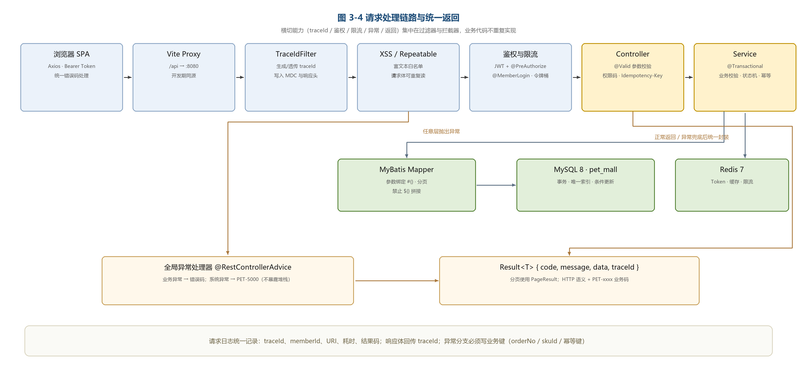
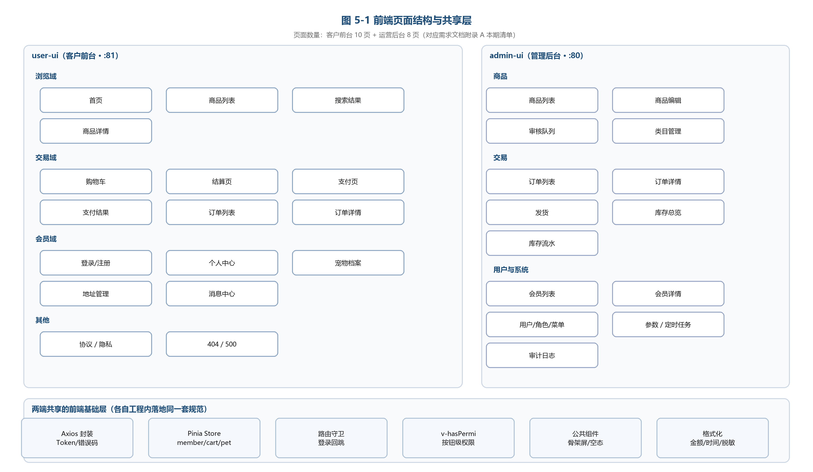
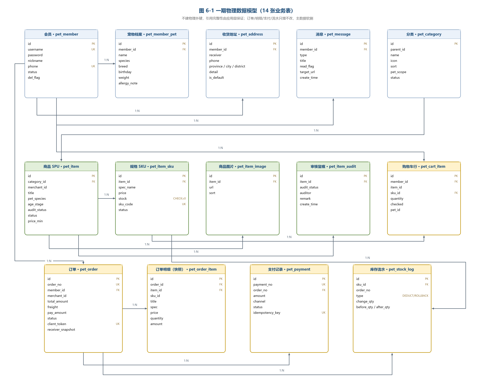
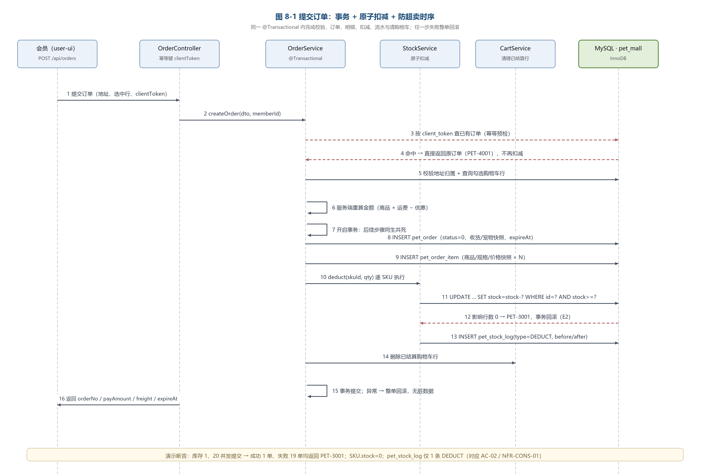
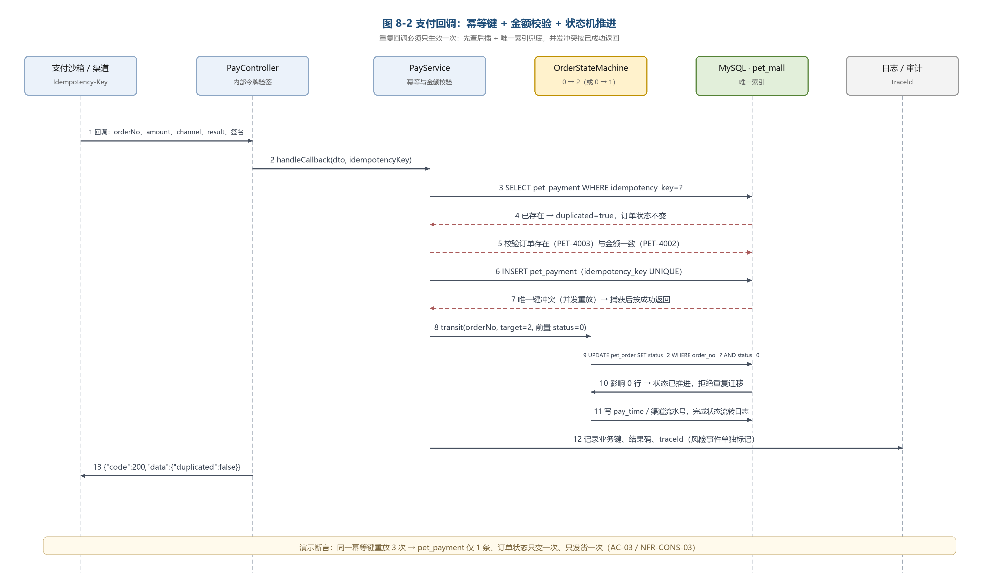
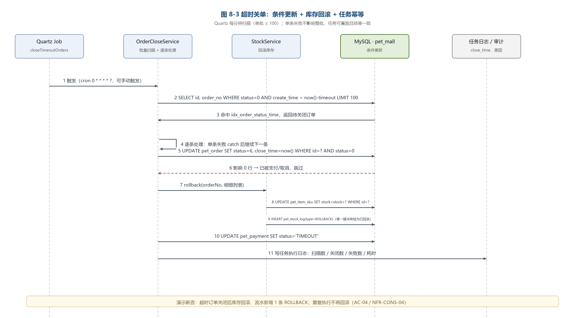

<!-- COVER -->
萌宠优选 · 宠物商城系统
企业级设计文档（Software Design Description）

文档编号 PET-MALL-SDD-001　｜　版本 V1.0　｜　状态 已冻结　｜　编制日期 2026-10-19

| 项目 | 内容 |
|---|---|
| 项目名称 | 萌宠优选 · 宠物商城系统（Pet Mall） |
| 文档名称 | 企业级设计文档（SDD） |
| 文档编号 | PET-MALL-SDD-001 |
| 当前版本 | V1.0（设计基线，随需求基线 V2.0 同步冻结） |
| 所属课程 | AI 辅助软件开发 · 实验四「企业级应用开发」 |
| 参照案例 | 教材第九章「社区超市商城系统」 |
| 团队规模 | 4 人小组（本期实投 2 人） |
| 技术基座 | RuoYi 3.9.2（Spring Boot 4.1.0）+ Vue3 + MySQL 8.0 + Redis 7 |
| 上游文档 | 《企业级需求文档》PET-MALL-SRS-002 V2.0 |
| 交付形态 | 源码 + SQL + 脚本 + 三文档 + PPT + 录屏 |
| 编写人 | 项目组（A 架构/交易，B 会员/安全） |
| 审核人 | 指导教师 / 组内交叉评审 |
| 密级 | 内部（课程交付物） |

**修订历史**

| 版本 | 日期 | 修订人 | 修订说明 |
|---|---|---|---|
| V0.1 | 2026-10-19 | 项目组 | 初稿：总体架构、技术选型、模块划分、部署架构、ADR 骨架 |
| V0.8 | 2026-10-19 | 项目组 | 补充物理表 DDL、接口契约、下单/回调/关单时序、安全与非功能设计 |
| V1.0 | 2026-10-19 | 项目组 | 设计基线冻结：ADR 定稿、追溯矩阵与自检清单完成 |

> 说明：本文件为实验四交付的「设计文档」，回答"怎么实现"。需求基线、验收标准与范围以需求文档为准；测试执行数据、缺陷与压测报告见测试报告。三份文档的边界见 SRS 13.2。
<!-- /COVER -->

<!-- TOC -->
目录
<!-- /TOC -->

# 设计摘要

本设计把「萌宠优选」一期交付拆成**一个模块化单体后端 + 两个前端工程 + 一套脚本化交付**，核心结论如下：

| 关注点 | 设计结论 | 关键章节 |
|---|---|---|
| 架构 | 模块化单体（六层）+ 前后端分离；业务集中在新模块 `ruoyi-mall`，基座不改 | 3.1～3.3、ADR-01 |
| 交易一致性 | 条件 UPDATE 原子扣减（零超卖）+ 幂等键唯一索引（支付只生效一次）+ Quartz 扫描关单（只回滚一次） | 8.1～8.3、6.6 |
| 安全 | 双域 Token 隔离 + RBAC 权限码 + 数据范围 + Service 归属校验 + 审计留痕 + 限流与脱敏 | 9、3.6 |
| 数据 | MySQL `shop` 单库 14 张 `pet_*` 表；订单/明细/支付/流水只增不改，快照优先，不建物理外键 | 6 |
| 接口 | RESTful + 统一返回 `Result{code,message,data,traceId}`，前后台路径分域，下单与回调强制幂等 | 7、ADR-10 |
| 部署 | PowerShell 一键启停 + `.env` 配置分离 + 三类 SQL 与回滚脚本；单机假设显式声明 | 11、ADR-07 |
| 风险与取舍 | 无 MQ/网关/容器：用 Quartz、应用内限流、脚本部署替代，并在 ADR 中记录演进路径 | 13、3.9 |

# 1 文档说明

## 1.1 编写目的

本文档把《宠物商城系统 企业级需求文档 V2.0》的 262 条功能需求、51 条业务规则与可验证非功能指标，转化为**可直接编码、可评审、可验证**的设计基线。具体用途：

1. **给出实现蓝图**：确定架构风格、模块边界、分层规则、库表结构与接口契约，使前后端可以在 D3 契约冻结后并行开发。
2. **固化关键技术方案**：对防超卖、支付幂等、超时关单、双域鉴权、缓存、部署六个高风险点给出可落地的算法、SQL 与代码位置。
3. **沉淀决策依据**：以 ADR 形式记录"为什么这样设计、放弃了什么、风险在哪"，回答评审最常问的"是否直接套模板"。
4. **支撑测试与证据**：每条设计都能对应到验收用例、测试类与压测场景，使测试报告的证据链可追溯。
5. **保证可复现**：给出环境矩阵、配置分层、启停脚本、初始化数据与回滚方案，使换机复现成为设计的一部分而非临场发挥。

## 1.2 文档范围与边界

| 维度 | 本文档覆盖 | 不在本文档内 |
|---|---|---|
| 内容 | 总体架构、技术选型论证、模块与分层、前端设计、物理库表与 DDL、接口契约、关键时序与算法、安全与非功能落地、部署与运维、测试设计、ADR、追溯矩阵 | 需求定义与验收判定（见 SRS）、测试执行记录与缺陷（见测试报告）、AI 对话原始记录（见 AI 日志）、PPT 与视频脚本 |
| 范围 | 一期（19 个工作日）交付所需的全部设计；二期能力的预留点与演进路径 | 真实支付渠道对接细节、多商家分账、K8s 部署、小程序端实现 |
| 深度 | 到"类/表/接口/算法/SQL"级；可直接照此编码 | 到"代码级逐行注释"；代码本身以仓库为准 |

## 1.3 设计输入、编号与追溯方式

**设计输入**：SRS V2.0 的第 3、4、5、6、7、8、9 章；环境基线文档 §3–§12 的实测事实；初步规划 §3（技术方案）与 §11.2（设计文档目录）。

**编号约定**：

| 前缀 | 含义 | 示例 | 说明 |
|---|---|---|---|
| `ADR-xx` | 架构决策记录 | ADR-05 | 第 13 章，一条决策一节 |
| `图 x-y` | 设计图 | 图 8-1 | 编号跟随所在章，图目录见附录 A |
| `pet_*` | 业务物理表 | pet_order | 与若依 `sys_*`/`qrtz_*` 并存 |
| `PET-xxxx` | 业务错误码 | PET-3001 | 与 SRS 8.4 完全一致 |
| `C-/A-/B-` | 需求功能编号 | C-07-11 | 直接引用 SRS 第 5 章，不另造编号 |
| `AC-/KPI-/NFR-` | 验收与指标编号 | AC-02 | 直接引用 SRS 第 9、10 章 |

**追溯方式**：本文所有模块、接口、表、关键算法均标注对应需求编号；第 14.1 节给出"需求 → 设计落点 → 测试用例"的追溯矩阵，与 SRS 10.3 的 RTM 对齐。

## 1.4 读者指引

| 读者 | 重点章节 | 使用方式 |
|---|---|---|
| 后端开发 | 3、4、6、7、8、13 | 按模块与分层编码；表结构与接口契约以本文为准 |
| 前端开发 | 3.1–3.5、5、7、8 | 按路由、页面、接口契约并行开发，不等待后端 |
| 测试人员 | 6.6、7.3、8、10、12 | 由关键场景与错误码派生用例；并发/幂等/安全用例见 12.4–12.5 |
| 指导教师 / 评审 | 2、3、8、9、13、14 | 判断架构合理性、企业级能力与自研含量 |
| 运维 / 交付 | 3.4、11 | 按脚本与环境矩阵一键启动、复现、回滚 |

## 1.5 术语与缩略语

| 术语 | 含义 | 本文使用约定 |
|---|---|---|
| 模块化单体 | 单进程部署、按业务域分模块、模块内分层的架构形态 | 本期架构风格（ADR-01） |
| SPU / SKU | 标准产品单元 / 最小库存单元 | `pet_item` / `pet_item_sku` |
| 原子扣减 | 以带条件的单条 UPDATE 完成"校验 + 扣减" | `WHERE id=? AND stock>=?` |
| 幂等键 | 同一业务请求的唯一标识，用于去重 | `client_token`（下单）、`idempotency_key`（支付） |
| 条件更新 | 以状态条件参与 UPDATE 的并发控制手段 | `WHERE status=0` |
| 快照 | 下单时固化的商品/收货/宠物信息 | 历史订单不受主数据变更影响 |
| 双域鉴权 | 前台会员域与后台管理域 Token 完全隔离 | Redis key 前缀 `member:` / `admin:` |
| 数据范围 | 后台角色可见的数据边界（全部/本类目/本人） | 复用若依 `data_scope` |
| MDC | Mapped Diagnostic Context，日志上下文 | 承载 traceId 与 memberId |
| ADR | Architecture Decision Record，架构决策记录 | 第 13 章 |
| RTM | 需求追溯矩阵 | 见 14.1 |
| Profile | Spring 环境配置（dev/test/prod） | 见 11.5 |
| 目标态 | 产品化的完整形态（二期及以后） | 与"一期"相对 |

## 1.6 参考文档

| 编号 | 名称 | 用途 |
|---|---|---|
| R1 | 《企业级需求文档》PET-MALL-SRS-002 V2.0 | 需求基线，本文的唯一上游 |
| R2 | 《环境配置与环境说明》PET-MALL-ENV-001 | 主机、版本、端口、数据源、配置分层的实测事实 |
| R3 | 《宠物商城系统 · 双人版初步规划》2026-10-19 | 范围、选型与里程碑的上游输入 |
| R4 | 《实验报告（四）AI 辅助软件开发》 | 交付物与评分导向 |
| R5 | 教材第九章「社区超市商城系统」 | 对标基线与差异化对照 |
| R6 | RuoYi 3.9.2 官方文档、Spring Boot 4.1、MyBatis、MySQL 8.0、Redis 7、Vue3/Vite6/Element Plus 文档 | 实现约束与最佳实践 |
| R7 | 《电子商务法》《个人信息保护法》《网络安全法》《广告法》 | 合规落点依据（一期适用项） |

# 2 设计目标、原则与约束

## 2.1 设计目标

设计目标由 SRS 2.4.2 的 7 个可验证指标与第 9 章非功能需求推导而来，每个目标都必须有明确的设计手段与验证方式。

| 编号 | 设计目标 | 关键设计手段 | 验收映射 |
|---|---|---|---|
| G-01 | 主闭环可用 | 前后端分离 + 契约先行；9 个前台页面覆盖浏览—加购—下单—支付—收货 | KPI-01、DEMO-01 |
| G-02 | 零超卖 | 条件 UPDATE 原子扣减 + `CHECK (stock>=0)` + 事务回滚 + 并发测试 | KPI-02、NFR-CONS-01 |
| G-03 | 支付幂等 | 幂等键唯一索引 + 先查后插 + 唯一键冲突兜底 + 状态机条件更新 | KPI-03、NFR-CONS-03 |
| G-04 | 超时关单回滚 | Quartz 每分钟扫描 + 条件关闭 + 逐条回滚 + 流水唯一键 | KPI-04、NFR-CONS-04 |
| G-05 | 鉴权有效 | 双域 Token 隔离 + RBAC 权限码 + 数据范围 + Service 归属校验 + 审计 | KPI-05、NFR-SEC-02 |
| G-06 | 性能达标 | 索引覆盖查询 + Redis 缓存 + 分页 + 连接池 + 避免 N+1 | KPI-06、NFR-PERF |
| G-07 | 可复现交付 | 脚本一键启停 + 配置分层 + 种子数据 + 回滚脚本 + README | KPI-07、NFR-DEP |
| G-08 | 可维护与可扩展 | 模块化分层、统一横切、ADR、预留扩展点 | NFR-MNT、NFR-EXT |

> 设计取舍原则：**先保证"可被证伪的企业级能力"（防超卖、幂等、关单、越权），再补体验类功能**。与 SRS 11.4 的降级红线一致，任何时间压力下都不牺牲 G-02～G-05、G-07。

## 2.2 设计原则

| 编号 | 原则 | 设计含义 | 反例（明确禁止） |
|---|---|---|---|
| P-01 | 契约先行 | D3 冻结 ER 与 API，之后只增不改；前端可按契约并行 | 边写边改字段名导致联调返工 |
| P-02 | 分层单向依赖 | Controller → Service → Mapper；禁止反向调用与跨层直连 | Controller 直接写 SQL、Mapper 调用 Service |
| P-03 | 横切统一 | 返回、异常、分页、鉴权、日志、限流、脱敏只在统一入口实现 | 每个 Controller 各自 try/catch 拼返回体 |
| P-04 | 服务端权威 | 金额、库存、可售状态、权限一律以服务端重算/校验为准 | 信任前端传入的金额与库存 |
| P-05 | 约束下沉数据库 | 唯一索引、`CHECK`、条件更新兜底，代码校验与库约束双保险 | 只靠"先查后判"保证唯一 |
| P-06 | 幂等优先 | 所有会改变交易状态的入口都必须有幂等键或条件更新 | 重复点击产生两笔订单/两次扣减 |
| P-07 | 最小改动复用基座 | 复用若依 RBAC、审计、Quartz、Redis、代码生成；只新增 `ruoyi-mall` | 重写一套权限或定时框架 |
| P-08 | 可观测默认 | 每次请求有 traceId；关键业务事件必带业务键；健康检查与指标端点常开 | 出问题只能靠猜与重启 |
| P-09 | 可复现交付 | 环境、数据、启动、回滚全部脚本化、文档化 | "我机器上能跑" |
| P-10 | 单机务实、架构留口 | 承认单机假设（无 MQ、无网关、无容器），但模块边界与接口为演进预留 | 为了"显得企业级"引入不可维护的分布式组件 |

## 2.3 约束与假设

**环境约束（来自 PET-MALL-ENV-001 实测，设计必须适配）**

| 编号 | 约束 | 对设计的影响 |
|---|---|---|
| C-01 | Windows 11 + PowerShell 5.1，单机开发 | 部署以 PowerShell 脚本为主；不承诺 Docker |
| C-02 | 默认 JDK 25、已装 JDK 17、未装 JDK 21 | 运行与编译统一 JDK 17（target 17），启动脚本显式校验版本（ADR-09） |
| C-03 | Maven 未安装 | D1 安装 Maven 3.9.x 并配置 wrapper；构建命令固定 `mvn -v` 可查 |
| C-04 | 无 Docker、无 Nginx（可选） | 一期以 Vite dev server + 本地进程部署；Nginx 仅作为可选加分项 |
| C-05 | Redis 7 免安装版，服务未注册 | 启动脚本负责检测/拉起；Token 丢失时降级为重新登录 |
| C-06 | 端口占用：80（管理端）、8080（后端）、6379、3306 | 客户前台固定 81；启动脚本先探端口不静默杀进程 |
| C-07 | `npm.ps1` 被执行策略拦截 | 所有脚本与文档统一使用 `npm.cmd` |
| C-08 | 单机单库单 Redis，无 MQ/网关/容器编排 | 关单用 Quartz；缓存用单实例 Redis；写明单机假设与演进路径 |
| C-09 | 基座历史进程可能残留（此前启动过后端与管理端） | 统一由 `start-all.ps1` 接管；启动前检测并提示 PID，避免"多份进程"导致的行为不一致 |

**业务与组织约束**

| 编号 | 约束 | 对设计的影响 |
|---|---|---|
| C-10 | 一期 19 个工作日、实投 2 人 | 页面压到 10 + 8；功能按 Must 收敛；D10 保留"单工程双布局"退化方案 |
| C-11 | 复用 RuoYi 3.9.2 基座（Spring Boot 4.1.0） | 不修改 `ruoyi-*` 核心代码；业务集中在新模块 `ruoyi-mall` |
| C-12 | 无真实商户资质与支付渠道 | 支付为沙箱实现，抽象 `PaymentChannel` 便于替换（ADR-08 关联） |
| C-13 | 演示环境需快速复现 | `test` profile 支持 1 分钟支付超时与手动触发关单 |

**关键假设（若不成立需回到设计评审）**

| 编号 | 假设 | 失效影响 |
|---|---|---|
| A-01 | 单实例部署，Quartz 任务不会被多节点重复触发 | 若多实例，关单任务需加分布式锁或改为调度平台（ADR-06） |
| A-02 | 会员与商家数据量级：1 万会员、1 万 SPU、10 万订单 | 超出后需分库分表或归档（10.1 容量估算） |
| A-03 | 支付回调由沙箱内部令牌模拟验签 | 接真实渠道时需实现验签与证书管理（8.2 扩展点） |
| A-04 | 前端与后端同机，Vite 代理转发 `/api` | 分离部署时需配置 Nginx 与 CORS/HTTPS |

## 2.4 关键设计决策一览

| 编号 | 决策主题 | 结论 | 主要理由 | 详见 |
|---|---|---|---|---|
| ADR-01 | 架构风格 | 模块化单体 + 前后端分离，不拆微服务 | 2 人 19 天；单机部署；模块边界已满足可扩展 | 13.1 |
| ADR-02 | 技术基座 | 复用 RuoYi 3.9.2，新增 `ruoyi-mall` | RBAC/审计/Quartz/Redis 开箱可用，交付风险最低 | 13.2 |
| ADR-03 | 数据库 | MySQL 8.0 单库 `shop`，`pet_` 前缀，不建物理外键 | 事务与索引成熟；便于演进与回滚；引用由应用保证 | 13.3 |
| ADR-04 | 认证与会话 | 会员 Token 存 Redis（7 天）；后台沿用 JWT + Redis；双域隔离 | 可即时失效、双端互不干扰 | 13.4 |
| ADR-05 | 缓存 | Redis 7 单实例，分类/推荐/详情缓存，DB 分库 | 命中率与实现成本平衡；清缓存不影响登录 | 13.5 |
| ADR-06 | 超时关单 | Quartz 每分钟扫描 + 条件更新，不引入 MQ | 无 MQ 环境；扫描表小、可幂等、可手动触发 | 13.6 |
| ADR-07 | 部署方式 | PowerShell 一键脚本 + README，Docker 可选 | 无 Docker；换机复现成本最低 | 13.7 |
| ADR-08 | 支付实现 | 沙箱渠道 + `PaymentChannel` 抽象 + 幂等回调 | 无商户资质；接口可平滑替换真实渠道 | 13.8 |
| ADR-09 | 运行 JDK | 统一 JDK 17（target 17），拒绝 JDK 25 直接运行 | 已装 17、与 pom 一致；规避 SB4 在 25 上的边缘问题 | 13.9 |
| ADR-10 | 前端工程形态 | 双工程（admin-ui + user-ui），预留单工程双布局退化 | 双域鉴权清晰、演示接近教材；风险有预案 | 13.10 |

## 2.5 一期设计与二期预留

设计对二期能力采取"**表字段与接口占位、流程不实现**"的策略，避免二期重构。

| 能力 | 一期设计 | 二期预留点 |
|---|---|---|
| 售后 | 订单状态 7/8 与入口占位；不建售后表 | 新增 `pet_after_sale` 及状态机；订单 3/4 → 7 → 8 |
| 订阅 | 商品 `support_subscribe` 字段与详情页入口占位 | 新增订阅/周期表；`PaymentChannel` 支持协议扣款 |
| 优惠券/秒杀 | `discount_amount` 字段与计价引擎扩展点 | 促销规则表 + 独立活动库存 + 规则引擎 |
| 处方商品 | `is_prescription` 标记位；一期不售卖此类目 | 处方审核工作台与购买资格校验 |
| 多仓/WMS | 库存表不含仓维度，接口按"单仓"设计 | 增加 `warehouse_id` 与库存分配策略 |
| 真实支付 | `PaymentChannel` 接口 + 沙箱实现 | 微信/支付宝实现类；验签与证书 |
| 多商家分账 | 订单已冗余 `merchant_id` | 拆单 + 结算单 + 分账规则 |
| 异步消息 | 站内信落库 + 同步通知 | 事件总线与 MQ 消费 |

# 3 总体架构设计

## 3.1 架构风格与选择

### 3.1.1 候选方案比较

| 方案 | 描述 | 优势 | 代价 | 结论 |
|---|---|---|---|---|
| 微服务（Spring Cloud） | 按域拆服务，网关 + 注册中心 + 配置中心 | 独立扩展、技术异构 | 需 Nacos/网关/MQ/容器；2 人 19 天无法运维 | 不采用 |
| **模块化单体 + 前后端分离** | 单进程部署，按业务域分模块，模块内 Controller/Service/Mapper 分层 | 事务简单、部署简单、模块边界清晰、可演进 | 单点扩展受限 | **采用** |
| 传统 MVC（JSP/模板） | 前后端同工程，服务端渲染 | 起步快 | 与教材要求"前后端分离"冲突，演示效果差 | 不采用 |
| Serverless / 托管平台 | 云函数 + 托管数据库 | 免运维 | 无公网与云账号；不可控成本 | 不采用 |

**决策**：采用**模块化单体 + 前后端分离**。核心判断依据是"企业级能力可被证伪"比"架构形式先进"更重要——防超卖、幂等、关单、越权拦截在单体下更易保证正确性与可复现性；同时通过模块边界、统一横切与扩展点设计，保留向多服务演进的可能（见 3.9）。完整论证见 ADR-01。

### 3.1.2 架构质量属性

| 质量属性 | 架构响应 |
|---|---|
| 可修改性 | 业务集中在 `ruoyi-mall` 模块，基座不侵入；新增域 = 新增包，不改他人代码 |
| 可测试性 | 分层清晰，Service 可脱离 Web 层单测；关键并发路径可独立并发测试 |
| 可观测性 | 过滤器统一生成 traceId，日志/响应/审计共享同一标识 |
| 安全性 | 双域鉴权在入口收敛；权限码、数据范围、归属校验三层防护 |
| 可部署性 | 单 jar + 两个前端工程 + 脚本，依赖少、启动快 |
| 可扩展性 | 计价引擎、支付渠道、通知渠道均为接口扩展点 |

## 3.2 逻辑架构

系统采用六层结构，自上而下单向依赖，横切能力由框架与统一入口提供，不进入业务代码。



### 3.2.1 分层职责

| 层 | 职责 | 代码位置 | 允许依赖 | 明确禁止 |
|---|---|---|---|---|
| 接入层 | 两个 SPA：客户前台（:81）、管理后台（:80） | `user-ui/`、`admin-ui/` | 仅 HTTP/JSON | 直连数据库 |
| 代理与入口 | Vite 代理 `/api` → :8080；生产可选 Nginx | `vite.config.js` | 无 | 在代理层写业务逻辑 |
| Web 层 | 过滤器、鉴权拦截、参数校验、Controller、全局异常、统一返回 | `ruoyi-admin`（`com.ruoyi.web.controller.mall`） | Service | 写 SQL、开事务、拼装业务规则 |
| 业务层 | 领域服务、状态机、计价、库存、幂等、事务边界 | `ruoyi-mall`（`com.ruoyi.mall.service`） | Mapper、基座工具 | 依赖 Controller、直接操作 HttpServletRequest |
| 基础能力层 | 安全、数据源、事务、RBAC、字典、参数、定时任务、通用工具、OpenAPI | `ruoyi-framework`、`ruoyi-system`、`ruoyi-quartz`、`ruoyi-common` | Spring / 三方库 | 依赖业务模块 |
| 数据与存储层 | MySQL `shop`、Redis（Token/缓存/限流）、文件目录 | 基础设施 | 无 | 业务逻辑上移 |

### 3.2.2 依赖规则

| 编号 | 规则 | 检查方式 |
|---|---|---|
| LAY-01 | 只允许自上而下依赖：Controller → Service → Mapper | 代码评审 + 包扫描 |
| DR-02 | `ruoyi-mall` 不得依赖 `ruoyi-admin`；业务不得反向依赖 Web 层 | Maven 依赖检查 |
| LAY-03 | 跨模块调用必须走 Service 接口，禁止直接注入他域 Mapper | 代码评审 |
| LAY-04 | 公共能力只从 `common`/`framework` 取，禁止复制粘贴工具类 | 代码评审 |
| LAY-05 | 事务边界只允许出现在 Service 的公有方法上 | 代码评审 + `@Transactional` 检查 |

### 3.2.3 横切关注点

| 关注点 | 实现位置 | 作用范围 | 对应需求 |
|---|---|---|---|
| 认证鉴权 | Spring Security（后台）+ `MemberAuthInterceptor`（前台） | 全部受保护接口 | SEC-AUTH-01～08 |
| 统一返回 | `Result<T>` + `PageResult<T>` | 全部接口 | API-03/04 |
| 统一异常 | `GlobalExceptionHandler` + `BizException` | 全部接口 | NFR-REL-04、9.3 |
| traceId | `TraceIdFilter` + MDC + 响应字段 | 全部请求 | NFR-OBS-01/02 |
| 限流 | `RateLimitInterceptor` + Redis 令牌桶 | 登录/下单等 | API-13、NFR-SEC-06 |
| 审计 | 若依 `@Log` → `sys_oper_log` | 后台写操作 | A-09-04、NFR-SEC-08 |
| 脱敏 | Jackson 序列化器 + 日志转换器 | 手机号/地址/证件 | NFR-SEC-07、A-09-09 |
| 数据范围 | 若依 `@DataScope` + 角色 `data_scope` | 后台查询 | DP-09、A-09-02 |
| 指标 | Spring Boot Actuator + Micrometer | 运维端点 | NFR-OBS-03 |

## 3.3 模块划分



### 3.3.1 后端模块清单

| 模块 | 代码包 | 核心职责 | 依赖 | 需求映射 |
|---|---|---|---|---|
| 会员与认证 | `mall.member` | 注册登录、Token、资料、地址 | common、redis | C-10-01、C-14、SEC-AUTH |
| 宠物档案 | `mall.pet` | 档案 CRUD、多宠、适配数据源 | member | C-05、C-04-06 |
| 商品与分类 | `mall.item` | 分类树、商品/SKU/图片、搜索筛选、首页内容 | redis | C-01、C-02、C-03、C-04、A-01 |
| 商品审核 | `mall.audit` | 待审队列、通过/驳回、留痕、上下架 | item、audit log | A-01-07、UC-25 |
| 购物车 | `mall.cart` | 加购、改量、勾选、失效区、宠物标记 | item、pet | C-06 |
| 计价引擎 | `mall.price` | 服务端重算、运费与包邮、优惠预留 | item | B-01-01、BR-09～14、BR-21 |
| 订单 | `mall.order` | 下单事务、六页签、取消、确认收货、快照 | cart、stock、price、state | C-07、C-08、B-02-01 |
| 支付 | `mall.pay` | 沙箱支付、回调、幂等、支付查询 | order、state | C-07-10～13、6.1 |
| 库存 | `mall.stock` | 原子扣减、回滚、流水、对账 | item | B-01-02、BR-01～08 |
| 状态机 | `mall.state` | 订单状态定义、迁移校验、流转日志 | order | B-02-01、4.3 |
| 履约 | `mall.fulfill` | 商家发货、管理员订单管理 | order、audit log | A-03、C-08-07 |
| 消息通知 | `mall.notify` | 站内信落库、未读、模板 | member | C-13-04、B-03-01 |
| 后台治理 | `mall.admin` | 会员管理、参数、任务、审计查询 | 各域只读接口 | A-05、A-09 |
| 平台能力 | `mall.common` | Result、异常、错误码、幂等、限流、脱敏、工具 | framework、common | B-05 |

### 3.3.2 前端模块清单

| 工程 | 模块 | 页面/组件 | 依赖接口域 |
|---|---|---|---|
| user-ui | 浏览 | 首页、列表、搜索、详情 | `/api/home/*`、`/api/items*` |
| user-ui | 交易 | 购物车、结算、支付、支付结果、订单列表/详情 | `/api/cart*`、`/api/checkout/*`、`/api/orders*`、`/api/pay*` |
| user-ui | 会员 | 登录注册、个人中心、宠物档案、地址、消息 | `/api/member/*` |
| user-ui | 基础 | axios、store、路由、权限指令、公共组件 | — |
| admin-ui | 商品 | 商品列表/编辑、审核队列、类目 | `/api/admin/items*`、`/api/admin/categories*` |
| admin-ui | 交易 | 订单列表/详情、发货、库存总览/流水 | `/api/admin/orders*`、`/api/admin/stock*` |
| admin-ui | 用户与系统 | 会员列表/详情、用户/角色/菜单、参数、任务、审计 | `/api/admin/members*`、若依系统接口 |

### 3.3.3 模块间协作约束

1. **商品域是交易域的输入**：购物车与订单只通过 `ItemQueryService` 读取可售商品与 SKU，不直接查 `pet_item` 表。
2. **库存域是唯一可写库存的模块**：任何库存变化必须经 `StockService`，保证流水完整、可对账。
3. **状态机模块是唯一可改订单状态的模块**：订单状态变更必须经 `OrderStateMachine.transit()`，业务方只提交"目标状态 + 前置条件"。
4. **支付模块不直接改库存**：退款/关单的库存动作通过库存域接口完成，避免跨域写表。
5. **治理域只做查询编排与权限校验**，不复制交易域的业务规则。

## 3.4 部署架构



### 3.4.1 进程与端口

| 进程 | 端口 | 技术 | 启动方式 | 说明 |
|---|---|---|---|---|
| admin-ui | 80 | RuoYi-Vue3 + Vite | `npm.cmd run dev` | 管理后台，复用基座 |
| user-ui | 81 | Vue3 + Vite6 + Element Plus | `npm.cmd run dev` | 客户前台，本期新建 |
| ruoyi-admin | 8080 | Spring Boot 4.1.0 可执行 jar | `java -jar`（脚本托管） | 唯一后端进程，含所有模块 |
| MySQL | 3306 | MySQL 8.0.46 | Windows 服务 `MySQL80` | 业务库 `shop` |
| Redis | 6379 | Redis 7（Windows 免安装） | `dev-redis/redis-server.exe` | DB0 Token、DB1 缓存 |
| 文件存储 | — | 本地目录 `D:/ruoyi/uploadPath` | 随应用 | 商品图、售后凭证（二期） |
| 运维端点 | 8080 | Actuator / Springdoc | 随应用 | `/actuator/health`、`/actuator/prometheus`、`/v3/api-docs` |

### 3.4.2 网络与代理

| 调用方向 | 协议/路径 | 说明 |
|---|---|---|
| 浏览器 → admin-ui | HTTP `http://localhost` | 开发服务器 |
| 浏览器 → user-ui | HTTP `http://localhost:81` | 开发服务器 |
| 前端 → 后端 | HTTP `/api/**`（Vite proxy → `http://localhost:8080`） | 开发期同源代理，规避 CORS；生产可换 Nginx |
| 后端 → MySQL | JDBC（Druid 连接池） | `jdbc:mysql://127.0.0.1:3306/shop` |
| 后端 → Redis | RESP | `127.0.0.1:6379`，DB0/DB1 |
| 后端 → 文件 | 本地文件 IO | 上传与读取 |

### 3.4.3 单机假设与目标态拓扑

**一期单机假设（必须显式声明，避免误解为高可用系统）**：

1. 后端单实例：Quartz 任务不会重复触发；本地缓存（如有）无需跨节点同步。
2. 无网关与负载均衡：鉴权、限流在应用内完成。
3. 无消息队列：关单、通知为定时任务 + 同步调用。
4. 单库单 Redis：无读写分离与集群。

**目标态拓扑（演进路径，见 3.9）**：`CDN/Nginx → 网关（鉴权/限流/路由）→ 多个业务服务（商品、交易、支付、会员）→ MySQL 主从 + Redis 集群 + MQ + 对象存储 + 链路追踪`。现有模块边界即为未来服务边界，演进时不需要重写业务逻辑。

## 3.5 请求处理链路



### 3.5.1 过滤器与拦截器顺序

| 顺序 | 组件 | 类型 | 职责 | 失败表现 |
|---|---|---|---|---|
| 1 | `TraceIdFilter` | Filter | 生成/透传 traceId，写入 MDC 与响应头 `X-Trace-Id` | 不失败 |
| 2 | `XssFilter` | Filter | 富文本白名单过滤，拦截脚本注入 | 参数被清洗 |
| 3 | `RepeatableFilter` | Filter | 包装请求体，允许重复读取（用于验签与日志） | 不失败 |
| 4 | Spring Security | Filter Chain | 后台接口认证（JWT + Redis）、`@PreAuthorize` 权限码 | 401 / 403 |
| 5 | `MemberAuthInterceptor` | Interceptor | 前台 `/api/member/**`、`/api/cart/**`、`/api/orders/**` 会员鉴权 | 401 `PET-2001` |
| 6 | `RateLimitInterceptor` | Interceptor | 登录/下单/领券限流（Redis 令牌桶） | 429 `PET-4290` + `Retry-After` |
| 7 | `@Valid` + Controller | MVC | 参数校验、权限码、幂等键接收 | 400 `PET-1001` |
| 8 | Service | Spring Bean | 业务校验、事务、状态机、幂等 | 业务异常 → 对应错误码 |
| 9 | `GlobalExceptionHandler` | `@RestControllerAdvice` | 异常 → 统一返回，记录日志 | 统一 JSON |

### 3.5.2 traceId 规范

| 项 | 规范 |
|---|---|
| 生成 | 请求头无 `X-Trace-Id` 时由 `TraceIdFilter` 生成 UUID（去横线，32 位）；有则透传（限 64 字符、仅字母数字） |
| 传递 | MDC key `traceId`；Feign/HTTP 调用透传（本期无跨服务）；异步线程手动传递 |
| 落盘 | 日志 pattern 含 `[%X{traceId}]`；业务事件日志必须带 `orderNo`/`skuId`/`idempotencyKey` |
| 回传 | 统一响应体 `traceId` 字段 + 响应头 `X-Trace-Id` |
| 排查 | 页面报错提示"错误码 + traceId"，可在日志/审计中按 traceId 全链路检索 |

### 3.5.3 统一返回结构

```json
{
  "code": 200,
  "message": "操作成功",
  "data": { },
  "traceId": "9f2c4e8a7b3d4c1e8f0a2b6d9c3e1f4a"
}
```

- `code`：`200` 成功；业务错误使用 SRS 8.4 的 `PET-xxxx`；HTTP 状态码同时按语义设置（400/401/403/404/409/429/500/503）。
- `data`：成功时为业务对象；分页时为 `PageResult`。
- `message`：面向用户的简短提示；禁止暴露堆栈、SQL、内部路径。
- `traceId`：与响应头一致，便于用户反馈与日志检索。

## 3.6 双域鉴权与数据所有权

### 3.6.1 双域 Token 模型

| 域 | 使用方 | 令牌形式 | 存储 | 有效期 | 续期 | 失效 |
|---|---|---|---|---|---|---|
| 会员域 | user-ui | 随机 Token（UUID，不透明） | Redis `member:token:{token}` → `memberId` | 7 天 | 剩余不足一半时可续期 | 登出删除；改密码全删 |
| 管理域 | admin-ui | JWT（基座） | Redis `admin:token:{uuid}` → LoginUser | 30 分钟（基座默认） | 基座自动续期 | 登出删除；禁用账号即时失效 |

**隔离要求**：前台 Token 不能访问 `/api/admin/**`、`/api/merchant/**`（401/403 + 审计）；后台 Token 不能访问会员专属接口（除显式允许的管理场景）。两者 Redis key 前缀不同、解析器不同、错误码不同。

### 3.6.2 数据所有权与归属校验落点

| 规则 | 设计落点 | 实现方式 |
|---|---|---|
| DP-01 会员仅读写本人数据 | `MemberContext` + Service 校验 | 拦截器解析 Token 写 `memberId`；查询 SQL 强制 `member_id = #{memberId}` |
| DP-02 商家仅操作本人商品/订单 | `OwnershipChecker` | Service 入口校验 `merchant_id`，不依赖前端隐藏 |
| DP-03 商家订单只返回其商品明细 | 联表过滤 | 明细按 `merchant_id` 过滤；手机号/地址脱敏 |
| DP-04 管理员全量但关键操作留痕 | 若依 `@Log` | 写操作落 `sys_oper_log` |
| DP-05 匿名仅可见可售商品 | 查询条件固定 | `status=1 AND audit_status=2 AND del_flag='0'` |
| DP-06 订单归属以主表为准 | `OrderQueryService` | 由订单号反查 `member_id` 再校验 |
| DP-07 收货信息快照 | `receiver_snapshot` | 下单固化 JSON，改地址不影响历史订单 |
| DP-09 后台数据范围 | `@DataScope` | 角色 `data_scope` 拼 SQL 条件 |
| DP-11 档案仅本人可见 | `PetService` 归属校验 | 客服/运营需授权并留审计（二期细化） |
| DP-12 审计不可删改 | 表权限 + 只提供查询 | 不提供删除接口；导出需二次确认 |

## 3.7 技术选型与论证

| 层次 | 选型 | 版本 | 选择理由 | 替代方案 | 风险与对策 | 需求依据 |
|---|---|---|---|---|---|---|
| 后端框架 | RuoYi 3.9.2（Spring Boot 4.1.0） | 3.9.2 / 4.1.0 | 自带 RBAC、审计、字典、Quartz、Redis、代码生成；与教材同源，可解释"复用 vs 自研" | 自建 Spring Boot 骨架、.NET、Go | 被质疑套模板 → 3.8 对照表 + 三个自研重点（防超卖/幂等/关单） | 2.7、11.1 |
| 运行 JDK | JDK 17（编译 target 17） | 17.0.19 | 已安装、与 pom 一致；规避 SB4 在 JDK 25 上的边缘问题 | JDK 21 / 25 | 若后续统一 21，只需改启动脚本与 IDEA SDK | NFR-COMP-03、ADR-09 |
| 数据库 | MySQL 8.0.46 | 8.0.46 | 事务/索引/CHECK 约束成熟；环境已运行 | PostgreSQL | 并发扣减用单条原子 UPDATE + CHECK 兜底 | 7、BR-03 |
| 连接池 | Druid（基座默认） | 1.2.x | 自带监控与 SQL 防火墙；与基座一致 | HikariCP | 参数保守配置（maxActive=20）适配单机 | NFR-PERF-08 |
| ORM | MyBatis（注解 + XML） | 基座版本 | SQL 可控，便于写条件扣减与对账 SQL | JPA / MyBatis-Plus | 禁止 `${}` 拼接，统一 `#{}` | NFR-SEC-03 |
| 缓存 | Redis 7（单机） | 7.x | Token、热点缓存、限流三合一；环境已有免安装版 | Caffeine / Memcached | 免安装版不稳定 → 脚本拉起 + 降级查库 | ADR-05、NFR-REL-03 |
| 定时任务 | RuoYi Quartz | 基座版本 | 复用任务管理与执行日志；分钟级扫描足够 | RabbitMQ 延迟队列、XXL-JOB | 单机可用、多实例需改造（ADR-06） | BR-04、NFR-REL-05 |
| 管理前端 | RuoYi-Vue3 | 3.9.2 | Vue3 + Vite6 + Element Plus 直接复用 | 自建 | 定制页面仍需开发，但权限/布局零成本 | 3.3.2 |
| 客户前端 | 新建 `user-ui` | Vue3 + Vite6 + Element Plus + Pinia + Axios | 前后端分离、双域鉴权清晰、便于演示 | 并入管理端（单工程双布局） | 两工程成本 → 页面压到 10 页；D10 退化预案 | ADR-10 |
| 接口文档 | Springdoc OpenAPI 3 | 基座内置 | 注解即文档，`/swagger-ui.html` 可直接截图 | YApi / Apifox | 注解遗漏 → 关键接口 100% 覆盖并纳入 DoD | API-11、NFR-MNT-04 |
| 单元测试 | JUnit 5 + Mockito + Spring Boot Test | 随 SB | 与基座一致；支持 MockMvc 集成测试 | TestNG | 覆盖率目标 ≥ 60%（核心 Service） | NFR-MNT-02 |
| 压测 | k6（单文件二进制） | 最新稳定版 | 免安装、脚本化、输出含 P95/QPS | JMeter | 环境无 Docker → 单文件直接运行 | NFR-PERF-08 |
| 构建 | Maven 3.9.x + Node 24 | — | 与基座、前端工具链一致 | Gradle / pnpm | Maven 未装 → D1 安装并补 wrapper | C-03 |
| 部署 | PowerShell 脚本 + README | — | 无 Docker；换机复现成本最低 | Docker Compose | 脚本需幂等、可重复执行 | ADR-07、NFR-DEP |

## 3.8 自研与复用对照

评审常问"是不是直接套模板"。下表明确回答：哪些是基座能力，哪些是本期自研，自研点在哪、证据在哪。

| 能力 | 来源 | 自研内容 | 证据位置 |
|---|---|---|---|
| 登录认证（后台） | 复用若依 JWT + Spring Security | 扩展会员域 Token 与双域隔离 | 4.6、9.2；代码 `MemberAuthInterceptor` |
| RBAC 与菜单 | 复用若依 | 新增 `mall:*` 权限码、商家角色、审核员最小权限账号 | 6.4、9.3；`sys_role`/`sys_menu` 截图 |
| 审计日志 | 复用若依 `@Log` + `sys_oper_log` | 补充安全事件（越权/限流/回调异常）单独记录 | 9.7 |
| 定时任务 | 复用 Quartz | 自研关单与自动收货任务的幂等与回滚逻辑 | 8.3、8.4 |
| 代码生成 | 复用若依生成器（仅骨架） | 全部业务规则、状态机、并发控制为手写 | 4.14、8 |
| 防超卖 | **自研** | 条件 UPDATE 原子扣减 + CHECK + 流水唯一键 + 并发测试 | 8.1、6.6；`StockService` |
| 支付幂等 | **自研** | 幂等键唯一索引 + 先查后插 + 冲突兜底 + 金额校验 | 8.2；`PayService` |
| 超时关单 | **自研** | 扫描 + 条件更新 + 逐条回滚 + 任务日志 | 8.3；`OrderCloseJob` |
| 订单状态机 | **自研** | 迁移表驱动 + 非法迁移拒绝 + 流转日志 | 4.14.12、8.8 |
| 计价引擎 | **自研** | 服务端重算 + 运费/包邮 + 优惠扩展点 + 快照 | 8.6 |
| 数据脱敏 | 部分复用 | 自定义序列化器 + 日志脱敏规则 | 9.6 |
| 限流 | **自研（Redis 令牌桶）** | 按接口配置阈值与返回头 | 9.5 |
| 前端页面 | admin 复用、user **自研** | 9 个前台页面 + 组件 + 状态管理 | 5.2 |
| 部署脚本 | **自研** | 环境检查、Redis 拉起、端口探测、启动与停止 | 11.3 |

**结论**：基座提供"企业级骨架"（权限、审计、任务、缓存、文档），本期自研集中在**交易一致性、双域安全、计价与部署复现**四类高风险能力，与评分导向（SRS 10.6）一致。

## 3.9 扩展点与演进路径

| 扩展点 | 一期实现 | 演进方式 | 影响范围 |
|---|---|---|---|
| 支付渠道 | `PaymentChannel` 接口 + `SandboxPaymentChannel` | 新增微信/支付宝实现类，注入即可 | 支付模块，不改订单 |
| 计价规则 | `PriceCalculator` 接口 + 默认实现（运费/包邮） | 新增优惠券/满减计算器，按顺序串接 | 计价模块 |
| 通知渠道 | `NotificationSender` 接口 + 站内信实现 | 新增短信/推送实现，异步化 | 消息模块 |
| 关单调度 | Quartz 扫描（`order.status/create_time` 索引） | 改延迟消息（MQ），语义不变 | 任务模块 |
| 库存模型 | 单仓 `stock` 字段 | 增加仓维度表与分配策略 | 库存模块 + 表结构 |
| 多商家 | 订单冗余 `merchant_id`，商家过滤 | 拆单、结算单、分账 | 订单/财务 |
| 多端 | 统一 `/api` 契约 | H5/小程序复用 API 与会员 Token | 前端新增工程 |
| 水平扩展 | 无状态应用（Token 在 Redis） | 前置网关 + 会话外置后可直接多实例；Quartz 需改为调度平台 | 部署架构 |

# 4 后端模块与分层详细设计

## 4.1 工程结构

后端在 `shop/RuoYi-Vue-master` 基础上改造复制为 `backend/`，新增业务模块 `ruoyi-mall`：

```text
backend/
├─ pom.xml                        # 聚合工程，新增 <module>ruoyi-mall</module>
├─ ruoyi-admin/                   # Web 入口
│  └─ src/main/java/com/ruoyi/web/controller/mall/
│     ├─ MemberController.java          # /api/member/**
│     ├─ PetController.java             # /api/member/pets/**
│     ├─ AddressController.java         # /api/member/addresses/**
│     ├─ HomeController.java            # /api/home/**
│     ├─ ItemController.java            # /api/items/**
│     ├─ CartController.java            # /api/cart/**
│     ├─ CheckoutController.java        # /api/checkout/**
│     ├─ OrderController.java           # /api/orders/**
│     ├─ PayController.java             # /api/pay/**
│     ├─ MerchantItemController.java    # /api/merchant/items/**
│     ├─ MerchantOrderController.java   # /api/merchant/orders/**
│     ├─ AdminItemController.java       # /api/admin/items/**
│     ├─ AdminCategoryController.java   # /api/admin/categories/**
│     ├─ AdminMemberController.java     # /api/admin/members/**
│     ├─ AdminOrderController.java      # /api/admin/orders/**
│     ├─ AdminStockController.java      # /api/admin/stock/**
│     └─ AdminAuditController.java      # /api/admin/audit-logs
├─ ruoyi-framework/               # 安全、拦截器、全局异常（扩展）
│  └─ .../framework/
│     ├─ web/filter/TraceIdFilter.java
│     ├─ web/filter/XssFilter.java
│     ├─ interceptor/MemberAuthInterceptor.java
│     ├─ interceptor/RateLimitInterceptor.java
│     └─ web/exception/GlobalExceptionHandler.java
├─ ruoyi-system/                  # RBAC、字典、参数（复用为主）
├─ ruoyi-quartz/                  # 定时任务（新增 Job）
│  └─ .../quartz/task/OrderCloseJob.java、OrderAutoConfirmJob.java
├─ ruoyi-common/                  # Result、异常、工具（复用 + 少量扩展）
└─ ruoyi-mall/                    # 新增业务模块
   └─ src/main/java/com/ruoyi/mall/
      ├─ domain/                  # DO 实体（映射 pet_* 表）
      ├─ dto/                     # 入参
      ├─ vo/                      # 出参
      ├─ query/                   # 查询条件
      ├─ mapper/                  # Mapper 接口（含 XML）
      ├─ service/                 # 接口
      ├─ service/impl/            # 实现（事务边界）
      ├─ state/                   # 订单状态机
      ├─ price/                   # 计价引擎
      ├─ pay/                     # 支付渠道抽象
      ├─ notify/                  # 通知渠道
      ├─ context/                 # MemberContext 等
      ├─ enums/                   # 状态、错误码、业务枚举
      └─ util/                    # 幂等、金额、脱敏工具
```

> 取舍：优先新增独立 Maven 模块，体现"模块化设计"；若模块拆分导致构建问题，退化为 `ruoyi-admin` 下的 `com.ruoyi.mall` 包，**分层与依赖规则不变**，在 README 与本文记录取舍结论（与 R3 一致）。

## 4.2 包结构与命名规范

| 元素 | 规范 | 示例 |
|---|---|---|
| Controller | `XxxController`，方法名对应动作 | `OrderController.create()` |
| Service 接口 | `XxxService` | `OrderService` |
| Service 实现 | `XxxServiceImpl`，事务注解在此 | `OrderServiceImpl` |
| Mapper | `XxxMapper`，XML 同名 | `PetOrderMapper` |
| DO | `PetOrder`（表 `pet_order`） | 字段与表一一对应 |
| DTO | `XxxCreateDTO` / `XxxUpdateDTO` / `XxxQueryDTO` | `OrderCreateDTO` |
| VO | `XxxVO` | `OrderDetailVO` |
| 枚举 | `XxxStatusEnum` / `XxxTypeEnum` | `OrderStatusEnum` |
| 参数对象 | `XxxProperties`（`@ConfigurationProperties`） | `MallProperties` |
| 权限码 | `mall:{域}:{动作}` | `mall:item:audit`、`mall:order:ship` |

## 4.3 分层职责与编码规则

| 层 | 必须做 | 禁止做 | 代码审查要点 |
|---|---|---|---|
| Controller | 参数绑定与 `@Valid`、权限码、调用 Service、返回 `Result` | 业务判断、事务、直接调 Mapper、拼装 SQL | 方法体 ≤ 15 行 |
| Service | 业务校验、事务边界、状态机、幂等、调用多个域服务 | 依赖 `HttpServletRequest`、返回 VO 给内部调用 | 事务只包必要操作 |
| Mapper | 单表 CRUD 与受控联表查询；条件更新语句 | 写业务分支、拼接 `${}` | SQL 必须有索引可走 |
| Domain | 仅承载字段与简单派生方法 | 注入 Spring Bean | 保持贫血模型（本期） |

**统一实现约束**：

1. 所有 Controller 返回 `Result<T>`；分页返回 `Result<PageResult<T>>`。
2. 所有写操作按需加 `@Log(title="...", businessType=...)`，审计到 `sys_oper_log`。
3. 所有金额字段使用 `BigDecimal`，统一 `setScale(2, RoundingMode.HALF_UP)`；禁止 `float/double`。
4. 所有时间由服务端生成（`LocalDateTime.now()` 统一时区 `Asia/Shanghai`），前端只负责展示。
5. 所有对外 JSON 字段：手机号脱敏、地址按需截断、密码字段永不返回。

## 4.4 领域对象与转换

| 对象 | 用途 | 转换方向 | 说明 |
|---|---|---|---|
| DO | 数据库映射 | Table ↔ DO | 与表字段一致，禁止直接返回前端 |
| DTO | 接收请求 | JSON → DTO | 携带 `@NotNull`/`@Size` 校验注解 |
| Query | 查询条件 | URL → Query | 含分页参数 `pageNum/pageSize` |
| VO | 返回前端 | DO → VO | 组装、脱敏、格式化金额为字符串 |
| Snapshot | 快照对象 | DO → JSON 字符串 | 收货/宠物/优惠快照，存入订单表 |

转换采用**手写静态方法**（`OrderConvert.toDetailVO(...)`）而非反射工具，理由：字段变化可编译期发现、避免隐式赋值漏洞、便于逐字段脱敏。

## 4.5 统一返回与分页

```java
public class Result<T> implements Serializable {
    private int code;          // 200 成功；否则 PET 业务码
    private String message;
    private T data;
    private String traceId;    // 由 TraceIdFilter/MDC 注入

    public static <T> Result<T> ok(T data) { ... }
    public static <T> Result<T> fail(int code, String message) { ... }
}
```

```java
public class PageResult<T> implements Serializable {
    private long pageNum;
    private long pageSize;
    private long total;
    private List<T> list;
}
```

分页参数约定：`pageNum` 默认 1；`pageSize` 默认 10、最大 100；超限自动截断并在日志记录。分页查询统一使用若依 `PageHelper`（或 MyBatis `RowBounds`），禁止前端传入 `offset`。

## 4.6 统一异常设计

| 异常类型 | 触发场景 | 错误码 | HTTP | 处理 |
|---|---|---|---|---|
| `BizException` | 业务规则拒绝（库存不足、状态非法、越权） | 携带 `PET-xxxx` | 按码映射 | 返回业务提示，记录业务日志 |
| `ParamException` | 参数校验失败 | `PET-1001` | 400 | 返回字段错误摘要 |
| `AuthException` | 未登录/Token 失效 | `PET-2001` | 401 | 前端跳转登录并回跳 |
| `ForbiddenException` | 权限不足/越权 | `PET-2003` | 403 | 记录安全日志（含 memberId/URI） |
| `DuplicateRequestException` | 幂等冲突 | `PET-4001` | 200 | 返回已存在结果（不是错误） |
| `SystemException` | 未预期异常 | `PET-5000` | 500 | 记录堆栈（仅日志），响应不含细节 |
| `CacheUnavailableException` | Redis 关键路径不可用 | `PET-5002` | 503 | 登录/鉴权返回 503；查询降级 |

```java
@RestControllerAdvice
public class GlobalExceptionHandler {
    @ExceptionHandler(BizException.class)
    public Result<Void> handleBiz(BizException e, HttpServletRequest req) {
        // 记录业务键 + traceId，返回对应 PET 码
    }

    @ExceptionHandler(Exception.class)
    public Result<Void> handleUnknown(Exception e, HttpServletRequest req) {
        // 记录 error 日志（含 traceId），返回 PET-5000，禁止输出堆栈
    }
}
```

## 4.7 参数校验与防重

| 场景 | 校验方式 | 失败结果 |
|---|---|---|
| 请求体字段 | `@Valid` + JSR-303 注解 | `PET-1001` + 字段错误列表 |
| 路径/查询参数 | `@Min/@Max/@Pattern` + 业务校验 | `PET-1001` |
| 下单防重 | `clientToken`（唯一索引）+ 先查后插 | 返回原订单，`PET-4001` |
| 支付回调防重 | `Idempotency-Key`（唯一索引） | 返回 `duplicated=true` |
| 发货/确认收货防重 | 状态条件更新（`WHERE status=?`） | 影响 0 行 → `PET-3002` |
| 前端重复点击 | 按钮 loading + 提交锁 | 只发一次请求 |
| 接口级限流 | Redis 令牌桶（登录 5/min、下单 10/min） | 429 + `Retry-After` |

## 4.8 日志与 traceId 实现

```xml
<!-- logback-spring.xml 片段：控制台与文件均输出 traceId -->
<pattern>[%d{yyyy-MM-dd HH:mm:ss.SSS}] [%X{traceId:-}] [%thread] %-5level %logger{36} - %msg%n</pattern>
```

| 日志类型 | 内容 | 级别 | 保留 |
|---|---|---|---|
| 访问日志 | traceId、memberId、method、URI、耗时、结果码 | INFO | 30 天（演示环境） |
| 业务事件 | 下单、支付回调、关单、审核、越权、限流 | INFO/WARN | 180 天 |
| 异常日志 | 异常类型、业务键、堆栈（仅日志） | ERROR | 180 天 |
| SQL 日志 | dev/test 打印（`mybatis.configuration.log-impl`） | DEBUG | 不入生产 |

脱敏规则在日志输出层统一处理：手机号 `138****8000`、地址只保留到区级、密码与 Token 永不打印。

## 4.9 配置设计

| 配置类 | 键前缀 | 覆盖内容 | 来源 |
|---|---|---|---|
| `MallProperties` | `mall.*` | 支付超时、自动收货天数、上限、缓存 TTL、限流阈值 | `application.yml` + 系统参数表 |
| `MallCacheProperties` | `mall.cache.*` | 分类/推荐/详情 TTL | `application-{profile}.yml` |
| `MallRateLimitProperties` | `mall.rate-limit.*` | 登录/下单阈值 | 配置类 |
| 数据源 | `spring.datasource.*` | 连接串、账号、Druid 参数 | `application-druid.yml`，密码占位符 |
| Redis | `spring.data.redis.*` | 主机、端口、database | `application-{profile}.yml` |

**规则**：业务代码禁止出现魔法值（如 `15` 分钟、`99` 元包邮）；统一从配置类或系统参数表读取；参数变更落审计日志（A-09-06）。

## 4.10 缓存设计

| 缓存 key | 内容 | TTL | 更新策略 | 失效影响 |
|---|---|---|---|---|
| `mall:cache:category:tree` | 两级分类树 | 30 min | 分类增删改后主动删除 | 回源 DB |
| `mall:cache:home:recommend` | 首页推荐位商品 | 10 min | 定时过期 | 回源 DB |
| `mall:cache:item:detail:{id}` | 商品详情（含 SKU） | 5 min | 商品编辑/审核/上下架后删除 | 回源 DB |
| `mall:cache:item:sales:{id}` | 销量（可选） | 60 s | 定时过期 | 展示略旧 |
| `mall:token:member:{token}` | 会员 Token → memberId | 7 天 | 登录写、登出删 | 需重新登录 |
| `mall:rate:{action}:{key}` | 限流计数 | 60 s | 递增 | 限流放行（降级） |

**一致性与容错**：

1. **Cache-Aside**：先更新 DB，再删除缓存；删除失败记录告警并在下次过期纠正。
2. **不做双写**：避免并发下缓存与 DB 不一致。
3. **穿透**：空结果缓存 60 s（`NULL` 占位）。
4. **雪崩**：TTL 加随机抖动（±10%）。
5. **击穿**：详情热点 key 使用逻辑过期 + 互斥重建（本期简化为短 TTL）。
6. **降级**：Redis 不可用时，列表/详情直接查库；登录与鉴权返回 503（`PET-5002`），并告警。

## 4.11 定时任务设计

| 任务 | cron | 作用 | 幂等手段 | 失败处理 | 需求 |
|---|---|---|---|---|---|
| `orderCloseJob` | `0 * * * * ?`（每分钟） | 关闭超时未支付订单并回滚库存 | 条件更新 + 流水唯一键 + 支付单状态 | 单条失败继续；整批异常记日志并告警 | BR-04、C-07-13 |
| `orderAutoConfirmJob` | `0 0 2 * * ?`（每天 02:00） | 发货超 N 天自动确认收货 | 条件更新 `WHERE status=3` | 记日志，可重跑 | C-08-07 |
| `stockReconcileJob`（可选） | 每天 03:00 | 库存流水对账，输出差异报表 | 只读 | 差异写入告警日志 | INV-04、A-02-03 |

**Quartz 配置要点**：

1. 任务类实现 `Job`，通过 `SpringContextHolder` 获取 Service（避免注入问题）。
2. 任务并发禁止：`@DisallowConcurrentExecution`。
3. 每次执行写任务日志（若依 `sys_job_log`），包含扫描数、处理数、失败数、耗时。
4. 保留手动触发入口 `POST /api/admin/jobs/close-timeout-orders`（权限 `mall:job:trigger`，仅演示/测试环境）。

## 4.12 消息与通知设计

| 事件 | 触发点 | 通知形式 | 存储 | 需求 |
|---|---|---|---|---|
| 支付成功 | 回调成功推进订单后 | 站内信 | `pet_message` | C-08-10 |
| 订单发货 | 商家/管理员发货后 | 站内信（含运单号） | `pet_message` | C-08-10 |
| 订单关闭 | 关单任务 | 站内信 | `pet_message` | C-07-13 |
| 审核结果 | 商品审核后 | 站内信（给商家） | `pet_message` | A-01-07 |
| 订阅提醒（二期） | 扣款前 3 天 | 站内信 + 短信 | `pet_message` + 短信适配器 | C-11-03 |

实现方式：业务事件在事务提交后（`TransactionSynchronization.afterCommit`）写消息表并推送；通知失败不影响主流程，由重试任务补偿。二期引入事件总线后，仅替换发送实现。

## 4.13 文件上传设计

| 项 | 设计 |
|---|---|
| 接口 | `POST /api/upload/image`（会员/商家/管理员按权限） |
| 校验 | 扩展名白名单（jpg/png/webp）+ Content-Type + 魔数 + 大小 ≤ 5MB |
| 存储 | 本地 `uploadPath`，按 `yyyy/MM/dd/uuid.ext` 分目录 |
| 返回 | 相对 URL，由前端拼接静态前缀 |
| 安全 | 禁止可执行扩展名；文件名随机化；读取时校验归属（二期改私有读 + 签名 URL） |
| 异常 | `PET-6001` 类型或大小不支持 |

## 4.14 各业务模块详细设计

### 4.14.1 会员与认证模块

| 项 | 内容 |
|---|---|
| 职责 | 注册、登录、登出、资料维护、密码修改、失败锁定 |
| 关键类 | `MemberController`、`MemberService`、`MemberAuthInterceptor`、`TokenService` |
| 核心方法 | `register(RegisterDTO)`、`login(LoginDTO)`、`logout(token)`、`currentMember()`、`updateProfile(dto)` |
| 存储 | `pet_member`；Token 存 Redis `mall:token:member:{token}` |
| 安全 | BCrypt 加密；登录失败 5 次锁定 10 分钟；Token 随机 32 位 |
| 异常 | 用户名/手机号重复 `PET-1002`；密码错误 `PET-2002`；账号禁用 `PET-2004` |
| 需求 | C-10-01、C-14-01/09、SEC-AUTH-01/02/07/08 |

```java
public LoginVO login(LoginDTO dto) {
    MemberDO member = memberMapper.selectByUsername(dto.getUsername());
    if (member == null || !BCrypt.checkpw(dto.getPassword(), member.getPassword())) {
        loginAttemptService.recordFailure(dto.getUsername()); // 5 次锁 10 分钟
        throw new BizException(ErrorCode.PET_2002);
    }
    if (member.getStatus() == 1) throw new BizException(ErrorCode.PET_2004);
    String token = UUID.randomUUID().toString().replace("-", "");
    redisTemplate.opsForValue().set("mall:token:member:" + token,
            member.getId(), Duration.ofDays(7));
    return LoginVO.of(token, mask(member));
}
```

### 4.14.2 宠物档案模块

| 项 | 内容 |
|---|---|
| 职责 | 档案 CRUD、多宠管理、归档、适配判定所需数据 |
| 关键类 | `PetController`、`PetService`、`PetAdaptService`（被商品详情调用） |
| 上限 | 单账号 5 只（`mall.pet-max`，超限 `PET-1004`） |
| 归属 | 所有接口按 `memberId` 过滤；越权 `PET-2003` |
| 联动 | 商品列表/详情展示适配标签；购物车行可标记 `pet_id` |
| 需求 | C-05-01～05、C-04-06、C-06-07、DP-11 |

**适配判定接口**（被商品域调用，避免循环依赖）：

```java
public interface PetAdaptService {
    /** 返回适配结论：SUITABLE / CAUTION / UNSUITABLE，并给出原因列表 */
    AdaptResult judge(Long memberId, ItemAdaptInfo item);
}
```

判定算法见 8.7；宠物档案删除为逻辑归档（`status=1`），不影响历史订单快照。

### 4.14.3 收货地址模块

| 项 | 内容 |
|---|---|
| 职责 | 地址 CRUD、设默认、上限校验 |
| 关键类 | `AddressController`、`AddressService` |
| 约束 | 最多 20 个（`mall.address-max`）；默认地址唯一（事务内清除其他默认） |
| 快照 | 下单时序列化为 `receiver_snapshot`，后续改地址不影响历史订单 |
| 需求 | C-07-01、C-14-07、DR-08 |

### 4.14.4 分类与内容模块

| 项 | 内容 |
|---|---|
| 职责 | 两级分类树、首页推荐位、Banner（一期简化为固定推荐） |
| 关键类 | `HomeController`、`CategoryService`、`RecommendService` |
| 缓存 | 分类树 30 min、推荐 10 min（见 4.10） |
| 权限 | 浏览匿名；后台维护需 `mall:category:*` |
| 需求 | C-01-01～03、C-02-01、A-01-03、A-09-06 |

### 4.14.5 商品与 SKU 模块

| 项 | 内容 |
|---|---|
| 职责 | 商品/SKU 维护、列表搜索筛选、详情、上下架、库存展示 |
| 关键类 | `ItemController`、`ItemService`、`ItemQueryService`、`ItemSearchService` |
| 查询 | 关键词 LIKE（标题/卖点）、类目、物种、年龄段、价格区间、有货、排序（综合/销量/价格/上新） |
| 可售判定 | `status=1 AND audit_status=2 AND del_flag='0'`；SKU `status=1` |
| 详情 | 商品 + SKU 列表 + 图片 + 适配结论（调用 `PetAdaptService`） |
| 权限 | 浏览匿名；商家仅本人（`merchant_id`）；管理员全量 |
| 需求 | C-02、C-03、C-04、A-01-01/02、DP-05、DP-10 |

**列表查询 SQL 约定**：所有筛选条件可选（`<if>`），固定追加可售条件；`ORDER BY` 使用白名单枚举，禁止前端拼接排序字段；分页必须走索引（`idx_item_category_status`、`idx_item_sales`）。

### 4.14.6 商品审核模块

| 项 | 内容 |
|---|---|
| 职责 | 待审队列、通过/驳回（理由必填）、审核留痕、审核后才可上架 |
| 关键类 | `AdminItemController`、`ItemAuditService` |
| 状态 | `audit_status`：0 待审 / 1 驳回 / 2 通过 |
| 流程 | 商家创建/关键字段变更 → 待审 → 管理员审核 → 通过（可上架）/ 驳回（理由）→ 商家修改重提 |
| 留痕 | 每次审核写 `pet_item_audit`（结论、审核人、理由、时间） |
| 权限 | `mall:item:audit`（`reviewer` 账号仅有此码，演示最小权限） |
| 需求 | A-01-07、UC-25、AC-12 |

### 4.14.7 购物车模块

| 项 | 内容 |
|---|---|
| 职责 | 加购、改量、勾选、删除、失效商品、实时合计、宠物标记 |
| 关键类 | `CartController`、`CartService` |
| 约束 | 唯一 `(member_id, sku_id)`；单用户 ≤ 200 SKU；数量 1–99 且 ≤ 可售库存 |
| 失效 | 下架/审核未通过/售罄/超限 → 置入失效区，不可勾选，可一键清理 |
| 合并 | 游客本地购物车登录后按 SKU 数量相加合并（8.5） |
| 需求 | C-06-01～10、C-06-08、DR-09 |

### 4.14.8 计价引擎模块

| 项 | 内容 |
|---|---|
| 职责 | 服务端重算（商品金额、运费、包邮、优惠预留）、优惠快照 |
| 关键类 | `PriceCalculator`（接口）、`DefaultPriceCalculator`、`FreightRule` |
| 步骤 | 基准价 → 行小计 → 优惠（预留）→ 运费 → 积分（预留）→ 应付 |
| 运费 | 满 99 包邮（可配），否则 10 元（可配）；多商品按总额判定 |
| 精度 | `BigDecimal`，`HALF_UP`，保留 2 位；前端金额字符串两位小数 |
| 扩展 | 优惠券/满减以计算器链方式插入，顺序由 `MallProperties.promotionOrder` 决定 |
| 需求 | B-01-01、BR-09～14、BR-21、C-07-09 |

### 4.14.9 订单模块

| 项 | 内容 |
|---|---|
| 职责 | 提交订单（事务）、订单列表/详情、取消、确认收货、订单快照 |
| 关键类 | `OrderController`、`OrderService`、`OrderQueryService`、`OrderCloseService` |
| 事务 | `createOrder()` 整体事务：校验 → 订单/明细 → 扣库存/流水 → 清购物车 |
| 幂等 | `client_token` 唯一索引；已存在直接返回原订单 |
| 快照 | 收货地址、宠物标记、商品标题/规格/价格、优惠（预留） |
| 六页签 | 全部/待付款/待发货/待收货/已完成/已取消（映射状态集合） |
| 超时 | `expireAt = create_time + pay_timeout_minutes`；返回给前端倒计时 |
| 需求 | C-07、C-08、BR-02/03/04、UC-11/14/15/16/17 |

### 4.14.10 支付模块

| 项 | 内容 |
|---|---|
| 职责 | 沙箱支付、回调处理、支付记录查询、幂等 |
| 关键类 | `PayController`、`PayService`、`PaymentChannel`、`SandboxPaymentChannel` |
| 支付方式 | WECHAT / ALIPAY / BALANCE（沙箱模拟三分支：成功/失败/超时） |
| 幂等 | `idempotency_key` 唯一索引；先查后插；冲突按已成功返回 |
| 金额校验 | 回调金额必须等于订单 `pay_amount`，否则 `PET-4002` |
| 抽象 | `PaymentChannel.pay(order)`、`PaymentChannel.verify(callback)`，二期替换真实渠道 |
| 需求 | C-07-10～13、B-02-02、6.1、UC-12/13 |

### 4.14.11 库存模块

| 项 | 内容 |
|---|---|
| 职责 | 原子扣减、回滚、流水、对账、库存查询 |
| 关键类 | `StockService`、`StockLogService` |
| 扣减 | `UPDATE pet_item_sku SET stock = stock - #{qty} WHERE id = #{skuId} AND stock >= #{qty}` |
| 回滚 | `UPDATE ... SET stock = stock + #{qty}` + 流水 `ROLLBACK` |
| 流水 | `(sku_id, order_no, type)` 唯一；记录前后值 |
| 对账 | `Σ change_qty = 当前库存 − 初始库存` |
| 需求 | B-01-02、BR-01～05、INV-01/04、DR-01/03/12 |

### 4.14.12 订单状态机模块

| 项 | 内容 |
|---|---|
| 职责 | 状态定义、迁移合法性校验、流转日志、幂等条件更新 |
| 关键类 | `OrderStatusEnum`、`OrderStateMachine`、`OrderStateLogService` |
| 状态 | 0 待付款、1 待审核、2 待发货、3 待收货、4 已完成、5 已取消、6 已关闭、7 售后中、8 已退款 |
| 迁移 | 静态迁移表 `Map<Status, Set<Status>>`；非法迁移 `PET-3002` |
| 并发 | `UPDATE pet_order SET status=? WHERE order_no=? AND status=?`，影响 0 行即拒绝 |
| 日志 | 每次成功流转写 `sys_oper_log`（businessType=ORDER_STATUS，记录前后状态与操作人），不单独建流转表 |
| 需求 | B-02-01、4.3、NFR-CONS-05 |

```java
public void transit(String orderNo, OrderStatus target, OrderStatus expected) {
    if (!MACHINE.canTransit(expected, target)) {
        throw new BizException(ErrorCode.PET_3002);
    }
    int affected = orderMapper.updateStatus(orderNo, target.getCode(), expected.getCode());
    if (affected == 0) throw new BizException(ErrorCode.PET_3002); // 已被其他请求推进
    auditService.logStatusChange(orderNo, expected, target);      // 写 sys_oper_log
}
```

### 4.14.13 履约与后台管理模块

| 项 | 内容 |
|---|---|
| 职责 | 商家/管理员发货、订单查询、会员管理、参数与任务管理、审计查询 |
| 关键类 | `MerchantOrderController`、`AdminOrderController`、`AdminMemberController`、`AuditQueryService` |
| 发货 | `PUT /api/merchant/orders/{orderNo}/ship`；状态 2 → 3；条件更新幂等；记录运单号与发货时间 |
| 商家隔离 | 查询强制 `merchant_id`；越权 403 + 审计 |
| 管理员 | 全量订单查询、协助取消、会员禁用/启用、库存总览与流水 |
| 审计 | 查询 `sys_oper_log`，支持操作人/时间/模块筛选，导出受控 |
| 需求 | A-02-02/03、A-03-01/02/06、A-05-01/02、A-09-04/06/08 |

### 4.14.14 审计与安全模块

| 项 | 内容 |
|---|---|
| 职责 | 写操作审计、安全事件记录、脱敏、数据范围 |
| 关键类 | `AuditLogAspect`（复用基座 `@Log`）、`SecurityEventLogger`、`DesensitizeSerializer` |
| 审计内容 | 操作人、IP、时间、对象、前后值摘要、结果 |
| 安全事件 | 越权、限流、回调验签失败、金额不一致、幂等冲突 |
| 只增不改 | 不提供删除/更新接口；导出需二次确认并记录 |
| 需求 | A-09-02/04/09、DP-04/12、NFR-SEC-08 |

# 5 前端设计

## 5.1 前端工程与目录结构

### 5.1.1 两个工程的分工

| 工程 | 来源 | 端口 | 使用方 | 设计目标 |
|---|---|---|---|---|
| `admin-ui` | 复用 RuoYi-Vue3 3.9.2 | 80 | 管理员、商家、审核员 | 零成本获得布局、菜单、RBAC、字典、上传等能力，只写业务页面 |
| `user-ui` | 新建（Vue3 + Vite6 + Element Plus + Pinia + Axios） | 81 | 游客、会员 | 面向消费者的商城体验；与后台完全隔离的登录态 |

**为什么不合并为一个工程**：双域 Token、路由守卫、菜单体系、构建产物都不同；合并后需要在一个 axios 层内区分两套鉴权，演示时容易混淆，也让"越权拦截"演示失去说服力。风险（两套工程维护成本）通过"页面数量压到 10 + 8"与 D10 退化预案控制（ADR-10）。

### 5.1.2 user-ui 目录结构

```text
user-ui/
├─ vite.config.js              # port 81；proxy /api -> http://localhost:8080
├─ .env.development            # VITE_API_BASE=/api
├─ src/
│  ├─ main.js                  # 挂载 Pinia、路由、Element Plus、全局指令
│  ├─ App.vue
│  ├─ api/                     # 每个后端域一个文件：member.js、item.js、cart.js、order.js、pay.js
│  ├─ utils/request.js         # axios 实例与拦截器（Token、错误码、traceId）
│  ├─ router/index.js          # 路由与守卫
│  ├─ stores/                  # member.js、cart.js、pet.js、app.js
│  ├─ directives/hasPermi.js   # 按钮级权限（后台复用基座同名指令）
│  ├─ layouts/                 # DefaultLayout（含顶部导航、底部导航）
│  ├─ views/                   # 页面（见 5.2）
│  ├─ components/              # 商品卡片、SKU 选择、金额、空态、骨架屏、分页
│  └─ styles/                  # 变量、重置、移动端安全区
└─ package.json
```

### 5.1.3 admin-ui 定制范围

| 类型 | 内容 |
|---|---|
| 复用（不改） | 登录页、布局、菜单、用户/角色/菜单/参数/定时任务/操作日志、上传组件 |
| 新增页面 | 商品管理、商品审核、类目管理、订单管理、会员管理、库存管理、工作台概览 |
| 新增 api 文件 | `src/api/mall/item.js`、`audit.js`、`order.js`、`member.js`、`stock.js`、`dashboard.js` |
| 权限指令 | 复用 `v-hasPermi`，权限码统一 `mall:*` |

## 5.2 页面结构与路由



### 5.2.1 用户端路由

| 路由 | 页面 | 鉴权 | 主要接口 | 对应需求 |
|---|---|---|---|---|
| `/` | 首页 | 匿名 | `GET /api/home/categories`、`GET /api/home/recommend` | C-01 |
| `/items` | 商品列表 | 匿名 | `GET /api/items` | C-02 |
| `/search` | 搜索结果（复用列表组件） | 匿名 | `GET /api/items?keyword=` | C-03 |
| `/items/:id` | 商品详情 | 匿名 | `GET /api/items/{id}` | C-04 |
| `/login`、`/register` | 登录/注册 | 匿名 | `POST /api/member/login`、`/register` | C-10-01 |
| `/cart` | 购物车 | 会员 | `GET/POST/PUT/DELETE /api/cart/items` | C-06 |
| `/checkout` | 结算页 | 会员 | `POST /api/checkout/preview`、`GET /api/member/addresses` | C-07-04/09 |
| `/pay/:orderNo` | 支付页 | 会员 | `POST /api/pay/mock` | C-07-10 |
| `/pay/result` | 支付结果 | 会员 | `GET /api/pay/{orderNo}` | C-07-12 |
| `/orders` | 订单列表（六页签） | 会员 | `GET /api/orders?status=` | C-08-01 |
| `/orders/:orderNo` | 订单详情 | 会员 | `GET /api/orders/{orderNo}` | C-08-03 |
| `/member` | 个人中心 | 会员 | `GET/PUT /api/member/me` | C-14-01 |
| `/member/pets` | 宠物档案 | 会员 | `/api/member/pets` | C-05 |
| `/member/addresses` | 地址管理 | 会员 | `/api/member/addresses` | C-07-01 |
| `/messages` | 消息中心 | 会员 | `GET /api/member/messages` | C-13-04 |
| `/agreement` | 用户协议 / 隐私政策 | 匿名 | 静态页 | C-14-10 |
| `/:pathMatch(.*)*` | 404 | 匿名 | — | C-01-09 |

> 计数口径：定制路由 11 条，其中"搜索结果"复用列表组件、"订单详情"为订单中心子路由，按**页面族计为 10 页**，与 SRS 附录 A 一致。

### 5.2.2 管理端路由

| 路由 | 页面 | 权限码 | 主要接口 |
|---|---|---|---|
| `/mall/dashboard` | 工作台概览（可选） | `mall:dashboard:view` | `GET /api/admin/dashboard/summary` |
| `/mall/items` | 商品管理（列表 + 编辑抽屉） | `mall:item:list` / `mall:item:add` / `mall:item:edit` | `/api/admin/items` |
| `/mall/audit` | 商品审核队列 | `mall:item:audit` | `GET /api/admin/items?auditStatus=0`、`PUT /api/admin/items/{id}/audit` |
| `/mall/categories` | 类目管理 | `mall:category:*` | `/api/admin/categories` |
| `/mall/orders` | 订单管理（列表 + 详情 + 发货） | `mall:order:list` / `mall:order:ship` | `/api/admin/orders` |
| `/mall/members` | 会员管理（列表 + 详情） | `mall:member:list` / `mall:member:status` | `/api/admin/members` |
| `/mall/stock` | 库存总览与流水 | `mall:stock:list` | `/api/admin/stock` |
| `/mall/merchant/items` | 我的商品（商家视角） | `mall:merchant:item:*` | `/api/merchant/items` |
| `/mall/merchant/orders` | 我的订单（商家视角） | `mall:merchant:order:*` | `/api/merchant/orders` |
| 若依原生 | 用户/角色/菜单/参数/定时任务/操作日志 | `system:*`、`monitor:*` | 基座接口 |

> 定制页面 8 个（概览、商品、审核、类目、订单、会员、库存 + 商家两页合并计 1），系统管理复用若依原生页面，不占定制名额。

### 5.2.3 路由守卫规则

| 场景 | 行为 |
|---|---|
| 匿名访问公开页 | 放行；若已登录访问 `/login`，重定向首页 |
| 匿名访问会员页 | 跳转 `/login?redirect={path}`；登录成功后回跳 |
| 会员 Token 过期 | 清理本地状态 → 跳转登录 → 提示"登录已过期" |
| 后台无权限路由 | 由菜单接口控制不渲染；直接输入 URL 时前端拦截并提示，后端仍二次校验 |
| 404 | 未匹配路由渲染 404 页，提供返回首页 |

## 5.3 状态管理

| Store | 状态 | 主要 action | 持久化 | 说明 |
|---|---|---|---|---|
| `member` | token、profile、isLogin | login、logout、loadProfile | token 存 localStorage | 前端仅存 Token，权限以服务端为准 |
| `cart` | 列表、勾选、合计、数量角标 | load、add、updateQty、toggle、remove、mergeGuestCart | 游客购物车存 localStorage | 登录后合并（8.5） |
| `pet` | 档案列表、当前宠物 | load、select、create、update | 无 | 供列表/详情/加购使用 |
| `app` | 分类树、搜索历史 | loadCategories、addHistory、clearHistory | 搜索历史 localStorage | 分类树与后端缓存配合 |
| `order`（可选） | 当前订单、筛选状态 | loadOrders、loadDetail | 无 | 页面级状态可放组件，避免全局膨胀 |

**原则**：能被 URL 表达的状态（筛选、分页、页签）放路由 query，保证刷新与回退可用；跨页面共享的登录态与购物车放 Pinia；页面内状态留在组件。

## 5.4 API 层与请求拦截

```javascript
// utils/request.js（要点节选）
const service = axios.create({ baseURL: import.meta.env.VITE_API_BASE, timeout: 15000 });

service.interceptors.request.use((config) => {
  const token = useMemberStore().token;
  if (token) config.headers['Authorization'] = 'Bearer ' + token;
  return config;
});

service.interceptors.response.use(
  (res) => {
    const body = res.data;
    if (body.code === 200) return body.data;
    if (body.code === 401 || body.code === 2001) { useMemberStore().logout(); router.push('/login'); }
    ElMessage.error(`${body.message}（${body.traceId}）`);
    return Promise.reject(body);
  },
  (err) => {
    const status = err.response?.status;
    if (status === 429) ElMessage.warning('操作过于频繁，请稍后再试');
    else if (status >= 500) ElMessage.error('系统繁忙，请稍后重试');
    return Promise.reject(err);
  }
);
```

| 设计点 | 规则 |
|---|---|
| 超时 | 15 s；回调类不适用（服务端间调用） |
| 重试 | GET 允许 1 次幂等重试（网络错误）；POST/PUT/DELETE 禁止自动重试 |
| 错误提示 | 展示 `message` + `traceId` 后 6 位，便于用户反馈定位 |
| 401 处理 | 清理登录态并跳转登录；不弹多个重复提示 |
| 429 处理 | 按 `Retry-After` 禁用按钮倒计时 |
| 下载/上传 | 独立实例，避免全局超时与 JSON 拦截 |

## 5.5 组件设计

| 组件 | 职责 | 复用页面 |
|---|---|---|
| `ItemCard` | 商品卡片（图、标题、价格、销量、标签、库存状态） | 首页、列表、搜索 |
| `SkuSelector` | 规格矩阵、售罄置灰、联动价格库存 | 详情、加购弹窗 |
| `AdaptTag` | 适配结论标签（适合/需注意/不适合 + 原因浮层） | 列表、详情 |
| `MoneyText` | 金额格式化（分转元、两位小数、划线价） | 全站 |
| `QuantityStepper` | 数量步进（1–99、≤ 库存） | 购物车、详情、结算 |
| `AddressPicker` | 地址选择与新增 | 结算、个人中心 |
| `OrderStatusTag` | 状态标签与颜色映射 | 订单列表、详情、后台 |
| `EmptyState` | 空态（文案 + 插图 + 操作） | 全站 |
| `SkeletonList` | 骨架屏 | 列表、详情、订单 |
| `CountdownText` | 支付倒计时 / 秒杀倒计时（预留） | 支付、结算 |
| `ConfirmDialog` | 二次确认（删除、取消订单、适配冲突） | 全站 |
| `PaginationBar` | 分页（Web）与加载更多（移动端） | 列表、订单 |

## 5.6 关键交互设计

| 场景 | 交互设计 | 对应需求 |
|---|---|---|
| 加购未登录 | 登录弹窗 → 登录后回跳详情并保留 SKU 选择 | C-04-12、C-06-08 |
| 适配冲突 | 加购/下单前弹二次确认："该商品含鸡肉，您的宠物过敏" → 确认后可购买并记录 | C-04-06、AC-05 |
| 库存不足 | 加购按钮禁用/数量上限提示；下单返回 `PET-3001` 时刷新购物车并标红缺货行 | C-02-05、C-06-05 |
| 重复提交 | 提交按钮 loading + 请求锁；携带 `clientToken`（进入结算页生成一次） | C-07-11、AC-11 |
| 支付倒计时 | 结算返回 `expireAt` 后倒计时；归零提示"订单已关闭"并刷新状态 | C-07-10、C-07-13 |
| 支付结果 | 以服务端回调为准；前端轮询 3 次（2s 间隔）后仍未知则提示"以订单详情为准" | C-07-12 |
| 购物车失效 | 失效行置灰不可勾选，提供"一键清理"；恢复上架自动回有效区 | C-06-05、AC-10 |
| 订单取消 | 二次确认 → 取消成功刷新列表并提示库存已释放 | C-08-04 |
| 列表返回 | 保留筛选、排序、滚动位置（query + scroll 缓存） | C-02-07 |
| 图片失败 | 占位图 + 重试；楼层无数据自动隐藏 | C-01-09 |
| 敏感信息 | 手机号脱敏展示；地址非必要不展开 | NFR-SEC-07 |

## 5.7 权限与前端安全

| 项 | 设计 |
|---|---|
| 按钮级权限 | `v-hasPermi="['mall:item:audit']"` 控制显隐；后端接口仍二次校验 |
| 路由级权限 | 菜单由后端返回，前端按权限动态生成；直接访问无权限路由时拦截 |
| Token 存储 | localStorage（会员）；后台沿用若依 Cookie/Token 机制；禁止在 URL 携带 Token |
| XSS | 富文本详情由后端白名单过滤；前端禁用 `v-html` 渲染用户输入；评价/备注纯文本 |
| CSRF | Token 放 Header 而非 Cookie，天然规避 CSRF（配合后端设计说明） |
| 敏感数据 | 前端不缓存密码；不在 console 打印 Token 与完整手机号 |
| 依赖安全 | 锁定 package-lock；构建产物不引入 CDN 脚本 |

## 5.8 构建与代理配置

```javascript
// vite.config.js（user-ui 要点）
export default defineConfig({
  server: { port: 81, proxy: { '/api': { target: 'http://localhost:8080', changeOrigin: true } } },
  plugins: [vue()],
  build: { outDir: 'dist', sourcemap: false },
  define: { __APP_VERSION__: JSON.stringify(process.env.npm_package_version) }
});
```

| 项 | 设计 |
|---|---|
| 环境变量 | `.env.development` / `.env.production`；只暴露 `VITE_` 前缀 |
| 构建 | `npm.cmd run build`（禁止 `npm.ps1`，被执行策略拦截） |
| 产物 | `dist/` 静态文件，可由 Nginx 托管（可选） |
| 版本号 | 构建注入，用于"关于"页与问题反馈 |
| 兼容 | Chrome/Edge 最近两个大版本；不承诺 IE |

# 6 数据库设计

## 6.1 设计原则

| 编号 | 原则 | 落地方式 |
|---|---|---|
| DB-01 | 交易数据只增不改 | 订单、明细、支付、库存流水不提供 UPDATE 业务字段与 DELETE 接口；状态字段只允许状态机更新 |
| DB-02 | 主数据逻辑删除 | `pet_member`、`pet_item`、`pet_category` 使用 `del_flag`；删除后不影响历史订单 |
| DB-03 | 快照优先 | 订单固化收货、宠物、商品、价格快照，历史订单与主数据解耦 |
| DB-04 | 唯一索引即业务约束 | 订单号、`client_token`、`idempotency_key`、库存流水组合键、购物车 SKU 唯一 |
| DB-05 | 金额定点数 | `DECIMAL(10,2)`；Java `BigDecimal`；禁止 float/double |
| DB-06 | 不建物理外键 | 引用完整性由应用层保证，避免分库/归档时被外键约束卡死 |
| DB-07 | 字符集统一 | `utf8mb4` + `utf8mb4_general_ci`，支持 emoji 昵称 |
| DB-08 | 时间统一 | 服务端生成，连接串 `serverTimezone=Asia/Shanghai` |
| DB-09 | 命名统一 | 表 `pet_` 前缀 + 下划线；唯一键 `uk_`；普通索引 `idx_`；外键列同名 |
| DB-10 | 可对账 | 库存流水可与库存字段对账；支付金额可与订单金额对账 |

## 6.2 物理模型



### 6.2.1 表清单

| # | 表名 | 实体 | 类型 | 主键/唯一约束 | 主要索引 | 预估量（一期） | 需求来源 |
|---|---|---|---|---|---|---|---|
| 1 | `pet_member` | 会员 | 主数据 | `uk_username`、`uk_phone` | `idx_status` | 1 万 | E01、C-10 |
| 2 | `pet_member_pet` | 宠物档案 | 主数据 | `id` | `idx_member` | 3 万 | E02、C-05 |
| 3 | `pet_address` | 收货地址 | 主数据 | `id` | `idx_member` | 3 万 | E03、C-07-01 |
| 4 | `pet_category` | 分类 | 主数据 | `id` | `idx_parent` | 30 | E04、C-02 |
| 5 | `pet_item` | 商品 SPU | 主数据 | `id` | `idx_category_status`、`idx_sales`、`idx_merchant` | 1 万 | E05、C-04、A-01 |
| 6 | `pet_item_sku` | 规格 SKU | 主数据 | `id`、`uk_sku_code`、`chk_stock` | `idx_item` | 5 万 | E06、A-01-02 |
| 7 | `pet_item_image` | 商品图片 | 主数据 | `id` | `idx_item` | 5 万 | E07 |
| 8 | `pet_item_audit` | 审核留痕 | 流水 | `id` | `idx_item` | 2 万 | E13、A-01-07 |
| 9 | `pet_cart_item` | 购物车行 | 业务 | `uk_member_sku` | `idx_member` | 10 万 | E08、C-06 |
| 10 | `pet_order` | 订单 | 交易 | `id`、`uk_order_no`、`uk_client_token` | `idx_member_status`、`idx_status_create`、`idx_merchant` | 10 万 | E09、C-07、C-08 |
| 11 | `pet_order_item` | 订单明细 | 交易 | `id` | `idx_order` | 30 万 | E10 |
| 12 | `pet_payment` | 支付记录 | 交易 | `id`、`uk_payment_no`、`uk_idempotency_key` | `idx_order_no` | 10 万 | E11、C-07-10 |
| 13 | `pet_stock_log` | 库存流水 | 流水 | `id`、`uk_sku_order_type` | `idx_sku`、`idx_order_no` | 30 万 | E12、B-01-02 |
| 14 | `pet_message` | 站内消息 | 业务 | `id` | `idx_member_read` | 30 万 | E29、C-13-04 |

> 计数说明：SRS 7.2 给出"一期落地 14 张"，对应 E01～E13 加 E29（消息，B-03-01 一期实现）；E30 操作审计复用若依 `sys_oper_log`，不新建表。二期表（售后、订阅、优惠券、评价等）不在本期建表，仅在字段与接口层预留。

### 6.2.2 关系与基数

| 关系 | 基数 | 说明 |
|---|---|---|
| 会员 → 宠物档案 | 1:N | 单账号最多 5 只（一期） |
| 会员 → 收货地址 | 1:N | 最多 20 个；默认地址业务唯一 |
| 会员 → 购物车行 | 1:N | 同一 SKU 仅一行（`uk_member_sku`） |
| 会员 → 订单 | 1:N | 订单归属以 `member_id` 为准 |
| 会员 → 消息 | 1:N | 未读角标按 `read_flag` 统计 |
| 分类 → 商品 | 1:N | 两级分类，商品挂二级 |
| 商品 → SKU | 1:N | 至少 1 个 SKU |
| 商品 → 图片 / 审核留痕 | 1:N | 审核留痕只增不改 |
| SKU → 购物车行 | 1:N | 跨会员共享同一 SKU |
| 订单 → 明细 | 1:N | 明细为快照，商品改价不影响 |
| 订单 → 支付记录 | 1:N（业务上 1:1 成功） | 失败重试可多次，成功仅一条 |
| 订单 → 库存流水 | 1:N | DEDUCT/ROLLBACK 成对出现 |
| SKU → 库存流水 | 1:N | 流水组合键唯一，防重复扣减/回滚 |

## 6.3 通用字段与约定

| 字段 | 类型 | 约定 | 说明 |
|---|---|---|---|
| `id` | `BIGINT UNSIGNED` | `AUTO_INCREMENT` | 主键；对外不暴露业务含义 |
| `create_time` | `DATETIME` | `NOT NULL DEFAULT CURRENT_TIMESTAMP` | 服务端生成 |
| `update_time` | `DATETIME` | `DEFAULT CURRENT_TIMESTAMP ON UPDATE CURRENT_TIMESTAMP` | 仅主数据与可变业务表 |
| `del_flag` | `CHAR(1)` | `'0'` 正常 / `'1'` 删除 | 仅主数据 |
| `status` | `TINYINT` | 各表语义见字段注释 | 订单状态 0–8 与 SRS 4.3.1 一致 |
| 金额 | `DECIMAL(10,2)` | `NOT NULL DEFAULT 0.00` | 单位元，两位小数 |
| `order_no` | `VARCHAR(32)` | `PET + yyyyMMddHHmmss + 4 位随机` | 唯一 |
| `client_token` | `VARCHAR(64)` | 前端生成 UUID，可空但唯一 | MySQL 唯一索引允许多个 NULL，故不冲突 |
| `idempotency_key` | `VARCHAR(64)` | `NOT NULL` | 支付回调必填 |
| 空字符串约定 | — | 可空业务键用 `''` 而非 NULL | 避免唯一索引对 NULL 失效（库存流水 `order_no`） |
| 布尔 | `TINYINT(1)` | 0 否 / 1 是 | 不使用 `BIT`，便于各驱动映射 |
| JSON 快照 | `VARCHAR`/`TEXT` | 紧凑 JSON，无换行 | 便于 SQL 检索与人工排查 |

### 6.3.1 与需求字段字典的差异说明

| 表 | 字段 | SRS 定义 | 设计定义 | 原因 |
|---|---|---|---|---|
| `pet_order` | `receiver_snapshot` | VARCHAR(500) | VARCHAR(1000) | 收纳收件人/电话/省市区/详址/邮编，避免二期扩展字段时改表 |
| `pet_order` | `expire_at` | 无 | DATETIME | 支付截止时间显式落库，供倒计时与关单条件使用，避免每次按参数重算 |
| `pet_order` | `remark` | 无（SRS C-07-08 有订单备注） | VARCHAR(200) | 承载订单备注，敏感词过滤后存储 |
| `pet_item` | `support_subscribe` / `is_prescription` | 二期属性 | TINYINT 预留 | 二期订阅与处方商品不需要改表 |
| `pet_item` | `cost_price` | 无 | DECIMAL(10,2) NULL | 后台成本价，便于二期毛利报表；一期不展示 |
| `pet_payment` | `status` | VARCHAR(20) | VARCHAR(20) | 保持字符串，便于扩展 REFUNDED 等状态 |

## 6.4 建表 DDL（`db/02_pet_mall.sql`）

> 执行顺序：`01_base.sql`（若依 `ry_20260417.sql` + `quartz.sql`）→ `02_pet_mall.sql` → `03_seed.sql`。回滚：`db/rollback.sql` 仅 drop `pet_*` 表，保留若依系统表。

### 6.4.1 会员表 `pet_member`

```sql
CREATE TABLE pet_member (
  id            BIGINT UNSIGNED NOT NULL AUTO_INCREMENT COMMENT '会员ID',
  username      VARCHAR(30)  NOT NULL COMMENT '登录名，4-20位',
  password      VARCHAR(100) NOT NULL COMMENT 'BCrypt 哈希',
  nickname      VARCHAR(30)  NOT NULL COMMENT '昵称',
  phone         VARCHAR(20)  DEFAULT NULL COMMENT '手机号，接口脱敏',
  avatar        VARCHAR(255) DEFAULT NULL COMMENT '头像地址',
  status        TINYINT      NOT NULL DEFAULT 0 COMMENT '0正常 1禁用',
  del_flag      CHAR(1)      NOT NULL DEFAULT '0' COMMENT '0存在 1删除',
  create_time   DATETIME     NOT NULL DEFAULT CURRENT_TIMESTAMP,
  update_time   DATETIME     DEFAULT CURRENT_TIMESTAMP ON UPDATE CURRENT_TIMESTAMP,
  PRIMARY KEY (id),
  UNIQUE KEY uk_username (username),
  UNIQUE KEY uk_phone (phone),
  KEY idx_status (status)
) ENGINE=InnoDB DEFAULT CHARSET=utf8mb4 COLLATE=utf8mb4_general_ci COMMENT='会员';
```

### 6.4.2 宠物档案表 `pet_member_pet`

```sql
CREATE TABLE pet_member_pet (
  id            BIGINT UNSIGNED NOT NULL AUTO_INCREMENT COMMENT '档案ID',
  member_id     BIGINT UNSIGNED NOT NULL COMMENT '归属会员',
  name          VARCHAR(30)  NOT NULL COMMENT '宠物名',
  species       CHAR(2)      NOT NULL COMMENT 'CAT/DOG/SMALL',
  breed         VARCHAR(50)  DEFAULT NULL COMMENT '品种',
  birthday      DATE         DEFAULT NULL COMMENT '生日，用于推算月龄',
  weight        DECIMAL(5,2) DEFAULT NULL COMMENT '体重kg，0.1-100',
  sterilized    TINYINT      NOT NULL DEFAULT 0 COMMENT '是否绝育 0否 1是',
  allergy_note  VARCHAR(200) DEFAULT NULL COMMENT '过敏源/忌口',
  status        TINYINT      NOT NULL DEFAULT 0 COMMENT '0正常 1归档',
  create_time   DATETIME     NOT NULL DEFAULT CURRENT_TIMESTAMP,
  update_time   DATETIME     DEFAULT CURRENT_TIMESTAMP ON UPDATE CURRENT_TIMESTAMP,
  PRIMARY KEY (id),
  KEY idx_member (member_id),
  CONSTRAINT chk_pet_weight CHECK (weight IS NULL OR (weight >= 0.1 AND weight <= 100))
) ENGINE=InnoDB DEFAULT CHARSET=utf8mb4 COLLATE=utf8mb4_general_ci COMMENT='宠物档案';
```

### 6.4.3 收货地址表 `pet_address`

```sql
CREATE TABLE pet_address (
  id            BIGINT UNSIGNED NOT NULL AUTO_INCREMENT COMMENT '地址ID',
  member_id     BIGINT UNSIGNED NOT NULL COMMENT '归属会员',
  receiver      VARCHAR(30)  NOT NULL COMMENT '收货人',
  phone         VARCHAR(20)  NOT NULL COMMENT '联系电话',
  province      VARCHAR(50)  NOT NULL COMMENT '省',
  city          VARCHAR(50)  NOT NULL COMMENT '市',
  district      VARCHAR(50)  NOT NULL COMMENT '区/县',
  detail        VARCHAR(200) NOT NULL COMMENT '详细地址',
  is_default    TINYINT      NOT NULL DEFAULT 0 COMMENT '0否 1默认',
  create_time   DATETIME     NOT NULL DEFAULT CURRENT_TIMESTAMP,
  update_time   DATETIME     DEFAULT CURRENT_TIMESTAMP ON UPDATE CURRENT_TIMESTAMP,
  PRIMARY KEY (id),
  KEY idx_member (member_id, is_default)
) ENGINE=InnoDB DEFAULT CHARSET=utf8mb4 COLLATE=utf8mb4_general_ci COMMENT='收货地址';
```

### 6.4.4 分类表 `pet_category`

```sql
CREATE TABLE pet_category (
  id            BIGINT UNSIGNED NOT NULL AUTO_INCREMENT COMMENT '分类ID',
  parent_id     BIGINT UNSIGNED NOT NULL DEFAULT 0 COMMENT '父级ID，0为一级',
  name          VARCHAR(50)  NOT NULL COMMENT '分类名',
  icon          VARCHAR(255) DEFAULT NULL COMMENT '图标',
  sort          INT          NOT NULL DEFAULT 0 COMMENT '排序，越小越前',
  pet_scope     VARCHAR(20)  NOT NULL DEFAULT 'ALL' COMMENT 'CAT/DOG/SMALL/ALL',
  status        TINYINT      NOT NULL DEFAULT 0 COMMENT '0正常 1停用',
  create_time   DATETIME     NOT NULL DEFAULT CURRENT_TIMESTAMP,
  update_time   DATETIME     DEFAULT CURRENT_TIMESTAMP ON UPDATE CURRENT_TIMESTAMP,
  PRIMARY KEY (id),
  KEY idx_parent (parent_id, sort)
) ENGINE=InnoDB DEFAULT CHARSET=utf8mb4 COLLATE=utf8mb4_general_ci COMMENT='商品分类';
```

### 6.4.5 商品表 `pet_item`

```sql
CREATE TABLE pet_item (
  id              BIGINT UNSIGNED NOT NULL AUTO_INCREMENT COMMENT '商品ID',
  category_id     BIGINT UNSIGNED NOT NULL COMMENT '二级分类',
  merchant_id     BIGINT UNSIGNED NOT NULL COMMENT '归属商家',
  title           VARCHAR(100) NOT NULL COMMENT '标题',
  subtitle        VARCHAR(200) DEFAULT NULL COMMENT '卖点',
  main_image      VARCHAR(255) NOT NULL COMMENT '主图',
  brand           VARCHAR(50)  DEFAULT NULL COMMENT '品牌（二期独立实体）',
  pet_species     VARCHAR(20)  NOT NULL COMMENT 'CAT/DOG/SMALL/ALL',
  age_stage       VARCHAR(20)  NOT NULL COMMENT 'JUNIOR/ADULT/SENIOR/ALL',
  weight_range    VARCHAR(20)  DEFAULT NULL COMMENT '适用体重段，如 3-10',
  price_min       DECIMAL(10,2) NOT NULL COMMENT '最低SKU价（冗余）',
  cost_price      DECIMAL(10,2) DEFAULT NULL COMMENT '成本价（后台）',
  support_subscribe TINYINT    NOT NULL DEFAULT 0 COMMENT '二期：是否支持订阅',
  is_prescription TINYINT      NOT NULL DEFAULT 0 COMMENT '二期：是否处方商品',
  detail          MEDIUMTEXT   DEFAULT NULL COMMENT '详情富文本，XSS过滤后存储',
  audit_status    TINYINT      NOT NULL DEFAULT 0 COMMENT '0待审 1驳回 2通过',
  status          TINYINT      NOT NULL DEFAULT 0 COMMENT '0下架 1上架',
  sales           INT          NOT NULL DEFAULT 0 COMMENT '累计销量',
  del_flag        CHAR(1)      NOT NULL DEFAULT '0' COMMENT '0存在 1删除',
  create_time     DATETIME     NOT NULL DEFAULT CURRENT_TIMESTAMP,
  update_time     DATETIME     DEFAULT CURRENT_TIMESTAMP ON UPDATE CURRENT_TIMESTAMP,
  PRIMARY KEY (id),
  KEY idx_category_status (category_id, status, audit_status),
  KEY idx_species_stage (pet_species, age_stage),
  KEY idx_sales (sales),
  KEY idx_merchant (merchant_id),
  KEY idx_title (title)
) ENGINE=InnoDB DEFAULT CHARSET=utf8mb4 COLLATE=utf8mb4_general_ci COMMENT='商品SPU';
```

### 6.4.6 规格表 `pet_item_sku`

```sql
CREATE TABLE pet_item_sku (
  id            BIGINT UNSIGNED NOT NULL AUTO_INCREMENT COMMENT 'SKU_ID',
  item_id       BIGINT UNSIGNED NOT NULL COMMENT '所属商品',
  spec_name     VARCHAR(50)  NOT NULL COMMENT '规格名，如 2kg装',
  price         DECIMAL(10,2) NOT NULL COMMENT '售价',
  stock         INT          NOT NULL DEFAULT 0 COMMENT '可售库存',
  sku_code      VARCHAR(50)  DEFAULT NULL COMMENT 'SKU编码',
  image         VARCHAR(255) DEFAULT NULL COMMENT '规格图',
  status        TINYINT      NOT NULL DEFAULT 1 COMMENT '0停用 1启用',
  create_time   DATETIME     NOT NULL DEFAULT CURRENT_TIMESTAMP,
  update_time   DATETIME     DEFAULT CURRENT_TIMESTAMP ON UPDATE CURRENT_TIMESTAMP,
  PRIMARY KEY (id),
  UNIQUE KEY uk_sku_code (sku_code),
  KEY idx_item (item_id),
  CONSTRAINT chk_sku_price CHECK (price > 0),
  CONSTRAINT chk_sku_stock CHECK (stock >= 0)
) ENGINE=InnoDB DEFAULT CHARSET=utf8mb4 COLLATE=utf8mb4_general_ci COMMENT='商品规格SKU';
```

### 6.4.7 商品图片表 `pet_item_image`

```sql
CREATE TABLE pet_item_image (
  id            BIGINT UNSIGNED NOT NULL AUTO_INCREMENT COMMENT '图片ID',
  item_id       BIGINT UNSIGNED NOT NULL COMMENT '所属商品',
  url           VARCHAR(255) NOT NULL COMMENT '图片地址',
  sort          INT          NOT NULL DEFAULT 0 COMMENT '排序',
  create_time   DATETIME     NOT NULL DEFAULT CURRENT_TIMESTAMP,
  PRIMARY KEY (id),
  KEY idx_item (item_id, sort)
) ENGINE=InnoDB DEFAULT CHARSET=utf8mb4 COLLATE=utf8mb4_general_ci COMMENT='商品图片';
```

### 6.4.8 审核留痕表 `pet_item_audit`

```sql
CREATE TABLE pet_item_audit (
  id            BIGINT UNSIGNED NOT NULL AUTO_INCREMENT COMMENT '留痕ID',
  item_id       BIGINT UNSIGNED NOT NULL COMMENT '商品ID',
  audit_status  TINYINT      NOT NULL COMMENT '1驳回 2通过',
  auditor       VARCHAR(50)  NOT NULL COMMENT '审核人账号',
  remark        VARCHAR(500) DEFAULT NULL COMMENT '审核意见，驳回必填',
  create_time   DATETIME     NOT NULL DEFAULT CURRENT_TIMESTAMP,
  PRIMARY KEY (id),
  KEY idx_item (item_id, create_time)
) ENGINE=InnoDB DEFAULT CHARSET=utf8mb4 COLLATE=utf8mb4_general_ci COMMENT='商品审核留痕';
```

### 6.4.9 购物车表 `pet_cart_item`

```sql
CREATE TABLE pet_cart_item (
  id            BIGINT UNSIGNED NOT NULL AUTO_INCREMENT COMMENT '购物车行ID',
  member_id     BIGINT UNSIGNED NOT NULL COMMENT '会员',
  item_id       BIGINT UNSIGNED NOT NULL COMMENT '商品',
  sku_id        BIGINT UNSIGNED NOT NULL COMMENT 'SKU',
  quantity      INT          NOT NULL DEFAULT 1 COMMENT '数量1-99',
  checked       TINYINT      NOT NULL DEFAULT 1 COMMENT '是否勾选',
  pet_id        BIGINT UNSIGNED DEFAULT NULL COMMENT '标记为哪只宠物购买',
  create_time   DATETIME     NOT NULL DEFAULT CURRENT_TIMESTAMP,
  update_time   DATETIME     DEFAULT CURRENT_TIMESTAMP ON UPDATE CURRENT_TIMESTAMP,
  PRIMARY KEY (id),
  UNIQUE KEY uk_member_sku (member_id, sku_id),
  KEY idx_member (member_id),
  CONSTRAINT chk_cart_qty CHECK (quantity >= 1 AND quantity <= 99)
) ENGINE=InnoDB DEFAULT CHARSET=utf8mb4 COLLATE=utf8mb4_general_ci COMMENT='购物车行';
```

### 6.4.10 订单表 `pet_order`

```sql
CREATE TABLE pet_order (
  id                BIGINT UNSIGNED NOT NULL AUTO_INCREMENT COMMENT '订单ID',
  order_no          VARCHAR(32)   NOT NULL COMMENT '订单号 PET+时间戳+4位随机',
  member_id         BIGINT UNSIGNED NOT NULL COMMENT '下单会员',
  merchant_id       BIGINT UNSIGNED NOT NULL COMMENT '商家',
  total_amount      DECIMAL(10,2) NOT NULL COMMENT '商品总额',
  discount_amount   DECIMAL(10,2) NOT NULL DEFAULT 0.00 COMMENT '优惠总额（二期）',
  freight           DECIMAL(10,2) NOT NULL DEFAULT 0.00 COMMENT '运费',
  pay_amount        DECIMAL(10,2) NOT NULL COMMENT '应付=总额+运费-优惠',
  status            TINYINT       NOT NULL DEFAULT 0 COMMENT '0待付款 1待审核 2待发货 3待收货 4已完成 5已取消 6已关闭 7售后中 8已退款',
  receiver_snapshot VARCHAR(1000) NOT NULL COMMENT '收货信息快照JSON',
  pet_snapshot      VARCHAR(500)  DEFAULT NULL COMMENT '宠物标记快照JSON',
  remark            VARCHAR(200)  DEFAULT NULL COMMENT '订单备注',
  client_token      VARCHAR(64)   DEFAULT NULL COMMENT '前端幂等键',
  expire_at         DATETIME      NOT NULL COMMENT '支付截止时间',
  pay_time          DATETIME      DEFAULT NULL COMMENT '支付时间',
  ship_time         DATETIME      DEFAULT NULL COMMENT '发货时间',
  receive_time      DATETIME      DEFAULT NULL COMMENT '收货时间',
  close_time        DATETIME      DEFAULT NULL COMMENT '关闭时间',
  cancel_reason     VARCHAR(200)  DEFAULT NULL COMMENT '取消/关闭原因',
  create_time       DATETIME      NOT NULL DEFAULT CURRENT_TIMESTAMP,
  update_time       DATETIME      DEFAULT CURRENT_TIMESTAMP ON UPDATE CURRENT_TIMESTAMP,
  PRIMARY KEY (id),
  UNIQUE KEY uk_order_no (order_no),
  UNIQUE KEY uk_client_token (client_token),
  KEY idx_member_status (member_id, status),
  KEY idx_status_create (status, create_time),
  KEY idx_merchant (merchant_id, status),
  CONSTRAINT chk_order_amount CHECK (pay_amount >= 0)
) ENGINE=InnoDB DEFAULT CHARSET=utf8mb4 COLLATE=utf8mb4_general_ci COMMENT='订单';
```

### 6.4.11 订单明细表 `pet_order_item`

```sql
CREATE TABLE pet_order_item (
  id            BIGINT UNSIGNED NOT NULL AUTO_INCREMENT COMMENT '明细ID',
  order_id      BIGINT UNSIGNED NOT NULL COMMENT '订单ID',
  item_id       BIGINT UNSIGNED NOT NULL COMMENT '商品ID',
  sku_id        BIGINT UNSIGNED NOT NULL COMMENT 'SKU_ID',
  title         VARCHAR(100)  NOT NULL COMMENT '商品标题快照',
  spec          VARCHAR(50)   NOT NULL COMMENT '规格名快照',
  price         DECIMAL(10,2) NOT NULL COMMENT '下单单价',
  quantity      INT           NOT NULL COMMENT '数量',
  amount        DECIMAL(10,2) NOT NULL COMMENT '行金额 = 单价*数量',
  image         VARCHAR(255)  DEFAULT NULL COMMENT '图片快照',
  pet_snapshot  VARCHAR(200)  DEFAULT NULL COMMENT '宠物标记快照（名称/物种）',
  create_time   DATETIME      NOT NULL DEFAULT CURRENT_TIMESTAMP,
  PRIMARY KEY (id),
  KEY idx_order (order_id),
  KEY idx_sku (sku_id)
) ENGINE=InnoDB DEFAULT CHARSET=utf8mb4 COLLATE=utf8mb4_general_ci COMMENT='订单明细（快照）';
```

### 6.4.12 支付记录表 `pet_payment`

```sql
CREATE TABLE pet_payment (
  id               BIGINT UNSIGNED NOT NULL AUTO_INCREMENT COMMENT '主键',
  payment_no       VARCHAR(32)   NOT NULL COMMENT '支付单号',
  order_no         VARCHAR(32)   NOT NULL COMMENT '订单号',
  amount           DECIMAL(10,2) NOT NULL COMMENT '支付金额，须等于订单应付',
  channel          VARCHAR(20)   NOT NULL COMMENT 'WECHAT/ALIPAY/BALANCE',
  status           VARCHAR(20)   NOT NULL COMMENT 'SUCCESS/FAIL/TIMEOUT',
  idempotency_key  VARCHAR(64)   NOT NULL COMMENT '幂等键',
  callback_time    DATETIME      DEFAULT NULL COMMENT '回调时间',
  create_time      DATETIME      NOT NULL DEFAULT CURRENT_TIMESTAMP,
  PRIMARY KEY (id),
  UNIQUE KEY uk_payment_no (payment_no),
  UNIQUE KEY uk_idempotency_key (idempotency_key),
  KEY idx_order_no (order_no)
) ENGINE=InnoDB DEFAULT CHARSET=utf8mb4 COLLATE=utf8mb4_general_ci COMMENT='支付记录';
```

### 6.4.13 库存流水表 `pet_stock_log`

```sql
CREATE TABLE pet_stock_log (
  id            BIGINT UNSIGNED NOT NULL AUTO_INCREMENT COMMENT '主键',
  sku_id        BIGINT UNSIGNED NOT NULL COMMENT 'SKU_ID',
  order_no      VARCHAR(32)   NOT NULL DEFAULT '' COMMENT '关联订单号，调整为空的用空串',
  type          VARCHAR(20)   NOT NULL COMMENT 'DEDUCT/ROLLBACK/ADJUST',
  change_qty    INT           NOT NULL COMMENT '变更量，扣减为负',
  before_qty    INT           NOT NULL COMMENT '变更前库存',
  after_qty     INT           NOT NULL COMMENT '变更后库存',
  operator      VARCHAR(50)   DEFAULT NULL COMMENT '操作人，自动任务为 system',
  remark        VARCHAR(200)  DEFAULT NULL COMMENT '备注/来源单据',
  create_time   DATETIME      NOT NULL DEFAULT CURRENT_TIMESTAMP,
  PRIMARY KEY (id),
  UNIQUE KEY uk_sku_order_type (sku_id, order_no, type),
  KEY idx_order_no (order_no),
  KEY idx_sku (sku_id, create_time)
) ENGINE=InnoDB DEFAULT CHARSET=utf8mb4 COLLATE=utf8mb4_general_ci COMMENT='库存流水';
```

### 6.4.14 站内消息表 `pet_message`

```sql
CREATE TABLE pet_message (
  id            BIGINT UNSIGNED NOT NULL AUTO_INCREMENT COMMENT '消息ID',
  member_id     BIGINT UNSIGNED NOT NULL COMMENT '接收会员',
  type          VARCHAR(20)   NOT NULL COMMENT 'ORDER/AUDIT/REFUND/SYSTEM',
  title         VARCHAR(100)  NOT NULL COMMENT '标题',
  content       VARCHAR(500)  NOT NULL COMMENT '内容',
  target_url    VARCHAR(255)  DEFAULT NULL COMMENT '跳转地址',
  read_flag     TINYINT       NOT NULL DEFAULT 0 COMMENT '0未读 1已读',
  create_time   DATETIME      NOT NULL DEFAULT CURRENT_TIMESTAMP,
  PRIMARY KEY (id),
  KEY idx_member_read (member_id, read_flag, create_time)
) ENGINE=InnoDB DEFAULT CHARSET=utf8mb4 COLLATE=utf8mb4_general_ci COMMENT='站内消息';
```

## 6.5 索引设计与查询路径

| 查询场景 | 典型 SQL 条件 | 命中索引 | 预期 |
|---|---|---|---|
| 订单超时扫描 | `status=0 AND create_time<? LIMIT 100` | `idx_status_create` | 扫描量小，单批 ≤ 100 |
| 会员订单六页签 | `member_id=? AND status=? ORDER BY create_time DESC` | `idx_member_status` | 覆盖过滤与排序前缀 |
| 商家订单 | `merchant_id=? AND status=?` | `idx_merchant` | 商家隔离查询 |
| 商品列表 | `category_id=? AND status=1 AND audit_status=2` | `idx_category_status` | 过滤 + 排序 |
| 商品搜索 | `title LIKE '%关键词%'` | `idx_title`（前缀可用，模糊不可用） | 数据量小可接受；二期换搜索引擎 |
| 商品详情 SKU | `item_id=?` | `idx_item` | 1:N 小结果集 |
| 加购去重 | `member_id=? AND sku_id=?` | `uk_member_sku` | 唯一索引直接定位 |
| 支付幂等 | `idempotency_key=?` | `uk_idempotency_key` | 唯一索引 |
| 订单号查询 | `order_no=?` | `uk_order_no` | 唯一索引 |
| 库存流水对账 | `sku_id=?` | `idx_sku` | 按 SKU 聚合 |
| 消息未读 | `member_id=? AND read_flag=0` | `idx_member_read` | 角标统计 |

**索引使用约束**：

1. 单表索引不超过 6 个，避免写放大；新增索引须给出对应查询。
2. 禁止在索引列上使用函数（如 `DATE(create_time)`），需要按天统计时用范围条件。
3. 模糊搜索 `%keyword%` 无法命中 B+Tree 前缀，一期以数据量（1 万 SPU）为约束，二期换云搜索（B-04-01）。
4. 排序字段必须在索引中或结果集足够小（分页深翻问题二期用"上次最大 id"优化）。

## 6.6 并发控制与锁策略

| 场景 | 并发风险 | 控制手段 | 失败语义 |
|---|---|---|---|
| 下单扣库存 | 超卖 | 单条条件 UPDATE：`SET stock=stock-? WHERE id=? AND stock>=?` | 影响 0 行 → `PET-3001`，整单回滚 |
| 库存更新后余额 | 负数 | `CHECK (stock >= 0)` 兜底 | 数据库异常 → 事务回滚 |
| 重复下单 | 双单 | `uk_client_token` 唯一索引 + 下单前查询 | 返回原订单，`PET-4001` |
| 支付回调重放 | 重复入账 | `uk_idempotency_key` + 先查后插 | 返回 `duplicated=true` |
| 订单状态并发变更 | 状态错乱 | 条件更新 `WHERE order_no=? AND status=?` | 影响 0 行 → `PET-3002` |
| 超时关单与支付竞争 | 已支付订单被关闭 | 关单条件 `WHERE status=0`；支付推进同样条件更新 | 先到先得，后者影响 0 行 |
| 重复回滚 | 库存虚增 | `uk_sku_order_type` 流水唯一键 | 冲突视为已回滚，跳过 |
| 设默认地址 | 多默认 | 事务内 `UPDATE ... SET is_default=0 WHERE member_id=?` 再置 1 | 事务保证 |
| 商品审核并发 | 重复审核 | 条件更新 `WHERE id=? AND audit_status=0` | 影响 0 行提示"已被处理" |

**隔离级别**：使用 MySQL 默认 `REPEATABLE READ`。业务上不做跨事务读一致性假设，关键判断均以"条件更新影响行数"为准，避免依赖快照读。

**死锁预防**：批量扣减按 `sku_id` 升序执行；单事务内更新顺序固定（先订单、后 SKU 按 id 排序）；出现死锁由 Spring 重试一次（`@Retryable` 或捕获 `DeadlockLoserDataAccessException` 后重试），仍失败返回 `PET-5001`。

## 6.7 一致性、完整性与对账

| 规则 | 保障手段 | 验证方式 |
|---|---|---|
| 库存不为负 | 条件扣减 + CHECK | 并发测试（20 线程抢 1 件） |
| 支付回调唯一 | 幂等键唯一索引 | 重放 3 次测试 |
| 库存流水唯一 | `(sku_id, order_no, type)` 唯一 | 重复关单/取消测试 |
| 订单金额自洽 | 服务端计算 + 落库断言 | 单测 + 集成测试 |
| 已支付必有支付记录 | 状态推进由支付服务完成 | 对账 SQL（见下） |
| 状态迁移合法 | 状态机迁移表 + 条件更新 | 状态机单测覆盖全部迁移 |
| 收货快照不变 | 下单固化 JSON | 改地址后查历史订单 |
| 库存可对账 | `Σ change_qty = 当前库存 − 初始库存` | 对账脚本每日执行 |

**对账 SQL（库存）**：

```sql
-- 检查每个 SKU 的流水累计与当前库存是否一致（seed 以 ADJUST 流水写入初始库存）
SELECT s.id                     AS sku_id,
       s.stock                  AS current_stock,
       COALESCE(SUM(l.change_qty), 0) AS flow_sum
FROM pet_item_sku s
LEFT JOIN pet_stock_log l ON l.sku_id = s.id
GROUP BY s.id, s.stock
HAVING flow_sum <> s.stock;
```

> 说明：为支持对账，`03_seed.sql` 为每个 SKU 写入一条 `ADJUST` 流水（`order_no=''`、`operator='seed'`），使任意时刻满足 `Σchange_qty = 当前库存`；否则需额外维护"初始库存"字段。该约定同时简化了关单回滚与重复回滚判断。

**对账 SQL（支付与订单）**：

```sql
-- 状态为已支付及之后的订单必须存在成功支付记录，且金额一致
SELECT o.order_no, o.status, o.pay_amount, p.amount
FROM pet_order o
LEFT JOIN pet_payment p ON p.order_no = o.order_no AND p.status = 'SUCCESS'
WHERE o.status IN (2, 3, 4, 8)
  AND (p.id IS NULL OR p.amount <> o.pay_amount);
```

## 6.8 初始化数据

| 数据 | 数量 | 设计要求 | 对应 SRS 7.7 |
|---|---|---|---|
| 账号 | 5 个 | `admin`、`merchant1`、`member1`、`member2`、`reviewer`；密码 BCrypt | 一致 |
| 会员与商家 | 1 商家 + 2 会员 | `merchant1` 绑定 `merchant_id=9001`；会员预置档案与地址 | 一致 |
| 分类 | 8 个（4 父 + 4 子） | 猫粮、狗粮、零食、用品、医疗保健等；含图标与排序 | 一致 |
| 商品 | 12 个 | 覆盖猫/犬/小宠、幼年/成体/老年、不同价格段；1 个待审、1 个驳回 | 一致 |
| SKU | 24 个 | 每商品 1–3 规格；至少 1 个库存 1（防超卖演示）、1 个库存 0（售罄演示） | 一致 |
| 宠物档案 | 3 个 | `member1` 两个（幼猫/成犬）、`member2` 一个（成猫） | 一致 |
| 地址 | 3 个 | `member1` 两个（含默认）、`member2` 一个 | 一致 |
| 演示订单 | 2 个 | 1 个待付款（关单演示）、1 个已完成（详情演示） | 一致 |
| 角色与权限 | 商家角色 + 审核员角色 | `mall:item:*`、`mall:order:ship`、`mall:audit:list`、`mall:item:audit` | 一致 |
| 系统参数 | 8 个 | 对应 `mall.*` 配置键，写 `sys_config`（变更留痕） | 新增说明 |

**种子脚本要求**：可重复执行（`INSERT ... ON DUPLICATE KEY UPDATE` 或先 `DELETE` 再插入）；密码使用固定 BCrypt 哈希（仅演示环境）；演示订单的 `create_time` 相对当前时间生成，避免关单演示时立即被关闭。

## 6.9 脚本拆分与执行顺序

| 脚本 | 内容 | 可重复执行 | 回滚 |
|---|---|---|---|
| `db/01_base.sql` | 若依 `ry_20260417.sql` + `quartz.sql`（31 张系统表） | 是（`DROP TABLE IF EXISTS` 后建） | `rollback.sql` 不处理系统表 |
| `db/02_pet_mall.sql` | 14 张 `pet_*` 业务表 | 是（先 drop 再 create，仅测试环境） | `rollback.sql` drop `pet_*` |
| `db/03_seed.sql` | 账号、分类、商品、SKU、档案、地址、订单、角色权限、系统参数 | 是（`ON DUPLICATE KEY UPDATE`） | 重新执行恢复初始数据 |
| `db/rollback.sql` | `DROP TABLE IF EXISTS pet_stock_log, ... pet_member`（按依赖逆序） | 是 | — |

**生产/演示差异**：演示与答辩环境允许 `02_pet_mall.sql` 重建；真实上线时表结构变更必须走 `ALTER` 迁移脚本并备份，禁止 drop 重建。

## 6.10 数据安全、隐私与保留

| 项 | 设计 |
|---|---|
| 密码 | BCrypt（强度 10）；日志、响应、审计中永不出现 |
| 手机号 | 存储明文（便于联系），接口与日志脱敏为 `138****8000`；二期引入哈希列用于等值查询 |
| 地址 | 接口按需展示到区级；订单快照完整存储，仅本人与授权客服可见 |
| 宠物档案 | 属个人信息，默认仅本人可见；后台查看需授权并留审计（二期细化） |
| 备份 | 每日逻辑备份（`mysqldump`）；交付前完整备份；备份文件不入 Git |
| 保留 | 交易数据 ≥ 3 年；审计日志 ≥ 3 年；日志文件 180 天；个人信息超期删除/匿名化 |
| 删除 | 主数据逻辑删除；交易数据不删除；账号注销二期实现匿名化 |
| 导出 | 后台导出需审批与审计，导出文件加密并设置有效期（二期） |

## 6.11 与若依系统表的边界

| 表 | 归属 | 本期处理 |
|---|---|---|
| `sys_user`、`sys_role`、`sys_menu`、`sys_dept` 等 | 若依 RBAC | 复用；新增 `mall:*` 菜单与权限码；商家、审核员为后台账号 |
| `sys_config` | 若依参数 | 承载 `mall.*` 系统参数，变更走审计 |
| `sys_oper_log` | 若依审计 | 复用为操作审计，只增不改 |
| `sys_logininfor` | 若依登录日志 | 复用，展示登录记录 |
| `qrtz_*` | Quartz | 复用；新增关单与自动收货任务 |
| `pet_*` | 本期业务 | 新建 14 张，与系统表通过 `member_id`/账号松耦合，不建外键 |

# 7 接口设计

## 7.1 接口规范落地

| 编号 | 规范（SRS 8.1） | 设计实现 |
|---|---|---|
| API-01 | RESTful + JSON | `Content-Type: application/json;charset=UTF-8`；动作用 POST/PUT/DELETE，查询用 GET |
| API-02 | 路径分域 | 前台 `/api/**`；商家 `/api/merchant/**`；后台 `/api/admin/**`；回调 `/api/pay/callback`；运维 `/actuator/**` |
| API-03 | 统一返回 | `Result{code,message,data,traceId}`；HTTP 状态码与业务码同时设置 |
| API-04 | 分页 | 入参 `pageNum/pageSize`；出参 `PageResult{pageNum,pageSize,total,list}`；`pageSize` 上限 100 |
| API-05 | 鉴权 | `Authorization: Bearer <token>`；前台 `@MemberLogin`，后台 Spring Security + `@PreAuthorize` |
| API-06 | 幂等 | 下单 `clientToken`（请求体）；支付回调 `Idempotency-Key`（请求头）；发货/收货用状态条件 |
| API-07 | 错误语义 | 400/401/403/404/409/429/500/503 + `PET-xxxx`；见 7.3 |
| API-08 | 时间格式 | `yyyy-MM-dd HH:mm:ss`；日期 `yyyy-MM-dd`；统一 `Asia/Shanghai` |
| API-09 | 金额 | 出参为字符串两位小数（如 `"128.00"`）；入参可接受数字或字符串，服务端转 `BigDecimal` |
| API-10 | 版本 | 一期路径不带版本；OpenAPI 中标注 `v1`；二期引入 `/api/v1` 时保留旧路径重定向 |
| API-11 | 文档 | Springdoc 注解；`/v3/api-docs`、`/swagger-ui.html`；关键接口 100% 注解 |
| API-12 | 超时与重试 | 前端 15 s；非幂等接口禁止自动重试；服务端调用外部渠道超时 5 s 并由任务补偿 |
| API-13 | 限流 | 登录 5 次/分钟、下单 10 次/分钟、支付回调 100 次/分钟；返回 429 + `Retry-After` |
| API-14 | 验签 | 一期沙箱用内部令牌（Header `Authorization`）+ 幂等键；二期真实渠道实现签名验签 |

**命名约定**：路径使用复数名词（`/api/orders`），子资源用嵌套（`/api/member/pets/{id}`），动作型操作用 `POST /{no}/cancel`、`/confirm`、`/ship`（比 PATCH 状态更直观且便于审计）。

## 7.2 接口清单

### 7.2.1 会员、档案、地址

| 方法 | 路径 | 说明 | 鉴权 | 权限码 | 幂等 | 备注 |
|---|---|---|---|---|---|---|
| POST | `/api/member/register` | 注册 | 匿名 | — | 用户名唯一 | 限流 5/min/IP |
| POST | `/api/member/login` | 登录 | 匿名 | — | — | 限流 5/min/账号；失败锁定 |
| POST | `/api/member/logout` | 登出 | 会员 | — | 删除 Token | — |
| GET | `/api/member/me` | 当前会员 | 会员 | — | — | 手机号脱敏 |
| PUT | `/api/member/me` | 修改资料 | 会员 | — | — | 昵称/头像 |
| GET | `/api/member/pets` | 档案列表 | 会员 | — | — | 仅本人 |
| POST | `/api/member/pets` | 新增档案 | 会员 | — | — | 上限 5 |
| PUT | `/api/member/pets/{id}` | 编辑档案 | 会员 | — | 归属校验 | — |
| DELETE | `/api/member/pets/{id}` | 归档档案 | 会员 | — | — | 逻辑归档 |
| GET | `/api/member/addresses` | 地址列表 | 会员 | — | — | 仅本人 |
| POST | `/api/member/addresses` | 新增地址 | 会员 | — | — | 上限 20 |
| PUT | `/api/member/addresses/{id}` | 编辑地址 | 会员 | — | 归属校验 | — |
| DELETE | `/api/member/addresses/{id}` | 删除地址 | 会员 | — | — | 有进行中订单时拒绝 |
| PUT | `/api/member/addresses/{id}/default` | 设默认 | 会员 | — | 事务清其他默认 | — |
| GET | `/api/member/messages` | 消息列表 | 会员 | — | — | 分页 + 未读数 |
| PUT | `/api/member/messages/{id}/read` | 标记已读 | 会员 | — | 仅本人 | — |

### 7.2.2 首页与商品

| 方法 | 路径 | 说明 | 鉴权 | 缓存 | 备注 |
|---|---|---|---|---|---|
| GET | `/api/home/categories` | 分类树 | 匿名 | 30 min | 扁平转树 |
| GET | `/api/home/recommend` | 推荐商品 | 匿名 | 10 min | 一期按销量 + 上新 |
| GET | `/api/items` | 列表/搜索/筛选/排序 | 匿名 | 列表不缓存 | 参数见 7.4 |
| GET | `/api/items/{id}` | 详情 + SKU + 适配 | 匿名/会员 | 5 min | 会员附加适配结论 |
| GET | `/api/items/hot-keywords` | 热词（可选） | 匿名 | 30 min | 由搜索日志统计 |

### 7.2.3 购物车、结算、订单

| 方法 | 路径 | 说明 | 鉴权 | 幂等/并发 | 备注 |
|---|---|---|---|---|---|
| GET | `/api/cart` | 购物车列表 + 合计 | 会员 | — | 含失效区标记 |
| POST | `/api/cart/items` | 加购 | 会员 | 唯一 `(member,sku)` 累加 | 校验可售/库存/限购 |
| PUT | `/api/cart/items/{id}` | 改数量/勾选 | 会员 | — | 数量 ≤ 库存与 99 |
| DELETE | `/api/cart/items/{id}` | 删除 | 会员 | — | — |
| POST | `/api/checkout/preview` | 试算 | 会员 | — | 不落库，返回金额明细 |
| POST | `/api/orders` | 提交订单 | 会员 | `clientToken` 幂等 | 限流 10/min |
| GET | `/api/orders?status=` | 订单列表（六页签） | 会员 | — | 仅本人 |
| GET | `/api/orders/{orderNo}` | 订单详情 | 会员 | — | 归属校验 |
| POST | `/api/orders/{orderNo}/cancel` | 取消订单 | 会员 | 状态条件更新 | 仅待付款 |
| POST | `/api/orders/{orderNo}/confirm` | 确认收货 | 会员 | 状态条件更新 | 仅待收货 |

### 7.2.4 支付

| 方法 | 路径 | 说明 | 鉴权 | 幂等 | 备注 |
|---|---|---|---|---|---|
| POST | `/api/pay/mock` | 沙箱支付（成功/失败/超时） | 会员 | 订单 + 渠道 + 结果 | 模拟渠道行为，内部走回调逻辑 |
| POST | `/api/pay/callback` | 支付回调 | 内部令牌 | `Idempotency-Key` 必填 | 渠道调用；返回 `duplicated` |
| GET | `/api/pay/{orderNo}` | 支付记录 | 会员 | — | 支付结果页轮询 |

### 7.2.5 商家端

| 方法 | 路径 | 说明 | 权限码 | 备注 |
|---|---|---|---|---|
| GET | `/api/merchant/items` | 我的商品 | `mall:merchant:item:list` | 强制 `merchant_id` |
| POST | `/api/merchant/items` | 发布商品 | `mall:merchant:item:add` | 进入待审 |
| PUT | `/api/merchant/items/{id}` | 编辑本人商品 | `mall:merchant:item:edit` | 关键字段变更重新待审 |
| PUT | `/api/merchant/items/{id}/status` | 上下架 | `mall:merchant:item:status` | 审核通过才可上架 |
| GET | `/api/merchant/orders?status=` | 我的订单 | `mall:merchant:order:list` | 仅返回含本人商品的订单 |
| PUT | `/api/merchant/orders/{orderNo}/ship` | 发货 | `mall:merchant:order:ship` | 状态 2→3，幂等 |

### 7.2.6 管理后台

| 方法 | 路径 | 说明 | 权限码 | 备注 |
|---|---|---|---|---|
| GET | `/api/admin/items` | 商品列表（含待审） | `mall:item:list` | 支持 `auditStatus` 过滤 |
| POST | `/api/admin/items` | 后台创建商品 | `mall:item:add` | 直接待审或通过（按角色） |
| PUT | `/api/admin/items/{id}/audit` | 审核 | `mall:item:audit` | 通过/驳回（理由必填），写留痕 |
| PUT | `/api/admin/items/{id}/status` | 上下架 | `mall:item:status` | 审核通过才可上架 |
| GET/POST/PUT/DELETE | `/api/admin/categories` | 分类管理 | `mall:category:*` | 删除前校验被引用 |
| GET | `/api/admin/members` | 会员列表 | `mall:member:list` | 手机号脱敏 |
| PUT | `/api/admin/members/{id}/status` | 禁用/启用 | `mall:member:status` | 禁用后 Token 失效 |
| GET | `/api/admin/orders` | 订单列表 | `mall:order:list` | 多条件筛选 |
| GET | `/api/admin/orders/{orderNo}` | 订单详情 | `mall:order:list` | 含支付、流水、日志 |
| PUT | `/api/admin/orders/{orderNo}/ship` | 管理员发货 | `mall:order:ship` | 同商家发货 |
| GET | `/api/admin/stock` | 库存总览 | `mall:stock:list` | 按 SKU 展示 |
| GET | `/api/admin/stock/logs` | 库存流水 | `mall:stock:list` | 按 SKU/订单筛选 |
| GET | `/api/admin/audit-logs` | 操作审计 | `mall:audit:list` | 只读；筛选与分页 |
| GET | `/api/admin/dashboard/summary` | 概览（可选） | `mall:dashboard:view` | 今日订单数、待发货、低库存 |
| POST | `/api/admin/jobs/close-timeout-orders` | 手动触发关单 | `mall:job:trigger` | 仅 test/dev |
| POST | `/api/upload/image` | 图片上传 | 会员/商家/管理员 | 类型、大小、魔数校验 |

> 追溯说明：`/api/member/messages*`、`/api/admin/stock*`、`/api/upload/image` 为**设计补充接口**（SRS 8.2 未逐条列出），分别由 C-13-04（消息中心）、A-02-02/03（库存总览与流水）、B-05-01（文件上传）推导而来；其余接口与 SRS 8.2 一一对应。补充接口同样纳入契约冻结范围，D3 后只增不改。

### 7.2.7 运维端点

| 方法 | 路径 | 说明 | 鉴权 | 备注 |
|---|---|---|---|---|
| GET | `/actuator/health` | 健康检查（含 DB/Redis） | 匿名（仅内网） | UP/DOWN |
| GET | `/actuator/prometheus` | 指标 | 需授权（配置） | HTTP/JVM/连接池/缓存 |
| GET | `/v3/api-docs` | OpenAPI JSON | 匿名 | 可禁用生产 |
| GET | `/swagger-ui.html` | 接口文档 | 匿名 | 演示截图用 |

## 7.3 统一响应与错误码映射

| 错误码 | HTTP | 异常类型 | 典型触发 | 前端处理 |
|---|---|---|---|---|
| PET-1001 | 400 | `ParamException` | 参数缺失/格式错误 | 表单标红提示 |
| PET-1002 | 400 | `BizException` | 用户名/手机号/SKU 编码重复 | 提示已存在 |
| PET-1003 | 400 | `BizException` | 删除被引用数据（分类/商品） | 提示先处理关联 |
| PET-1004 | 400 | `BizException` | 超上限（档案/地址/数量） | 提示上限 |
| PET-1005 | 400 | `BizException` | 回调令牌/签名校验失败 | 不展示，记录安全日志 |
| PET-2001 | 401 | `AuthException` | 未登录/Token 失效 | 跳登录并回跳 |
| PET-2002 | 401 | `BizException` | 账号或密码错误 | 提示错误 |
| PET-2003 | 403 | `ForbiddenException` | 越权/权限不足 | 提示无权限；记录安全日志 |
| PET-2004 | 403 | `BizException` | 账号被禁用 | 提示联系管理员 |
| PET-3001 | 409 | `BizException` | 库存不足 | 刷新购物车并标红 |
| PET-3002 | 409 | `BizException` | 状态不允许（非待付款取消/重复发货） | 刷新订单状态 |
| PET-3003 | 400 | `BizException` | 商品不可售（下架/未审核/删除） | 提示并移除失效行 |
| PET-3004 | 400 | `BizException` | 地址无效/不属于本人 | 重选地址 |
| PET-3005 | 400 | `BizException` | 超限购数量 | 提示限购 |
| PET-4001 | 200 | `DuplicateRequestException` | `clientToken` 重复下单 | 直接跳转订单详情 |
| PET-4002 | 400 | `BizException` | 回调金额不一致 | 不展示；告警 |
| PET-4003 | 404 | `BizException` | 回调订单不存在 | 不展示；告警 |
| PET-4004 | 409 | `BizException` | 售后条件不满足（二期） | 提示规则 |
| PET-4005 | 409 | `BizException` | 退款超上限（二期） | 提示 |
| PET-4290 | 429 | `RateLimitException` | 登录/下单/回调超频 | 按 `Retry-After` 倒计时 |
| PET-5000 | 500 | `Exception` | 未捕获异常 | 提示系统繁忙 + traceId |
| PET-5001 | 500 | `DataAccessException` | 数据库异常/死锁重试失败 | 提示稍后重试 |
| PET-5002 | 503 | `CacheUnavailableException` | Redis 关键路径不可用 | 提示稍后重试 |
| PET-6001 | 400 | `BizException` | 文件类型/大小不支持 | 重新选择 |
| PET-7001 | 400 | `BizException` | 禁售/违禁词命中（二期） | 提示不允许 |
| PET-7002 | 403 | `BizException` | 处方资格无效（二期） | 引导上传处方 |

**约定**：`PET-4001` 返回 HTTP 200 且 `code` 为 4001，前端按"成功"处理并跳转；其余非 200 码按错误处理。批量失败时 `data` 可携带 `detail` 数组（如缺货 SKU 列表）。

## 7.4 典型接口契约

### 7.4.1 登录

```json
// POST /api/member/login  请求
{ "username": "member1", "password": "member123" }

// 200 响应
{
  "code": 200, "message": "登录成功", "traceId": "9f2c4e8a7b3d4c1e8f0a2b6d9c3e1f4a",
  "data": {
    "token": "3f8a1c9d4e7b2a5f6c0d8e1a4b7c2f9d",
    "expiresIn": 604800,
    "member": { "id": 1001, "nickname": "铲屎官小李", "phone": "138****8000", "avatar": null }
  }
}
```

### 7.4.2 商品列表

```text
GET /api/items?keyword=幼猫粮&categoryId=12&species=CAT&ageStage=JUNIOR
             &priceMin=10&priceMax=200&onlyStock=1&sort=sales_desc&pageNum=1&pageSize=10
```

```json
{
  "code": 200, "message": "操作成功", "traceId": "...",
  "data": {
    "pageNum": 1, "pageSize": 10, "total": 3,
    "list": [
      { "id": 5001, "title": "离乳期幼猫粮 2kg", "mainImage": "/img/5001.jpg",
        "priceMin": "89.00", "sales": 320, "petSpecies": "CAT", "ageStage": "JUNIOR",
        "stockStatus": "IN_STOCK", "adapt": { "level": "SUITABLE", "reasons": [] } }
    ]
  }
}
```

### 7.4.3 商品详情

```json
// GET /api/items/5001  响应 data
{
  "id": 5001, "title": "离乳期幼猫粮 2kg", "subtitle": "高蛋白易消化",
  "brand": "萌宠优选", "categoryId": 12,
  "petSpecies": "CAT", "ageStage": "JUNIOR", "weightRange": "1-5",
  "images": ["/img/5001-1.jpg", "/img/5001-2.jpg"],
  "detail": "<p>...</p>",
  "skus": [
    { "id": 3001, "specName": "2kg 装", "price": "89.00", "stock": 42, "status": 1 },
    { "id": 3002, "specName": "5kg 装", "price": "199.00", "stock": 0, "status": 1 }
  ],
  "adapt": {
    "level": "CAUTION",
    "reasons": ["商品含鸡肉，档案记录鸡肉过敏（需二次确认）"]
  }
}
```

### 7.4.4 加购

```json
// POST /api/cart/items  请求
{ "skuId": 3001, "quantity": 2, "petId": 4001 }

// 200 响应 data
{ "cartItemId": 7001, "cartTotalSku": 3, "quantity": 2 }
```

### 7.4.5 结算试算

```json
// POST /api/checkout/preview  请求
{ "skuIds": [3001, 3002], "addressId": 2001 }

// 200 响应 data
{
  "items": [
    { "skuId": 3001, "title": "离乳期幼猫粮 2kg", "price": "89.00", "quantity": 2, "amount": "178.00", "petName": "小橘" }
  ],
  "totalAmount": "178.00",
  "discountAmount": "0.00",
  "freight": "0.00",
  "payAmount": "178.00",
  "freeShipping": true,
  "stockWarning": []
}
```

### 7.4.6 提交订单

```json
// POST /api/orders  请求
{
  "addressId": 2001,
  "clientToken": "c-8f3a1b2e-20261020-0001",
  "items": [ { "skuId": 3001, "quantity": 2, "petId": 4001 } ],
  "remark": "放门口"
}

// 200 响应 data
{
  "orderNo": "PET202610201930120001",
  "payAmount": "178.00",
  "freight": "0.00",
  "status": 0,
  "expireAt": "2026-10-20 19:45:12"
}
```

### 7.4.7 沙箱支付与回调

```json
// POST /api/pay/mock  请求（模拟渠道收银台）
{ "orderNo": "PET202610201930120001", "channel": "WECHAT", "result": "SUCCESS" }

// 200 响应 data
{ "paymentNo": "PAY20261020193200001", "status": "SUCCESS", "orderStatus": 2 }
```

```text
POST /api/pay/callback
Authorization: Bearer <sandbox-internal-token>
Idempotency-Key: pay-20261020193200-0001
Content-Type: application/json

{ "orderNo": "PET202610201930120001", "amount": "178.00", "channel": "WECHAT", "result": "SUCCESS" }
```

```json
// 200 响应（首次）
{ "code": 200, "message": "success", "data": { "duplicated": false }, "traceId": "..." }
// 重放响应
{ "code": 200, "message": "success", "data": { "duplicated": true  }, "traceId": "..." }
```

### 7.4.8 取消订单与确认收货

```text
POST /api/orders/PET202610201930120001/cancel
→ data: { "orderNo": "...", "status": 5, "stockRolledBack": true }

POST /api/orders/PET202610201930120001/confirm
→ data: { "orderNo": "...", "status": 4, "receiveTime": "2026-10-25 10:00:00" }
```

### 7.4.9 发货与审核

```text
PUT /api/merchant/orders/PET202610201930120001/ship
{ "company": "顺丰", "trackingNo": "SF1234567890" }
→ data: { "orderNo": "...", "status": 3, "shipTime": "..." }

PUT /api/admin/items/5001/audit
{ "auditStatus": 1, "remark": "缺少生产许可证编号，请补充资质" }
→ data: { "itemId": 5001, "auditStatus": 1 }
```

### 7.4.10 健康检查

```json
// GET /actuator/health
{ "status": "UP",
  "components": { "db": { "status": "UP" }, "redis": { "status": "UP" }, "diskSpace": { "status": "UP" } } }
```

## 7.5 幂等键约定

| 场景 | 键 | 生成方 | 位置 | 存储 | 冲突处理 |
|---|---|---|---|---|---|
| 提交订单 | `clientToken` | 前端进入结算页生成 UUID | 请求体 | `pet_order.uk_client_token` | 返回原订单（`PET-4001`） |
| 支付回调 | `Idempotency-Key` | 渠道/沙箱 | 请求头 | `pet_payment.uk_idempotency_key` | 返回 `duplicated=true` |
| 发货 | 订单号 + 目标状态 | 前端 | 路径 | 条件更新 | 影响 0 行 → `PET-3002` |
| 确认收货 | 订单号 + 目标状态 | 前端 | 路径 | 条件更新 | 同上 |
| 关单 | 订单号 + `ROLLBACK` | 任务 | 内部 | `pet_stock_log.uk_sku_order_type` | 流水冲突跳过 |
| 加购 | `(memberId, skuId)` | — | — | 唯一索引 + 累加 | 合并数量 |

**要求**：幂等键长度 ≤ 64、可见 ASCII；服务端不信任客户端"不会重复提交"，所有写接口都要有至少一层数据库级幂等保障。

## 7.6 OpenAPI 文档组织

| 项 | 设计 |
|---|---|
| 分组 | 按 Tag 分组：Member、Pet、Item、Cart、Order、Pay、Merchant、Admin、Ops |
| 注解 | `@Tag`、`@Operation`、`@Parameter`、`@Schema(description=...)`；金额字段示例 `"89.00"` |
| 错误示例 | 关键接口标注可能错误码（`@ApiResponse`） |
| 鉴权 | 声明 Bearer 安全方案；后台标注权限码 |
| 访问 | dev/test 开放；prod 可关闭或加白名单 |
| 使用 | 答辩截图 `/swagger-ui.html`；前端按 OpenAPI 生成 mock（可选） |

## 7.7 接口版本与变更控制

| 规则 | 说明 |
|---|---|
| 冻结 | D3 冻结接口清单与字段；之后只增不改 |
| 兼容 | 新增字段可空、新增接口独立；禁止改字段语义与类型 |
| 废弃 | 标记 `@Deprecated` 并保留一个阶段；文档记录替代接口 |
| 记录 | 变更写入本文修订历史与 SRS 变更单（CHG-01～05） |
| 联调 | 每日联调以 OpenAPI 与本文 7.4 为准，口头约定无效 |

# 8 关键场景详细设计

本章给出六个高风险场景的时序、算法与代码位置。它们对应 SRS 10.5 的 DEMO-02～05 与 AC-02～04，是评审与录屏的核心。

## 8.1 下单事务与防超卖



### 8.1.1 事务步骤

| 步骤 | 动作 | 失败处理 |
|---|---|---|
| 1 | 幂等预检：按 `client_token` 查订单 | 已存在 → 直接返回原订单（`PET-4001`） |
| 2 | 地址归属与有效性校验 | 403/`PET-3004` |
| 3 | 读取勾选购物车行（含 SKU、商品、可售状态） | 空/不可售 → `PET-1001`/`PET-3003` |
| 4 | 数量与限购校验 | 超限 → `PET-3005` |
| 5 | 服务端重算金额（8.6） | 金额异常 → `PET-1001` |
| 6 | 插入订单（状态 0，收货/宠物快照，`expire_at`） | 唯一键冲突 → 按幂等返回 |
| 7 | 插入订单明细快照 | 异常回滚 |
| 8 | 按 `sku_id` 升序逐条原子扣减 + 写 `DEDUCT` 流水 | 影响 0 行 → `PET-3001` 整单回滚 |
| 9 | 删除已结算购物车行 | 异常回滚 |
| 10 | 事务提交，事务提交后写站内信 | 通知失败不影响订单 |

### 8.1.2 核心伪代码

```java
@Transactional(rollbackFor = Exception.class)
public OrderCreateVO createOrder(OrderCreateDTO dto, Long memberId) {
    // 1 幂等预检
    PetOrder exist = orderMapper.selectByClientToken(dto.getClientToken());
    if (exist != null) {
        return OrderCreateVO.of(exist, true);   // duplicated
    }
    // 2 地址归属
    AddressDO address = addressService.getOwned(dto.getAddressId(), memberId);
    // 3 选中行与可售校验
    List<CartItemDO> items = cartService.listChecked(memberId, dto.getSkuIds());
    if (CollectionUtils.isEmpty(items)) {
        throw new BizException(ErrorCode.PET_1001);
    }
    // 4 计价（服务端权威）
    PriceResult price = priceCalculator.calculate(items, address);
    // 5 订单 + 明细快照
    PetOrder order = orderFactory.create(memberId, address, items, price);
    orderMapper.insert(order);
    orderItemService.insertSnapshots(order, items);
    // 6 原子扣减（按 skuId 升序，防死锁）并写流水
    for (CartItemDO item : sortBySkuId(items)) {
        stockService.deduct(item.getSkuId(), item.getQuantity(), order.getOrderNo());
    }
    // 7 清购物车
    cartService.removeChecked(memberId, dto.getSkuIds());
    // 8 事务提交后发送通知（afterCommit，失败不回滚）
    notifyService.orderCreated(order);
    return OrderCreateVO.of(order, false);
}
```

```java
@Transactional(rollbackFor = Exception.class)
public void deduct(Long skuId, int qty, String orderNo) {
    int affected = skuMapper.deductStock(skuId, qty);
    if (affected == 0) {
        throw new BizException(ErrorCode.PET_3001, "SKU " + skuId + " 库存不足");
    }
    SkuDO sku = skuMapper.selectById(skuId);
    stockLogService.log(skuId, orderNo, "DEDUCT", -qty,
            sku.getStock() + qty, sku.getStock());
}
```

### 8.1.3 扣减 SQL 与索引

```xml
<update id="deductStock">
  UPDATE pet_item_sku
     SET stock = stock - #{qty}, update_time = NOW()
   WHERE id = #{skuId}
     AND stock >= #{qty}
</update>
```

- 单条语句完成"判断 + 扣减"，InnoDB 行锁保证并发安全；条件不满足时影响 0 行。
- 主键定位，无额外索引成本；`CHECK (stock >= 0)` 为第二道防线。

### 8.1.4 异常与边界矩阵

| 编号 | 条件 | 结果 | 数据变化 |
|---|---|---|---|
| E1 | 未登录/地址不属于本人 | 401/403 | 无 |
| E2 | 任一 SKU 库存不足 | `PET-3001` + 缺货 SKU 列表 | 整单回滚，库存不变 |
| E3 | 商品下架/未过审/已删除 | `PET-3003` | 整单回滚 |
| E4 | 同一 `clientToken` 重复提交 | `PET-4001` + 原订单 | 不重复扣减 |
| E5 | 前端金额与服务端不一致 | 以服务端为准，返回新金额并提示 | 无（用户确认后重提） |
| E6 | 数据库异常/死锁 | `PET-5001`，可重试 | 事务回滚，无脏数据 |
| E7 | 超限购 | `PET-3005` | 无 |
| E8 | 请求超时（客户端断开） | 服务端事务继续完成 | 前端按 `clientToken` 重试可查到订单 |

### 8.1.5 并发验证设计

| 项 | 设计 |
|---|---|
| 测试类 | `StockConcurrentTest`（JUnit5） |
| 场景 | 库存 1，20 线程同时下单同一 SKU |
| 断言 | 成功 1 单；失败 19 单均为 `PET-3001`；`stock=0`；`DEDUCT` 流水 1 条；订单 1 条 |
| 证据 | 控制台输出 + `SELECT stock FROM pet_item_sku WHERE id=?` + 流水表截图 |
| 对应 | KPI-02、NFR-CONS-01、AC-02 |

## 8.2 支付沙箱与回调幂等



### 8.2.1 支付渠道抽象

```java
public interface PaymentChannel {
    String code();                                   // WECHAT / ALIPAY / BALANCE
    PayResult pay(PaymentContext context);           // 发起支付（沙箱直接返回）
    CallbackResult verify(CallbackRequest request);  // 验签与参数校验
}
```

| 实现 | 一期行为 | 二期替换 |
|---|---|---|
| `SandboxPaymentChannel` | 校验内部令牌；按 `result` 返回成功/失败/超时 | 保留用于演示与测试 |
| `WechatPaymentChannel` | 不实现 | 调起统一下单、验签、证书管理 |
| `AlipayPaymentChannel` | 不实现 | 同上 |

### 8.2.2 回调处理步骤

| 步骤 | 动作 | 失败/重复处理 |
|---|---|---|
| 1 | 校验内部令牌（一期）/ 验签（二期） | `PET-1005`，记录安全日志 |
| 2 | 参数校验（订单号、金额、渠道、结果） | `PET-1001` |
| 3 | 按 `idempotency_key` 查支付记录 | 已存在 → 返回 `duplicated=true`，不改状态 |
| 4 | 校验订单存在与金额一致 | `PET-4003`/`PET-4002`，告警 |
| 5 | 插入支付记录（唯一键兜底） | 并发冲突 → 捕获后按已成功返回 |
| 6 | 状态机推进 `0 → 2`（需审核时 `0 → 1`） | 条件更新影响 0 行 → 记录异常 |
| 7 | 写业务事件日志与安全日志 | 日志失败不影响结果 |
| 8 | 返回成功 | — |

### 8.2.3 幂等实现要点

```java
@Transactional(rollbackFor = Exception.class)
public CallbackResult handleCallback(CallbackDTO dto, String idempotencyKey) {
    PaymentDO exist = paymentMapper.selectByIdempotencyKey(idempotencyKey);
    if (exist != null) {
        return CallbackResult.duplicated(exist);
    }
    PetOrder order = orderMapper.selectByOrderNo(dto.getOrderNo());
    if (order == null) throw new BizException(ErrorCode.PET_4003);
    if (order.getPayAmount().compareTo(dto.getAmount()) != 0) {
        securityLogger.warn("PAY_AMOUNT_MISMATCH", order.getOrderNo());
        throw new BizException(ErrorCode.PET_4002);
    }
    try {
        paymentMapper.insert(PaymentFactory.of(dto, idempotencyKey));
    } catch (DuplicateKeyException e) {
        return CallbackResult.duplicated(paymentMapper.selectByIdempotencyKey(idempotencyKey));
    }
    if ("SUCCESS".equals(dto.getResult())) {
        orderStateMachine.transit(order.getOrderNo(),
                OrderStatus.WAIT_DELIVER, OrderStatus.WAIT_PAY);
    } else {
        paymentMapper.updateStatus(idempotencyKey, "FAIL");
    }
    return CallbackResult.success();
}
```

### 8.2.4 沙箱三分支

| 分支 | `/api/pay/mock` 的 `result` | 行为 | 订单状态 | 可演示结果 |
|---|---|---|---|---|
| 成功 | `SUCCESS` | 生成支付单并调用回调逻辑 | 0 → 2 | 支付成功页 + 库存已扣 |
| 失败 | `FAIL` | 仅记录失败支付单 | 保持 0 | 支付失败提示，可重试 |
| 超时 | `TIMEOUT` | 不写成功支付单 | 保持 0，等待关单任务 | 15 分钟后自动关闭并回滚 |

### 8.2.5 重放验证设计

| 项 | 设计 |
|---|---|
| 测试类 | `PayIdempotentTest` |
| 场景 | 同一 `Idempotency-Key` 连续调用回调 3 次 |
| 断言 | `pet_payment` 仅 1 条；订单状态只变一次；发货只可能一次；`duplicated` 后两次为 true |
| 证据 | 三次响应截图 + 两条 SQL 查询结果 |
| 对应 | KPI-03、NFR-CONS-03、AC-03 |

## 8.3 超时关单与库存回滚



### 8.3.1 扫描与关闭

```sql
-- 1. 扫描（命中 idx_status_create，单批最多 100）
SELECT id, order_no, member_id
FROM pet_order
WHERE status = 0
  AND create_time < DATE_SUB(NOW(), INTERVAL #{timeoutMinutes} MINUTE)
ORDER BY id
LIMIT 100;

-- 2. 条件关闭（防止与支付竞争）
UPDATE pet_order
SET status = 6, close_time = NOW(), cancel_reason = '支付超时自动关闭'
WHERE id = #{id} AND status = 0;
```

```sql
-- 3. 回滚库存
UPDATE pet_item_sku SET stock = stock + #{qty}, update_time = NOW() WHERE id = #{skuId};
-- 4. 写 ROLLBACK 流水（唯一键防重复）
INSERT INTO pet_stock_log (sku_id, order_no, type, change_qty, before_qty, after_qty, operator)
VALUES (#{skuId}, #{orderNo}, 'ROLLBACK', #{qty}, #{before}, #{before + qty}, 'system');
-- 5. 支付单置超时
UPDATE pet_payment SET status = 'TIMEOUT' WHERE order_no = #{orderNo} AND status = 'FAIL';
```

### 8.3.2 任务实现要点

| 要点 | 做法 |
|---|---|
| 批量 | 单批 100，避免长事务；循环至无数据或达到最大轮次 |
| 单条隔离 | 每条订单独立事务（`REQUIRES_NEW` 或逐条调用），单条失败记录后继续 |
| 幂等 | 条件更新 + 流水唯一键；重复扫描不会重复回滚 |
| 竞争 | 与支付回调同时到达时，谁先条件更新成功谁生效 |
| 日志 | 任务执行写 `sys_job_log`：扫描数、关闭数、失败数、耗时 |
| 可重跑 | 任何时刻手动触发都安全（用于演示 1 分钟超时） |

### 8.3.3 演示配置

| profile | `mall.pay-timeout-minutes` | 说明 |
|---|---|---|
| `dev` | 15 | 日常开发 |
| `test` | 1 | 录屏演示：下单后 1 分钟自动关闭，不必等待 |
| `prod` | 30 | 产品口径（目标态） |

手动触发入口：`POST /api/admin/jobs/close-timeout-orders`（`mall:job:trigger`，仅 dev/test 开启）。

## 8.4 自动确认收货

| 项 | 设计 |
|---|---|
| 触发 | 每天 02:00（`orderAutoConfirmJob`） |
| 条件 | `status = 3 AND ship_time < NOW() - INTERVAL auto_confirm_days DAY` |
| 更新 | `UPDATE pet_order SET status=4, receive_time=NOW() WHERE status=3 AND id=?` |
| 幂等 | 条件更新；重复执行无副作用 |
| 配置 | `mall.auto-confirm-days` 默认 10（3–30 可配） |
| 通知 | 写站内信"系统已自动确认收货" |
| 需求 | C-08-07 |

## 8.5 购物车合并与失效判定

### 8.5.1 游客购物车合并

| 步骤 | 动作 |
|---|---|
| 1 | 游客本地购物车存 `localStorage`（skuId、quantity） |
| 2 | 登录成功后读取本地购物车 |
| 3 | 逐条调用加购接口；同 SKU 数量相加，上限 99 与库存 |
| 4 | 合并成功后清空本地购物车并提示"已合并 N 件商品" |
| 5 | 合并失败的行（下架/售罄）提示并保留在本地，允许清理 |

### 8.5.2 失效判定

| 条件 | 判定 | 展示 |
|---|---|---|
| 商品下架（`status=0`） | 失效 | 失效区，不可勾选 |
| 审核未通过（`audit_status!=2`） | 失效 | 同上 |
| 商品删除（`del_flag='1'`） | 失效 | 同上 |
| SKU 停用（`status=0`） | 失效 | 同上 |
| 库存不足 | 有效但限制数量 | 选中数量自动降为库存，提示 |
| 库存为 0 | 失效（售罄） | 失效区 |

**实现要点**：购物车列表返回每行的 `valid`、`invalidReason`；结算只处理 `checked && valid` 的行；下单时再次校验（防止列表缓存期间变化）。

## 8.6 计价引擎设计

### 8.6.1 计算顺序（与 SRS 6.3 对齐）

```text
1 基准价 = SKU 售价（二期：活动价/会员价/订阅价取适用最低价）
2 行小计 = 基准价 × 数量
3 商品总额 = Σ 行小计
4 优惠（二期）：满减 → 优惠券 → 分摊
5 运费 = 未达包邮门槛 ? 运费 : 0
6 积分抵扣（二期）：不超过应付 50%
7 应付 = 商品总额 + 运费 − 优惠 − 积分抵扣
8 优惠分摊到行（二期，用于退款）
```

### 8.6.2 一期实现范围

| 项 | 一期 | 二期 |
|---|---|---|
| 商品金额 | 实现 | 同 |
| 运费/包邮 | 实现（满 99 包邮，否则 10 元，可配） | 按重量/体积/地区/冷链 |
| 优惠券/满减 | 不实现，`discount_amount` 固定 0 | 规则引擎与分摊 |
| 积分 | 不实现 | 抵扣与回退 |
| 快照 | 保存金额与运费 | 增加优惠快照 |

### 8.6.3 示例算例

| 场景 | 商品总额 | 运费 | 应付 | 说明 |
|---|---|---|---|---|
| 单商品 89 元 × 2 | 178.00 | 0.00 | 178.00 | 满足包邮 |
| 单商品 49.90 × 1 | 49.90 | 10.00 | 59.90 | 未达 99 |
| 单价 0.10 × 3 | 0.30 | 10.00 | 10.30 | 精度用例（无浮点误差） |
| 库存不足 SKU | — | — | — | 不进入计价，直接 `PET-3001` |

### 8.6.4 实现要点

```java
public PriceResult calculate(List<CartItemDO> items, AddressDO address) {
    BigDecimal goods = items.stream()
        .map(i -> i.getPrice().multiply(BigDecimal.valueOf(i.getQuantity())))
        .reduce(BigDecimal.ZERO, BigDecimal::add)
        .setScale(2, RoundingMode.HALF_UP);
    BigDecimal freight = goods.compareTo(props.getFreightFreeThreshold()) >= 0
        ? BigDecimal.ZERO.setScale(2) : props.getFreightFee();
    BigDecimal discount = BigDecimal.ZERO.setScale(2);   // 二期由计算器链产生
    BigDecimal pay = goods.add(freight).subtract(discount).setScale(2, RoundingMode.HALF_UP);
    return new PriceResult(goods, freight, discount, pay);
}
```

**约束**：计价只做纯计算（无数据库写、无状态变更），可被单测直接覆盖；金额任何一步不做 `double` 转换。

## 8.7 宠物适配判定

### 8.7.1 判定顺序

```text
1 物种：商品 pet_species = ALL 或 = 宠物 species → 通过；否则"不适合（物种不符）"
2 年龄：商品 age_stage = ALL 或 = 由生日推算的年龄段 → 通过；否则"不适合（年龄段不符）"
3 体重：商品 weight_range = ALL 或宠物 weight 落入区间 → 通过；否则"不适合（体重段不符）"
4 过敏：商品 allergns（一期为标题/卖点关键词匹配或二期结构化字段）与档案 allergy_note 有交集
        → "需注意（含过敏原，请确认）"
5 信息缺失：对应字段为空 → "信息不足（请完善档案）"，不阻断购买
6 全部通过 → "适合"
```

年龄段换算：`JUNIOR ≤ 12 月`、`ADULT 13–84 月`、`SENIOR ≥ 85 月`（由 `birthday` 推算；无生日按 ADULT 处理并提示信息不足）。

### 8.7.2 结论与交互

| 结论 | 列表展示 | 详情展示 | 加购/下单 |
|---|---|---|---|
| SUITABLE | 绿色"适合" | 绿色标签 + 原因 | 直接允许 |
| CAUTION | 黄色"需注意" | 黄色标签 + 冲突原因 | 二次确认后可购买，记录确认 |
| UNSUITABLE | 红色"不适合" | 红色标签 + 原因 | 允许购买但强提示（不强制拦截，符合 SRS C-02-06） |
| UNKNOWN | 灰色"信息不足" | 引导完善档案 | 允许购买 |

**边界**：适配是**提示性能力**，不改变交易规则；处方商品（二期）才是强制拦截，见 SRS BR-31～35。

### 8.7.3 实现位置

`PetAdaptService.judge(memberId, item)` 由商品域调用，内部读取档案（只读）；返回 DTO 由 Controller 组装进详情/列表 VO。为避免循环依赖，`pet` 域不依赖 `item` 域，只接收 `ItemAdaptInfo` 参数。

## 8.8 商品审核流

| 状态 | 触发 | 可执行动作 | 结果 |
|---|---|---|---|
| 待审（`audit_status=0`） | 商家创建/编辑关键字段 | 管理员通过 / 驳回 | 通过 → 可上架；驳回 → 商家修改重提 |
| 通过（`audit_status=2`） | 审核通过 | 上架/下架 | 前台可见（`status=1`） |
| 驳回（`audit_status=1`） | 审核驳回（理由必填） | 商家修改后重提 | 回到待审 |

**关键约束**：

1. 审核动作使用条件更新 `WHERE id=? AND audit_status=0`，防止重复审核。
2. 每次审核写 `pet_item_audit`（结论、审核人、理由、时间），不可修改。
3. 审核通过不等于自动上架：上架需商家或管理员显式操作，避免误上架。
4. 关键字段（标题、类目、价格、资质）变更后自动回到待审；非关键字段（描述排版）不触发。
5. 权限码 `mall:item:audit`；`reviewer` 账号仅此权限，用于演示最小权限（AC-07）。

## 8.9 越权拦截链

| 层次 | 手段 | 拦截对象 | 失败结果 |
|---|---|---|---|
| L1 前端 | 菜单/按钮隐藏、路由守卫 | 无权限入口 | 不可见 |
| L2 入口鉴权 | 双域 Token 校验 | 未登录、跨域 Token | 401 `PET-2001` |
| L3 权限码 | `@PreAuthorize` / 拦截器注解 | 垂直越权（会员调后台） | 403 `PET-2003` + 安全日志 |
| L4 资源归属 | Service 层 `OwnershipChecker` | 水平越权（改他人数据） | 403 `PET-2003` + 安全日志 |
| L5 SQL 条件 | 查询强制 `member_id`/`merchant_id` | 数据越界 | 结果为空或 403 |
| L6 数据范围 | 若依 `@DataScope` | 后台角色越界查询 | 仅可见范围 |
| L7 审计 | 全量记录敏感操作 | 事后追责 | `sys_oper_log` |

**演示要点（DEMO-02）**：会员 Token 调 `/api/admin/items` → 403 + 审计新增；商家 A 改商家 B 商品 → 403；`reviewer` 无价格编辑入口且接口拒绝。

## 8.10 缓存读路径与一致性

### 8.10.1 读路径

```text
请求 → Controller → Service → Cache.get(key)
   ├─ 命中 → 反序列化返回（记录命中率指标）
   └─ 未命中 → 查 DB → 写缓存（TTL + 随机抖动）→ 返回
```

### 8.10.2 删除与失效时机

| 操作 | 删除的缓存 |
|---|---|
| 分类新增/编辑/删除/排序 | `mall:cache:category:tree` |
| 商品创建/编辑/审核/上下架/删除 | `mall:cache:item:detail:{id}`、`mall:cache:home:recommend` |
| 推荐位配置变更（二期） | `mall:cache:home:recommend` |
| 会员禁用/登出 | Token（与缓存无关，DB0） |

### 8.10.3 降级

| 依赖 | 不可用时行为 |
|---|---|
| Redis 缓存 | 分类/推荐/详情降级查库，功能可用，性能下降 |
| Redis Token | 登录接口返回 503（`PET-5002`），已登录请求无法鉴权 → 提示重新登录 |
| Redis 限流 | 放行并记录告警（避免全站不可用） |

**一致性声明**：本期采用 Cache-Aside，允许短时间不一致（≤ TTL）；订单与库存**不做缓存**，一律读 DB 或走条件更新，避免缓存引入超卖风险。

# 9 安全设计

## 9.1 安全架构与威胁建模

安全设计遵循"**入口收敛、默认拒绝、越权可证伪、操作可追溯**"四条主线，对应 SRS 9.3 与 DP-01～12。

| STRIDE 类别 | 威胁 | 本系统场景 | 设计响应 | 验证 |
|---|---|---|---|---|
| Spoofing 伪造 | 伪造身份 | 冒用他人 Token、伪造回调 | Token 随机 + Redis 校验；回调用内部令牌/验签；登录失败锁定 | 伪造 Token 返回 401 |
| Tampering 篡改 | 篡改数据 | 改价、改库存、改回调金额 | 服务端重算；回调金额校验；参数绑定 | AC-09、金额不一致用例 |
| Repudiation 抵赖 | 操作否认 | 管理员改状态不认账 | 全量审计（操作人/IP/前后值） | 审计日志截图 |
| Information disclosure 泄露 | 敏感信息暴露 | 手机号、地址、密码、堆栈 | 脱敏、BCrypt、异常不返回堆栈 | 响应/日志抽查 |
| Denial of service 拒绝服务 | 刷接口 | 登录爆破、下单刷单 | 限流、失败锁定、幂等 | 429 截图 |
| Elevation of privilege 提权 | 越权 | 会员调后台、商家改他人商品 | 双域鉴权 + 权限码 + 归属校验 + 数据范围 | 403 用例（AC-06/07/08） |

## 9.2 认证设计

### 9.2.1 会员认证

| 项 | 设计 |
|---|---|
| 注册 | 用户名 4–20 位、唯一；密码 8–20 位含字母数字；手机号校验格式；BCrypt 存储 |
| 登录 | 校验用户名与密码；成功生成 32 位随机 Token；写 Redis（7 天） |
| 鉴权 | `MemberAuthInterceptor` 校验 Header Token，解析出 `memberId` 写入 `MemberContext` |
| 续期 | 剩余 TTL < 1/2 时自动续期至 7 天（滑动过期） |
| 登出 | 删除 Redis Token；前端清本地状态 |
| 失败锁定 | 同一账号连续 5 次失败锁定 10 分钟（Redis 计数） |
| 改密码 | 旧密码校验；成功后删除该会员全部 Token，强制重新登录 |
| 禁用 | 管理员禁用会员后，立即删除其 Token 并拒绝登录（`PET-2004`） |

### 9.2.2 后台认证

| 项 | 设计 |
|---|---|
| 机制 | 复用若依 JWT + Redis（`admin:token:{uuid}`） |
| 权限 | Spring Security + `@PreAuthorize("@ss.hasPermi('mall:item:audit')")` |
| 数据范围 | 角色 `data_scope`：全部 / 本类目 / 本人，通过 `@DataScope` 拼条件 |
| 按钮权限 | 前端 `v-hasPermi`；后端必须二次校验（前端隐藏不等于后端放行） |
| 会话 | 30 分钟无操作过期；禁用账号立即失效 |
| 登录安全 | 密码复杂度、失败锁定、登录日志（若依 `sys_logininfor`） |

### 9.2.3 双域隔离校验

| 校验点 | 逻辑 |
|---|---|
| 路径前缀 | `/api/admin/**`、`/api/merchant/**` 仅接受后台 Token；`/api/member/**`、`/api/cart/**`、`/api/orders/**` 仅接受会员 Token |
| Redis 前缀 | 会员 `mall:token:member:`；后台 `admin:token:`；不允许跨前缀解析 |
| 错误码 | 会员 Token 访问后台 → 401（未认证）或 403（无权限），并写安全日志 |
| 测试 | 用会员 Token 直调后台接口，断言 401/403（AC-06） |

## 9.3 授权设计

### 9.3.1 RBAC 模型

```text
后台账号(sys_user) —N:M— 角色(sys_role) —N:M— 菜单/权限(sys_menu.perms)
                                    └── data_scope：1 全部 / 2 本类目 / 3 本人
前台会员(pet_member) —1:N— 业务资源（档案、地址、购物车、订单）
```

| 角色（本期） | 后台账号 | 权限码 | 数据范围 |
|---|---|---|---|
| 超级管理员 | `admin` | 全部 `mall:*` + `system:*` | 全部 |
| 商家 | `merchant1` | `mall:merchant:item:*`、`mall:merchant:order:*` | 本人（`merchant_id`） |
| 审核员 | `reviewer` | 仅 `mall:item:audit`、`mall:audit:list` | 全部（只读） |
| 会员 | `member1`/`member2` | 前台会员权限 | 本人 |

### 9.3.2 权限码清单

| 域 | 权限码 | 说明 |
|---|---|---|
| 商品 | `mall:item:list` / `add` / `edit` / `audit` / `status` | 后台商品管理 |
| 类目 | `mall:category:list` / `add` / `edit` / `remove` | 分类管理 |
| 订单 | `mall:order:list` / `ship` | 后台订单 |
| 会员 | `mall:member:list` / `status` | 会员管理 |
| 库存 | `mall:stock:list` | 库存总览与流水 |
| 审计 | `mall:audit:list` | 审计查询 |
| 概览 | `mall:dashboard:view` | 工作台 |
| 任务 | `mall:job:trigger` | 手动触发关单（仅 dev/test） |
| 商家 | `mall:merchant:item:list` / `add` / `edit` / `status`；`mall:merchant:order:list` / `ship` | 商家域 |

### 9.3.3 归属校验实现

```java
@Component
public class OwnershipChecker {
    public void checkItemOwned(Long itemId, Long merchantId) {
        Long owner = itemMapper.selectMerchantId(itemId);
        if (owner == null || !owner.equals(merchantId)) {
            securityLogger.warn("HORIZONTAL_ACCESS", "itemId=" + itemId);
            throw new BizException(ErrorCode.PET_2003);
        }
    }

    public void checkOrderOwned(String orderNo, Long memberId) {
        Long owner = orderMapper.selectMemberId(orderNo);
        if (owner == null || !owner.equals(memberId)) {
            securityLogger.warn("HORIZONTAL_ACCESS", "orderNo=" + orderNo);
            throw new BizException(ErrorCode.PET_2003);
        }
    }
}
```

**原则**：归属校验在 Service 层完成，Controller 只负责取当前主体；任何"由前端传入 ownerId"的写法都是缺陷。

### 9.3.4 数据范围 SQL

```xml
<select id="selectMemberPage">
  SELECT id, username, nickname, phone, status, create_time
  FROM pet_member
  WHERE del_flag = '0'
  <if test="params.scope == 'MERCHANT'">
    AND id IN (SELECT DISTINCT member_id FROM pet_order WHERE merchant_id = #{merchantId})
  </if>
  ORDER BY id DESC
</select>
```

## 9.4 输入输出安全

| 风险 | 设计 | 验证 |
|---|---|---|
| SQL 注入 | MyBatis 全量 `#{}`；排序字段白名单枚举；禁止 `${}` 拼接用户输入 | 注入用例返回参数错误或空结果 |
| XSS | 富文本详情后端白名单过滤（如 Jsoup）；前端禁用 `v-html` 渲染用户内容；备注/评价纯文本 | 提交 `<script>` 被过滤 |
| CSRF | Token 放 Header，不使用 Cookie 会话；接口无状态 | 设计说明 + 伪造请求失败 |
| 越权（IDOR） | 所有按 id 访问的资源都做归属校验；不暴露自增 id 作为唯一凭证（订单用 orderNo） | AC-06/07/08 |
| 文件上传 | 类型白名单 + 大小 + 魔数校验；重命名；禁止可执行扩展名 | 上传 `.jsp` 被拒绝（`PET-6001`） |
| 路径穿越 | 上传路径由服务端生成，不使用用户文件名 | 文件名含 `../` 被拒绝 |
| 敏感信息泄露 | 异常不返回堆栈/SQL；错误页不暴露路径；日志脱敏 | 500 响应检查 |
| 重放攻击 | 幂等键 + 一次性回调；Token 有 TTL | 重放测试 |
| 参数污染 | `@Valid` 白名单字段绑定；禁止 `Map` 直接入库 | Code Review |

## 9.5 限流设计

| 接口 | 阈值 | 维度 | 实现 | 超限响应 |
|---|---|---|---|---|
| 登录 | 5 次/分钟 | 账号 + IP | Redis 计数（`INCR` + `EXPIRE`） | 429 `PET-4290` + `Retry-After: 60` |
| 注册 | 3 次/分钟 | IP | 同上 | 429 |
| 下单 | 10 次/分钟 | 会员 | 令牌桶（`mall:rate:order:{memberId}`） | 429 |
| 支付回调 | 100 次/分钟 | 全局 | 计数器 | 429（渠道会重试） |
| 商品搜索 | 60 次/分钟 | IP | 计数器 | 429（可选，防止爬虫） |

```java
// RateLimitInterceptor 核心逻辑
String key = "mall:rate:" + action + ":" + identity;
Long count = redis.opsForValue().increment(key);
if (count != null && count == 1) redis.expire(key, windowSeconds);
if (count != null && count > limit) {
    response.setHeader("Retry-After", String.valueOf(windowSeconds));
    throw new RateLimitException(ErrorCode.PET_4290);
}
```

**降级**：Redis 不可用时限流放行并记录告警，避免因安全组件故障导致全站不可用。

## 9.6 敏感数据与脱敏

| 数据 | 存储 | 接口展示 | 日志 | 导出 |
|---|---|---|---|---|
| 密码 | BCrypt | 永不返回 | 永不打印 | 不导出 |
| 手机号 | 明文（便于联系） | `138****8000` | 脱敏 | 需审批，脱敏 |
| 收货地址 | 明细存储 | 本人可见完整；后台按需脱敏到区级 | 脱敏 | 需审批 |
| 宠物档案 | 明细存储 | 仅本人；客服需授权 | 不打印明细 | 需审批 |
| 身份证/资质（二期） | 加密存储 | 脱敏 | 不打印 | 需审批 |
| Token | Redis | 仅登录响应返回一次 | 不打印 | — |
| 数据库密码 | `.env` 环境变量 | — | — | — |

**实现**：

```java
public class PhoneDesensitizeSerializer extends JsonSerializer<String> {
    @Override
    public void serialize(String value, JsonGenerator gen, SerializerProvider sp)
            throws IOException {
        gen.writeString(value == null ? null : value.replaceAll("(\\d{3})\\d{4}(\\d{4})", "$1****$2"));
    }
}
```

日志脱敏通过 Logback `ReplacingCompositeConverter` 或自定义 `MessageConverter` 实现，规则：11 位手机号、18 位身份证、`Bearer xxx`。

## 9.7 审计与安全日志

| 类型 | 内容 | 存储 | 保留 |
|---|---|---|---|
| 操作审计 | 操作人、IP、时间、模块、动作、对象、前后值摘要、结果 | `sys_oper_log`（若依 `@Log`） | ≥ 3 年 |
| 登录日志 | 账号、IP、结果、失败原因 | `sys_logininfor` | ≥ 180 天 |
| 安全事件 | 越权、限流、回调验签失败、金额不一致、幂等冲突 | 应用日志 + `sys_oper_log`（businessType=SECURITY） | ≥ 3 年 |
| 业务事件 | 下单、支付、关单、发货、审核 | 应用日志（结构化） | 180 天 |

**审计不可篡改**：不提供删除/修改接口；数据库账号无 `DELETE` 权限（演示环境可用只读账号查看）；导出需二次确认并记录。

## 9.8 合规落地

| 法规要求 | 一期落点 | 设计位置 |
|---|---|---|
| 主体资质公示 | "关于与客服"页展示营业执照/许可证占位文案 | C-14-11（关于页）、5.2.1 |
| 交易信息保存 ≥ 3 年 | 订单/支付/流水不删除；备份策略 | 6.10 |
| 明码标价、划线价真实 | 价格字段与展示规则；划线价二期校验 | 8.6、BR-13 |
| 7 天无理由（规则定义） | 售后规则文案；流程二期 | SRS 6.8、9.8 文案 |
| 个人信息最小必要 | 只收集业务必需字段；档案默认仅本人可见 | 6.10、9.6 |
| 告知同意 | 注册页勾选协议；隐私政策页 | 5.2、C-14-10 |
| 日志留存 ≥ 6 个月 | 日志保留 180 天 | 4.8 |
| 禁售清单 | 禁售词库校验（发布/搜索） | 8.8、BR-36 |
| 广告法（禁用绝对化用语） | 词库校验 + 审核人工复核 | 8.8、BR-37（二期完善） |

## 9.9 安全测试映射

| 测试项 | 方法 | 期望 | 对应 |
|---|---|---|---|
| 未登录访问受保护接口 | curl 无 Token | 401 `PET-2001` | SEC-AUTH-02 |
| 会员访问后台接口 | 会员 Token 调 `/api/admin/items` | 401/403 + 审计 | AC-06 |
| 商家改他人商品 | 商家 A Token 改商家 B 商品 | 403 `PET-2003` | AC-08 |
| 审核员改价格 | `reviewer` 调改价接口 | 403 | AC-07 |
| SQL 注入 | 搜索参数带 `' OR 1=1 --` | 参数错误/空结果 | NFR-SEC-03 |
| XSS | 商品详情提交 `<script>` | 被过滤 | NFR-SEC-04 |
| 暴力登录 | 连续 6 次错误密码 | 锁定提示 | SEC-AUTH-07 |
| 限流 | 1 分钟下单 11 次 | 429 + `Retry-After` | NFR-SEC-06 |
| 脱敏 | 会员列表/日志抽查 | 手机号打码 | NFR-SEC-07 |
| 幂等重放 | 回调重放 3 次 | 只生效一次 | NFR-CONS-03 |

# 10 非功能设计

## 10.1 性能设计

### 10.1.1 目标与手段

| 指标 | 目标（SRS 9.1） | 设计手段 | 验证 |
|---|---|---|---|
| 首页接口 | P95 ≤ 500 ms（缓存后 ≤ 200 ms） | 分类/推荐缓存 + 单表查询 + 分页 | k6 |
| 商品列表 | P95 ≤ 300 ms | 组合索引 + 避免 N+1 + 只查必要字段 | k6 |
| 商品详情 | P95 ≤ 300 ms | 详情缓存 + SKU 批量查询 | k6 |
| 购物车/试算 | P95 ≤ 500 ms | 单用户数据量小 + 批量查询 | k6 |
| 提交订单 | P95 ≤ 800 ms | 减少往返（批量扣减）+ 短事务 | k6 |
| 支付回调 | P95 ≤ 500 ms | 单条查询 + 条件更新 + 唯一索引 | 接口压测 |
| 登录 | P95 ≤ 500 ms | BCrypt 强度 10 + Redis 写入 | k6 |
| 并发浏览 | 200 VU × 1 min，错误率 < 1% | 连接池 + 缓存 + 无状态应用 | k6 |
| 缓存命中率 | 分类/推荐 ≥ 80% | TTL + 主动删除策略 | 指标统计 |
| 慢查询 | 无 > 500 ms 业务 SQL | 索引覆盖 + 分页 + 禁止全表扫描 | 慢查询日志 |

### 10.1.2 容量估算

| 资源 | 一期假设 | 估算 | 说明 |
|---|---|---|---|
| 会员 | 1 万 | 行宽约 0.3 KB → 3 MB | 可忽略 |
| 商品/SKU | 1 万 / 5 万 | 约 50 MB | 含详情 TEXT |
| 订单/明细 | 10 万 / 30 万 | 约 300 MB | 3 年数据量级 |
| 支付/流水 | 10 万 / 30 万 | 约 150 MB | 只增 |
| 峰值 QPS | 浏览 100 / 下单 20 | 单实例 4C8G 足够 | 压测验证 |
| 连接池 | Druid `maxActive=20` | 峰值并发 20 足够 | 超出排队 |

**结论**：一期单库单表可支撑；二期数据增长后按"订单按年归档 + 冷热分离 + 读写分离"演进。

### 10.1.3 关键优化点

| 优化 | 做法 |
|---|---|
| 索引 | 见 6.5；所有列表查询必须能命中索引 |
| 批量 | 订单明细批量插入；SKU 批量查询；避免循环查库 |
| 分页 | 统一 `PageHelper`，`pageSize` 上限 100；深翻页二期优化 |
| 缓存 | 热点读缓存；订单/库存/支付不缓存 |
| 事务 | 事务内不做远程调用、不发消息（`afterCommit`） |
| 连接池 | 初始 5、最小 5、最大 20；`validationQuery=SELECT 1` |
| JVM | 单实例默认堆 512 MB–1 GB，按压测调整（写入部署说明） |

## 10.2 可靠性与降级

| 需求 | 设计 |
|---|---|
| 健康检查 | `/actuator/health` 含 DB 与 Redis；任一 DOWN 返回 503 |
| 优雅降级 | Redis 缓存不可用 → 查库；Token 不可用 → 登录接口 503；限流不可用 → 放行并告警 |
| 统一异常 | 全局处理器；业务异常可读、系统异常隐藏细节（`PET-5000`） |
| 任务健壮 | 单条失败不影响整批；任务可重跑；执行日志可查 |
| 幂等 | 下单/回调/关单/发货全部幂等 |
| 备份 | 每日 `mysqldump`；交付前完整备份；备份不入 Git |
| 恢复 | RPO ≤ 24 h、RTO ≤ 30 min：恢复最近备份 + 重放日志（本期无增量日志，按备份恢复） |
| 回滚 | Git tag 回退源码 + `db/rollback.sql` 回退业务表；演练一次留证 |
| 单点风险 | 单机部署，MySQL 与 Redis 为单点；演示前检查环境，准备备份数据脚本 |

## 10.3 可观测性

| 项 | 设计 |
|---|---|
| 结构化日志 | 统一 pattern：时间、traceId、级别、线程、类、消息；关键字段 JSON 化（`orderNo` 等） |
| traceId | 全链路（见 3.5.2） |
| 指标 | Actuator + Micrometer：HTTP 请求量/耗时、JVM 内存/GC、Druid 连接池、缓存命中率（自定义） |
| 健康检查 | `health` 暴露 db/redis/diskSpace |
| 审计可查 | 后台审计日志页面（`mall:audit:list`） |
| 关键事件 | 支付回调、关单、越权、限流单独 WARN 日志并带业务键 |
| 压测证据 | k6 报告含 QPS、平均 RT、P95、错误率（随测试报告交付） |
| 告警（二期） | 分级告警、值班与升级；一期以日志 + 人工巡检 + 任务失败日志为主 |

## 10.4 可维护性

| 需求 | 设计 |
|---|---|
| 分层与模块化 | 见 3.2、4.1；包结构与命名规范见 4.2 |
| 单元测试覆盖率 | 核心 Service ≥ 60%（会员、购物车、订单、库存、支付） |
| 注释 | 复杂逻辑（防超卖、幂等、关单、状态机）必须有类/方法注释，说明"为什么" |
| 接口文档 | 关键接口 100% OpenAPI 注解 |
| 配置分离 | dev/test/prod + `.env`；无明文密码 |
| 提交规范 | `feat/fix/test/docs/refactor: 说明`；每日合入 develop；阶段打 tag |
| 静态检查 | 统一代码风格；可选引入 Checkstyle/ESLint，记录结论 |
| 可读性 | Controller ≤ 15 行；Service 方法 ≤ 60 行；禁止超长类 |

## 10.5 可扩展性

| 需求 | 设计 |
|---|---|
| 业务域扩展 | 新增域 = 新增 `mall.xxx` 包 + Controller 前缀，不改基座 |
| 营销能力 | 计价引擎计算器链；优惠券/满减二期插入 |
| 异步化 | 关单任务可换延迟消息；通知可换 MQ |
| 多商家 | 订单冗余 `merchant_id`；查询已按商家隔离 |
| 缓存扩展 | key 前缀与 TTL 集中管理；可换集群 |
| 水平扩展 | 应用无状态（Token 外置）；多实例时需改 Quartz 与本地文件存储 |
| 单机假设声明 | 见 3.4.3；任何多实例改造必须回到 ADR 评审 |

## 10.6 兼容性与可访问性

| 项 | 设计 |
|---|---|
| 浏览器 | Chrome/Edge 最近两个大版本；不要求 IE |
| 分辨率 | 管理端 ≥ 1366×768；前台 ≥ 1280 宽，768 宽基本可用 |
| 运行环境 | JDK 17、Node 24、MySQL 8.0、Redis 7 |
| 中文与表情 | `utf8mb4`；昵称/评价支持 emoji |
| 时区 | 服务端与展示统一 Asia/Shanghai |
| 可访问性（目标态） | 图片 alt、键盘可操作、对比度 ≥ 4.5:1、表单标签与错误提示（WCAG 2.1 AA） |

## 10.7 非功能需求与设计落点映射

| NFR 编号 | 指标/要求 | 设计落点 | 验证 |
|---|---|---|---|
| NFR-PERF-01～07 | 接口 P95 | 10.1、6.5、4.10 | k6 |
| NFR-PERF-08 | 200 VU 压测 | 10.1.2 | k6 报告 |
| NFR-PERF-10 | 缓存命中率 | 4.10 | 指标 |
| NFR-CONS-01 | 零超卖 | 8.1、6.6 | 并发测试 |
| NFR-CONS-02 | 事务原子性 | 8.1、4.14.9 | 异常注入 |
| NFR-CONS-03 | 支付幂等 | 8.2 | 重放测试 |
| NFR-CONS-04 | 关单只回滚一次 | 8.3 | 重复执行测试 |
| NFR-CONS-05 | 状态机强校验 | 4.14.12 | 状态机单测 |
| NFR-CONS-06 | 金额精度 | 4.3、8.6 | 0.1×3 用例 |
| NFR-CONS-07 | 对账可验证 | 6.7 | 对账 SQL |
| NFR-SEC-01～12 | 安全 | 9.2～9.7 | 安全测试清单 |
| NFR-REL-01～08 | 可靠性 | 10.2 | 健康检查/备份演练 |
| NFR-OBS-01～07 | 可观测性 | 3.5.2、4.8、10.3 | 日志/指标截图 |
| NFR-MNT-01～07 | 可维护性 | 3.2、4.1～4.3、10.4 | 覆盖率/OpenAPI |
| NFR-EXT-01～06 | 可扩展性 | 3.9、10.5 | ADR 说明 |
| NFR-COMP-01～06 | 兼容性 | 10.6 | 浏览器检查 |
| NFR-DEP-01～06 | 部署复现 | 11 | 换机复现录屏 |
| NFR-PROC-01～05 | 过程合规 | 13、测试报告、AI 日志 | 文档核对 |

# 11 部署与运维设计

## 11.1 环境矩阵

| 维度 | dev（开发） | test（测试/演示） | prod（目标态） |
|---|---|---|---|
| 用途 | 日常开发联调 | 自动化测试、录屏演示 | 产品化部署（不在一期交付） |
| Profile | `dev` | `test` | `prod` |
| 数据库 | `shop` | `shop_test`（或同库不同数据） | 独立实例 + 备份 |
| Redis | 本机 DB0/DB1 | 本机（可清空） | 集群/主从 |
| 支付超时 | 15 分钟 | **1 分钟** | 30 分钟 |
| 手动触发关单 | 允许 | 允许 | 禁止 |
| SQL 日志 | 打印 | 打印 | 关闭 |
| 日志级别 | DEBUG | INFO | INFO |
| 前端 | Vite dev server | Vite dev server / 构建产物 | Nginx 静态托管 |
| 部署 | 手工/脚本 | `start-all.ps1` | 容器或云主机（二期） |

## 11.2 目录与构建产物

```text
pet-mall/                          # 交付根目录
├─ backend/                        # Maven 聚合工程（含 ruoyi-mall）
│  └─ ruoyi-admin/target/ruoyi-admin.jar
├─ admin-ui/                       # 管理前端（dist/ 构建产物）
├─ user-ui/                        # 客户前台（dist/ 构建产物）
├─ db/
│  ├─ 01_base.sql
│  ├─ 02_pet_mall.sql
│  ├─ 03_seed.sql
│  └─ rollback.sql
├─ deploy/
│  ├─ start-all.ps1
│  ├─ stop-all.ps1
│  ├─ .env.example
│  └─ nginx.conf                   # 可选
├─ test/
│  ├─ k6/                          # 压测脚本与报告
│  └─ e2e/                         # Playwright（可选）
├─ docs/                           # 需求/设计/测试/AI 日志
├─ evidence/                       # 截图、日志、压测输出
└─ README.md                       # 环境、建库、启动、账号、演示路径
```

**构建命令**：

| 产物 | 命令 | 说明 |
|---|---|---|
| 后端 jar | `mvn -DskipTests clean package` | JDK 17；Maven 3.9.x |
| 后端单测 | `mvn test` | 生成 surefire 报告 |
| admin-ui | `npm.cmd install`（仅首次）→ `npm.cmd run build` | Node 24；产物 `dist/` |
| user-ui | 同上 | 端口 81（开发） |
| 压测 | `k6 run test/k6/browse.js` | 单文件二进制 |

## 11.3 `start-all.ps1` 设计

### 11.3.1 执行流程

```text
1  读取 deploy/.env（不存在则提示复制 .env.example 并退出码 2）
2  校验 JDK：java -version 必须为 17.x（JDK 25 直接拒绝，退出码 3）
3  校验 Maven（可选，仅构建时；运行 jar 不依赖）
4  检查 MySQL 服务状态（Get-Service MySQL80）并执行 SELECT 1（失败退出码 4）
5  检查 shop 库是否存在，表数量是否 ≥ 14（不足提示执行建库脚本，退出码 5）
6  检查 Redis 6379：PING 成功则继续；否则拉起 dev-redis/redis-server.exe 并等待 ≤ 10 s（失败退出码 6）
7  检查端口 8080/80/81 占用：被占用则打印 netstat PID 并退出码 7（不静默杀进程）
8  启动后端 jar（后台进程，日志写 logs/backend.log），轮询 /actuator/health 直至 UP（≤ 60 s，失败退出码 8）
9  打印访问地址、测试账号、接口文档地址
10 退出码 0
```

### 11.3.2 设计要点

| 要点 | 设计 |
|---|---|
| 幂等 | 重复执行时若后端已在运行（health UP），跳过启动并提示"已运行" |
| 不破坏现场 | 端口被占用只提示，不 kill 非本脚本进程 |
| 可诊断 | 每步输出 `[1/10] ...` 与失败原因；日志落 `logs/start-{timestamp}.log` |
| 凭证安全 | 从 `.env` 注入环境变量；脚本与日志不打印密码 |
| 版本校验 | 解析 `java -version` 主版本，非 17 给出明确指引（ADR-09） |
| 跨机复现 | 所有路径相对脚本目录解析，不写死 `C:\Users\...` |

### 11.3.3 关键校验伪代码

```powershell
# 端口探测（示例）
function Test-Port($port) {
  $conn = Get-NetTCPConnection -LocalPort $port -State Listen -ErrorAction SilentlyContinue
  if ($conn) { Write-Host "端口 $port 已被 PID $($conn.OwningProcess) 占用"; return $true }
  return $false
}

# 健康检查轮询
for ($i = 0; $i -lt 60; $i++) {
  try {
    $r = Invoke-RestMethod -Uri "http://localhost:8080/actuator/health" -TimeoutSec 2
    if ($r.status -eq 'UP') { break }
  } catch { Start-Sleep -Seconds 1 }
}
```

## 11.4 `stop-all.ps1` 设计

| 步骤 | 动作 | 说明 |
|---|---|---|
| 1 | 按端口 8080 找到后端进程并停止 | 只停本脚本启动或确认为 java 的进程 |
| 2 | 停止 Redis（可选，保留 `data/`） | 不删除持久化文件 |
| 3 | 不停止 MySQL 服务 | 避免影响其他数据库 |
| 4 | 输出停止结果 | 失败给出原因，不静默 |

## 11.5 配置分离与环境变量

| 文件 | 内容 | 是否入库 |
|---|---|---|
| `application.yml` | 公共配置：端口、Jackson、Springdoc、Actuator、参数默认值 | 是 |
| `application-dev.yml` | 本机库/Redis、日志 debug、SQL 打印 | 是（密码占位符） |
| `application-test.yml` | 测试库、`pay-timeout-minutes: 1`、手动触发开关 | 是 |
| `application-prod.yml` | 环境变量引用、关闭 SQL 打印、日志 info | 是 |
| `.env` | 真实密码与密钥 | **否**（`.gitignore`） |
| `.env.example` | 变量名与示例值 | 是 |

| 变量 | 必填 | 说明 |
|---|---|---|
| `SPRING_PROFILES_ACTIVE` | 是 | `dev`/`test`/`prod` |
| `DB_HOST`、`DB_PORT`、`DB_NAME`、`DB_USER`、`DB_PASSWORD` | 密码必填 | MySQL 连接 |
| `REDIS_HOST`、`REDIS_PORT`、`REDIS_PASSWORD` | 否 | 本地无密码 |
| `JWT_SECRET` | 是 | 后台 Token 签名，长度 ≥ 32 字节 |
| `MALL_PAY_TIMEOUT_MINUTES` | 否 | 覆盖配置，便于演示 |

**规则**：仓库中禁止出现明文密码（扫描 `password:` 均为占位符）；`application-druid.yml` 必须改为占位符（ENV-07）。

## 11.6 数据库初始化与升级

| 场景 | 步骤 |
|---|---|
| 首次部署 | `mysql -u root -p < db/01_base.sql` → `02_pet_mall.sql` → `03_seed.sql` |
| 重置演示数据 | 重新执行 `03_seed.sql`（幂等） |
| 回滚业务表 | `mysql -u root -p shop < db/rollback.sql`，再按需重建 |
| 结构变更（目标态） | 新增 `db/migrations/YYYYMMDD_xxx.sql`，先备份再执行，记录变更单 |
| 校验 | `SHOW TABLES LIKE 'pet_%'` 应为 14 张；`SELECT COUNT(*) FROM pet_item` 应 ≥ 12 |

## 11.7 备份与回滚

| 项 | 设计 |
|---|---|
| 备份命令 | `mysqldump -u root -p shop > backup/shop_%DATE%.sql` |
| 频次 | 每日一次；交付前完整备份；重大演示前手动备份 |
| 保留 | 最近 7 天（演示环境） |
| 源码回滚 | `git tag`（v0.1…v1.0）→ `git checkout <tag>`；`main` 仅在阶段验收后合并 |
| 数据库回滚 | `db/rollback.sql` 删除 `pet_*` 表；`shop` 库保留若依基座（业务表删除后可重新导入） |
| 演练 | 交付前演练一次"回滚 + 重新初始化 + 启动"，留录屏/截图 |
| 风险 | 备份文件不入 Git；恢复前确认目标库名，避免误删生产库 |

## 11.8 换机复现步骤

| 步骤 | 操作 | 验证 |
|---|---|---|
| 1 | 复制整个 `pet-mall/` 到新路径（模拟新机器） | 目录结构完整 |
| 2 | 安装/确认 JDK 17、MySQL 8、Node 24、Maven 3.9 | `java -version`、`mvn -v`、`node -v` |
| 3 | 复制 `.env.example` 为 `.env` 并填写密码 | 无明文入库 |
| 4 | 执行 `db/01_base.sql`、`02_pet_mall.sql`、`03_seed.sql` | 14 张 `pet_*` 表 |
| 5 | 运行 `deploy/start-all.ps1` | 输出访问地址且 health UP |
| 6 | 启动两个前端（脚本提示） | 80 与 81 可访问 |
| 7 | 用 `member1` 登录并完成一次下单支付 | 订单与库存变化正确 |
| 8 | 录屏存档 | 换机复现证据（KPI-07） |

## 11.9 运维检查清单

| 检查项 | 命令/判据 | 期望 |
|---|---|---|
| 磁盘空间 | `Get-PSDrive C` | 剩余 ≥ 5 GB |
| JDK | `java -version` | 17.x |
| Node/npm | `node -v`、`npm.cmd -v` | 24.x / 11.x |
| MySQL | `Get-Service MySQL80`、`SELECT 1` | Running / 返回 1 |
| Redis | `redis-cli ping` | PONG |
| 后端 | `/actuator/health` | UP |
| 管理端 | 打开 80 并登录 `admin` | 成功 |
| 客户前台 | 打开 81 | 首页 |
| 接口文档 | `/swagger-ui.html` | 可访问 |
| 端口 | 80/81/8080/3306/6379 | 与预期进程一一对应 |
| 日志 | `logs/backend.log` | 无 ERROR 堆积 |
| 备份 | `backup/` | 当日文件存在 |

# 12 测试设计

> 本文只定义"为可测试性而做的设计"与用例设计；执行结果、覆盖率与缺陷记录见测试报告。

## 12.1 可测试性设计

| 设计 | 目的 |
|---|---|
| 分层与接口 | Service 可脱离 Web 层单测；计价、状态机、适配为纯函数/纯逻辑 |
| 种子数据 | `03_seed.sql` 提供固定账号、库存 1 的 SKU、待付款订单，测试可重复 |
| `test` profile | 支付超时 1 分钟、手动触发关单，缩短演示与测试等待 |
| 幂等键可控 | 测试可指定固定 `clientToken` 与 `Idempotency-Key` |
| 条件更新可断言 | 并发测试可直接断言影响行数与最终库存 |
| 对账 SQL | 可在测试后验证流水与库存一致 |
| 接口契约固定 | OpenAPI 可生成用例；前端可并行 mock |

## 12.2 单元测试设计

| 测试类 | 覆盖对象 | 核心用例 | 断言 |
|---|---|---|---|
| `MemberServiceTest` | 注册/登录 | 重复用户名、错误密码、禁用账号 | 异常码 `PET-1002/2002/2004` |
| `PetServiceTest` | 档案 | 上限、归属、归档 | 上限 `PET-1004`；越权 `PET-2003` |
| `CartServiceTest` | 购物车 | 同 SKU 累加、库存上限、失效判定 | 数量与 `valid` 正确 |
| `PriceCalculatorTest` | 计价 | 包邮边界、精度、空车 | 金额精确到分 |
| `StockServiceTest` | 库存 | 扣减成功/不足、回滚、重复回滚 | 影响行数、流水条数 |
| `OrderServiceTest` | 下单 | 幂等、库存不足回滚、金额一致 | 订单 1 条、库存不变 |
| `OrderStateMachineTest` | 状态机 | 合法/非法迁移全覆盖 | 非法抛 `PET-3002` |
| `PayServiceTest` | 支付 | 幂等重放、金额不一致、订单不存在 | `duplicated`、`PET-4002/4003` |
| `PetAdaptServiceTest` | 适配 | 物种/年龄/体重/过敏/信息不足 | 结论与原因正确 |
| `OrderCloseServiceTest` | 关单 | 超时关闭、已支付跳过、重复执行 | 状态与流水一次 |

**覆盖率目标**：核心 Service 行覆盖 ≥ 60%，状态机与计价 ≥ 80%（纯逻辑易测）。报告中给出 JaCoCo 截图。

## 12.3 集成测试设计

| 用例 | 前置 | 步骤 | 断言 |
|---|---|---|---|
| 主链路 | 会员已登录、商品有库存 | 加购 → 试算 → 下单 → 支付 → 发货 → 确认收货 | 六状态流转正确，库存与流水一致 |
| 下单回滚 | 一个 SKU 库存不足 | 提交订单 | 订单不存在，库存不变，无流水 |
| 取消订单 | 待付款订单 | 取消 | 状态 5，库存 +，`ROLLBACK` 流水 1 条 |
| 超时关单 | `test` profile、超时 1 分钟 | 下单后等待任务 | 状态 6，库存回滚，支付单 TIMEOUT |
| 审核流转 | 商家提交新品 | 驳回 → 修改重提 → 通过 → 上架 | 状态与留痕完整 |
| 商家隔离 | 商家 A、商家 B 各有商品 | A 改 B 商品 | 403 + 审计 1 条 |

## 12.4 并发与幂等测试设计

### 12.4.1 并发防超卖

```java
@Test
void shouldNotOversell() throws Exception {
    Long skuId = seed.lowStockSku();          // stock = 1
    int threads = 20;
    ExecutorService pool = Executors.newFixedThreadPool(threads);
    CountDownLatch start = new CountDownLatch(1);
    AtomicInteger success = new AtomicInteger();
    AtomicInteger fail3001 = new AtomicInteger();
    for (int i = 0; i < threads; i++) {
        pool.submit(() -> {
            start.await();
            try {
                orderService.createOrder(buildOrder(skuId), memberId);
                success.incrementAndGet();
            } catch (BizException e) {
                if (e.getCode() == 3001) fail3001.incrementAndGet();
            }
            return null;
        });
    }
    start.countDown();
    pool.shutdown();
    pool.awaitTermination(30, TimeUnit.SECONDS);

    assertEquals(1, success.get());
    assertEquals(19, fail3001.get());
    assertEquals(0, skuMapper.selectById(skuId).getStock());
    assertEquals(1, stockLogMapper.countByOrder(skuId, "DEDUCT"));
}
```

| 项 | 设计 |
|---|---|
| 数据准备 | 专门 seed 一个 `stock=1` 的 SKU，测试前重置 |
| 线程数 | 20（与 KPI-02 一致） |
| 输出 | 控制台打印成功/失败数、最终库存、流水条数 |
| 证据 | 输出重定向到 `evidence/concurrency-*.txt`，测试报告引用 |

### 12.4.2 幂等重放

| 用例 | 步骤 | 断言 |
|---|---|---|
| 重复回调 | 同一 `Idempotency-Key` 调 3 次 | 支付记录 1 条；订单状态只变 1 次；后两次 `duplicated=true` |
| 重复下单 | 同一 `clientToken` 提交 2 次 | 订单 1 条；库存只扣 1 次；第二次返回 `PET-4001` |
| 重复关单 | 手动触发关单任务 2 次 | `ROLLBACK` 流水 1 条；库存不重复增加 |
| 重复发货 | 同一订单发货 2 次 | 第二次 `PET-3002`；运单号不被覆盖 |

### 12.4.3 状态机单测矩阵

| 当前状态 | 目标状态 | 期望 |
|---|---|---|
| 0 | 2 | 允许 |
| 0 | 5 / 6 | 允许 |
| 0 | 3 / 4 | 拒绝 `PET-3002` |
| 2 | 3 | 允许 |
| 3 | 4 | 允许 |
| 4 | 0 | 拒绝 |
| 5 / 6 | 任意 | 拒绝 |
| 任意 | 非法 | 拒绝并记录 |

## 12.5 安全测试

安全用例见 9.9，执行时以清单形式回填测试报告：未登录 401、越权 403、注入无效果、XSS 被过滤、限流 429、脱敏正确、审计有记录。

## 12.6 压测设计（k6）

### 12.6.1 场景

| 场景 | 脚本 | 目标 | 阈值 |
|---|---|---|---|
| 浏览压测 | `browse.js` | 首页/列表/详情混合，200 VU × 1 min | 错误率 < 1%，列表 P95 ≤ 300 ms |
| 下单压测 | `order.js`（可选） | 单接口 20 VU | 下单 P95 ≤ 800 ms，无超卖 |
| 缓存对比 | `browse.js` 两轮 | 开启/关闭缓存 | 缓存后首页 P95 明显下降 |

### 12.6.2 脚本骨架

```javascript
import http from 'k6/http';
import { check, sleep } from 'k6';

export const options = {
  vus: 200, duration: '1m',
  thresholds: {
    http_req_failed: ['rate<0.01'],
    'http_req_duration{name:list}': ['p(95)<300'],
  },
};

export default function () {
  const h = { headers: { 'Content-Type': 'application/json' } };
  const list = http.get(`${__ENV.BASE_URL}/api/items?pageNum=1&pageSize=10&sort=sales_desc`, { tags: { name: 'list' } });
  check(list, { 'list ok': (r) => r.status === 200 && JSON.parse(r.body).code === 200 });
  http.get(`${__ENV.BASE_URL}/api/home/categories`, { tags: { name: 'home' } });
  sleep(1);
}
```

### 12.6.3 报告口径

| 指标 | 说明 |
|---|---|
| QPS | 每秒请求数 |
| 平均 RT / P95 | 毫秒；与 SRS 9.1 对齐 |
| 错误率 | HTTP 非 200 或业务码非 200 的占比 |
| 缓存命中率 | 应用指标或 Redis `INFO stats` |
| 结论 | 是否达标 + 瓶颈分析（DB/CPU/连接池） |

## 12.7 测试证据与追溯

| 证据 | 存放 | 对应验收 |
|---|---|---|
| 单测报告与覆盖率 | `evidence/unit/`、测试报告 | M10、NFR-MNT-02 |
| 并发测试输出 | `evidence/concurrency/` | KPI-02、AC-02 |
| 幂等重放截图 | `evidence/idempotent/` | KPI-03、AC-03 |
| 关单演示录屏 | `evidence/close/` | KPI-04、AC-04 |
| 越权与审计截图 | `evidence/security/` | KPI-05、AC-06/07/08 |
| k6 报告 | `evidence/perf/` | KPI-06、NFR-PERF |
| 换机复现录屏 | `evidence/reproduce/` | KPI-07、NFR-DEP |

# 13 架构决策记录（ADR）

> 每条 ADR 记录"背景—决策—理由—替代方案—影响—风险"。评审时可据此回答"为什么这样设计"。

## 13.1 ADR-01 架构风格：模块化单体 + 前后端分离

| 项 | 内容 |
|---|---|
| 状态 | 已采纳（2026-10-19） |
| 背景 | 课程要求"企业级应用"，同时约束为 2 人实投、19 个工作日、单机 Windows 环境、无 Docker/MQ/网关 |
| 候选方案 | ① Spring Cloud 微服务；② 模块化单体；③ 传统 MVC |
| 决策 | 采用 **模块化单体 + 前后端分离**：单进程部署，按业务域分模块，模块内 Controller/Service/Mapper 分层 |
| 理由 | 单机可部署、事务简单、调试与复现成本低；模块边界清晰，能讲清"企业级分层与模块化"；关键能力（防超卖/幂等/关单）在单体下更易保证正确性 |
| 影响 | 水平扩展受限；需在文档中显式声明单机假设；模块间调用需靠规范约束（LAY-01～05） |
| 风险与对策 | 被质疑"不是微服务"→ 用架构图与 3.9 演进路径说明"边界可服务化"；多实例需求出现时先补网关与会话外置 |

## 13.2 ADR-02 技术基座：复用 RuoYi 3.9.2

| 项 | 内容 |
|---|---|
| 状态 | 已采纳 |
| 背景 | 环境已有 RuoYi-Vue 3.9.2（Spring Boot 4.1.0）与管理前端；从零搭建 RBAC/审计/任务/缓存需 1–2 周 |
| 候选方案 | ① 复用若依；② 自建 Spring Boot 骨架；③ 换 .NET/Go |
| 决策 | 复用基座，业务集中在新模块 `ruoyi-mall`，不修改 `ruoyi-*` 核心 |
| 理由 | 交付风险最低；基座能力与教材同源，讲解成本低；可用 3.8 对照表证明自研含量 |
| 影响 | 需理解基座安全链与代码生成；模块拆分受 Maven 结构约束（可降级为包结构） |
| 风险与对策 | "套模板"质疑 → 三个自研重点（防超卖/幂等/关单）+ 自研 vs 复用对照表 + 代码走查 |

## 13.3 ADR-03 数据库：MySQL 8.0 单库 + `pet_` 前缀 + 不建外键

| 项 | 内容 |
|---|---|
| 状态 | 已采纳 |
| 背景 | 本机 MySQL 8.0.46 已运行，`shop` 库有若依 31 张表；需与系统表并存且可回滚 |
| 候选方案 | ① 单库新表；② 新实例；③ 分库 |
| 决策 | 同实例复用 `shop` 库（已有若依 31 张表），新增 `pet_*` 业务表；不建物理外键；唯一索引与 CHECK 承担约束 |
| 理由 | 迁移与回滚简单；避免外键在归档/分库时成为阻碍；唯一索引满足幂等与防重需求 |
| 影响 | 引用完整性依赖应用层；需在文档中列关系与校验点 |
| 风险与对策 | 脏引用 → 所有写入口校验引用存在；对账 SQL 定期检查 |

## 13.4 ADR-04 认证与会话：双域 Token + Redis

| 项 | 内容 |
|---|---|
| 状态 | 已采纳 |
| 背景 | 前台会员与后台管理员是两套身份体系；会员需要即时失效（禁用/登出） |
| 候选方案 | ① 统一 JWT；② 会员 Redis Token + 后台 JWT；③ Session |
| 决策 | 会员用不透明 Token 存 Redis（7 天，可续期）；后台沿用若依 JWT + Redis；两域 key 前缀隔离 |
| 理由 | 会员 Token 可控可撤销；后台复用基座；双域隔离便于演示越权拦截 |
| 影响 | 需维护两套解析器与两套错误码；Redis 成为登录关键依赖 |
| 风险与对策 | Redis 不可用 → 登录返回 503；文档明确"Token 外置"是水平扩展前提 |

## 13.5 ADR-05 缓存：Redis 单实例 + Cache-Aside

| 项 | 内容 |
|---|---|
| 状态 | 已采纳 |
| 背景 | 首页/分类/详情为读多写少；单机 Redis 7 已存在；需可演示"缓存前后压测对比" |
| 候选方案 | ① 本地 Caffeine；② Redis；③ 不缓存 |
| 决策 | Redis 单实例（DB1 缓存、DB0 Token）；Cache-Aside；分类 30 min、推荐 10 min、详情 5 min；写后删除 |
| 理由 | 与 Token 共用基础设施；可跨实例（未来）；可观测命中率 |
| 影响 | 需处理穿透/雪崩/降级；订单与库存不缓存 |
| 风险与对策 | 数据不一致 → 短 TTL + 写后删除；Redis 挂 → 降级查库并告警 |

## 13.6 ADR-06 超时关单：Quartz 扫描而非 MQ

| 项 | 内容 |
|---|---|
| 状态 | 已采纳 |
| 背景 | 一期无 MQ；待付款订单需超时关闭并回滚库存；演示需可手动触发 |
| 候选方案 | ① Quartz 每分钟扫描；② RabbitMQ 延迟队列；③ 时间轮/Redis ZSet |
| 决策 | RuoYi Quartz 每分钟扫描 `status=0 AND create_time<now-timeout`，单批 100，条件更新 + 逐条回滚 |
| 理由 | 复用基座任务管理与日志；扫描表小且有索引；实现与验证成本最低；可手动触发 |
| 影响 | 关单延迟最大 1 分钟；单机假设下无重复触发问题 |
| 风险与对策 | 多实例重复执行 → 条件更新 + 流水唯一键天然幂等；量级增大 → 换延迟消息（扩展点） |

## 13.7 ADR-07 部署：PowerShell 脚本而非 Docker

| 项 | 内容 |
|---|---|
| 状态 | 已采纳 |
| 背景 | 环境无 Docker；要求"一键启动 + 换机可复现"；Windows 11 + PowerShell 5.1 |
| 候选方案 | ① PowerShell 脚本；② Docker Compose；③ 手工文档 |
| 决策 | 脚本一键启停 + README + `.env.example` + 种子数据；Docker 作为可选加分项 |
| 理由 | 零额外依赖；脚本可检查环境、拉起 Redis、探测端口，恰好覆盖环境已知问题 |
| 影响 | 脚本需幂等、可诊断；跨平台能力弱 |
| 风险与对策 | 换机差异 → README + 环境检查清单 + 复现录屏；后期可补 Compose |

## 13.8 ADR-08 支付：沙箱 + 渠道抽象

| 项 | 内容 |
|---|---|
| 状态 | 已采纳 |
| 背景 | 无商户资质，不能接真实支付；但需演示成功/失败/超时与回调幂等 |
| 候选方案 | ① 纯假接口（无回调）；② 沙箱 + `PaymentChannel` 抽象；③ 接真实渠道 |
| 决策 | 定义 `PaymentChannel`，实现 `SandboxPaymentChannel`；`/api/pay/mock` 模拟收银台，`/api/pay/callback` 走真实回调逻辑（内部令牌模拟验签） |
| 理由 | 回调、幂等、状态机、关单链路完整可演示；替换真实渠道只增实现类 |
| 影响 | 需在文档与页面明确"沙箱，非真实资金" |
| 风险与对策 | 被误解为真实支付 → 页面显著标识"沙箱支付"；二期替换时补验签与证书管理 |

## 13.9 ADR-09 运行环境：统一 JDK 17

| 项 | 内容 |
|---|---|
| 状态 | 已采纳（覆盖初步规划的 JDK 21 说法） |
| 背景 | 实测默认 JDK 25、已装 17，未装 21；pom 编译 target 17；Spring Boot 4.1 在 25 上存在边缘兼容风险 |
| 候选方案 | ① JDK 17（已装）；② 安装 JDK 21；③ JDK 25 |
| 决策 | 统一 JDK 17 运行与编译；启动脚本显式校验版本并拒绝 25；IDEA Project SDK 固定 17 |
| 理由 | 零安装成本；与 target 17 一致；规避 SB4 在 25 上的未知问题 |
| 影响 | SRS 中"JDK 21"表述以本文为准（需求文档 2.7/9.8 的差异在交付说明中标注） |
| 风险与对策 | 后续升级 21 → 仅改 `JAVA_HOME` 与脚本校验，无代码改动 |

## 13.10 ADR-10 前端工程形态：双工程，保留单工程退化

| 项 | 内容 |
|---|---|
| 状态 | 已采纳（退化触发器：D10 完成度不足） |
| 背景 | 管理端可复用若依；客户前台需独立体验与双域鉴权；2 人维护两工程有成本 |
| 候选方案 | ① 两个 SPA；② 单工程双布局；③ 服务端渲染 |
| 决策 | 管理端复用 + 新建 `user-ui`（端口 81）；页面压到 10 + 8；若 D10 前台完成度不足，退化为单工程 `/mall/*` 双布局 |
| 理由 | 双域隔离清晰、演示接近教材、管理端零成本；退化方案保证底线交付 |
| 影响 | 联调需两套前端进程；接口契约必须先行（P-01） |
| 风险与对策 | 时间不足 → 严格执行退化触发器，并在交付说明中记录 |

# 14 设计追溯与自检

## 14.1 需求—设计追溯矩阵

| 需求（SRS） | 设计落点 | 关键表/接口 | 图/ADR | 测试映射 |
|---|---|---|---|---|
| 3.3 角色清单 | 9.3.1 RBAC 模型、权限码清单 | `sys_user/sys_role/sys_menu` | — | 权限矩阵用例 |
| 3.4 权限矩阵 | 9.3、9.2 | `@PreAuthorize`、`@MemberLogin` | — | AC-06/07/08 |
| 3.5 数据权限 DP-01～12 | 3.6.2、9.3.3 | 归属校验、`@DataScope` | — | AC-06 |
| 3.6 认证生命周期 | 9.2 | Token、Redis | ADR-04 | 登录/登出/锁定 |
| 4.2.1 购物主流程 | 3.1、8.1 | 全链路接口 | 图 8-1 | 主链路集成测试 |
| 4.2.4 库存原则 | 8.1、6.6 | `pet_item_sku`、`pet_stock_log` | 图 8-1 | AC-02 |
| 4.2.5 支付回调幂等 | 8.2 | `pet_payment`、回调接口 | 图 8-2 | AC-03 |
| 4.2.6 超时关单 | 8.3 | `pet_order`、任务 | 图 8-3 | AC-04 |
| 4.2.8 商品审核 | 8.8 | `pet_item_audit` | — | AC-12 |
| 4.3.1 订单状态机 | 4.14.12 | `pet_order.status` | — | 状态机单测 |
| 4.4 用例模型 | 5.2 页面、7.2 接口 | — | 图 5-1 | 页面/接口对照 |
| 5.1 C-01 首页 | 5.2.1、4.14.4 | `/api/home/*` | 图 5-1 | 首页截图 |
| 5.2 C-02 列表 | 4.14.5、6.5 | `/api/items` | — | 筛选/排序用例 |
| 5.3 C-03 搜索 | 4.14.5、6.5 | `/api/items?keyword=` | — | 搜索用例 |
| 5.4 C-04 详情/适配 | 8.7、4.14.2 | `/api/items/{id}` | — | AC-05 |
| 5.5 C-05 宠物档案 | 4.14.2 | `/api/member/pets` | — | 建档用例 |
| 5.6 C-06 购物车 | 4.14.7、8.5 | `/api/cart/*` | — | AC-10 |
| 5.7 C-07 结算支付 | 8.1、8.2、4.14.9/10 | `/api/orders`、`/api/pay/*` | 图 8-1/8-2 | AC-01/03/11 |
| 5.8 C-08 订单中心 | 4.14.9、8.4 | `/api/orders` | — | 六页签用例 |
| 5.10 C-10 注册登录 | 4.14.1、9.2 | `/api/member/*` | ADR-04 | 登录用例 |
| 5.14 C-14 个人中心 | 5.2.1、4.14.1/2/3 | `/api/member/*` | — | 资料/地址用例 |
| 5.15 A 域后台 | 5.2.2、4.14.13 | `/api/admin/*`、`/api/merchant/*` | — | 后台截图 |
| 5.16 B 域基础能力 | 3.2、4.5～4.13 | 统一返回/异常/缓存/任务 | 图 3-1 | 代码走查 |
| 6.1 库存规则 | 8.1、6.6 | 条件 UPDATE、CHECK、流水 | 图 8-1 | 并发测试 |
| 6.2 价格规则 | 8.6 | `PriceCalculator` | — | AC-09 |
| 6.3 优惠叠加 | 4.14.8、8.6.1 | 计算器链（预留） | — | 二期 |
| 6.4 运费包邮 | 8.6 | 配置项 | — | 算例 |
| 6.6 处方合规 | 2.5 预留 | `is_prescription` | — | 二期 |
| 7.2 逻辑实体 | 6.2/6.4 | 14 张表 | 图 6-1 | ER 对照 |
| 7.4 字段字典 | 6.4 DDL | 全部表 | — | 表结构评审 |
| 7.5 设计约定 | 6.3 | 命名/金额/时间/快照 | — | 代码走查 |
| 7.6 一致性规则 | 6.6、6.7 | 唯一索引、对账 SQL | — | 对账执行 |
| 8.1 接口规范 | 7.1 | 统一返回/分页/鉴权 | 图 3-4 | 接口检查 |
| 8.2 接口清单 | 7.2 | 全部接口 | — | OpenAPI 截图 |
| 8.3 典型接口 | 7.4 | 契约示例 | — | 前后端联调 |
| 8.4 错误码 | 7.3 | `ErrorCode` 枚举 | — | 异常用例 |
| 9.1 性能 | 10.1 | 索引/缓存/连接池 | — | k6 |
| 9.2 并发一致性 | 6.6、8.1～8.3 | 条件更新/唯一索引 | — | 并发/重放 |
| 9.3 安全 | 9.1～9.8 | 鉴权/限流/脱敏/审计 | — | 安全清单 |
| 9.4 可靠性 | 10.2 | 健康检查/降级/备份 | — | 演练 |
| 9.5 可观测性 | 3.5.2、10.3 | traceId/指标 | 图 3-4 | 日志截图 |
| 9.6 可维护性 | 3.2、4.1～4.3、10.4 | 分层/命名/注释 | — | 代码走查 |
| 9.7 可扩展性 | 3.9、10.5 | 扩展点/ADR | — | 评审说明 |
| 9.9 部署复现 | 11 | 脚本/配置/备份 | 图 3-3 | 换机复现 |
| 10.2 AC-01～16 | 8.1～8.10、12 | 用例设计 | 图 8-1～8-3 | 测试报告 |
| 10.4 DoD M1～M12 | 11、12、14.2 | 交付物与证据 | — | 验收核对 |
| 10.6 评分证据 | 14.2 | 证据清单 | — | 交付检查 |
| 11.1 MoSCoW | 2.5、3.3 | 一期/二期边界 | — | 范围评审 |
| 11.4 降级红线 | 2.1 设计目标 G-02～G-05 | 不可砍能力 | — | 计划检查 |
| 13.2 三文档边界 | 1.2 | 本文定位 | — | 文档评审 |

## 14.2 企业级能力设计落点与证据

| 能力 | 设计落点 | 代码位置 | 演示/证据 |
|---|---|---|---|
| 安全 | 9.2 双域鉴权、9.3 RBAC + 归属、9.4 输入校验、9.5 限流、9.6 脱敏、9.7 审计 | `framework` 拦截器、`service` 归属校验 | 403 截图、审计日志、限流 429、脱敏对比 |
| 数据一致性 | 8.1 原子扣减、8.2 幂等、8.3 关单、6.6 条件更新、6.7 对账 | `StockService`、`PayService`、`OrderCloseJob` | 并发输出、重放结果、关单录屏、对账 SQL |
| 性能 | 10.1 索引/缓存/连接池/批量 | `ItemService`、缓存组件 | k6 报告、缓存前后对比 |
| 可靠性 | 10.2 健康检查/降级/备份/回滚 | `actuator`、全局异常 | health UP、回滚演练 |
| 工程化 | 3.2 分层、4.3 规范、7.6 OpenAPI、13 ADR | 全工程 | 覆盖率、Swagger、Git 记录、ADR |
| 运维部署 | 11 脚本/配置/复现 | `deploy/` | 一键启动、换机复现录屏 |
| 差异化 | 8.7 适配判定、8.1～8.3 交易加固 | `PetAdaptService`、`StockService` | 适配演示、并发/幂等证据、教材对比页 |

## 14.3 设计文档自检清单

| 检查项 | 对应章节 | 状态 |
|---|---|---|
| 部署架构图 | 3.4、图 3-3 | 已完成 |
| 技术选型表（选型/理由/替代/风险） | 3.7 | 已完成 |
| 模块划分与分层 | 3.2、3.3、图 3-1/3-2 | 已完成 |
| 统一规范（返回/异常/分页/鉴权/日志/文档） | 4.5～4.8、7.1 | 已完成 |
| 数据库设计（表/索引/约束/DDL） | 6 | 已完成 |
| 关键接口时序（下单/回调/关单） | 8.1～8.3、图 8-1～8-3 | 已完成 |
| 核心方案（防超卖/幂等/超时关单/缓存/鉴权） | 8、4.10、9.2～9.3 | 已完成 |
| 安全设计 | 9 | 已完成 |
| 非功能设计（性能/可靠/可观测/可维护/可扩展） | 10 | 已完成 |
| 部署与回滚 | 11 | 已完成 |
| 测试设计（可测性/用例/压测） | 12 | 已完成 |
| ADR（架构/数据库/认证/缓存/事务/部署） | 13（10 条） | 已完成 |
| 自研 vs 复用对照 | 3.8 | 已完成 |
| 需求追溯矩阵 | 14.1 | 已完成 |
| ER 图与表关系 | 6.2、图 6-1 | 已完成 |
| 前端设计（页面/路由/状态/组件/权限） | 5 | 已完成 |
| 接口清单与契约 | 7 | 已完成 |
| 单机假设与演进路径 | 3.4.3、3.9、10.5 | 已完成 |
| 三文档边界 | 1.2 | 已完成 |

## 14.4 未纳入本设计与后续演进

| 未纳入项 | 原因 | 后续动作 |
|---|---|---|
| 真实支付渠道 | 无商户资质 | 实现 `WechatPaymentChannel`/`AlipayPaymentChannel`，补验签、证书、对账 |
| 售后与退款 | 一期范围外 | 新增售后表与状态机，订单状态 7/8 启用，退款走渠道 |
| 订阅定期购 | 无支付授权能力 | 周期引擎 + 协议扣款 + 提醒，新增订阅/周期表 |
| 优惠券/秒杀/预售 | 明确 Won't | 计价引擎插入规则链，活动独立库存，防超卖复用条件更新 |
| 处方商品 | 资质与审核人力 | `is_prescription` 启用，处方审核工作台 |
| 多仓/WMS | 无仓储条件 | 库存表加仓维度，分配策略与调拨 |
| 发票/对账 | 无税务流程 | 对接电子发票平台与渠道对账单 |
| 多商家分账 | 本期单商家 | 拆单 + 结算单 + 分账规则 |
| 消息队列异步化 | 单机部署 | 关单改延迟消息，通知事件化 |
| 链路追踪 | 用 traceId 替代 | 接入 OpenTelemetry + 采样 |
| 多端（H5/小程序） | 范围外 | 复用 `/api` 与会员 Token，新建端工程 |
| 高可用部署 | 单机环境 | 网关 + 多实例 + MySQL 主从 + Redis 集群；Quartz 改调度平台 |

# 附录

## 附录 A 设计文档图索引

| 图号 | 名称 | 文件 | 所在章节 |
|---|---|---|---|
| 图 3-1 | 系统逻辑架构（分层 + 模块 + 横切关注点） | `images/fig-3-1-arch.png` | 3.2 |
| 图 3-2 | 模块划分与依赖关系 | `images/fig-3-2-modules.png` | 3.3 |
| 图 3-3 | 部署架构（单机 · 免 Docker · 脚本一键启动） | `images/fig-3-3-deploy.png` | 3.4 |
| 图 3-4 | 请求处理链路与统一返回 | `images/fig-3-4-chain.png` | 3.5 |
| 图 5-1 | 前端页面结构与共享层 | `images/fig-5-1-frontend.png` | 5.2 |
| 图 6-1 | 一期物理数据模型（14 张业务表） | `images/fig-6-1-er.png` | 6.2 |
| 图 8-1 | 提交订单：事务 + 原子扣减 + 防超卖时序 | `images/fig-8-1-order-seq.png` | 8.1 |
| 图 8-2 | 支付回调：幂等键 + 金额校验 + 状态机推进 | `images/fig-8-2-callback-seq.png` | 8.2 |
| 图 8-3 | 超时关单：条件更新 + 库存回滚 + 任务幂等 | `images/fig-8-3-close-seq.png` | 8.3 |

## 附录 B 设计交付物与证据清单

| 类别 | 交付物 | 要求 | 责任阶段 |
|---|---|---|---|
| 文档 | 本文（Markdown + Word） | 编号版本统一，图表齐全 | P7 |
| 库表 | `db/02_pet_mall.sql` | 14 张表可一键导入 | P1 |
| 数据 | `db/03_seed.sql` | 可重复执行，覆盖演示场景 | P1/P4 |
| 回滚 | `db/rollback.sql` | 仅删业务表，保留系统表 | P6 |
| 部署 | `deploy/start-all.ps1`、`stop-all.ps1`、`.env.example` | 幂等、可诊断、换机可跑 | P6 |
| 接口 | `/swagger-ui.html` 截图、OpenAPI JSON | 关键接口 100% 注解 | P5 |
| 架构证据 | 架构图/部署图/时序图（本文图 3-1～8-3） | 可在答辩讲解 | P7 |
| 质量证据 | 单测报告、覆盖率、并发输出、k6 报告 | 真实可复现 | P6 |
| 决策证据 | ADR-01～10、自研 vs 复用表 | 回答"为什么" | P7 |

## 附录 C 关键配置参数索引

| 配置键 | 默认值 | 含义 | 对应需求 |
|---|---|---|---|
| `mall.pay-timeout-minutes` | 15（演示）/ 30（产品） | 待付款订单超时关单时限 | BR-02、6.1.1 |
| `mall.stock-lock-minutes` | 30（二期） | 锁库存时长，一期不启用 | 4.2.4 |
| `mall.auto-confirm-days` | 10 | 发货后自动确认收货天数 | C-08-07 |
| `mall.cart-max-sku` | 200 | 单用户购物车 SKU 上限 | C-06-10 |
| `mall.address-max` | 20 | 单用户地址上限 | C-14-07 |
| `mall.pet-max` | 5（一期）/ 10（产品） | 单账号宠物档案上限 | C-05-04 |
| `mall.buy-limit-default` | 99 | 单 SKU 单次限购 | C-04-04 |
| `mall.review-window-days` | 30 | 完成后可评价天数（二期） | C-08-08 |
| `mall.freight-free-threshold` | 99.00 | 包邮门槛（元） | BR-21 |
| `mall.freight-fee` | 10.00 | 未达门槛运费（元） | BR-21 |
| `mall.member-token-ttl` | 7d | 会员 Token 有效期 | SEC-AUTH-01 |
| `mall.cache.category-ttl` | 30m | 分类树缓存 | 4.10 |
| `mall.cache.recommend-ttl` | 10m | 推荐缓存 | 4.10 |
| `mall.cache.item-detail-ttl` | 5m | 商品详情缓存 | 4.10 |
| `mall.rate-limit.login` | 5 次/分钟 | 登录限流 | API-13 |
| `mall.rate-limit.order` | 10 次/分钟 | 下单限流 | API-13 |
| `mall.job.close-timeout-cron` | `0 * * * * ?` | 关单任务 cron | BR-04 |

**约束**：以上参数不得硬编码在业务代码中，统一由 `MallProperties`（`@ConfigurationProperties`）或系统参数表读取；参数变更写入审计日志。
