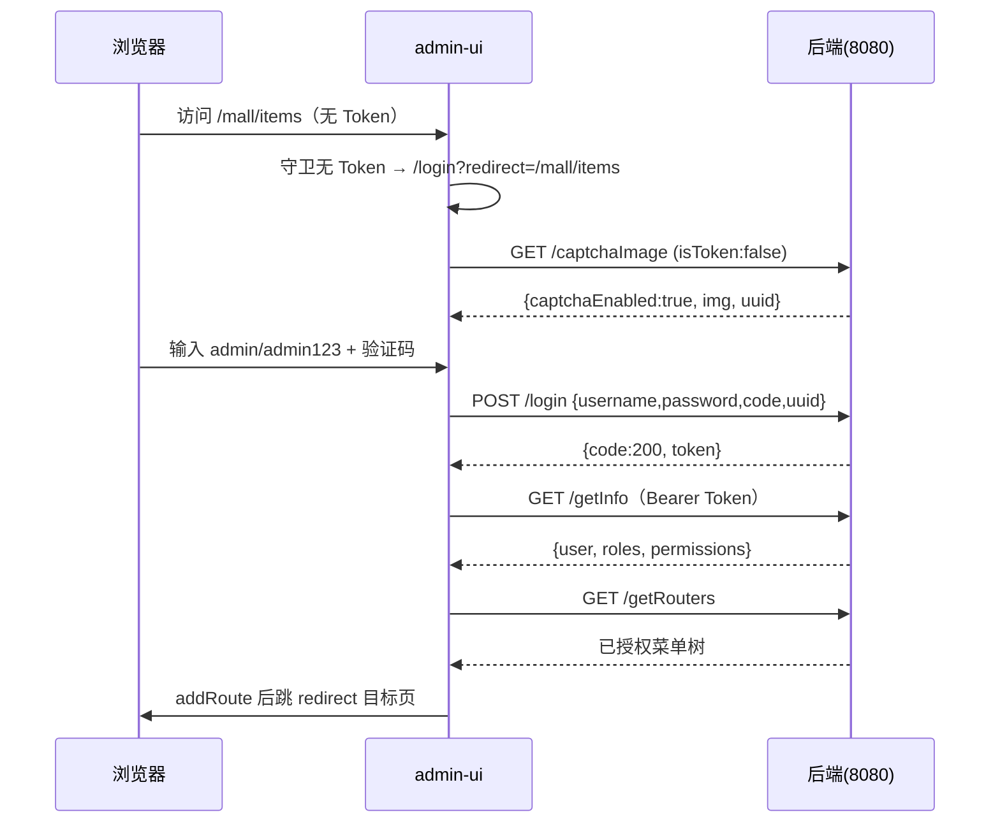
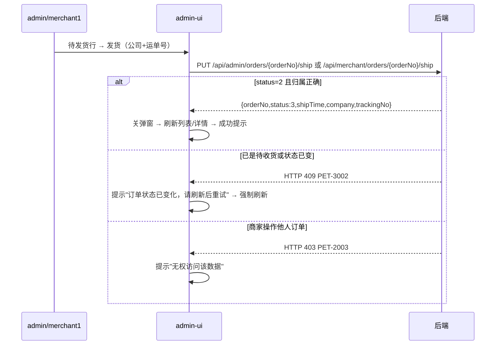

# 萌宠优选 · 宠物商城系统 管理端（`admin-ui`）前端详细设计 v1.0

> 项目：萌宠优选 · 宠物商城系统（宠物用品垂直商城）
> 文档编号：PET-MALL-FE-ADMIN-001　｜　版本：v1.0　｜　日期：2026-10-26　｜　状态：设计定稿（随实现评审迭代）
> 适用工程：`admin-ui`（RuoYi-Vue3 3.9.2 基座二次开发，开发端口 **80**，接口代理 `/dev-api` → `http://localhost:8080`）
> 设计依据：《宠物商城系统_企业级需求文档_v2.0》（**SRS**）；《宠物商城系统_企业级设计文档_v1.0》（**HLD**）；**已完成的后端源码**（`backend/ruoyi-mall`，**实现基线**）；数据库脚本 `db/02_pet_mall.sql`、`db/03_seed.sql`；`admin-ui` 基座源码
> 契约优先级：**实现基线 > HLD §7 > SRS §8.2**。三者冲突时以已完成后端代码为准，本文 §3.12 记录差异；旧设计文档 §5.1.3/§5.2.2 与本文冲突处以本文为准（差异见 §3.12）。
> 本文只覆盖管理端（管理员 + 商家 + 审核员）；用户端 `user-ui` 另行设计。

---

## 目录

- [0 文档信息](#0-文档信息)
- [1 概述](#1-概述)
- [2 总体设计](#2-总体设计)
- [3 接口契约基线（管理端消费口径）](#3-接口契约基线管理端消费口径)
- [4 菜单、路由与权限设计](#4-菜单路由与权限设计)
- [5 页面详细设计](#5-页面详细设计)
  - 5.1 页面总览与统一约定　｜　5.2 工作台　｜　5.3 商品管理　｜　5.4 商品审核　｜　5.5 类目管理　｜　5.6 订单管理　｜　5.7 会员管理　｜　5.8 库存总览与流水　｜　5.9 审计日志　｜　5.10 商家-我的商品　｜　5.11 商家-我的订单
- [6 请求层、公共组件与工具设计](#6-请求层公共组件与工具设计)
- [7 关键流程设计](#7-关键流程设计)
- [8 非功能与工程质量](#8-非功能与工程质量)
- [9 实施计划、联调与验收](#9-实施计划联调与验收)
- [附录 A 需求—页面—菜单—权限—接口追溯矩阵](#附录-a-需求页面菜单权限接口追溯矩阵)
- [附录 B 状态/枚举/错误码速查](#附录-b-状态枚举错误码速查)
- [附录 C 演示数据与账号](#附录-c-演示数据与账号)
- [附录 D 文件清单与改造点](#附录-d-文件清单与改造点)
- [附录 E 前端消费字段字典](#附录-e-前端消费字段字典)
- [附录 F 设计自检清单](#附录-f-设计自检清单)

---

## 0 文档信息

### 0.1 修订记录

| 版本 | 日期 | 修订人 | 修订内容 |
|---|---|---|---|
| v1.0 | 2026-10-26 | 前端设计组（AI 辅助） | 首版：后端已完成前提下的管理端实现级详细设计（总体、真实接口契约、菜单权限、10 个页面、请求层与组件、关键流程、非功能、实施验收） |

### 0.2 与既有文档的关系

| 文档 | 关系 | 本文处理方式 |
|---|---|---|
| SRS v2.0 | 需求来源（A-01～A-09、A-09-04 审计） | 第 1、5、9 章与附录 A 做需求编号追溯 |
| HLD v1.0 §5 前端设计 | 总体骨架 | 本文是其 §5.1.3「admin-ui 定制范围」与 §5.2.2「管理端路由」的落地细化，并修正与实现不一致处 |
| FE-USER 旧稿 v1.0 / 用户端设计 | 仅作参考，不属本文范围 | 双端边界在第 2 章说明；用户端页面细节不写入本文 |
| 数据库执行记录 v1.0 | 表结构事实 | 附录 E 给出前端消费字段字典，字段名与 `domain/` 实体一致 |
| 后端源码（已完成） | **最终契约事实来源** | 第 3 章逐接口对照 Controller / DTO / Domain / Service / Mapper 提取 |

### 0.3 读者指引

| 读者 | 建议阅读 |
|---|---|
| 前端开发（管理端） | §2、§3、§4、§5、§6、附录 D/E |
| 前端 Leader / 评审 | §1、§2、§6、§8、§9、附录 A/F |
| 后端 / 联调负责人 | §3（契约与差异）、§4（权限）、§7（流程）、§9.3（联调顺序） |
| 测试 / 验收 | §5 各页验收要点、§8.7 测试设计、§9.4 DoD、附录 B/C |
| 指导教师 | §0、§1、§2、§9 与附录 A（A-01～A-09 追溯） |

### 0.4 术语

| 术语 | 含义 |
|---|---|
| 管理端 / `admin-ui` | 管理员、商家、审核员使用的后台 SPA，复用 RuoYi-Vue3 3.9.2 基座，开发端口 80 |
| 管理员 | `sys_user` 中拥有 `mall:*` 权限、`dept_id` 不绑定商家的账号（演示 `admin`） |
| 商家 | `sys_user` 中角色 `merchant`、`dept_id=9001`（`merchant1`）；`merchant_id` 与 `dept_id` 同值 |
| 审核员 | `sys_user` 中角色 `reviewer`，仅 `mall:item:audit`、`mall:audit:list` 两个权限 |
| Result | 商城统一响应 `{code,message,data,traceId,errorCode}`（**不是**若依的 `{code,msg,data}`） |
| PageResult | 商城统一分页 `{pageNum,pageSize,total,list}`（**不是**若依的 `rows/total`） |
| `mall:*` | 商城后台权限码前缀，共 24 个（§4.5） |
| A-01～A-09 | SRS §5.15 运营后台功能需求编号 |
| 实现基线 | 已完成的 `backend/ruoyi-mall` 源码 |
| `Admin-Token` | 若依后台 Token 的 Cookie 名（`admin-ui/src/utils/auth.js`） |

---

## 1 概述

### 1.1 编写目的

后端编程已完成并通过构建、数据库与冒烟验收。本文在**不修改后端契约**的前提下，把 HLD §5 的前端骨架细化为管理端可直接编码的施工图，回答：

1. **页面怎么长**：10 个页面组件的路由、布局、查询条件、表格列、表单、弹窗、交互与状态；
2. **数据怎么取**：每个页面调用哪个真实接口、传什么参数、拿到什么字段、异常怎么处理；
3. **权限怎么控**：菜单来自哪里、路由如何动态生成、按钮权限码怎么配、审核员/商家看到什么；
4. **怎么落地**：请求层如何适配商城 `Result`（与若依 `AjaxResult` 不同）、公共组件/枚举/校验如何复用、测试与验收怎么做。

本文同时修正 HLD 与实现不一致的 19 处（§3.12）——例如商家路由实际为 `/merchant/*` 而非 `/mall/merchant/*`、审计日志页缺失、上传组件不兼容、请求层缺失、会员无详情接口等。

### 1.2 设计范围

| 项 | 本期范围 |
|---|---|
| 页面 | **10 个 C 级页面组件**：工作台、商品管理、商品审核、类目管理、订单管理、会员管理、库存总览与流水、审计日志（8 个管理端）+ 我的商品、我的订单（2 个商家端） |
| 目录 | 2 个 M 级目录：商城管理（`/mall`）、商家中心（`/merchant`） |
| 按钮 | 15 个 F 级按钮权限（商品增改/上下架、审核、类目增改删、发货、会员启停、库存调整、任务触发、商家商品增改/上下架、商家发货） |
| 复用 | 若依登录/验证码/布局/菜单/角色/字典/上传/分页/标签页/锁屏/审计日志查询能力 |
| 复用页面 | 系统管理、系统监控、系统工具下的若依原生页面（用户、角色、菜单、参数、定时任务、操作日志等）不改动 |
| 不包含 | 用户端 `user-ui`；售后、营销、内容装修、财务报表、多仓 WMS 等二期页面；商品删除/导出/商家列表/会员详情等后端未实现的接口 |

### 1.3 复用边界（做什么 / 不做什么）

| 类型 | 内容 | 说明 |
|---|---|---|
| **原样复用，不改** | 登录页、`Layout`（侧边栏/顶栏/`TagsView`/面包屑/锁屏）、动态路由生成、`v-hasPermi` 指令、`Pagination`、`RightToolbar`、`DictTag`、`ImagePreview`、`Editor`、`TreePanel`、`FileUpload`、`$modal/$tab/$auth/$cache` 插件、系统管理/监控/工具页面 | 降低风险，保证与若依升级兼容 |
| **必须新增** | `src/views/mall/**` 10 个页面文件；`src/api/mall/**` 9 个 api 文件；`src/utils/mallRequest.js` 商城请求层；`src/utils/mallDict.js` 枚举常量；`src/components/mall/**` 商城公共组件；可选 `src/api/mall/upload.js` | 否则菜单白屏、接口取不到 data |
| **需小改造** | 新增 `MallImageUpload`（包装 `ImageUpload`，取 `res.data.url`）；`src/assets/styles/` 增加商城少量样式变量 | 商城上传响应结构与若依不同 |
| **禁止改动** | `src/utils/request.js`、`src/permission.js`、`src/router/index.js`、`src/layout/**`、`src/store/modules/{user,permission}.js` | 商城请求走独立实例；动态路由与登录链路保持若依原样 |
| **数据变更（可选）** | 在 `sys_menu` 已有商城菜单基础上，如需「商家库存」独立页面则补菜单/权限；如希望使用 `useDict` 则补 `mall.*` 字典 | 一期可先用前端常量，不改库 |

### 1.4 设计原则

| 编号 | 原则 | 落地 |
|---|---|---|
| FE-A1 | 契约以代码为准 | 路径/参数/字段/校验从 Controller、DTO、Domain、Mapper 提取；不猜字段 |
| FE-A2 | 请求统一收口 | 商城接口只经 `mallRequest`；若依接口只经原 `request`；页面不直接写 axios |
| FE-A3 | 状态 URL 化 | 查询条件、分页、页签放 query，刷新/回退/分享不丢 |
| FE-A4 | 双状态分列 | 商品「审核状态」与「上下架状态」分两列、两套操作，绝不合并 |
| FE-A5 | 权限双层 | `v-hasPermi` 只控显隐；后端 `@PreAuthorize` 是安全边界；无权限 URL 后端仍 403 |
| FE-A6 | 金额/时间统一格式化 | BigDecimal→`toFixed(2)`；日期字符串直接渲染或 `parseTime`，不二次转时区 |
| FE-A7 | 错误有出口 | 每个请求都有「提示 + 页面动作」（刷新/回列表/重新登录/重试） |
| FE-A8 | 复用优先 | 页面结构、组件、交互全部对齐 `views/system/user/index.vue` 范式 |

### 1.5 关键设计决策（ADR 摘要）

| 决策 | 选择 | 理由 |
|---|---|---|
| 请求层 | 新增 `mallRequest.js`，与若依 `request.js` 并存 | 两者成功/失败结构不同（`message` vs `msg`、HTTP 4xx vs HTTP 200+code）；混用必丢业务错误 |
| 菜单/路由 | 完全依赖 `sys_menu` + `getRouters` 动态生成 | 不写死路由；商家/审核员/管理员同一套代码，靠授权区分 |
| 页面文件位置 | `src/views/mall/**`，`component` 字符串与之全等 | `loadView` 全等匹配，路径错一个字符即白屏 |
| 字典 | 一期前端常量 `mallDict.js`，不改库 | 数据库无 `mall.*` 字典；前端常量可立即用；二期再补 seed |
| 枚举展示 | 统一 `MallStatusTag` + 常量映射 | 10 个页面复用，避免各处硬编码颜色/文案 |
| 商品编辑形态 | 列表 + 抽屉/弹窗（SPU + SKU 子表 + 图片子表） | 与若依范式一致；数据量适中 |
| 订单详情 | 右侧抽屉（列表内查看）+ 独立详情接口 | 少一次整页跳转；`receiverSnapshot` 需解析 |
| 会员详情 | 无独立接口 → 行内抽屉仅展示列表行数据 | 后端无 `GET /api/admin/members/{id}` |
| 库存菜单 | 管理端独立页；商家端不建菜单，能力并入「我的商品」抽屉（§5.10） | 商家无库存菜单与独立权限码 |

### 1.6 完成定义（本设计的验收口径）

- 10 个页面文件存在，`getRouters` 返回的 10 条子路由均能渲染，无白屏/控制台报错；
- 管理员 `admin` 可见全部页面；`merchant1` 仅见商家中心两页且数据仅本人；`reviewer` 仅见商品审核 + 审计日志，且审核页无编辑/上下架按钮；
- 商城接口经 `mallRequest` 能正确解包 `data`，业务失败能展示 `message + PET-xxxx` 与 `traceId` 后 6 位；
- 商品「审核通过 ≠ 上架」流程、商家编辑重审流程、订单发货状态机、库存调整与流水、审计日志查询全部可演示；
- `npm.cmd run build:prod` 成功，`dist/` 可部署；关键页面有联调证据（`admin-ui` 当前**未安装** Vitest/Playwright/ESLint，测试工具为§8.7 建议新增项，不作为本次交付前置）。

---

## 2 总体设计

### 2.1 部署与请求链路

```text
┌────────────────────────────┐
│ 浏览器（管理员/商家/审核员） │
│ http://localhost:80         │
└─────────────┬──────────────┘
              │ /dev-api/**（开发期）
              ▼
┌────────────────────────────┐
│ admin-ui（Vite 6，端口 80） │
│ RuoYi-Vue3 3.9.2            │
│ /dev-api 代理并去掉前缀      │
└─────────────┬──────────────┘
              │ http://localhost:8080
              ▼
┌─────────────────────────────────────────────┐
│ Spring Boot 3（RuoYi 3.9.2） 端口 8080       │
│ 若依原生：/login /getInfo /getRouters /system/** │
│ 商城后台：/api/admin/**（JWT + @PreAuthorize）   │
│ 商城商家：/api/merchant/**（JWT + @PreAuthorize）│
│ 商城上传：/api/upload/image（登录即可）          │
└───────────┬─────────────────────┬───────────┘
            ▼                     ▼
        MySQL 8 `shop`         Redis 7
        （45 张表）             （JWT 会话/缓存/验证码）
```

**要点**：

1. 开发期：浏览器请求 `/dev-api/api/admin/items` → Vite `rewrite` 去掉 `/dev-api` → 后端 `/api/admin/items`。
2. 生产：`.env.production` 的 `VITE_APP_BASE_API=/prod-api`，由 Nginx 把 `/prod-api` 反代到后端；`/profile/**` 静态资源需一并反代或由后端直接提供。
3. 商城接口与若依接口**共用 `Admin-Token`**（同一个 JWT），无需第二套鉴权；但请求/响应处理必须分开（§6.1）。
4. 会员 Token（用户端 `member_tokens:*`）与后台 JWT（`login_tokens:*`）完全隔离；`admin-ui` 不处理会员 Token。

### 2.2 逻辑分层

```text
views/mall/**（页面）
  ├─ 只做展示与交互编排
  ├─ 通过 api/mall/** 取数；枚举用 utils/mallDict.js；组件用 components/mall/**
  ▼
api/mall/**（每个后端域一个文件）
  ├─ 函数只做「参数 → 请求 → 返回解包后的 data」
  ├─ 商城接口走 utils/mallRequest.js
  └─ 若依原生接口（菜单/部门/字典/上传可选）走 @/utils/request
  ▼
utils/mallRequest.js（商城专用 axios 实例）
  ├─ baseURL=VITE_APP_BASE_API、timeout=15s
  ├─ Authorization: Bearer <Admin-Token>
  ├─ code===200 → 返回 body.data
  ├─ HTTP 4xx/5xx → 从 err.response.data 取 message/errorCode/traceId
  ├─ code!==200（HTTP 200）→ 提示 body.message，reject(body)
  └─ 401/2001 → 清态回登录；429 → 按 Retry-After 倒计时
  ▼
后端 /api/admin/**、/api/merchant/**、/api/upload/**
```

**依赖规则**：`views → api/components/utils`；`components` 不调接口；`utils` 不依赖视图；`api/mall` 不写业务判断（页面负责把错误码转成页面动作）。

### 2.3 技术栈（与仓库实际版本一致）

| 层 | 版本/选型 | 说明 |
|---|---|---|
| 框架 | Vue 3.5.26（Composition API + `<script setup>`） | 与基座一致 |
| 构建 | Vite 6.4.1 | 端口 80；`host:true`；`open:true` |
| UI | Element Plus 2.13.1 | 表格/表单/弹窗/抽屉/上传 |
| 状态 | Pinia 3.0.4 | 复用基座 `user/permission/app/dict/tagsView/settings/lock` |
| 路由 | Vue Router 4.6.4 | 动态路由由 `getRouters` 生成 |
| 请求 | axios 1.13.2 | 若依实例 + 商城实例并存 |
| 图表 | ECharts 5.6.0（已依赖） | 工作台可选，不做强制 |
| 富文本 | `@vueup/vue-quill` 1.2.0（Editor 组件） | 商品 `detail` 编辑 |
| 工具 | js-cookie、file-saver、jsencrypt、sortablejs 等 | 复用基座 |
| Node | 18+（实际 24/11） | Windows 统一 `npm.cmd` |

### 2.4 工程结构与新增文件

```text
admin-ui/
├─ src/
│  ├─ api/
│  │  └─ mall/                              # 新增（9 个文件）
│  │     ├─ dashboard.js   item.js   category.js
│  │     ├─ order.js       member.js stock.js
│  │     ├─ auditLog.js    merchant.js upload.js
│  ├─ components/
│  │  └─ mall/                              # 新增（§6.4）
│  │     ├─ MallStatusTag.vue
│  │     ├─ MallMoney.vue
│  │     ├─ MallImageUpload.vue
│  │     ├─ SkuEditor.vue
│  │     ├─ CategoryTreeSelect.vue
│  │     ├─ OrderDetailDrawer.vue
│  │     ├─ AuditDrawer.vue
│  │     └─ StockAdjustDialog.vue
│  ├─ utils/
│  │  ├─ mallRequest.js                     # 新增（§6.1）
│  │  └─ mallDict.js                        # 新增（§6.3）
│  ├─ views/
│  │  └─ mall/                              # 新增（10 个页面文件）
│  │     ├─ dashboard/index.vue
│  │     ├─ item/index.vue
│  │     ├─ audit/index.vue
│  │     ├─ category/index.vue
│  │     ├─ order/index.vue
│  │     ├─ member/index.vue
│  │     ├─ stock/index.vue
│  │     ├─ auditlog/index.vue
│  │     └─ merchant/
│  │        ├─ item/index.vue
│  │        └─ order/index.vue
│  └─ assets/styles/                        # 可选：mall 少量样式
├─ vite.config.js                           # 不改（80 端口、/dev-api 代理已就绪）
└─ package.json                             # 不新增依赖（ECharts/Element Plus 已有）
```

> 菜单 `component` 字符串与文件路径必须**全等**（无 `.vue`、无前导 `/`）：`mall/item/index` ⇔ `src/views/mall/item/index.vue`（§4.3）。

### 2.5 环境变量、代理与构建

| 项 | 值/命令 | 说明 |
|---|---|---|
| 开发启动 | `cd admin-ui; npm.cmd run dev` | 端口 80；首次安装 `npm.cmd install` |
| 开发 API 前缀 | `VITE_APP_BASE_API=/dev-api` | 请求 URL = `/dev-api` + api 内路径 |
| 开发代理 | `/dev-api` → `http://localhost:8080`，`rewrite` 去前缀；`/v3/api-docs/(.*)` 直通 | `vite.config.js` 已配置 |
| 生产构建 | `npm.cmd run build:prod` | **注意脚本名是 `build:prod`，没有 `build`** |
| 生产 API 前缀 | `VITE_APP_BASE_API=/prod-api` | 由 Nginx 反代到后端 |
| 产物 | `dist/`，`static/js\|css/[ext]`，`sourcemap:false` | 不部署 sourcemap |
| 压缩 | `VITE_BUILD_COMPRESS=gzip` | 按需开启 |
| 静态资源 | `/profile/**` 后端放行（`SecurityConfig`） | `/dev-api/profile/...` 可直取上传图 |
| Node/npm | Node 18+；Windows 一律 `npm.cmd`（`npm.ps1` 被执行策略拦截） | — |

### 2.6 编码与协作规范

| 项 | 规范 |
|---|---|
| 页面文件 | `src/views/mall/<域>/index.vue`；`<script setup name="Xxx">` 的 `name` 建议与路由 `name` 一致（如 `Items`、`Audit-log`），供 `keep-alive`/`TagsView` |
| 组件文件 | `src/components/mall/PascalCase.vue`；props 显式类型 + 默认值；事件 `defineEmits` 声明 |
| api 函数 | 动词开头：`listItems`、`getItemDetail`、`createItem`、`updateItemStatus`、`auditItem`、`shipOrder`、`listStockOverview`、`adjustStock`、`listAuditLogs`；一域一文件；只返回 `data` |
| 查询状态 | `queryParams` 用 `reactive`；分页 `pageNum/pageSize`；页签/筛选放 URL query（可选 `useRoute` 同步） |
| 弹窗/抽屉 | `open`/`title`/`form`/`rules`，`proxy.$refs.formRef.validate` 后提交；提交按钮 loading 防重 |
| 表格 | 列显隐用 `columns` + `RightToolbar`；时间列 `parseTime`；金额列 `MallMoney`；状态列 `MallStatusTag` |
| 权限 | 按钮/操作一律 `v-hasPermi="['mall:...']"`；JS 内用 `proxy.$auth.hasPermiOr([...])` |
| 提示 | 成功用 `proxy.$modal.msgSuccess`；失败由请求层统一提示，页面只处理动作型错误 |
| 金额 | 展示 `Number(v).toFixed(2)`；输入 `el-input-number :precision="2"`；不做浮点累加作为应收 |
| 时间 | 后端字符串 `yyyy-MM-dd HH:mm:ss`；直接展示或 `parseTime`；**不要** `new Date(str).toISOString()` |
| 禁止 | 页面直接 `axios`；在 `views/mall` 里 `import request from '@/utils/request'` 调商城接口；硬编码后端地址；`console.log` 输出 Token/手机号 |
| Git | 提交源码/文档/锁文件；不提交 `node_modules`、`dist`、`.env.local`、日志 |

### 2.7 联调环境基线

| 项 | 值 |
|---|---|
| 后端 | `http://localhost:8080`（`SERVER_PORT` 可覆盖） |
| Swagger | `http://localhost:8080/swagger-ui.html`（商城接口在 `com.ruoyi.web.controller.mall` 扫描范围内） |
| 数据库 | MySQL 8，库 `shop`，45 张表（31 若依 + 14 `pet_*`） |
| 缓存 | Redis 7（JWT 会话、验证码、接口缓存、限流计数） |
| 演示账号 | `admin/admin123`（全部）、`merchant1/merchant123`（商家两页）、`reviewer/reviewer123`（审核+审计） |
| 会员账号 | `member1/member123`、`member2/member123`（用户端，后台不可登录） |
| 参数 | 支付超时 15 分钟、自动确认 10 天、包邮 99/运费 10、低库存阈值 10（`sys_config` 的 `mall.*`；后台页面以接口返回体现，不写死） |
| 演示数据重置 | `db/03_seed.sql`（会重置业务表与订单时间，演示前执行） |

---

## 3 接口契约基线（管理端消费口径）

> 本章是所有页面取数的唯一依据。路径、字段、校验、错误码均来自已完成后端源码；示例字段顺序不代表返回顺序。**禁止依赖后端未返回的字段。**

### 3.1 统一响应 `Result`

后端 `com.ruoyi.mall.common.Result<T>` 实际结构：

```json
{
  "code": 200,
  "message": "success",
  "data": {},
  "traceId": "9f2c4e8a7b3d4c1e8f0a2b6d9c3e1f4a",
  "errorCode": null
}
```

| 字段 | 类型 | 前端用途 |
|---|---|---|
| `code` | number | 成功判定：`200` 成功；`4001` 重复下单按成功；其余失败 |
| `message` | string | 失败提示文案（后端中文）；成功为 `success`，页面不展示 |
| `data` | any | 业务数据；分页接口为 `PageResult` |
| `traceId` | string | 32 位；失败提示附后 6 位，便于查日志 |
| `errorCode` | string/null | 失败时 `PET-xxxx`（如 `PET-3003`），可直接用于分支 |

**与若依 `AjaxResult` 的差异（管理端必须处理）**：若依是 `{code,msg,data}`，成功 `msg="操作成功"`；商城是 `{code,message,data,traceId,errorCode}`。`admin-ui/src/utils/request.js` 只认 `msg`，且未知 code 提示"系统未知错误"；商城失败又是 **HTTP 4xx/5xx**，会被 axios 的 error 分支吞成"系统接口4xx异常"。因此**商城接口必须走专用请求层**（§6.1）。

### 3.2 统一分页 `PageResult`

```json
{ "pageNum": 1, "pageSize": 10, "total": 12, "list": [] }
```

| 约定 | 说明 |
|---|---|
| 请求 | `pageNum`（从 1 开始）、`pageSize`（默认 10，上限 100，超出后端截断） |
| 返回 | `list` 可能为 `[]`，`total` 为总条数 |
| 前端 | `Pagination` 绑定 `total` 与 `v-model:page/limit`；**不是**若依的 `rows/total` |

### 3.3 后台鉴权模型

| 项 | 事实 |
|---|---|
| 登录接口 | `POST /login`（若依），body `{username,password,code,uuid}`；验证码来自 `GET /captchaImage` |
| 验证码 | `sys_config.sys.account.captchaEnabled='true'` 默认开启；`/captchaImage` 返回 `{code,msg,captchaEnabled,img(base64),uuid}` |
| Token | 登录成功返回 `token`（JWT）；存 Cookie **`Admin-Token`**（浏览器会话 Cookie，`Cookies.set` 未设 expires） |
| 请求头 | 若依 `request.js` 注入 `Authorization: Bearer <Admin-Token>`；`headers.isToken=false` 时不带（仅登录/验证码） |
| 用户信息 | `GET /getInfo` → `{user,roles,permissions,pwdChrtype,isDefaultModifyPwd,isPasswordExpired}`；`permissions` 含 `mall:*` |
| 菜单 | `GET /getRouters` → `{code,msg,data:[RouterVo...]}`；动态路由由 `permission.js` 生成 |
| 权限校验 | 后端 `@PreAuthorize("@ss.hasPermi('mall:...')")`；无权限时若依返回 **HTTP 200 + `{code:403,msg}`**（不是 HTTP 403） |
| JWT 失效 | 若依返回 HTTP 200 + `{code:401,msg}` → `request.js` 弹重新登录 |
| 登出 | `POST /logout`（带 Token），清 Cookie 与 Pinia |
| Token 隔离 | 会员 Token 在 Redis `member_tokens:*`，后台 JWT 在 `login_tokens:*`；`admin-ui` 只持 `Admin-Token` |

**两层失败形态**（页面必须都能处理）：

| 场景 | HTTP | body | 处理 |
|---|---|---|---|
| 商城业务失败 | 400/403/404/409/429/500 | `Result`（`message`/`errorCode`/`traceId`） | `mallRequest` 读 `err.response.data`，提示业务文案 |
| 商城成功 | 200 | `Result`（`code=200`） | `mallRequest` 解包 `data` |
| 若依权限不足 | 200 | `{code:403,msg}` | 若依 `request` 已提示"没有权限" |
| 若依 JWT 失效 | 200 | `{code:401,msg}` | 若依 `request` 弹重新登录 |

### 3.4 错误码与前端动作矩阵（管理端相关）

| 错误码 | HTTP | 典型场景 | 前端动作 |
|---|---|---|---|
| `PET-1001` | 400 | 参数/校验失败：分类不存在、商户为空、规格名重复、驳回未填意见、库存为负 | 提示 `message`；表单字段标红；不跳页 |
| `PET-1002` | 400 | 唯一键冲突：`sku_code` 重复、幂等键冲突 | 提示"数据已存在，请勿重复提交"；定位 SKU 编码列 |
| `PET-1003` | 400 | 分类被引用/有子类，不能删除 | 提示先处理关联；不删除 |
| `PET-2001` | 401 | 未登录/Token 失效（会员域） | 管理端不出现；若出现按 401 处理 |
| `PET-2003` | 403 | 越权：商家改他人商品/订单、账号未绑定商家、会员不存在 | 提示"无权限/无权操作"；刷新列表；不泄露数据 |
| `PET-3001` | 409 | 库存不足以调整为目标值 | 提示 `message`；刷新库存总览 |
| `PET-3002` | 409 | 状态不允许：重复发货、非法状态迁移 | 提示"订单状态已变化，请刷新"；刷新详情/列表 |
| `PET-3003` | 400 | 商品/SKU 不存在或不可售；未审核就上架 | 提示并刷新；上架按钮置灰 |
| `PET-4003` | 404 | 订单不存在（orderNo 错误/已删） | 提示并返回列表 |
| `PET-4290` | 429 | 请求过于频繁 | 按 `Retry-After` 禁用按钮倒计时 |
| `PET-5000/5001/5002` | 500/503 | 系统/数据库/缓存异常 | "系统繁忙，请稍后重试" + traceId 后 6 位 |
| `PET-6001` | 400 | 上传类型/大小不支持 | 上传组件提示允许类型与大小 |
| 若依 `code=403` | 200 | `@PreAuthorize` 拒绝 | 若依已提示"没有权限"；页面不重复弹 |

> 成功/失败以 `code` 为准；`4001` 是唯一"非 200 但按成功"的例外（本模块下单不涉及，但公共请求层需保留）。

### 3.5 序列化与字段类型（表格/表单依据）

| 类型 | 后端实际 | 前端处理 |
|---|---|---|
| 金额 `BigDecimal` | JSON **number**（如 `89.00` 实际为 `89`、`298.80`） | 展示 `Number(v).toFixed(2)`；输入 `el-input-number :precision="2"`；禁止浮点累加算应收 |
| 时间 `Date` | 字符串 `"yyyy-MM-dd HH:mm:ss"`（全局 Jackson + `@JsonFormat`，GMT+8） | 直接展示或 `parseTime`；不要二次 `new Date()` 转 ISO |
| 日期入参 | 后端只接 String（`startTime/endTime/beginTime/endTime`） | `el-date-picker value-format="YYYY-MM-DD HH:mm:ss"`；订单结束时间若选日期需自行补 `23:59:59`（后端不补） |
| 0/1 语义 | `Integer`：`status`、`auditStatus`、`skuStatus`、`checked`、`isDefault`、`readFlag` | 用 0/1 判断，不用 `true/false` |
| `receiverSnapshot` | **JSON 字符串**，非对象！ | `JSON.parse` 后展示；解析失败降级展示原文 |
| `petSnapshot` | 字符串（订单头为多个宠物名拼接；明细为单个姓名） | 直接展示 |
| 富文本 `detail` | HTML 字符串 | 管理端用 `Editor` 编辑，回显 `v-html`（后台可信内容）；用户输入仍纯文本 |
| 图片路径 | 相对路径，如 `/profile/mall/items/item-01.jpg` | 展示拼 `VITE_APP_BASE_API`（`ImagePreview` 已处理）；提交时存相对路径 |
| `null` | 默认输出（未配置 `non_null`） | 表格/表单处理 `null`（`?? ''`） |
| 库存总览 `Map` | key 为驼峰别名（§3.8 A18），不是下划线 | 按 key 取值，勿按数据库列名 |

### 3.6 分页、筛选、排序约定

| 项 | 约定 |
|---|---|
| 分页 | 仅 A2 商品、A13 订单、A16 会员、A21 审计日志返回 `PageResult`；A18/A19 库存返回 `List`（**无分页**） |
| 排序 | 后端固定排序，前端不提供排序参数：商品 `create_time DESC,id DESC`；订单/会员/审计按各 Mapper 默认；库存 `stock ASC,id ASC` |
| 筛选 | 只使用后端声明了的参数；**商品列表的 `species` 被服务端忽略**（§3.9），页面不放该筛选项 |
| URL | 查询条件建议同步到 route query（刷新保持），至少分页与关键筛选；详情抽屉不写 URL |
| 日期 | 订单/审计为顶层参数，**不得使用 `addDateRange()`**（它生成 `params[beginTime]`，不匹配） |

### 3.7 幂等、限流、缓存与审计

| 项 | 后端事实 | 前端设计 |
|---|---|---|
| 幂等 | 发货/上下架/调整是条件更新或主键操作；重复操作返回 `PET-3002` 或幂等结果。**审核接口当前只按 `id+del_flag` 更新**（未带 `audit_status=0` 条件），并发/重复审核存在覆盖风险 → 前端只对 `auditStatus=0` 的行显示审核按钮，审核成功后立即刷新；后端建议补条件更新（§9.5 第17项） | 按钮 loading + 二次确认；失败刷新详情 |
| 防重复提交 | 若依 `request.js` 对同 `url+data` 1 秒内重复 POST/PUT 直接 reject（仅 console 警告） | 商城 `mallRequest` 不继承该行为，页面必须自己做 loading 锁，避免静默失败 |
| 限流 | 商城登录/下单限流；后台管理接口无额外限流 | 429 按 `Retry-After` 倒计时 |
| 缓存 | 分类/推荐等由后端 Redis 缓存；后台列表不缓存 | 每次查询以接口为准；操作成功后主动刷新 |
| 审计 | 带 `@Log` 的写操作写入 `sys_oper_log`（A4/A5/A6/A7/A10/A11/A12/A15/A17/A20/A22/A23、商家 M3/M4/M5/M8/M11） | 审计日志页可查到；操作成功提示即可，不额外展示日志 |
| 上传 | `/api/upload/image` 无 `@PreAuthorize`，登录即可；`multipart` 字段 `file` | 页面用 `MallImageUpload`，失败提示 6001 或后端 message |

### 3.8 管理端接口清单（A1–A24）

| # | 方法 | 路径 | 权限码 | 说明 | 页面 |
|---|---|---|---|---|---|
| A1 | GET | `/api/admin/dashboard/summary` | `mall:dashboard:view` | 工作台概览 | 5.2 |
| A2 | GET | `/api/admin/items` | `hasAnyPermi('mall:item:list,mall:item:audit')` | 商品列表（管理/审核共用） | 5.3、5.4 |
| A3 | GET | `/api/admin/items/{id}` | 同上 | 商品详情（含 SKU/图片/审核留痕） | 5.3、5.4 |
| A4 | POST | `/api/admin/items` | `mall:item:add` | 新建商品 | 5.3 |
| A5 | PUT | `/api/admin/items/{id}` | `mall:item:edit` | 编辑商品 | 5.3 |
| A6 | PUT | `/api/admin/items/{id}/status` | `mall:item:status` | 上架/下架 | 5.3 |
| A7 | PUT | `/api/admin/items/{id}/audit` | `mall:item:audit` | 审核（通过/驳回） | 5.4 |
| A8 | GET | `/api/admin/categories` | `mall:category:list` | 类目树（两级） | 5.5、5.3 映射 |
| A9 | GET | `/api/admin/categories/{id}` | `mall:category:list` | 类目详情 | 5.5 |
| A10 | POST | `/api/admin/categories` | `mall:category:add` | 新增类目 | 5.5 |
| A11 | PUT | `/api/admin/categories/{id}` | `mall:category:edit` | 编辑类目 | 5.5 |
| A12 | DELETE | `/api/admin/categories/{id}` | `mall:category:remove` | 删除类目 | 5.5 |
| A13 | GET | `/api/admin/orders` | `mall:order:list` | 订单列表 | 5.6 |
| A14 | GET | `/api/admin/orders/{orderNo}` | `mall:order:list` | 订单详情（明细/支付/流水） | 5.6 |
| A15 | PUT | `/api/admin/orders/{orderNo}/ship` | `mall:order:ship` | 平台发货 | 5.6 |
| A16 | GET | `/api/admin/members` | `mall:member:list` | 会员列表 | 5.7 |
| A17 | PUT | `/api/admin/members/{id}/status` | `mall:member:status` | 会员禁用/启用 | 5.7 |
| A18 | GET | `/api/admin/stock` | `mall:stock:list` | 库存总览（无分页） | 5.8 |
| A19 | GET | `/api/admin/stock/logs` | `mall:stock:list` | 库存流水（无分页） | 5.8 |
| A20 | PUT | `/api/admin/stock/{skuId}` | `mall:stock:adjust` | 库存调整 | 5.8 |
| A21 | GET | `/api/admin/audit-logs` | `mall:audit:list` | 操作审计（只读） | 5.9 |
| A22 | POST | `/api/admin/jobs/close-timeout-orders` | `mall:job:trigger` | 手动超时关单 | 5.2 |
| A23 | POST | `/api/admin/jobs/auto-confirm-orders` | `mall:job:trigger` | 手动自动确认收货 | 5.2 |
| A24 | POST | `/api/upload/image` | 无（登录即可） | 图片上传 | 5.3、5.5 |

> **不存在的接口（不要设计按钮）**：商品删除、类目启停独立接口、会员详情 `GET /api/admin/members/{id}`、导出 Excel、商家列表/详情。

### 3.9 关键接口参数与字段（摘要，页面设计见 §5）

#### A2 商品列表

| 参数 | 类型 | 说明 |
|---|---|---|
| `keyword` | String | `title LIKE OR brand LIKE`（**不含 subtitle**） |
| `categoryId` | Long | 展开自身+全部下级过滤 |
| `species` | String | **接收但被忽略**（服务端未使用），页面不要放 |
| `auditStatus` | Integer | 0 待审 / 1 驳回 / 2 通过；null=全部 |
| `status` | Integer | 0 下架 / 1 上架；null=全部 |
| `merchantId` | Long | 按商家过滤（admin 用；商家端由服务端强制） |
| `pageNum/pageSize` | Integer | 默认 1/10 |

响应 `PageResult<PetItem>`；列表行只含 `pet_item` 主表字段（**无 categoryName/merchantName/SKU 数**），`skus/images/audits` 为 `null`，`statusText` 不在商品响应中。

`PetItem` 字段：`id, categoryId, merchantId, title, subtitle, mainImage, brand, petSpecies(CAT/DOG/SMALL/ALL), ageStage(JUNIOR/ADULT/SENIOR/ALL), weightRange, priceMin, costPrice, supportSubscribe(0/1), isPrescription(0/1), detail(HTML), auditStatus(0/1/2), status(0/1), sales, delFlag, createTime, updateTime`。

#### A3 商品详情（admin）

- 额外填充：`skus[]`（**全部 SKU，含停用**，按 price ASC）、`images[]`（按 sort ASC）、`audits[]`（按 create_time DESC，仅 admin 详情）。
- `skus[]`：`{id,itemId,specName,price,stock,skuCode,image,status,createTime,updateTime}`。
- `images[]`：`{id,itemId,url,sort,createTime}`。
- `audits[]`：`{id,itemId,auditStatus(1/2),auditor,remark,createTime}`。

#### A4/A5 商品保存（`ItemSaveRequest`）

| 字段 | 校验 | 说明 |
|---|---|---|
| `merchantId` | 无注解 | **A4 必传**（缺失 `PET-1001 "商户不能为空"`）；A5 传了才改归属 |
| `categoryId` | `@NotNull` | 必须存在，否则 `PET-1001 "分类不存在"` |
| `title` | `@NotBlank @Size(max=100)` | trim 入库 |
| `subtitle` | `@Size(max=200)` | — |
| `mainImage` | `@NotBlank` | 上传返回的 `data.url`（相对路径） |
| `brand` | `@Size(max=50)` | — |
| `petSpecies` | `@NotBlank @Pattern(CAT\|DOG\|SMALL\|ALL)` | — |
| `ageStage` | `@NotBlank @Pattern(JUNIOR\|ADULT\|SENIOR\|ALL)` | — |
| `weightRange` | 无 | 文本，如 `"0.5-5"` |
| `costPrice` | 无 | 可空；前端自行约束 ≥0 |
| `supportSubscribe` / `isPrescription` | 无 | 缺省 0 |
| `detail` | 无 | HTML（Quill） |
| `skus[]` | `@Valid`；创建时非空、规格名去重 | 见下 |
| `images[]` | `@Valid` | 空/未传时自动用 `mainImage` 生成一张 |

`skus[]`（`SkuRequest`）：`id`（编辑传旧 ID 走更新，不传=新增）、`specName`（`@NotBlank`，同商品不可重复 → `PET-1001`）、`price`（`@NotNull @DecimalMin("0.01")`）、`stock`（`@NotNull @Min(0)`）、`skuCode`（**唯一键**，重复 `PET-1002`；同表单先本地查重）、`image`、`status`（缺省 1）。

`images[]`（`ImageRequest`）：`{url @NotBlank, sort}`；A5 传了（含空数组）会先删后插，不传则不动。

**保存行为**：

| 场景 | 行为 |
|---|---|
| admin 新建 | `auditStatus=2`（已通过）、`status=0`（下架） |
| 商家新建 | `auditStatus=0`（待审）、`status=0` |
| admin 编辑 | **不重审、不改上下架**（已上架仍上架） |
| 商家编辑 | 强制 `auditStatus=0`、`status=0`（重新待审并下架） |
| 移除的旧 SKU | 不物理删除，仅 `status=0` 软停用 |
| `priceMin` | 由启用 SKU 最低价计算；全停用为 0 |
| 响应 | 保存后的完整详情（可回填表单）；`message`："商品已创建"/"商品已更新" |

#### A6 上下架

`PUT /api/admin/items/{id}/status`，body `StatusRequest{status:0|1}`。上架要求 `auditStatus==2`，否则 `PET-3003 "商品未审核通过，不能上架"`；下架无前置。响应 `data=null`。

#### A7 审核

`PUT /api/admin/items/{id}/audit`，body `AuditRequest{auditStatus:1|2, remark}`：

- `auditStatus` 只能 1（驳回）或 2（通过）；
- 驳回时 `remark` **必填**，否则 `PET-1001 "驳回时必须填写审核意见"`；`@Size(max=500)`；
- 驳回会同时把 `status` 置 0（强制下架）；
- **通过不会自动上架**；
- 写 `pet_item_audit` 留痕（`auditor`=登录名、`remark`、时间）；
- 响应 `{itemId,auditStatus}`，`message:"审核完成"`。
- **并发约束（源码事实）**：`PetItemMapper.updateAudit` 当前只有 `id+del_flag` 条件，没有 `AND audit_status=0`。因此两个管理员可能重复审核/覆盖结果；前端必须：①列表只显示 `auditStatus=0` 的待审项给审核按钮；②审核成功后关闭抽屉并强制刷新；③不提供“撤销审核”。后端补条件更新列为 §9.5 第17项（待确认/建议修复）。

#### A8–A12 类目

| 接口 | 请求 | 响应 data |
|---|---|---|
| A8 GET `/api/admin/categories` | 无 | `PetCategory[]`（两级树，含停用；`children`） |
| A9 GET `/api/admin/categories/{id}` | — | 单个 `PetCategory` |
| A10 POST | `CategoryRequest` | 新建后类目，`message:"类目已创建"` |
| A11 PUT | `CategoryRequest` | 更新后类目，`message:"类目已更新"` |
| A12 DELETE | — | `null`，`message:"success"` |

`CategoryRequest`：`parentId`（null/0=一级；父级必须是一级，否则 `PET-1001 "分类最多支持两级"`；不能选自己/下级）、`name @NotBlank @Size(max=50)`、`icon`、`sort`（缺省 0）、`petScope`（空/null→ALL；仅 `CAT/DOG/SMALL/ALL`）、`status`（缺省 **0=启用**，1=停用，与 `sys_normal_disable` 一致）。

删除：有子类 → `PET-1003 "请先删除子分类"`；有商品引用 → `PET-1003 "分类下存在商品，无法删除"`。

`PetCategory` 字段：`id,parentId,name,icon,sort,petScope,status,createTime,updateTime,children[]`。

#### A13/A14 订单

A13 `GET /api/admin/orders` 参数：`orderNo`（**模糊**）、`memberId`、`merchantId`、`status(0-8)`、`startTime`、`endTime`（**顶层参数**，原样透传）、`pageNum/pageSize`。列表行含 `statusText` 与 `items[]`，不含 `payment/stockLogs`。

A14 `GET /api/admin/orders/{orderNo}`（**orderNo 字符串**）：不存在 → `PET-4003`（404）；额外填充 `statusText`、`items[]`、`payment`、`stockLogs[]`。

`PetOrder` 字段：`id,orderNo,memberId,merchantId,totalAmount,discountAmount,freight,payAmount,status,statusText,receiverSnapshot(JSON字符串),petSnapshot,remark,clientToken,expireAt,payTime,shipTime,receiveTime,closeTime,createTime,updateTime,cancelReason,items[],payment,stockLogs[]`。

`receiverSnapshot` 示例：`{"receiver":"张小明","phone":"13800138001","province":"广东省","city":"深圳市","district":"南山区","detail":"...","postcode":"518000"}`；发货后追加 `logistics:{company,trackingNo,shipTime}`。

`items[]`：`{id,orderId,itemId,skuId,title,spec,price,quantity,amount,image,petSnapshot,createTime}`。
`payment`：`{id,paymentNo,orderNo,amount,channel,status,idempotencyKey,callbackTime,createTime}`。
`stockLogs[]`：见 A19。

订单状态：**0 待付款 / 1 待审核 / 2 待发货 / 3 待收货 / 4 已完成 / 5 已取消 / 6 已关闭 / 7 售后中 / 8 已退款**（`statusText` 由后端生成，可直接展示）。

#### A15 发货

`PUT /api/admin/orders/{orderNo}/ship`，body `ShipRequest{company @NotBlank @Size(max=50), trackingNo @NotBlank @Size(max=50)}`；只允许 `2→3`，否则 `PET-3002`；订单不存在 `PET-4003`；响应 `{orderNo,status:3,shipTime,company,trackingNo}`，`message:"发货成功"`；成功后给会员写站内消息。

#### A16/A17 会员

A16 `GET /api/admin/members`：`keyword`（username/nickname/phone 模糊）、`status(0/1)`、`pageNum/pageSize`。返回 `PageResult<PetMember>`，`phone` 已脱敏（`138****8001`，**不可逆，不要二次脱敏**），`password` 恒为 `null`。

A17 `PUT /api/admin/members/{id}/status`，body `StatusRequest{status:0|1}`，响应更新后的 `PetMember`；**禁用立即失效会员 Token**；会员不存在 → `PET-2003`（403）。

#### A18 库存总览

`GET /api/admin/stock` → `List<Map<String,Object>>`（**无分页**）。参数：`keyword`（标题或 SKU 编码）、`itemId`、`merchantId`、`lowStock`（默认 false）、`threshold`（默认 10）。

Map 的 11 个 key：`skuId, itemId, title, specName, skuCode, price, stock, skuStatus, itemStatus, auditStatus, merchantId`。排序 `stock ASC,id ASC`；无 `categoryName/sales`。

#### A19 库存流水

`GET /api/admin/stock/logs` → `List<PetStockLog>`（**无分页**）；参数 `skuId`、`orderNo`（精确）、`type`。

`PetStockLog`：`{id,skuId,orderNo,type,changeQty,beforeQty,afterQty,operator,remark,createTime}`。

`type` 三套取值**必须同时兼容**（§6.3）：运行时代码 `ORDER_DEDUCT/ORDER_ROLLBACK/MANUAL`；种子 `ADJUST`；DDL 注释 `DEDUCT/ROLLBACK/ADJUST`。

#### A20 库存调整

`PUT /api/admin/stock/{skuId}`，body `StockAdjustRequest{targetStock @NotNull @Min(0), remark @Size(max=200)}`：**目标库存**（非增量），服务端算差值；增库存直接加、减库存条件扣减，不足 `PET-3001 "库存不足以调整为N"`；`change==0` 不写流水；SKU 不存在 `PET-3003`；响应调整后完整 `PetItemSku`，`message:"库存已调整"`。

#### A21 审计日志

`GET /api/admin/audit-logs` → `PageResult<SysOperLog>`；参数 `title`、`operName`、`businessType`、`status`、`beginTime`、`endTime`（**顶层参数**；只传 10 位日期时后端自动补 `00:00:00`/`23:59:59`）、`pageNum/pageSize`。

`SysOperLog`：`operId,title,businessType,method,requestMethod,operatorType,operName,deptName,operUrl,operIp,operLocation,operParam,jsonResult,status,errorMsg,operTime,costTime`。只读，无删除/导出。

#### A22/A23 手动任务

| 接口 | 响应 data | 说明 |
|---|---|---|
| POST `/api/admin/jobs/close-timeout-orders` | `{"closed":number}` | 扫描 `status=0 AND expire_at<=NOW()` 关单+回滚+消息 |
| POST `/api/admin/jobs/auto-confirm-orders` | `{"confirmed":number}` | 扫描 `status=3` 超期订单置已完成 |

#### A24 上传

`POST /api/upload/image`，`multipart/form-data`，字段名 **`file`**；响应 `data = {url,fileName,newFileName,originalFilename}`，`url` 形如 `/profile/upload/2026/10/26/xxx.jpg`（可直接入库为相对路径）。限制：`max-file-size=10MB`，扩展名白名单（jpg/jpeg/png/gif/bmp 等）；超限/空文件由若依兜底返回 `{code:500,msg}`（HTTP 200），商城上传组件需兼容两种错误形态。

### 3.10 商家端接口清单（M1–M11）

| # | 方法 | 路径 | 权限码 | 说明 |
|---|---|---|---|---|
| M1 | GET | `/api/merchant/items` | `mall:merchant:item:list` | 我的商品列表（参数 keyword/categoryId/auditStatus/status/page；**无 species/merchantId**） |
| M2 | GET | `/api/merchant/items/{id}` | `mall:merchant:item:list` | 我的商品详情（skus+images，**audits=null**；非本人 `PET-2003`） |
| M3 | POST | `/api/merchant/items` | `mall:merchant:item:add` | 发布商品（强制 `auditStatus=0,status=0`；`message:"商品已提交审核"`） |
| M4 | PUT | `/api/merchant/items/{id}` | `mall:merchant:item:edit` | 编辑本人商品（**强制重审+下架**） |
| M5 | PUT | `/api/merchant/items/{id}/status` | `mall:merchant:item:status` | 上下架（上架要求 `auditStatus=2`） |
| M6 | GET | `/api/merchant/orders` | `mall:merchant:order:list` | 我的订单列表（参数 status/orderNo/page；**无 memberId/时间**） |
| M7 | GET | `/api/merchant/orders/{orderNo}` | `mall:merchant:order:list` | 我的订单详情（含 payment/stockLogs；非本人 `PET-2003`） |
| M8 | PUT | `/api/merchant/orders/{orderNo}/ship` | `mall:merchant:order:ship` | 商家发货（归属校验 + 状态机） |
| M9 | GET | `/api/merchant/stock` | `mall:merchant:item:list`（复用） | 我的库存总览（参数 keyword/itemId/lowStock/threshold；**无 merchantId**） |
| M10 | GET | `/api/merchant/stock/logs` | `mall:merchant:item:list`（复用） | 我的库存流水（skuId/orderNo/type；**两者都不传时后端无商家过滤，前端必须强制至少一个条件**） |
| M11 | PUT | `/api/merchant/stock/{skuId}` | `mall:merchant:item:edit`（复用） | 我的库存调整（先校验 SKU 归属） |

> `merchantId` 由后端 `SecurityUtils.getDeptId()` 解析（`dept_id=9001`），前端**不传**；未绑定部门 → `PET-2003`。

### 3.11 关键响应示例

商品列表（A2）：

```json
{
  "code": 200, "message": "success",
  "data": {
    "pageNum": 1, "pageSize": 10, "total": 12,
    "list": [{
      "id": 2, "categoryId": 12, "merchantId": 9001,
      "title": "皇家幼猫粮 K36 2kg", "subtitle": "幼猫专用配方，呵护肠胃",
      "mainImage": "/profile/mall/items/item-01.jpg", "brand": "皇家",
      "petSpecies": "CAT", "ageStage": "JUNIOR", "weightRange": "0.5-5",
      "priceMin": 89.00, "costPrice": 60.00,
      "supportSubscribe": 0, "isPrescription": 0,
      "detail": "<p>...</p>", "auditStatus": 2, "status": 1,
      "sales": 320, "delFlag": "0",
      "createTime": "2026-10-19 09:00:00", "updateTime": "2026-10-19 09:00:00"
    }]
  },
  "traceId": "9f2c4e8a7b3d4c1e8f0a2b6d9c3e1f4a", "errorCode": null
}
```

库存总览（A18）：

```json
{
  "code": 200, "message": "success",
  "data": [
    { "skuId": 21, "itemId": 2, "title": "皇家幼猫粮 K36 2kg", "specName": "2kg装",
      "skuCode": "RC-K36-2KG", "price": 89.00, "stock": 1,
      "skuStatus": 1, "itemStatus": 1, "auditStatus": 2, "merchantId": 9001 }
  ],
  "traceId": "…", "errorCode": null
}
```

订单详情（A14，节选）：

```json
{
  "code": 200, "message": "success",
  "data": {
    "orderNo": "PM202610190900000001", "status": 3, "statusText": "待收货",
    "totalAmount": 188.00, "discountAmount": 0.00, "freight": 0.00, "payAmount": 188.00,
    "receiverSnapshot": "{\"receiver\":\"张小明\",\"phone\":\"13800138001\",\"province\":\"广东省\",\"city\":\"深圳市\",\"district\":\"南山区\",\"detail\":\"科技园南路88号\",\"logistics\":{\"company\":\"顺丰速运\",\"trackingNo\":\"SF123456789\",\"shipTime\":\"2026-10-26 10:00:00\"}}",
    "items": [{ "title": "皇家幼猫粮 K36 2kg", "spec": "2kg装", "price": 89.00, "quantity": 2, "amount": 178.00, "image": "/profile/mall/items/item-01.jpg" }],
    "payment": { "paymentNo": "PAY202610190900000001", "channel": "WECHAT", "status": "SUCCESS", "amount": 188.00 },
    "stockLogs": [{ "skuId": 21, "type": "ORDER_DEDUCT", "changeQty": -2, "beforeQty": 3, "afterQty": 1, "createTime": "2026-10-19 09:00:05" }],
    "expireAt": "2026-10-19 09:15:00", "payTime": "2026-10-19 09:02:00",
    "shipTime": "2026-10-20 10:00:00", "createTime": "2026-10-19 09:00:00"
  },
  "traceId": "…", "errorCode": null
}
```

失败（示例：未审核就上架）：

```json
{
  "code": 3003, "message": "商品未审核通过，不能上架",
  "data": null, "traceId": "9f2c4e8a7b3d4c1e8f0a2b6d9c3e1f4a",
  "errorCode": "PET-3003"
}
```

### 3.12 与旧设计文档 / SRS 的差异清单（以本文为准）

| # | 旧设计/旧口径 | 实现基线 | 本文处理 |
|---|---|---|---|
| D1 | 上传组件「直接复用」 | 商城上传返回 `Result.data.{url,fileName,...}`，`ImageUpload` 读顶层 `res.fileName` | 新增 `MallImageUpload`（§6.4） |
| D2 | 新增 api 仅 6 个文件 | 实际需 9 个（dashboard/item/category/order/member/stock/auditLog/merchant/upload） | §2.4、§6.2 |
| D3 | 菜单/路由「复用不改」 | 菜单在 `sys_menu`，`component` 必须对应 `views/mall/**` 新文件，否则白屏 | §4.1–§4.3 |
| D4 | 权限码只列少数 | 实际 **24 个** `mall:*` | §4.5 全量 |
| D5 | 工作台「可选」 | 菜单 3001 + 接口 A1 已实现 | §5.2 必做 |
| D6 | 商家路由 `/mall/merchant/items`、`/mall/merchant/orders` | 实际 **`/merchant/items`、`/merchant/orders`**（3200 `path=merchant`） | §4.2 修正 |
| D7 | 无审计日志页 | 菜单 3008 `/mall/audit-log`，权限 `mall:audit:list` | §5.9 新增 |
| D8 | 商品权限只 list/add/edit | 另有 `mall:item:status`（上下架）、`mall:item:audit`（审核） | §4.5 补全 |
| D9 | 类目权限 `mall:category:*` | 实际 4 码：list/add/edit/remove | §4.5 补全 |
| D10 | 会员「列表 + 详情」 | **无会员详情接口**，仅列表与状态更新 | §5.7 改为行内抽屉 |
| D11 | 库存权限只 `mall:stock:list` | 另有 `mall:stock:adjust`；总览/流水**无分页** | §5.8 补全 |
| D12 | 商家权限 `mall:merchant:*` | 实际 6 码，且商家库存复用 item:list/edit，无独立菜单 | §5.10 说明 |
| D13 | 请求层未提及 | `request.js` 与商城 `Result` 有 6 类冲突 | §6.1 专用请求层 |
| D14 | 页面数「8 个」 | 实际 C 级菜单 **10 个**（8 管理 + 2 商家） | §1.2 更正 |
| D15 | 订单列表/详情日期用 `addDateRange` | 后端接收顶层 `startTime/endTime`，与 `params[beginTime]` 不匹配 | §5.6、§5.9 专用写法 |
| D16 | 商品列表可按 `species` 筛选 | 后端接收但**忽略** `species` | §5.3 不放该筛选项 |
| D17 | 商品删除/类目启停/导出 | 后端无这些接口 | §1.2/§3.8 不设计按钮 |
| D18 | 字典可直接 `useDict` | DB 无 `mall.*` 字典 | §6.3 前端常量 |
| D19 | 审核通过即上架 | 审核通过**不自动上架**；驳回强制下架 | §5.3/§5.4、§7 |

---

## 4 菜单、路由与权限设计

### 4.1 动态路由机制（沿用若依，不改）

```text
登录成功（Cookie Admin-Token）
  → permission.js 检测 roles 为空
  → GET /getInfo（roles/permissions）
  → GET /getRouters（返回 RouterVo 树）
  → permission store generateRoutes()
      → filterAsyncRouter：component "Layout"→Layout；其余 loadView(component)
      → loadView 用 import.meta.glob('../../views/**/*.vue') 按路径全等匹配
      → router.addRoute(route)
  → 菜单渲染（Sidebar）+ 面包屑/TagsView
```

**硬约束**：

1. `component` 是 `src/views/` 下的相对路径去掉 `.vue`，**大小写敏感、无前导 `/`、无 `.vue` 后缀**；
2. 找不到文件时 `loadView` 返回 `undefined`，路由注册空组件 → 白屏；
3. 菜单/按钮可见性由 `getRouters` 与 `permissions` 决定；**不要在前端写死商城路由**；
4. 商城若需要「独立详情页 URL」，只能加到 `router/index.js` 的 `dynamicRoutes` 并配 `permissions`——本设计优先用抽屉，避免改基座路由。

### 4.2 菜单—路由—组件—权限映射（`db/03_seed.sql`）

| menu_id | 菜单名 | 父级 | path | component | URL | 类型 | 权限码 |
|---|---|---|---|---|---|---|---|
| 3000 | 商城管理 | 0 | `mall` | 空（Layout） | `/mall` | M | — |
| 3001 | 工作台 | 3000 | `dashboard` | `mall/dashboard/index` | `/mall/dashboard` | C | `mall:dashboard:view` |
| 3002 | 商品管理 | 3000 | `items` | `mall/item/index` | `/mall/items` | C | `mall:item:list` |
| 3003 | 商品审核 | 3000 | `audit` | `mall/audit/index` | `/mall/audit` | C | `mall:item:audit` |
| 3004 | 类目管理 | 3000 | `categories` | `mall/category/index` | `/mall/categories` | C | `mall:category:list` |
| 3005 | 订单管理 | 3000 | `orders` | `mall/order/index` | `/mall/orders` | C | `mall:order:list` |
| 3006 | 会员管理 | 3000 | `members` | `mall/member/index` | `/mall/members` | C | `mall:member:list` |
| 3007 | 库存总览 | 3000 | `stock` | `mall/stock/index` | `/mall/stock` | C | `mall:stock:list` |
| 3008 | 审计日志 | 3000 | `audit-log` | `mall/auditlog/index` | `/mall/audit-log` | C | `mall:audit:list` |
| 3200 | 商家中心 | 0 | `merchant` | 空（Layout） | `/merchant` | M | — |
| 3201 | 我的商品 | 3200 | `items` | `mall/merchant/item/index` | `/merchant/items` | C | `mall:merchant:item:list` |
| 3202 | 我的订单 | 3200 | `orders` | `mall/merchant/order/index` | `/merchant/orders` | C | `mall:merchant:order:list` |
| 3010–3020 | 按钮 | 见 §3.8 | — | — | — | F | 见 §4.5 |
| 3210–3213 | 商家按钮 | 见 §3.10 | — | — | — | F | 见 §4.5 |

**必须新建的 10 个页面文件**：

> **风险 R-01（同名路由，必须在联调前处置）**：admin 同时加载菜单 3002/3201（`path` 都是 `items`）与 3005/3202（都是 `orders`）；后端 `RouterVo.name = capitalize(route_name || path)`，而 seed 中 `route_name=''`，因此两组路由名都是 `Items`/`Orders`。vue-router 4 对同名路由会覆盖先注册者，可能导致 `/mall/items`、`/mall/orders` 不可达或 `keep-alive` 串页。
>
> **推荐修复（DB 变更，评审后执行）**：
>
> ```sql
> UPDATE sys_menu SET route_name = 'MerchantItems'  WHERE menu_id = 3201;
> UPDATE sys_menu SET route_name = 'MerchantOrders' WHERE menu_id = 3202;
> ```
>
> 修复后商家路由名为 `MerchantItems/MerchantOrders`，与 admin 的 `Items/Orders` 不冲突；页面 `<script setup name="...">` 同步。若不改 seed，则必须在 §9 联调清单登记“admin 访问 `/mall/items`、`/mall/orders` 可能被商家路由覆盖”，验收时逐条确认（不建议带病上线）。


```text
src/views/mall/dashboard/index.vue      → /mall/dashboard
src/views/mall/item/index.vue           → /mall/items
src/views/mall/audit/index.vue          → /mall/audit
src/views/mall/category/index.vue       → /mall/categories
src/views/mall/order/index.vue          → /mall/orders
src/views/mall/member/index.vue         → /mall/members
src/views/mall/stock/index.vue          → /mall/stock
src/views/mall/auditlog/index.vue       → /mall/audit-log
src/views/mall/merchant/item/index.vue  → /merchant/items
src/views/mall/merchant/order/index.vue → /merchant/orders
```

### 4.3 角色与可见性

| 账号 | 角色 | 授权菜单 | 可见页面 | permissions |
|---|---|---|---|---|
| `admin` | 超级管理员（内置） | 全部（`isAdmin`） | 商城管理 8 页 + 商家中心 2 页 + 若依全部 | `['*:*:*']` |
| `merchant1` | 商家（role 100） | 3200/3201/3202/3210–3213 | 仅商家中心：我的商品、我的订单 | 6 个 `mall:merchant:*` |
| `reviewer` | 审核员（role 101） | 3000/3003/3013/3008 | 仅商品审核、审计日志 | `mall:item:audit`、`mall:audit:list` |

**审核员特殊规则**：

- A2/A3 权限是 `hasAnyPermi('mall:item:list,mall:item:audit')` → reviewer 能查列表/详情；
- 但 reviewer 无 `mall:item:edit`/`mall:item:status`/`mall:item:add` → 审核页**不能出现**编辑、上下架、新增按钮（`v-hasPermi` 隐藏，后端也会 403）；
- reviewer 可看审计日志（`mall:audit:list`）。

**商家特殊规则**：

- 数据范围由后端 `merchant_id=dept_id` 强制，前端不传 `merchantId`；
- 商家看不到商城管理目录与库存菜单（无授权）；
- 商家编辑商品 → 强制重审 + 下架，页面要提示"修改后需重新审核，且商品已下架"。

### 4.4 按钮级权限矩阵（页面 × 操作）

| 页面 | 操作 | 权限码 | 接口 | 备注 |
|---|---|---|---|---|
| 工作台 | 查看 | `mall:dashboard:view` | A1 | 菜单权限 |
| 工作台 | 手动关单/自动确认 | `mall:job:trigger` | A22/A23 | 仅 admin；`v-hasPermi` |
| 商品管理 | 查看列表 | `mall:item:list` | A2 | — |
| 商品管理 | 新增 | `mall:item:add` | A4 | admin 可见 |
| 商品管理 | 编辑 | `mall:item:edit` | A5 | — |
| 商品管理 | 上下架 | `mall:item:status` | A6 | 上架需 `auditStatus=2` |
| 商品管理 | 审核入口 | `mall:item:audit` | A7 | 也可在审核页 |
| 商品审核 | 查看待审 | `mall:item:audit` | A2（auditStatus=0）、A3 | reviewer 可 |
| 商品审核 | 通过/驳回 | `mall:item:audit` | A7 | 驳回理由必填 |
| 类目管理 | 查看 | `mall:category:list` | A8/A9 | — |
| 类目管理 | 新增/编辑/删除 | `mall:category:add/edit/remove` | A10/A11/A12 | 删除校验引用 |
| 订单管理 | 查看列表/详情 | `mall:order:list` | A13/A14 | — |
| 订单管理 | 发货 | `mall:order:ship` | A15 | 状态 2→3 |
| 会员管理 | 查看 | `mall:member:list` | A16 | 手机号脱敏 |
| 会员管理 | 禁用/启用 | `mall:member:status` | A17 | 禁用即失效 Token |
| 库存总览 | 查看总览/流水 | `mall:stock:list` | A18/A19 | 无分页 |
| 库存总览 | 调整 | `mall:stock:adjust` | A20 | 目标库存 |
| 审计日志 | 查看 | `mall:audit:list` | A21 | 只读 |
| 我的商品 | 查看 | `mall:merchant:item:list` | M1/M2 | 仅本人 |
| 我的商品 | 新增/编辑/上下架 | `mall:merchant:item:add/edit/status` | M3/M4/M5 | 编辑=重审+下架 |
| 我的商品 | 库存查看/调整 | `mall:merchant:item:list/edit` | M9/M10/M11 | 抽屉内；M10 必须带条件 |
| 我的订单 | 查看/发货 | `mall:merchant:order:list/ship` | M6/M7/M8 | 仅本人订单 |

### 4.5 权限码全量（24 个）

| 域 | 权限码 | 来源 |
|---|---|---|
| 工作台 | `mall:dashboard:view` | 3001 |
| 商品 | `mall:item:list` / `mall:item:add` / `mall:item:edit` / `mall:item:status` / `mall:item:audit` | 3002/3003/3010–3013 |
| 类目 | `mall:category:list` / `mall:category:add` / `mall:category:edit` / `mall:category:remove` | 3004/3014–3016 |
| 订单 | `mall:order:list` / `mall:order:ship` | 3005/3017 |
| 会员 | `mall:member:list` / `mall:member:status` | 3006/3018 |
| 库存 | `mall:stock:list` / `mall:stock:adjust` | 3007/3020 |
| 审计 | `mall:audit:list` | 3008 |
| 任务 | `mall:job:trigger` | 3019 |
| 商家-商品 | `mall:merchant:item:list` / `:add` / `:edit` / `:status` | 3201/3210–3212 |
| 商家-订单 | `mall:merchant:order:list` / `:ship` | 3202/3213 |

> 上传接口无权限码（登录即可）；`mall:item:audit` 同时出现在菜单 3003 与按钮 3013，去重计 1 个。

### 4.6 路由守卫与无权限表现

| 场景 | 行为 |
|---|---|
| 未登录访问任意后台页 | 若依 `permission.js` → `/login?redirect=<fullPath>` |
| 登录成功 | 回跳 `redirect`（站内）或 `/index`（若依欢迎页；商城首页为 `/mall/dashboard`，可在菜单点击） |
| 已登录访问 `/login` | 重定向 `/` |
| 动态路由未加载 | 守卫先 `getInfo` + `generateRoutes`，再 `{...to, replace:true}` 重进 |
| 直接输入无权限 URL | 前端：菜单不渲染该路由，`router` 未注册 → 命中 404；后端：对应接口 `@PreAuthorize` 返回 `code=403`（HTTP 200，若依链）→ 提示"没有权限" |
| Token 失效 | 若依 401 分支：弹"登录状态已过期" → 重新登录 → 回 `/index` |
| 锁屏 | 复用基座 `/lock`，与商城页面无关 |
| 404 | 若依 `/:pathMatch(.*)*` → `views/error/404` |

### 4.7 管理端与商家端的边界

| 维度 | 管理端（`/mall/*`） | 商家端（`/merchant/*`） |
|---|---|---|
| 可见账号 | admin、reviewer（部分） | merchant1 |
| 数据范围 | 全平台（可按 merchantId 筛选） | 强制本人 `merchant_id` |
| 商品新建后状态 | `auditStatus=2`（已通过）、`status=0`（下架） | `auditStatus=0`（待审）、`status=0`（下架） |
| 商品编辑 | 不重审、不改上下架 | 强制重审 + 下架 |
| 审核入口 | 商品审核页（A7） | 无（只能等待平台审核） |
| 库存 | 独立库存总览页（A18–A20） | 无菜单；能力并入「我的商品」抽屉（M9–M11） |
| 订单 | 全平台订单 + 平台代发货 | 仅含本人商品的订单 + 商家发货 |
| 菜单目录 | 商城管理（3000） | 商家中心（3200） |

---

## 5 页面详细设计
> **范围**：`admin-ui`（管理端 + 商家端）**10 个页面组件**（8 管理 + 2 商家），逐页给出路由、权限、布局、查询、表格列、操作、表单、接口、状态与验收，可直接照此编码。
> **引用契约**：`Result{code,message,data,traceId,errorCode}`、`PageResult{pageNum,pageSize,total,list}`、错误码矩阵、日期/金额序列化见 **§3**；商城请求层（`mallRequest`）与页面级枚举常量见 **§6**（枚举统一取 **§6.3** 的常量，页面不硬编码中文）。
> **事实来源**：`backend/ruoyi-mall` 源码、`db/03_seed.sql`（sys_menu 3000–3299、演示数据）、`admin-ui` 基座。本章**不新增**接口与权限码；源码无的能力（商品删除、类目启停、会员详情、导出等）一律不设计入口。

### 5.1 页面总览与统一约定
#### 5.1.1 页面清单与路由映射
10 个页面文件全部为新增（`admin-ui/src/views/mall/**` 当前不存在）。URL = 目录 path + 菜单 path；`component` 必须与 `views/` 下文件路径全等。

| # | 页面 | 菜单ID/名称 | URL | views 文件 | 页面权限码 | 需求 | 接口前缀 |
|---|---|---|---|---|---|---|---|
| 1 | 工作台 | 3001 工作台 | `/mall/dashboard` | `mall/dashboard/index.vue` | `mall:dashboard:view` | A-08-01、A-09-08 | `/api/admin/dashboard`、`/api/admin/jobs` |
| 2 | 商品管理 | 3002 商品管理 | `/mall/items` | `mall/item/index.vue` | `mall:item:list` | A-01-01/02/03/07 | `/api/admin/items` |
| 3 | 商品审核 | 3003 商品审核 | `/mall/audit` | `mall/audit/index.vue` | `mall:item:audit` | A-01-07 | `/api/admin/items` |
| 4 | 类目管理 | 3004 类目管理 | `/mall/categories` | `mall/category/index.vue` | `mall:category:list` | A-01-03 | `/api/admin/categories` |
| 5 | 订单管理 | 3005 订单管理 | `/mall/orders` | `mall/order/index.vue` | `mall:order:list` | A-03-01/02/06 | `/api/admin/orders` |
| 6 | 会员管理 | 3006 会员管理 | `/mall/members` | `mall/member/index.vue` | `mall:member:list` | A-05-01/02/08 | `/api/admin/members` |
| 7 | 库存总览与流水 | 3007 库存总览 | `/mall/stock` | `mall/stock/index.vue` | `mall:stock:list` | A-02-02/03/09 | `/api/admin/stock` |
| 8 | 审计日志 | 3008 审计日志 | `/mall/audit-log` | `mall/auditlog/index.vue` | `mall:audit:list` | A-09-04 | `/api/admin/audit-logs` |
| 9 | 商家-我的商品 | 3201 我的商品 | `/merchant/items` | `mall/merchant/item/index.vue` | `mall:merchant:item:list` | A-01、UC-23 | `/api/merchant/items`、`/api/merchant/stock` |
| 10 | 商家-我的订单 | 3202 我的订单 | `/merchant/orders` | `mall/merchant/order/index.vue` | `mall:merchant:order:list` | A-03、UC-24 | `/api/merchant/orders` |

> **两个一级目录**：`商城管理`（3000，`path=mall`）挂 1–8；`商家中心`（3200，`path=merchant`）挂 9–10。故商家页 URL 是 **`/merchant/*`**，**不是** `/mall/merchant/*`（旧稿错误）。
> **详情形态**：详情/编辑/审核/发货/调整全部用 `el-drawer`/`el-dialog` 承载，**不新增独立路由**，不修改 `router/index.js`。
> **本章新增文件**：10 个页面（见上表）+ `src/api/mall/{request,dashboard,item,category,order,member,stock,auditLog,merchant,upload}.js` + `components/mall/{MallImageUpload,ItemFormDrawer,OrderDetailDrawer,ShipDialog,MallAuditDrawer}.vue`；基座 `utils/request.js`、`permission.js`、`router/index.js`、`layout/**` **不改**，仅新增文件。

#### 5.1.2 两套一级菜单与角色可见性
| 菜单/页面 | admin（`*:*:*`） | merchant1（role 100） | reviewer（role 101） |
|---|---|---|---|
| 商城管理（3000） | 可见 | — | 可见 |
| ├ 工作台 3001 / 商品管理 3002 / 类目 3004 / 订单 3005 / 会员 3006 / 库存 3007 | 可见 | — | **不可见** |
| ├ 商品审核 3003 | 可见 | — | 可见 |
| └ 审计日志 3008 | 可见 | — | 可见 |
| 商家中心（3200）→ 我的商品 3201 / 我的订单 3202 | 可见 | 可见 | — |

**三条推论（易踩坑）**

1. reviewer **能查商品列表**（`GET /api/admin/items` 为 `hasAnyPermi('mall:item:list,mall:item:audit')`），但**没有** `mall:item:list/add/edit/status`：审核页不得出现编辑/上下架按钮（`v-hasPermi` + 后端 403 双保险）。
2. admin 同时可见 `/mall/*` 与 `/merchant/*`，用于验收；商家隔离必须用 `merchant1` 登录验证。
3. 商家端**无工作台、无库存菜单**：库存接口 M9–M11 在「我的商品」库存抽屉中承载（5.10.6）。

#### 5.1.3 菜单 → 路由 → 组件加载契约
| 环节 | 事实与要求 |
|---|---|
| `component` | 必须等于 `views/` 相对路径去 `.vue`：`mall/dashboard/index` 等 10 个（大小写敏感、无前导 `/`、无后缀）。 |
| 动态加载 | `store/modules/permission.js` 的 `loadView()` 用 `import.meta.glob('../../views/**/*.vue')` **全等**匹配；文件缺失 → 组件 `undefined` → 白屏。**10 个文件缺一不可**。 |
| 路由名 | `name = capitalize(route_name \|\| path)`；seed 中 `route_name=''` → `Dashboard/Items/Audit/Categories/Orders/Members/Stock/Audit-log`。 |
| 页面 name | `<script setup name="Xxx">` 与路由名一致（TagsView/keep-alive）：`Dashboard/Items/Audit/Categories/Orders/Members/Stock/Audit-log`；商家两页建议 `MerchantItems/MerchantOrders`（见 R-01）。 |
| 面包屑/图标 | 由 `meta.title`/`meta.icon` 生成；商家页父级是「商家中心」。 |
| 页面跳转 | `router.push({ path:'/mall/orders', query:{ status:2 } })`，query 键与查询参数同名（5.1.5）。 |

**风险 R-01（同名路由，必须处置）**：admin 同时加载 3002 与 3201（`path` 均为 `items`）、3005 与 3202（均为 `orders`），后端生成同名路由 `Items`/`Orders`；vue-router 4 遇到同名会替换并移除先注册者，可能导致 `/mall/items`、`/mall/orders` 不可达且 keep-alive 串页。**建议 A（DB 变更）**：为 3201/3202 补 `route_name = MerchantItems/MerchantOrders`（`checkRouteConfigUnique` 要求全局唯一）；**兜底 B**：不改 seed，接受两页不被缓存，并在联调清单登记。此风险同步登记到 §9.5 第21项。

#### 5.1.4 统一页面骨架（线框级）
```text
┌ div.app-container ───────────────────────────────────────────────┐
│ ① 查询区 <el-form inline v-show="showSearch">  输入/下拉/日期 [搜索][重置] │
│ ② 操作栏 <el-row :gutter="10" class="mb8"> 主按钮(v-hasPermi) <right-toolbar/> │
│ ③ 数据区 <el-table v-loading> + 列显隐 v-if + 空态 el-empty              │
│    分页 <pagination v-show="total>0" v-model:page v-model:limit/>       │
│ ④ 详情抽屉 el-drawer(720/900/1000px) ⑤ 表单弹窗 el-dialog(600/720px)    │
└──────────────────────────────────────────────────────────────────┘
```

| 区块 | 规范 |
|---|---|
| 根容器 | 统一 `div.app-container`；类目页不用左侧树面板（两级树表足够）。 |
| 查询区 | `el-form :model="queryParams" ref="queryRef" :inline="true" v-show="showSearch"`；输入 `clearable style="width:240px" @keyup.enter="handleQuery"`。 |
| 操作栏 | `el-row :gutter="10" class="mb8"` + `el-col :span="1.5"` + `el-button plain icon="..."`；`<right-toolbar v-model:showSearch="showSearch" :columns="columns" storage-key="mall-<page>" @queryTable="getList"/>`。 |
| 表格/分页 | 无后端排序参数 → **不开放 `sortable`**；分页 `:total="total"`（来自 `res.total`），`pageSizes=[10,20,30,50]`。 |
| 抽屉/弹窗 | 详情 `size="720px" direction="rtl" append-to-body`；商品/审核 `900px`；审核抽屉 `1000px`；表单弹窗 `width="600px" append-to-body`，footer 固定操作条。 |

#### 5.1.5 列表页统一交互规范
| 交互项 | 规范 |
|---|---|
| 搜索 | `handleQuery()`：`pageNum=1` → `getList()`；文本支持回车；下拉/日期改变不自动查。 |
| 重置 | `proxy.resetForm("queryRef")` + 清日期 ref + `pageNum=1` → `getList()`；**禁用 `addDateRange()`**（商城日期是顶层参数，5.6/5.9）。 |
| 分页 | `@pagination="getList"`；`pageNum` 从 1、`pageSize` 默认 10（后端上限 100）。 |
| URL query | 商品/审核/订单/会员/审计日志页同步筛选与分页到 URL（`router.replace`），进页回填；工作台/类目/库存页不同步（或仅进页读一次，库存页键加 `tab/log*` 前缀避免冲突）。 |
| 刷新策略 | 写操作成功后 `getList()`（保持当前页）；详情抽屉内操作成功后**同时**刷新抽屉与列表。 |
| 列显隐 | `columns = ref({ colKey: { label, visible } })`，列写 `v-if="columns.xxx.visible"`；`storage-key` 记忆。 |
| 排序 | SQL 固定（商品/订单 `create_time DESC`，总览 `stock ASC`，流水 `create_time DESC`）→ 页面不做列排序。 |
| 空值 | 统一 `—`；0 与 `null` 必须区分（0 显示 `0/0.00`，null 显示 `—`）。 |
| 时间 | 模板 `{{ parseTime(row.createTime) }}`（全局方法）；script 内 `proxy.parseTime`；后端已是字符串，不再 `new Date()`。 |
| 金额 | `formatMoney(v)= v==null?'—':Number(v).toFixed(2)`，右对齐，不参与计算。 |
| 图片/长文本 | 缩略图 `<image-preview :src width="50px"/>`；标题/备注 `:show-overflow-tooltip="true"`；`detail` 富文本不在列表渲染。 |

#### 5.1.6 表单 / 弹窗统一规范
| 项 | 规范 |
|---|---|
| 打开 | 新增：重置 form 为默认值再打开；编辑：先拉详情回填再打开；`title = 编辑 ? '修改xx' : '新增xx'`。 |
| 校验 | `el-form :model :rules ref label-width="110px"`；`required/max/min` **逐条对照后端注解**（见各页 5.x.6），不能只靠后端 400。 |
| 提交 | 按钮 `:loading="submitting"` + 唯一入口 `validate(async valid => ...)`；成功后 `msgSuccess` + 关闭 + `getList()`。 |
| 失败 | 弹窗保持打开、保留输入；错误提示由请求层统一（§6），页面不重复 `ElMessage`。 |
| 二次确认 | 上/下架、审核、发货、启停会员、删类目、库存调整、手动任务必须 `proxy.$modal.confirm`，文案写清后果。 |
| 防重复 | `submitting` 锁 + 行级 `row._xxLoading`，避免连点。 |
| 只读详情 | `el-descriptions :column="2/3" border` + 子表；**无保存按钮**。 |

#### 5.1.7 请求层与错误处理（引用 §6）
页面不直接写 axios：`import { listAdminItems } from '@/api/mall/item'`；API 返回**已解包 data**。

```js
async function getList() {
  loading.value = true
  try {
    const res = await listAdminItems(queryParams.value)  // PageResult
    list.value = res.list; total.value = res.total
  } finally { loading.value = false }
}
```

| 场景 | 请求层行为（§6） | 页面动作 |
|---|---|---|
| `code=200` | 返回 `body.data` | 正常渲染；`data=null`（上下架/删除）视为成功 |
| 业务失败 400/403/404/409/500 | 弹 `message`（附 `errorCode` + traceId 后 6 位） | 弹窗保持；按码分支见下 |
| 若依链 `{code:403}` | 通知「没有权限，请联系管理员授权」 | 停留，不泄露数据 |
| `{code:401}` / `PET-2001` | 重新登录流程 | 清 `Admin-Token` → 重新登录 |
| `PET-1001/1002` | 后端文案 | 表单标红对应字段，修正重提 |
| `PET-1003` | 数据被引用 | 类目页提示先处理子类/商品 |
| `PET-3001` | 库存不足以调整为 N | 库存页关闭弹窗并刷新总览+流水 |
| `PET-3002` | 订单状态已变化 | 刷新列表；抽屉打开时重拉详情 |
| `PET-3003` | 商品不可售/未过审/不存在 | 刷新行状态；详情失败回列表 |
| `PET-4003` | 订单不存在 | 关闭抽屉，刷新列表 |
| `PET-2003` | 无权访问数据 | 刷新列表，必要时回工作台 |
| GET 网络错误 | 幂等重试 1 次 | 仍失败 → 错误态 +「重试」 |
| 写操作网络错误 | **不自动重试** | 保持弹窗，由用户确认重提 |

> 上传不走 `mallRequest`：统一用 §6 的 **`MallImageUpload`**（`action = VITE_APP_BASE_API + '/api/upload/image'`，`on-success` 读 `res.data.url`）。基座 `ImageUpload` 读顶层 `res.fileName`，对商城响应不兼容，**不得直接复用**。

#### 5.1.8 权限与按钮规范
| 机制 | 用法 | 适用 |
|---|---|---|
| 菜单级 | `sys_menu` 授权 + `getRouters` 动态路由；未授权 → 侧边栏无菜单，直输 URL → 路由未注册 → 404 | 10 页 |
| 按钮级 | `v-hasPermi="['mall:item:audit']"`（示例；实际按页面换成 §4.5 中的权限码；无权限时 DOM 移除） | 全部写操作 |
| JS 判断 | `proxy.$auth.hasPermi/hasPermiOr([...])`（admin `*:*:*` 命中） | 动态列、快捷入口、条件渲染 |
| 后端 | `@PreAuthorize` + 数据级越权 `PET-2003` | 全部接口 |
| 无权限表现 | 菜单不显示 / 按钮不渲染 / 403 提示后停留；**不出现**空壳或灰显按钮（业务前置除外，如未过审不能上架） | — |

**本章按钮权限码（与 sys_menu F 级一一对应）**

| 页面 | 按钮 | 权限码 | 菜单ID |
|---|---|---|---|
| 工作台 | 手动关单 / 自动确认收货 | `mall:job:trigger` | 3019 |
| 商品管理 | 新增 / 修改 / 上架下架 | `mall:item:add` / `:edit` / `:status` | 3010/3011/3012 |
| 商品审核 | 审核 | `mall:item:audit` | 3013 |
| 类目管理 | 新增 / 修改 / 删除 | `mall:category:add` / `:edit` / `:remove` | 3014/3015/3016 |
| 订单管理 | 发货 | `mall:order:ship` | 3017 |
| 会员管理 | 禁用/启用 | `mall:member:status` | 3018 |
| 库存 | 库存调整 | `mall:stock:adjust` | 3020 |
| 我的商品 | 新增 / 修改 / 上下架 | `mall:merchant:item:add` / `:edit` / `:status` | 3210/3211/3212 |
| 我的订单 | 发货 | `mall:merchant:order:ship` | 3213 |

#### 5.1.9 状态 / 枚举展示铁律（引用 §6.3）
| 数据 | 取值 → 文案 | 展示 | 常量（§6.3） |
|---|---|---|---|
| `auditStatus` | 0 待审核 / 1 已驳回 / 2 审核通过 | tag：warning/danger/success | `MALL_AUDIT_STATUS` |
| `status`（商品） | 0 已下架 / 1 在售 | tag：info/success | `MALL_ITEM_STATUS` |
| `skuStatus` | 0 已停用 / 1 启用 | tag：info/success | `MALL_SKU_STATUS` |
| 订单 `status` | 0–8 待付款/待审核/待发货/待收货/已完成/已取消/已关闭/售后中/已退款 | tag（9 色，§6.3） | `MALL_ORDER_STATUS` |
| 支付 `status` / `channel` | SUCCESS/FAIL/TIMEOUT；WECHAT/ALIPAY/BALANCE | tag / 文本 | `MALL_PAY_STATUS`、`MALL_PAY_CHANNEL` |
| 流水 `type` | ORDER_DEDUCT/DEDUCT/ORDER_ROLLBACK/ROLLBACK/MANUAL/ADJUST | tag + 兜底原文 | `MALL_STOCK_LOG_TYPE` |
| 会员 `status` | 0 正常 / 1 已禁用 | tag：success/danger | `MALL_MEMBER_STATUS` |
| `petSpecies` / `ageStage` / `petScope` | CAT/DOG/SMALL/ALL；JUNIOR/ADULT/SENIOR/ALL；同上 | 文本 | 三个对应常量 |
| 日志 `businessType` / `status` | 0–9；0 正常/1 异常 | 复用系统字典 `sys_oper_type`/`sys_common_status` + `DictTag` | 系统字典 |

**五条硬规则**

1. **`auditStatus` 与 `status` 永远两列两标签**，禁止合并为「上架/待审」单列；`auditStatus=2` 只代表可上架。
2. **审核通过 ≠ 自动上架**：审核成功提示必须写「请到商品管理页上架」；`auditStatus!==2` 时上架按钮 `disabled` + tooltip。
3. **驳回 = 同时强制下架**（后端 `updateAudit` 同步置 `status=0`），审核弹窗必须提示。
4. **管理员编辑不重审、商家编辑强制重审并下架**（5.3.6 vs 5.10.6）。
5. 商城无数据库字典（`sys_dict_*` 无 `mall.*`）→ 页面**不得** `useDict("mall_xxx")`；除审计日志复用系统字典外，一律取 §6.3 常量。

### 5.2 工作台概览（`/mall/dashboard`）

#### 5.2.1 路由与权限
| 项 | 内容 |
|---|---|
| URL / 文件 | `/mall/dashboard`；`src/views/mall/dashboard/index.vue` |
| 菜单 | 3001（父 3000，`path=dashboard`，`component=mall/dashboard/index`，icon=dashboard） |
| 权限码 | 页面 `mall:dashboard:view`；运维按钮 `mall:job:trigger`（3019） |
| 角色 | 仅 admin 可见；merchant/reviewer 无菜单，直输 URL → 404 |
| 无权限表现 | 路由 404；权限被回收时接口 403 → 提示 + 卡片区空态；运维任务卡整块不渲染 |

#### 5.2.2 页面布局与模块
```text
┌ 今日概览 ────────────────────────────────────────────── [刷新] ┐
│ 指标卡×5：今日订单数 | 今日销售额 | 待发货 | 低库存SKU | 会员总数  │
│ ┌ 快捷入口（按权限渲染）──────────┐ ┌ 运维任务（v-hasPermi）────┐ │
│ │ 待发货订单 / 待审商品 / 低库存   │ │ [手动关单][自动确认收货]   │ │
│ │ 会员列表 / 商品管理              │ │ 仅 dev/test 展示          │ │
│ └────────────────────────────────┘ └──────────────────────────┘ │
└────────────────────────────────────────────────────────────────┘
```

| 模块 | 要点 |
|---|---|
| 指标卡 | `el-row :gutter="16"` + `:xs="24" :sm="12" :md="8" :lg="4"`；`el-card shadow="hover"`；不支持点击下钻。 |
| 快捷入口 | `v-if="proxy.$auth.hasPermi(...)"`：待发货→`/mall/orders?status=2`、待审→`/mall/audit?auditStatus=0`、低库存→`/mall/stock?lowStock=true`、会员→`/mall/members`、商品→`/mall/items`。 |
| 运维任务 | `v-hasPermi="['mall:job:trigger']"` **且** `import.meta.env.VITE_APP_ENV !== 'production'`（菜单备注「仅 dev/test」）。 |

#### 5.2.3 查询条件与状态
| 项 | 内容 |
|---|---|
| 查询条件 | 无（接口无参，固定今日口径） |
| 页面状态 | `summary`、`loading`、`error`、`jobLoading{close,confirm}` |
| URL query | 不同步；刷新按钮 + 任务成功后自动 `getSummary()`；**不做**定时轮询 |

#### 5.2.4 指标卡字段定义（替代表格列）
| 卡片 | 字段 | 格式化 | 后端口径（测试对账） | 空值 |
|---|---|---|---|---|
| 今日订单数 | `todayOrders` | 整数 | `COUNT(*) WHERE DATE(create_time)=CURDATE()`（**全状态**） | 0 |
| 今日销售额 | `todaySales` | `¥`+toFixed(2) | `SUM(pay_amount) WHERE status IN (2,3,4) AND DATE(pay_time)=CURDATE()` | ¥0.00 |
| 待发货 | `pendingShipment` | 整数 | `COUNT(*) WHERE status=2`（全平台） | 0 |
| 低库存 SKU | `lowStockSku` | >1000 显示 `1000+` | `stock<=10 AND sku.status=1 AND item.status=1 AND item.audit_status=2`，最多算 1000 | 0 |
| 会员总数 | `totalMembers` | 整数 | `COUNT(*) FROM pet_member WHERE del_flag='0'` | 0 |

> DTO 只有这 5 个字段，**无趋势/占比数据**；不做图表。

#### 5.2.5 行操作与批量操作
| 操作 | 权限码 | 二次确认 | 成功处理 | 失败 |
|---|---|---|---|---|
| 手动超时关单 | `mall:job:trigger` | 「将关闭超时待付款订单并回滚库存，确认执行？」 | `msgSuccess(res.closed+' 笔订单已关闭')` → `getSummary()` | 提示；不刷新 |
| 手动自动确认收货 | `mall:job:trigger` | 「将发货超期订单置为已完成，确认执行？」 | `msgSuccess(res.confirmed+' 笔订单已自动确认')` → `getSummary()` | 提示 |
| 快捷入口跳转 | 目标页权限 | 否 | `router.push` 带 query | — |
| 批量 | — | — | 本页无批量 | — |

#### 5.2.6 表单 / 弹窗
无新增/编辑表单，仅两个确认框（无输入）：`proxy.$modal.confirm` → 分别 `POST /api/admin/jobs/close-timeout-orders`、`POST /api/admin/jobs/auto-confirm-orders`。

#### 5.2.7 接口调用清单
| 用途 | 方法/路径 | 参数 | 响应字段 | 失败处理 |
|---|---|---|---|---|
| 概览 | `GET /api/admin/dashboard/summary` | 无 | 5 个字段 | 错误态 + 重试；401 重登 |
| 超时关单 | `POST /api/admin/jobs/close-timeout-orders` | 无 | `data.closed` | 403 说明无 `mall:job:trigger` |
| 自动确认 | `POST /api/admin/jobs/auto-confirm-orders` | 无 | `data.confirmed` | 同上 |

#### 5.2.8 加载 / 空 / 错 / 无权限 / 提交中状态
| 状态 | 表现 |
|---|---|
| 加载中 | 5 卡 `el-skeleton :rows="2" animated`；按钮可点 |
| 空/零值 | 0 显示 `0`、`¥0.00`（无空态语义） |
| 失败 | 卡片区 `<el-empty description="概览加载失败"/>` + 「重试」，页面框架保留 |
| 无权限 | 路由 404；运维卡不渲染 |
| 提交中 | 被点按钮 loading、另一任务按钮 disabled（防并发触发两个补偿任务） |

#### 5.2.9 验收要点
| # | 断言 | 需求 |
|---|---|---|
| 1 | 5 卡数值与接口一致，`todaySales` 两位小数。 | A-08-01 |
| 2 | 点「待发货」→ `/mall/orders?status=2`，列表 `total` = `pendingShipment`。 | A-08-01 |
| 3 | 点「低库存」→ `/mall/stock?lowStock=true`，条数 = `lowStockSku`（`1000+` 时为 ≥1000）。 | A-02-02 |
| 4 | 点「待审商品」→ `/mall/audit?auditStatus=0`（reviewer 也有此入口）。 | A-01-07 |
| 5 | merchant1 无「工作台」菜单，直输 `/mall/dashboard` → 404。 | A-08-01 |
| 6 | 手动关单 → 提示 N 笔；刷新后 `pendingShipment` 减少，订单状态 0→6。 | A-09-08 |
| 7 | reviewer 看不到运维任务卡。 | A-09-08 |
| 8 | 接口 500 时显示错误态与重试，不白屏。 | A-08-01 |

---

### 5.3 商品管理（`/mall/items`）
#### 5.3.1 路由与权限
| 项 | 内容 |
|---|---|
| URL / 文件 | `/mall/items`；`src/views/mall/item/index.vue` |
| 菜单 | 3002（父 3000，`path=items`，`component=mall/item/index`，icon=goods） |
| 权限码 | 页面 `mall:item:list`（后端列表/详情为 `hasAnyPermi('mall:item:list,mall:item:audit')`）；按钮 `mall:item:add`(3010)、`:edit`(3011)、`:status`(3012) |
| 无权限表现 | reviewer 无菜单 → 404；无按钮权限 → 按钮不渲染；上架未过审 → 3003 业务提示（按钮 disabled 前置） |

#### 5.3.2 页面布局与模块
```text
┌ 商品管理 ────────────────────────────────────────────────────────────┐
│ 查询：[关键字][类目 tree-select][审核状态][上下架][商家ID] [搜索][重置]  │
│ 操作栏：[+ 新增]                                [搜索/刷新/列显隐]       │
│ 表格（主图|ID|标题|类目|商家|价格起|审核状态|上下架|销量|更新时间|操作） │
│ 分页                                                                   │
│ 抽屉 900px：新增/编辑表单（SPU+SKU 子表+图片）｜只读详情（含审核留痕）   │
└───────────────────────────────────────────────────────────────────────┘
```

| 模块 | 要点 |
|---|---|
| 抽屉三模式 | `drawerMode: 'add'\|'edit'\|'view'`；`view` 时表单 disabled、隐藏保存、展示 `audits[]` 留痕；避免详情另建页面。 |
| 类目映射 | 挂载时拉一次 `GET /api/admin/categories` 构建 `categoryMap`，供筛选下拉与列表列复用；失败时列显示 `#categoryId`。 |
| 商家列 | 响应**无** `merchantName` → 显示 `#merchantId`（tooltip「= 商家账号 dept_id」）；不做额外接口映射（可选增强：`/system/dept/list`，非本期必需）。 |

#### 5.3.3 查询条件与状态
| 字段 | 控件 | 默认 | 进 URL | 说明（后端 SQL） |
|---|---|---|---|---|
| `keyword` | `el-input` clearable | 空 | 是 | `title LIKE OR brand LIKE`（**不含 subtitle**） |
| `categoryId` | `el-tree-select` | 空 | 是 | 展开为「自身+全部下级」 |
| `auditStatus` | `el-select` 待审核0/已驳回1/审核通过2 | 空 | 是 | `audit_status = ?` |
| `status` | `el-select` 已下架0/在售1 | 空 | 是 | `status = ?` |
| `merchantId` | `el-input-number`（仅 admin） | 空 | 是 | `merchant_id = ?` |
| `pageNum/pageSize` | 分页 | 1/10 | 是 | 上限 100 |

> **不提供 `species`**：后端接收但 `adminQuery` 未使用（静默忽略），放上去会成无效筛选。
> 页面状态：`loading/list/total/queryParams/categoryMap/drawerMode/open/form/saving`。

#### 5.3.4 表格列定义
| 列名 | 字段 | 宽 | 对齐 | 格式化 | 空值 |
|---|---|---|---|---|---|
| 主图 | `mainImage` | 90 | center | `image-preview` 50×50 | 占位图 |
| 商品ID | `id` | 80 | center | 原样 | — |
| 商品标题 | `title` | 220 | left | tooltip；点击打开只读抽屉 | `—` |
| 类目 | `categoryId` | 120 | left | `categoryMap[id] ?? '#'+id` | `—` |
| 商家 | `merchantId` | 110 | center | `#{{ merchantId }}` | `—` |
| 价格起 | `priceMin` | 100 | right | `¥`+toFixed(2)（启用 SKU 最低价） | `—` |
| 审核状态 | `auditStatus` | 110 | center | tag 0/1/2（warning/danger/success） | `—` |
| 上下架 | `status` | 100 | center | tag 0 已下架/info、1 在售/success（**与审核状态分列**） | `—` |
| 销量 | `sales` | 90 | right | 整数 | 0 |
| 更新时间 | `updateTime` | 160 | center | `parseTime` | `—` |
| 操作 | — | 190 | center | 详情/编辑/上架下架，`fixed="right"` | — |

> 后端无排序参数 → 全列不可排序。

#### 5.3.5 行操作与批量操作
| 按钮 | 权限码 | 显隐/禁用 | 二次确认 | 成功 | 失败 |
|---|---|---|---|---|---|
| 详情 | `mall:item:list` | 恒显示 | 否 | `GET /{id}` → view 抽屉（skus/images/audits） | 3003 提示 + 刷新 |
| 编辑 | `mall:item:edit` | 恒显示 | 否 | 拉详情回填 → edit 抽屉 | 3003 同上 |
| 上架 | `mall:item:status` | 仅 `status===0`；`auditStatus!==2` 时 disabled+tooltip「审核通过后才能上架」 | 「确认上架「title」？上架后前台可见」 | `msgSuccess('上架成功')` → `getList()` | 3003「商品未审核通过，不能上架」→ 刷新同步 |
| 下架 | `mall:item:status` | 仅 `status===1` | 「确认下架？下架后前台不可见」 | 同上 | 提示 + 刷新 |
| 批量/删除/导出 | — | **不设计**（源码无批量、无删除、无导出） | — | — | — |

> 不用 `el-switch` 改状态：上架有「审核通过」前置，switch 失败需回滚 UI 且易误触；统一「操作列按钮 + 二次确认 + 刷新」。行锁 `row._statusLoading`。

#### 5.3.6 新增 / 编辑表单（抽屉，`ItemSaveRequest`）
**（1）SPU 字段**

| 字段 | 控件 | 必填 | 校验（后端 → 前端） | 默认 | 说明 |
|---|---|---|---|---|---|
| `merchantId` | `el-input-number`（admin） | **新增必填** | 无注解但服务端校验：缺失 → `PET-1001 "商户不能为空"` | 编辑回填 | 改归属需二次确认 |
| `categoryId` | `el-tree-select` | 是 | `@NotNull("分类不能为空")`；不存在 → `PET-1001 "分类不存在"` | 空 | 建议末级 |
| `title` | `el-input` | 是 | `@NotBlank` + `@Size(max=100)`，服务端 trim | 空 | `maxlength=100 show-word-limit` |
| `subtitle` | `el-input` | 否 | `@Size(max=200)` | 空 | `maxlength=200` |
| `mainImage` | `MallImageUpload :limit="1"` | 是 | `@NotBlank("主图不能为空")` | 空 | 存相对路径 |
| `brand` | `el-input` | 否 | `@Size(max=50)` | 空 | — |
| `petSpecies` | `el-select` | 是 | `@NotBlank` + `@Pattern(CAT\|DOG\|SMALL\|ALL)` | 空 | §6.3 常量 |
| `ageStage` | `el-select` | 是 | `@NotBlank` + `@Pattern(JUNIOR\|ADULT\|SENIOR\|ALL)` | 空 | §6.3 常量 |
| `weightRange` | `el-input` | 否 | 无注解 | 空 | 文本如 `0.5-5`，前端 `maxlength=50` |
| `costPrice` | `el-input-number :precision="2" :min="0"` | 否 | 无注解（可空、无正数校验） | 空 | 前端约束 ≥0；提示不高于最低 SKU 售价（非阻断） |
| `supportSubscribe` / `isPrescription` | `el-switch` 0/1 | 否 | 无注解，服务端缺省 0 | 0/0 | 一期只保留标记，**无处方上传流程** |
| `detail` | `Editor`（Quill） | 否 | 无注解 | 空 | HTML；view 用 `v-html`（后台可信） |

**（2）SKU 子表（`SkuRequest[]`，可编辑行 + 「添加规格」）**

| 字段 | 控件 | 必填 | 校验（后端 → 前端） |
|---|---|---|---|
| `id` | 隐藏 | — | 编辑时旧 SKU **必须原样回传**；未回传 → 后端把该 SKU `status=0` 软停用（不物删） |
| `specName` | `el-input` | 是 | `@NotBlank("规格名不能为空")`；同商品内不可重复（`PET-1001 "规格名不能重复：xxx"`）→ 前端本地去重 |
| `price` | `el-input-number :precision="2" :min="0.01"` | 是 | `@NotNull("价格不能为空")` + `@DecimalMin("0.01")` |
| `stock` | `el-input-number :min="0" :step="1" :precision="0"` | 是 | `@NotNull("库存不能为空")` + `@Min(0)` |
| `skuCode` | `el-input` | 否 | 无注解；**DB 唯一键 `uk_sku_code`** → `PET-1002`；前端校验同表单唯一 |
| `image` | `MallImageUpload :limit="1"` | 否 | 无注解 |
| `status` | 不暴露 | — | 新增/保留行不传，服务端置 1；移除行 = 从数组删除 |

至少 1 个 SKU（否则后端 `PET-1001 "至少需要一个SKU"`）。

**（3）图片子表（`ImageRequest[]`）**：`url` 必填（`@NotBlank("图片地址不能为空")`）、`sort` 由拖拽顺序生成；编辑时 `images` **传全量**（后端先删后插）；不传/空数组时后端用 `mainImage` 生成一条 `sort=0`。

**（4）提交（管理员语义，与商家页不同）**

| 动作 | 接口 | 请求体 | 提示 | 语义 |
|---|---|---|---|---|
| 新增 | `POST /api/admin/items` | 上述字段；**不传** `auditStatus/status` | `商品已创建` + 「默认已审核通过 + 下架，请手动上架」 | 后端置 `auditStatus=2`、`status=0` |
| 编辑 | `PUT /api/admin/items/{id}` | 同上（`merchantId` 传当前值，旧 SKU 带 `id`） | `商品已更新` | **不改**审核/上下架，**不重审** |

```json
{ "merchantId": 9001, "categoryId": 11, "title": "皇家幼猫粮 K36 2kg",
  "mainImage": "/profile/upload/2026/10/26/xxx.jpg", "petSpecies": "CAT", "ageStage": "JUNIOR",
  "skus": [{ "id": 1, "specName": "2kg装", "price": 89.00, "stock": 120, "skuCode": "CAT-ROYAL-K36-2KG" },
           { "specName": "4kg装", "price": 169.00, "stock": 80, "skuCode": "CAT-ROYAL-K36-4KG" }],
  "images": [{ "url": "/profile/mall/items/item-01.jpg", "sort": 0 }] }
```

#### 5.3.7 接口调用清单
| 用途 | 方法/路径 | 关键参数 | 响应字段 | 错误处理 |
|---|---|---|---|---|
| 列表 | `GET /api/admin/items` | `keyword/categoryId/auditStatus/status/merchantId/pageNum/pageSize` | `data.list[]`、`data.total` | 401/403/500 |
| 详情 | `GET /api/admin/items/{id}` | 路径 | `skus[]/images[]/audits[]` + SPU | 3003 → 刷新 |
| 新增/编辑 | `POST /api/admin/items`、`PUT /{id}` | `ItemSaveRequest` | 完整详情 | 1001/1002/3003/5001 |
| 上/下架 | `PUT /api/admin/items/{id}/status` | `{status:0\|1}` | `data=null` | 3003 未过审 |
| 类目树 | `GET /api/admin/categories` | 无 | `data[]` | 降级 `#id` |
| 上传 | `POST /api/upload/image` | `file` | `data.url` | 组件提示 |

#### 5.3.8 加载 / 空 / 错 / 无权限 / 提交中状态
| 状态 | 表现 |
|---|---|
| 加载中 | 表格/抽屉 `v-loading` |
| 空数据 | 「暂无商品」+「新增商品」（有 add 权限）；筛选无结果 → 「调整筛选条件」+「重置」 |
| 失败 | 错误态 + 重试；详情失败关闭抽屉 |
| 无权限 | 页面 404；按钮不渲染；上架 disabled 属业务前置 |
| 提交中 | 保存 loading、表单 disabled；上传组件显示 loading |
| 提交失败 | 抽屉不关闭；1002 定位到 `skuCode` 行 |

#### 5.3.9 验收要点
| # | 断言 | 需求 |
|---|---|---|
| 1 | admin 新建商品 → `auditStatus=2`、`status=0`（两列分别展示）；前台不可见。 | A-01-01 |
| 2 | 点「上架」后 `status=1` 前台可见；下架后不可见。 | A-01-01 |
| 3 | `auditStatus!=2` 商品上架按钮 disabled；绕过前端请求返回 3003「商品未审核通过，不能上架」。 | A-01-07 |
| 4 | 编辑已上架已通过商品（改标题）→ `auditStatus`、`status` 均不变（不重审、不下架）。 | A-01-07 |
| 5 | 编辑时移除旧 SKU → 详情中该 SKU 仍存在但 `status=0`；`priceMin` 按启用 SKU 重算。 | A-01-02 |
| 6 | 两个 SKU 同 `skuCode` → 后端 1002；同表单重复时前端提前拦截。 | A-01-02 |
| 7 | `keyword` 只匹配 title/brand；`categoryId` 选一级含下级商品。 | A-01-01 |
| 8 | 页面无删除/导出/批量；无 `species` 查询项；详情展示 `audits[]`。 | A-01-01/07 |

---

### 5.4 商品审核（`/mall/audit`）
#### 5.4.1 路由与权限
| 项 | 内容 |
|---|---|
| URL / 文件 | `/mall/audit`；`src/views/mall/audit/index.vue` |
| 菜单 | 3003（父 3000，`path=audit`，`component=mall/audit/index`，icon=checkbox） |
| 权限码 | `mall:item:audit`（列表/详情靠 `hasAnyPermi`，reviewer 无 `mall:item:list` 也可查）；按钮 `mall:item:audit`(3013) |
| 无权限表现 | merchant → 404；本页**不出现编辑/上下架按钮**（admin 有权限也不渲染，保持单一职责）；接口 403 提示停留 |

#### 5.4.2 页面布局与模块
```text
┌ 商品审核 ───────────────────────────────────────────────────────────┐
│ el-alert：审核通过 ≠ 自动上架；驳回将同时下架；结果写入 pet_item_audit │
│ 查询：[关键字][类目][审核状态(默认 待审核)] [搜索][重置]               │
│ 操作栏：（无新增/批量）                            [刷新][列显隐]      │
│ 表格（主图|ID|标题|类目|商家|价格起|提交时间|审核状态|上下架|操作[审核]）│
│ 审核抽屉 1000px：左=商品资料（信息/图片/详情/SKU/审核历史） 右=审核表单 │
└────────────────────────────────────────────────────────────────────┘
```

| 模块 | 要点 |
|---|---|
| 提示条 | `el-alert type="info" :closable="false"` 常驻，两行后果说明。 |
| 审核抽屉 | `el-row :gutter="24"`：左 `:span="14"` 商品资料，右 `:span="10"` 审核表单 + 提交。 |
| 队列默认 | `auditStatus=0`；可切 1/2 复查历史；本页不做 `status/merchantId` 筛选。 |

#### 5.4.3 查询条件与状态
| 字段 | 控件 | 默认 | 进 URL | 说明 |
|---|---|---|---|---|
| `keyword` | `el-input` | 空 | 是 | title/brand 模糊 |
| `categoryId` | `el-tree-select` | 空 | 是 | 含下级 |
| `auditStatus` | `el-select` 0/1/2 | **0** | 是 | 默认待审队列 |
| `pageNum/pageSize` | 分页 | 1/10 | 是 | — |

> 页面状态：`loading/list/total/queryParams`、`detailOpen/detailLoading/detail`、`auditForm{auditStatus,remark}`、`auditSubmitting`。

#### 5.4.4 表格列定义
| 列名 | 字段 | 宽 | 对齐 | 格式化 |
|---|---|---|---|---|
| 主图 | `mainImage` | 90 | center | `image-preview` 50×50 |
| 商品ID | `id` | 80 | center | 原样 |
| 商品标题 | `title` | 220 | left | tooltip + 点击打开抽屉 |
| 类目 | `categoryId` | 120 | left | `categoryMap` 映射 |
| 商家 | `merchantId` | 100 | center | `#{{ merchantId }}` |
| 价格起 | `priceMin` | 100 | right | `¥`+toFixed(2) |
| 提交时间 | `createTime` | 160 | center | `parseTime` |
| 审核状态 | `auditStatus` | 110 | center | tag（0/1/2） |
| 上下架 | `status` | 100 | center | tag（只读，说明当前是否在售） |
| 操作 | — | 160 | center | 「审核」（仅 `auditStatus===0` 显示主按钮）/「查看」，`fixed="right"` |

#### 5.4.5 行操作与批量操作
| 按钮 | 权限码 | 显隐 | 二次确认 | 成功 | 失败 |
|---|---|---|---|---|---|
| 审核 | `mall:item:audit` | **仅 `auditStatus===0`**（已审/驳回只读，防覆盖） | 提交时确认（通过/驳回各一套文案） | `msgSuccess('审核完成')` → 关闭抽屉 → `getList()` | 1001 驳回未填意见；3003 刷新 |
| 查看 | `mall:item:audit` | 恒显示 | 否 | 只读抽屉（右栏隐藏提交） | 3003 刷新 |
| 批量审核/编辑/上下架/删除 | — | **不提供/不渲染** | — | — | — |

#### 5.4.6 审核抽屉（展示 + 表单）
**（1）左栏商品资料（只读，`GET /api/admin/items/{id}`）**

| 区块 | 字段 | 展示 |
|---|---|---|
| 基本信息 | `title/subtitle/brand/petSpecies/ageStage/weightRange/categoryId/merchantId/createTime` | `el-descriptions :column="2" border` |
| 标记/价格 | `supportSubscribe/isPrescription`；`priceMin/costPrice` | 标签；`¥` 两位（空 `—`） |
| 图片 | `mainImage` + `images[]` | 缩略图行（点击预览） |
| 详情 | `detail` | `v-html` 只读 |
| SKU | `skus[]`（含停用） | 小表格：规格/价格/库存/编码/状态；停用置灰 |
| 审核历史 | `audits[]`（`auditStatus/auditor/remark/createTime`，倒序） | `el-timeline`：通过绿/驳回红；空「暂无审核记录」 |

**（2）右栏审核表单（`AuditRequest`）**

| 字段 | 控件 | 必填 | 校验（后端） | 默认 | 说明 |
|---|---|---|---|---|---|
| `auditStatus` | `el-radio-group` 通过(2)/驳回(1) | 是 | `@NotNull` + `@Min(1) @Max(2)`（**无 0**） | 空（强制选择） | 文案含「通过后仍需手动上架」「驳回同时下架」 |
| `remark` | `el-input type="textarea" :rows="4"` | 驳回必填/通过选填 | `@Size(max=500)`；驳回缺失 → `PET-1001 "驳回时必须填写审核意见"` | 空 | `maxlength=500`；驳回时动态 `required` |

**（3）提交后果（必须在 UI 说明）**

| 结论 | 请求体 | 成功后提示 | 副作用 |
|---|---|---|---|
| 通过 2 | `PUT /api/admin/items/{id}/audit` `{auditStatus:2,remark}` | 「审核完成」+「**不会自动上架**，请到商品管理页上架」 | 仅 `audit_status=2`；写留痕 |
| 驳回 1 | 同上 `{auditStatus:1,remark}` | 「已驳回」+「该商品已同时下架」 | `audit_status=1` **且** `status=0`；写留痕（`auditor`=当前登录名） |

#### 5.4.7 接口调用清单
| 用途 | 方法/路径 | 参数 | 响应 | 错误 |
|---|---|---|---|---|
| 待审列表 | `GET /api/admin/items` | `auditStatus=0` + `keyword/categoryId/pageNum/pageSize` | `data.list[]/total` | 401/403 |
| 详情 | `GET /api/admin/items/{id}` | 路径 | `skus[]/images[]/audits[]` | 3003 → 关闭抽屉刷新 |
| 审核 | `PUT /api/admin/items/{id}/audit` | `{auditStatus:1\|2,remark}` | `data={itemId,auditStatus}`、`message:"审核完成"` | 1001/3003/403 |
| 类目树 | `GET /api/admin/categories` | 无 | `data[]` | 降级 `#id` |

#### 5.4.8 加载 / 空 / 错 / 无权限 / 提交中状态
| 状态 | 表现 |
|---|---|
| 加载中 | 表格 loading；抽屉左栏 loading、右栏禁用 |
| 空 | 「暂无待审商品」+「刷新」；**无新增入口** |
| 失败 | 列表错误态 + 重试；详情失败关闭抽屉 |
| 无权限 | 404 / 按钮不渲染 / 403 提示 |
| 提交中 | 提交按钮 loading、表单 disabled、抽屉禁止关闭（`before-close`） |
| 已通过 | 只读：右栏隐藏，显示「已于 {time} 由 {auditor} 审核通过」 |

#### 5.4.9 验收要点
| # | 断言 | 需求 |
|---|---|---|
| 1 | reviewer 进入默认 `auditStatus=0`，列表只含待审商品（seed item 11）。 | A-01-07 |
| 2 | 抽屉可见 SKU、图片、`audits[]`（item 11 为空态）。 | A-01-07 |
| 3 | 通过 → `auditStatus=2`，离开队列，`status` 仍 0，`pet_item_audit` 新增一条（auditor=reviewer）。 | A-01-07 |
| 4 | 驳回不填意见 → 前端拦截/后端 1001；填意见 → `auditStatus=1` 且 `status=0`。 | A-01-07 |
| 5 | 页面无编辑/上下架/删除按钮；reviewer 调上下架接口 403。 | A-01-07 |
| 6 | 通过后前台仍不可见（`status=0`），需商品管理页上架。 | A-01-07 |
| 7 | 多次审核 → 历史累积、倒序展示。 | A-01-07 |

---

### 5.5 类目管理（`/mall/categories`）
#### 5.5.1 路由与权限
| 项 | 内容 |
|---|---|
| URL / 文件 | `/mall/categories`；`src/views/mall/category/index.vue` |
| 菜单 | 3004（父 3000，`path=categories`，`component=mall/category/index`，icon=tree） |
| 权限码 | `mall:category:list`；按钮 `mall:category:add`(3014)、`:edit`(3015)、`:remove`(3016) |
| 无权限表现 | merchant/reviewer → 404；按钮不渲染；删除被引用 → 1003 业务提示 |

#### 5.5.2 页面布局与模块
```text
┌ 类目管理 ───────────────────────────────────────────────────────────┐
│ 操作栏：[+ 新增类目] [展开/折叠] [刷新]   [名称本地过滤] [仅看启用]    │
│ 树表 el-table row-key="id" :tree-props="{children:'children'}"       │
│  类目名称(缩进) | ID | 图标 | 排序 | 宠物范围 | 状态 | 创建时间 | 操作 │
│ 弹窗 600px：上级类目 / 名称 / 图标 / 排序 / 宠物范围 / 状态 / 保存     │
└─────────────────────────────────────────────────────────────────────┘
```

| 模块 | 要点 |
|---|---|
| 树表形态 | 后端直接返回**两级树**（`children[]`，含停用）；用一张 `el-table` 渲染，不做左侧树面板、不 `handleTree` 二次建树。 |
| 展开/折叠 | `toggleRowExpansion` 遍历一级行（或 `expandAll` 切换重建表格）。 |
| 本地过滤 | 名称过滤/仅看启用在已拉取树上做客户端过滤，不调接口（接口无查询参数）。 |
| 无启停按钮 | **无类目状态启停接口**，`status` 只能通过新增/编辑表单修改；状态列只读。 |
| 排序 | 沿用后端 `sort` 顺序；不做拖拽排序（无批量排序接口）。 |

#### 5.5.3 查询条件与状态
| 项 | 内容 |
|---|---|
| 服务端查询 | 无（`GET /api/admin/categories` 无参） |
| 本地控件 | 名称过滤 `el-input`（纯前端）；「仅看启用」`el-switch`（默认关，开时过滤 `status===0`） |
| URL query | 不同步 |
| 页面状态 | `loading/categoryTree/tableData/expandAll/nameFilter/onlyEnabled/dialog{open,title,form,submitting}` |

#### 5.5.4 表格列定义
| 列名 | 字段 | 宽 | 对齐 | 格式化 |
|---|---|---|---|---|
| 类目名称 | `name` | 260 | left | 树列缩进，一级加粗 |
| 类目ID | `id` | 90 | center | 原样 |
| 图标 | `icon` | 80 | center | `image-preview` 32×32；空显示「无」 |
| 排序 | `sort` | 80 | center | 整数（越小越前） |
| 宠物范围 | `petScope` | 100 | center | 猫/犬/小宠/通用 |
| 状态 | `status` | 90 | center | tag：0 启用/success、1 停用/info（**只读**） |
| 创建时间 | `createTime` | 160 | center | `parseTime` |
| 操作 | — | 220 | center | 新增下级 / 编辑 / 删除 |

#### 5.5.5 行操作与批量操作
| 按钮 | 权限码 | 显隐 | 二次确认 | 成功 | 失败 |
|---|---|---|---|---|---|
| 新增下级 | `mall:category:add` | 仅一级行（`parentId===0`） | 否 | 弹窗，`form.parentId = row.id` | — |
| 编辑 | `mall:category:edit` | 恒显示 | 否 | `GET /{id}` 回填 → 弹窗 | 1001「分类不存在」→ 刷新 |
| 删除 | `mall:category:remove` | 恒显示（`type="danger" link`） | 「确认删除类目「name」？将校验子类与商品引用」 | `msgSuccess('删除成功')` → `getList()` | 1003「请先删除子分类」/「分类下存在商品，无法删除」原样提示 |
| 启停 / 批量 | — | **不提供** | — | — | — |

#### 5.5.6 新增 / 编辑表单（弹窗 600px，`CategoryRequest`）
| 字段 | 控件 | 必填 | 校验（后端 → 前端） | 默认 | 联动 |
|---|---|---|---|---|---|
| `parentId` | `el-tree-select`（「顶级」+ 一级类目） | 否 | 无注解；服务端：父级必须是一级（最多两级）→ `PET-1001 "分类最多支持两级"`；不能是自己/下级 | 0（顶级） | 编辑时选项排除自身及下级；新增下级时=上级 id |
| `name` | `el-input` | 是 | `@NotBlank("分类名不能为空")` + `@Size(max=50)`；服务端 trim | 空 | `maxlength=50` |
| `icon` | `MallImageUpload :limit="1"` 或文本输入 | 否 | 无注解 | 空 | 存相对路径 |
| `sort` | `el-input-number :min="0" :precision="0"` | 否 | 无注解，缺省 0 | 0 | 越小越前 |
| `petScope` | `el-select` 通用/猫/犬/小宠 | 否 | `@Pattern(^$\|CAT\|DOG\|SMALL\|ALL)`；空 → 落 `ALL` | `ALL` | §6.3 常量 |
| `status` | `el-radio-group` 启用0/停用1 | 否 | 无注解，缺省 0 | 0 | 列表无独立启停入口 |

**提交**：`POST /api/admin/categories` → `类目已创建`；`PUT /{id}` → `类目已更新`；成功后关闭 + `getList()`（保持展开状态）。

#### 5.5.7 接口调用清单
| 用途 | 方法/路径 | 参数 | 响应 | 错误 |
|---|---|---|---|---|
| 类目树 | `GET /api/admin/categories` | 无 | `data[]`（`id/parentId/name/icon/sort/petScope/status/createTime/children[]`） | 401/403/500 |
| 详情 | `GET /api/admin/categories/{id}` | 路径 | 单个类目（不含 children） | 1001 不存在 → 刷新 |
| 新增/编辑 | `POST /api/admin/categories`、`PUT /{id}` | `CategoryRequest` | 新/更新后类目 | 1001 两级/自己下级 |
| 删除 | `DELETE /api/admin/categories/{id}` | 路径 | `data=null` | 1003 引用 |

#### 5.5.8 加载 / 空 / 错 / 无权限 / 提交中状态
| 状态 | 表现 |
|---|---|
| 加载中 | 表格 loading；弹窗拉详情时表单区 loading |
| 空 | 「暂无类目」+「新增类目」（有权限）；过滤无结果 → 「没有匹配的类目」 |
| 失败 | 错误态 + 重试 |
| 无权限 | 404 / 按钮不渲染；1003 用提示文案 |
| 提交中 | 保存 loading、表单 disabled、弹窗禁关 |

#### 5.5.9 验收要点
| # | 断言 | 需求 |
|---|---|---|
| 1 | 展示 seed 8 个类目（4+4）；一级行有「新增下级」，二级行无。 | A-01-03 |
| 2 | 构造三级请求 → 1001「分类最多支持两级」；编辑时上级下拉不含自身/下级，强行提交自身 → 1001。 | A-01-03 |
| 3 | 删除有子类的一级 → 1003「请先删除子分类」；删除被商品引用的 → 1003「分类下存在商品，无法删除」。 | A-01-03 |
| 4 | `petScope` 空保存 → 落 `ALL`；`status` 不选 → 0（启用）。 | A-01-03 |
| 5 | 无类目启停按钮；停用类目仍出现在树中（`tree(false)`）。 | A-01-03 |
| 6 | 名称过滤/仅看启用不产生网络请求。 | A-01-03 |

---

### 5.6 订单管理（`/mall/orders`）
#### 5.6.1 路由与权限
| 项 | 内容 |
|---|---|
| URL / 文件 | `/mall/orders`；`src/views/mall/order/index.vue` |
| 菜单 | 3005（父 3000，`path=orders`，`component=mall/order/index`，icon=money） |
| 权限码 | `mall:order:list`（列表/详情）；按钮 `mall:order:ship`(3017) |
| 无权限表现 | merchant/reviewer → 404；无 ship → 「发货」不渲染；`PET-4003` → 提示并回列表 |

#### 5.6.2 页面布局与模块
```text
┌ 订单管理 ────────────────────────────────────────────────────────────┐
│ 查询：[订单号][会员ID][商家ID][订单状态][创建时间 datetimerange][搜索][重置]│
│ 操作栏：（无新增/无导出）                           [刷新][列显隐]       │
│ 表格（订单号|会员|商家|商品明细|应付金额|状态|支付时间|发货时间|创建时间|操作）│
│ 分页                                                                   │
│ 详情抽屉 720px：基本信息/金额/收货与物流/明细/支付/库存流水/状态时间线   │
│ 发货弹窗 600px：物流公司 + 运单号                                       │
└───────────────────────────────────────────────────────────────────────┘
```

| 模块 | 要点 |
|---|---|
| 列表数据 | 行已带 `statusText` 与 `items[]`（后端 `attachItems`）；详情再拉一次以取 `payment/stockLogs`。 |
| 详情分区 | 顺序 `el-divider` 分区（不用多 tab，减少状态）。 |
| 无接口能力 | **无**取消/关闭/退款/改地址/导出/批量发货，不设计按钮。 |

#### 5.6.3 查询条件与状态
| 字段 | 控件 | 默认 | 进 URL | 说明（后端 SQL） |
|---|---|---|---|---|
| `orderNo` | `el-input` | 空 | 是 | `order_no LIKE %..%`（模糊） |
| `memberId` / `merchantId` | `el-input-number :min="1"` | 空 | 是 | 精确（merchantId=dept_id，演示 9001） |
| `status` | `el-select` 9 状态 | 空 | 是 | `status = ?` |
| `startTime/endTime` | `el-date-picker type="datetimerange" value-format="YYYY-MM-DD HH:mm:ss"` | 空 | 是 | `create_time >= / <=`，**顶层参数** |
| `pageNum/pageSize` | 分页 | 1/10 | 是 | — |

```js
// 禁止 addDateRange（它生成 params[beginTime]，本接口不认）
queryParams.value.startTime = dateRange.value?.[0] || undefined
queryParams.value.endTime   = dateRange.value?.[1] || undefined
```

> 后端对时间**不做时分秒补齐**；`value-format` 已输出完整时间，无需拼 `23:59:59`。
> 页面状态：`loading/list/total/queryParams/dateRange`、`detailOpen/detailLoading/detail`、`shipOpen/shipSubmitting/shipForm`。

#### 5.6.4 表格列定义
| 列名 | 字段 | 宽 | 对齐 | 格式化 | 空值 |
|---|---|---|---|---|---|
| 订单号 | `orderNo` | 190 | left | `link-type` 按钮，点击开详情 | — |
| 会员ID / 商家ID | `memberId` / `merchantId` | 90/100 | center | 原样；商家 `#id` | — |
| 商品明细 | `items` | 240 | left | `title×quantity` 拼接，tooltip 全量 | `—` |
| 应付金额 | `payAmount` | 110 | right | `¥`+toFixed(2) | `—` |
| 状态 | `status`/`statusText` | 100 | center | tag（§6.3 色）；优先后端 `statusText` | `—` |
| 支付时间 / 发货时间 | `payTime`/`shipTime` | 160 | center | `parseTime` | `—` |
| 创建时间 | `createTime` | 160 | center | `parseTime` | — |
| 操作 | — | 150 | center | 详情 / 发货（`status===2`），`fixed="right"` | — |

#### 5.6.5 行操作与批量操作
| 按钮 | 权限码 | 显隐 | 二次确认 | 成功 | 失败 |
|---|---|---|---|---|---|
| 详情 | `mall:order:list` | 恒显示 | 否 | `GET /{orderNo}` → 抽屉 | `PET-4003` → 提示 + 关闭 + 刷新 |
| 发货 | `mall:order:ship` | 仅 `status===2` | 「确认为 {orderNo} 发货？提交后进入待收货，不可撤销」 | 关弹窗 → `msgSuccess('发货成功')` → 刷新列表/详情 | 3002 → 提示并刷新；4003 → 回列表 |
| 批量发货/取消/退款/导出 | — | **不提供** | — | — | — |

#### 5.6.6 详情抽屉与发货弹窗
**（1）详情分区（路径参数是 `orderNo` 字符串）**

| 分区 | 字段 | 展示 |
|---|---|---|
| 基本信息 | `orderNo/status/statusText/memberId/merchantId/createTime/updateTime/remark/cancelReason` | `el-descriptions :column="2" border` |
| 金额 | `totalAmount/discountAmount/freight/payAmount` | 全部 `¥` 两位；本期优惠恒 0.00 |
| 收货与物流 | `receiverSnapshot` parse → `receiver/phone/province/city/district/detail/postcode`；`logistics.company/trackingNo/shipTime` | 姓名+电话+地址；无物流「未发货」；**解析失败降级原文** |
| 商品明细 | `items[]`：`image/title/spec/price/quantity/amount/petSnapshot` | 小表格；`petSnapshot` 尝试 parse 取宠物名，失败原文 |
| 支付 | `payment{paymentNo,channel,amount,status,callbackTime}` | `null` → 「未支付」 |
| 库存流水 | `stockLogs[]` | 小表格；空 → 「无库存流水」 |
| 时间线 | `createTime→payTime→shipTime→receiveTime/closeTime` | `el-timeline`；缺失节点灰显「未发生」 |

```js
// receiverSnapshot 是 JSON 字符串（不是对象）；发货后追加 logistics 键
const receiver = computed(() => {
  try { return JSON.parse(detail.value?.receiverSnapshot || '{}') } catch { return null }
})
```

> 后台脱敏：手机号默认 `138****8001`、姓名首字+`*`、详细地址默认隐藏；提供「显示完整信息」前端切换（供发货/客服核对，不改接口数据）。

**（2）发货弹窗（`ShipRequest`）**

| 字段 | 控件 | 必填 | 校验 | 默认 | 说明 |
|---|---|---|---|---|---|
| `company` | `el-select filterable allow-create` | 是 | `@NotBlank("物流公司不能为空")` + `@Size(max=50)` | 空 | 常用常量（顺丰/中通/圆通/韵达/京东/EMS），可手输 |
| `trackingNo` | `el-input` | 是 | `@NotBlank("运单号不能为空")` + `@Size(max=50)` | 空 | `maxlength=50`，提交前 trim |

> 提交 `PUT /api/admin/orders/{orderNo}/ship` → `{orderNo,status:3,shipTime,company,trackingNo}`；管理员发货**不校验商家归属**。

#### 5.6.7 接口调用清单
| 用途 | 方法/路径 | 参数 | 响应 | 错误 |
|---|---|---|---|---|
| 列表 | `GET /api/admin/orders` | `orderNo/memberId/merchantId/status/startTime/endTime/pageNum/pageSize` | `data.list[]`（含 `statusText/items[]`）、`total` | 401/403/500 |
| 详情 | `GET /api/admin/orders/{orderNo}` | 路径 orderNo | `data` + `payment/stockLogs[]` | 4003 → 关抽屉 + 刷新 |
| 发货 | `PUT /api/admin/orders/{orderNo}/ship` | 路径 + `ShipRequest` | `data={orderNo,status,shipTime,company,trackingNo}` | 3002/4003 |

#### 5.6.8 加载 / 空 / 错 / 无权限 / 提交中状态
| 状态 | 表现 |
|---|---|
| 加载中 | 列表/抽屉 loading |
| 空 | 「暂无订单」；有筛选 → 「没有符合条件的订单」+「重置」 |
| 失败 | 列表错误态 + 重试；详情失败关闭 |
| 无权限 | 404 / 发货按钮不渲染 / 2003 提示 |
| 提交中 | 发货 loading、表单 disabled、弹窗禁关 |
| 数据异常 | 快照非法 → 降级文本 + 提示；`payment=null` → 未支付；`stockLogs=[]` → 无流水 |

#### 5.6.9 验收要点
| # | 断言 | 需求 |
|---|---|---|
| 1 | 请求参数为顶层 `startTime/endTime`，**无** `params[beginTime]`。 | A-03-01 |
| 2 | `orderNo` 模糊匹配；`status=2` 只出待发货。 | A-03-01 |
| 3 | 列表有 `statusText` 与明细摘要；`payment/stockLogs` 仅详情请求。 | A-03-01 |
| 4 | 详情展示收货信息（JSON 已解析）、金额四项、明细、支付、流水、时间线。 | A-03-02 |
| 5 | 发货 → 状态 3 且发货时间有值；再次发货 → 3002 并刷新后仍为 3。 | A-03-06 |
| 6 | admin 可对任意商家订单发货。 | A-03-06 |
| 7 | 无取消/关闭/退款/导出/批量按钮。 | A-03-01 |
| 8 | 不存在订单详情 → 4003 提示并回列表。 | A-03-02 |

---

### 5.7 会员管理（`/mall/members`）
#### 5.7.1 路由与权限
| 项 | 内容 |
|---|---|
| URL / 文件 | `/mall/members`；`src/views/mall/member/index.vue` |
| 菜单 | 3006（父 3000，`path=members`，`component=mall/member/index`，icon=peoples） |
| 权限码 | `mall:member:list`；按钮 `mall:member:status`(3018) |
| 无权限表现 | merchant/reviewer → 404；无 status 权限 → 状态操作按钮不渲染（状态列仍只读展示） |

#### 5.7.2 页面布局与模块
```text
┌ 会员管理 ────────────────────────────────────────────────────────────┐
│ 查询：[关键字(用户名/昵称/手机号)][状态] [搜索][重置]                    │
│ 操作栏：（无新增/无导出）                            [刷新][列显隐]       │
│ 表格（ID|用户名|昵称|手机号|状态|注册时间|更新时间|操作[详情][禁用/启用]）│
│ 分页                                                                    │
│ 详情抽屉 600px：仅展示行数据 + 说明「后台未提供会员详情接口」             │
└───────────────────────────────────────────────────────────────────────┘
```

- **无详情接口** → 抽屉只用列表行数据渲染，**不发请求**；不设计 `/api/admin/members/{id}` 调用。
- **手机号脱敏由后端完成**（`MemberService.sanitize` → `138****8001`），前端**不得**二次脱敏、不提供「显示完整」。
- 状态操作用按钮 + 二次确认，不用 `el-switch`（防误触强制下线）。
- 启停接口返回**更新后的会员**，成功用返回值 `Object.assign(row, res)` 更新行，可再 `getList()` 兜底。

#### 5.7.3 查询条件与状态
| 字段 | 控件 | 默认 | 进 URL | 说明（后端 SQL） |
|---|---|---|---|---|
| `keyword` | `el-input` clearable | 空 | 是 | `username LIKE OR nickname LIKE OR phone LIKE`（手机号只能匹配脱敏串） |
| `status` | `el-select` 0 正常/1 禁用 | 空 | 是 | `status = ?` |
| `pageNum/pageSize` | 分页 | 1/10 | 是 | 上限 100 |

> 后端**不支持**注册时间筛选，页面不设计日期条件。页面状态：`loading/list/total/queryParams/detailOpen/currentRow/statusLoadingId`。

#### 5.7.4 表格列定义
| 列名 | 字段 | 宽 | 对齐 | 格式化 | 空值 |
|---|---|---|---|---|---|
| 会员ID | `id` | 90 | center | 原样 | — |
| 用户名 | `username` | 130 | left | 点击打开详情抽屉 | `—` |
| 昵称 | `nickname` | 140 | left | tooltip | `—` |
| 手机号 | `phone` | 130 | center | 原样展示脱敏串；表头 tooltip「后端脱敏，不可逆」 | `—` |
| 头像 | `avatar` | 80 | center | `image-preview` 32×32（可默认隐藏） | 占位 |
| 状态 | `status` | 100 | center | tag：0 正常/success、1 已禁用/danger | `—` |
| 注册时间 / 更新时间 | `createTime`/`updateTime` | 160 | center | `parseTime` | `—` |
| 操作 | — | 150 | center | 详情 / 禁用·启用 | — |

#### 5.7.5 行操作与批量操作
| 按钮 | 权限码 | 显隐 | 二次确认 | 成功 | 失败 |
|---|---|---|---|---|---|
| 详情 | `mall:member:list` | 恒显示 | 否 | 打开抽屉（纯前端行数据） | — |
| 禁用 | `mall:member:status` | 仅 `status===0` | 「禁用后该会员立即强制下线（Token 失效），需重新登录且登录被拒；进行中订单不受影响。确认？」 | 用返回会员更新行 → `msgSuccess('已禁用')` | `PET-2003`「会员不存在」→ 刷新 |
| 启用 | `mall:member:status` | 仅 `status===1` | 「确认恢复会员登录权限？」 | 同上 → `msgSuccess('已启用')` | 同上 |
| 批量/导出/新增编辑 | — | **不提供**（无接口） | — | — | — |

> 行内按钮 `loading` 绑 `statusLoadingId === row.id`；以接口返回 `status` 为准，避免乐观更新不一致。

#### 5.7.6 详情抽屉（只读）与状态变更
| 区块 | 内容 |
|---|---|
| 字段 | `el-descriptions :column="2" border`：`id/username/nickname/phone/status/createTime/updateTime` + 头像 |
| 说明区 | `el-alert type="info"`：「当前版本未提供会员详情/订单/地址/登录日志接口，以上信息来自列表；禁用后会员 Token 立即失效。」 |
| 状态变更请求 | `PUT /api/admin/members/{id}/status`，body `{ "status": 1 }`（1 禁用 / 0 启用）；响应 `data` = 更新后会员（`phone` 仍脱敏、`password` 恒 `null`） |

#### 5.7.7 接口调用清单
| 用途 | 方法/路径 | 参数 | 响应 | 错误 |
|---|---|---|---|---|
| 列表 | `GET /api/admin/members` | `keyword/status/pageNum/pageSize` | `data.list[]`（`id/username/nickname/phone/avatar/status/createTime/updateTime`）、`total` | 401/403/500 |
| 禁用/启用 | `PUT /api/admin/members/{id}/status` | 路径 + `{status:0\|1}` | 更新后会员 | `PET-2003` 403（不存在）→ 刷新；1001 参数 |

> 不存在：`GET /api/admin/members/{id}`、会员订单列表、导出——不得调用。

#### 5.7.8 加载 / 空 / 错 / 无权限 / 提交中状态
| 状态 | 表现 |
|---|---|
| 加载中 | 表格 loading（抽屉无需 loading） |
| 空 | 「暂无会员」；筛选无结果 → 「没有符合条件的会员」+「重置」 |
| 失败 | 错误态 + 重试 |
| 无权限 | 404 / 状态按钮不渲染 / 403 提示 |
| 提交中 | 对应行按钮 loading，其余行可操作 |
| 数据异常 | `phone` 为空 → `—`；`avatar` 为空 → 占位 |

#### 5.7.9 验收要点
| # | 断言 | 需求 |
|---|---|---|
| 1 | 手机号显示 `138****8001` 形态，前端无二次脱敏（不会出现 `138*******`）。 | A-05-01 |
| 2 | `keyword` 可按用户名/昵称/脱敏手机号模糊查；`status=1` 筛出禁用会员。 | A-05-01 |
| 3 | 点详情**不发起** `/api/admin/members/{id}`（Network 无该请求）。 | A-05-02 |
| 4 | 禁用 member1 → 会员端接口 401/被拒登录（`PET-2004`）；启用后恢复。 | A-05-08 |
| 5 | 页面无新增/编辑/导出/批量按钮。 | A-05-01 |
| 6 | 不存在会员启停 → 403/`PET-2003`，提示后刷新。 | A-05-08 |

---

### 5.8 库存总览与流水（`/mall/stock`）
#### 5.8.1 路由与权限
| 项 | 内容 |
|---|---|
| URL / 文件 | `/mall/stock`；`src/views/mall/stock/index.vue` |
| 菜单 | 3007（父 3000，`path=stock`，`component=mall/stock/index`，icon=chart） |
| 权限码 | `mall:stock:list`（总览 + 流水**共用**）；按钮 `mall:stock:adjust`(3020) |
| 无权限表现 | merchant/reviewer → 404；无 adjust → 「调整」不渲染，流水仍可查；3003（SKU 不存在）为数据问题 |

#### 5.8.2 页面布局与模块
```text
┌ 库存总览（/mall/stock）──────────────────────────────────────────────┐
│ el-alert：两个接口均【无分页】，返回全量；数据量大请用筛选缩小范围。      │
│ el-tabs：① 库存总览   ② 库存流水                                      │
│ ① [关键字][商品ID][商家ID][仅看低库存][阈值] [搜索][重置]  共 N 条      │
│    表格：SKU|商品|规格|编码|售价|库存|SKU状态|商品状态|审核状态|商家|操作 │
│ ② [SKU ID][订单号][类型] [搜索][重置]  共 N 条（无分页）               │
│    表格：ID|SKU|订单号|类型|变更量|变更前→后|操作人|备注|时间            │
│ 调整弹窗 600px：当前库存 / 目标库存 / 差异预览 / 备注 / 保存            │
└──────────────────────────────────────────────────────────────────────┘
```

- 两个接口返回 `List` 全量（非 `PageResult`）→ **不渲染 `pagination`，不做前端假分页**；表格 `max-height="560"` 内部滚动 + 「共 N 条」+ 常驻提示。
- 从商品页可带 `itemId`（`/mall/stock?itemId=123`）进页过滤。
- 调整成功后刷新总览；流水 tab 已加载则按其当前条件同步重拉。
- 无导出/盘点/流水删除接口 → 不设计这些按钮。

#### 5.8.3 查询条件与状态
| Tab | 字段 | 控件 | 默认 | 进 URL | 说明 |
|---|---|---|---|---|---|
| 总览 | `keyword` | `el-input` | 空 | 是 | `i.title LIKE` 或 `s.sku_code LIKE` |
| 总览 | `itemId` / `merchantId` | `el-input-number :min="1"` | 空 | 是 | `s.item_id` / `i.merchant_id`（admin） |
| 总览 | `lowStock` | `el-switch` 开=只看低库存 | 关 | 是 | `true` → `s.stock <= threshold` |
| 总览 | `threshold` | `el-input-number :min="0"` | 10 | 是 | 低库存阈值（`lowStock=false` 时无效） |
| 流水 | `skuId` | `el-input-number :min="1"` | 空（从总览带入） | 是 | `sku_id = ?` |
| 流水 | `orderNo` | `el-input` | 空 | 是 | `order_no = ?`（**精确**） |
| 流水 | `type` | `el-select`（6 值，映射见 5.8.4） | 空 | 是 | 传原始枚举串 |

> URL query 键加前缀避免两 tab 冲突：`tab/keyword/itemId/merchantId/lowStock/threshold/logSkuId/logOrderNo/logType`（至少进页可回填）。
> 页面状态：`activeTab`、`overviewLoading/overviewList`、`logsLoading/logsList`、两套 query、`adjustOpen/adjustForm/adjusting/currentSku`。

#### 5.8.4 表格列定义
**（1）库存总览（`List<Map>`，11 个驼峰 key 全部展示）**

| 列名 | key | 宽 | 对齐 | 格式化 | 空值 |
|---|---|---|---|---|---|
| SKU ID / 商品ID | `skuId` / `itemId` | 90/90 | center | 原样 | — |
| 商品标题 | `title` | 220 | left | tooltip | `—` |
| 规格 | `specName` | 120 | left | 原样 | `—` |
| SKU 编码 | `skuCode` | 170 | left | 原样（可空，可多条空） | `—` |
| 售价 | `price` | 100 | right | `¥`+toFixed(2) | `—` |
| 库存 | `stock` | 100 | right | `stock<=threshold` 红色加粗；0 加「缺货」标记 | 0 |
| SKU 状态 | `skuStatus` | 100 | center | tag 启用/已停用 | — |
| 商品状态 | `itemStatus` | 100 | center | tag 在售/已下架 | — |
| 审核状态 | `auditStatus` | 100 | center | tag 0/1/2 | — |
| 商家ID | `merchantId` | 100 | center | `#id` | — |
| 操作 | — | 160 | center | 调整 / 流水，`fixed="right"` | — |

> 后端排序固定 `stock ASC, id ASC`（低库存在前），页面不可排序。

**（2）库存流水（`PetStockLog`）**

| 列名 | 字段 | 宽 | 对齐 | 格式化 |
|---|---|---|---|---|
| 流水ID / SKU ID | `id`/`skuId` | 90/90 | center | 原样 |
| 订单号 | `orderNo` | 190 | left | 为 `null` 显示「手工调整」 |
| 类型 | `type` | 110 | center | 按下表映射，兜底原文 |
| 变更量 | `changeQty` | 100 | right | 正数绿 `+N`，负数红 `-N` |
| 库存变化 | `beforeQty→afterQty` | 140 | center | `120 → 119` |
| 操作人 | `operator` | 120 | center | `system`→系统、`seed`→初始化、其余原样 |
| 备注 / 时间 | `remark`/`createTime` | 200/160 | left/center | tooltip；`parseTime` |

**流水 `type` 映射（代码为准 + 兼容种子数据）**

| 原始值 | 来源 | 文案 | 颜色 |
|---|---|---|---|
| `ORDER_DEDUCT` | `StockService.TYPE_ORDER_DEDUCT` | 下单扣减 | danger |
| `DEDUCT` | `03_seed.sql` 演示数据 | 扣减 | danger |
| `ORDER_ROLLBACK` | `TYPE_ORDER_ROLLBACK` | 取消回滚 | success |
| `ROLLBACK` | DDL 注释口径（兼容） | 回滚 | success |
| `MANUAL` | `TYPE_MANUAL` | 人工调整 | warning |
| `ADJUST` | 种子初始库存 | 初始/调整 | info |
| 其它 | — | 原文 | info |

#### 5.8.5 行操作与批量操作
| 按钮 | 权限码 | 显隐 | 二次确认 | 成功 | 失败 |
|---|---|---|---|---|---|
| 调整（总览行） | `mall:stock:adjust` | 恒显示 | 「确认将 SKU {skuId} 库存由 {stock} 调整为 {targetStock}？将写入流水」 | `msgSuccess('库存已调整')` → 重拉总览（流水已加载则同步） | 3001 → 提示「库存不足以调整为 N」→ 关弹窗重拉；3003 → 重拉 |
| 流水（总览行） | `mall:stock:list` | 恒显示 | 否 | 切 logs tab，`logSkuId=row.skuId` 并查询 | — |
| 批量调整/删除流水 | — | **不提供** | — | — | — |

#### 5.8.6 库存调整弹窗（`StockAdjustRequest`）
| 字段 | 控件 | 必填 | 校验（后端） | 默认 | 说明 |
|---|---|---|---|---|---|
| 当前库存 | 只读文本 | — | — | `row.stock` | 仅展示 |
| `targetStock` | `el-input-number :min="0" :step="1" :precision="0"` | 是 | `@NotNull("目标库存不能为空")` + `@Min(0)`（**目标值，非增量**） | 当前库存 | 差异 `change = targetStock - stock` |
| 差异预览 | 只读文本 | — | — | 0 | `>0` 增加（绿）/`<0` 减少（红）/`=0` 无变化（提示不会写流水，建议禁用提交） |
| `remark` | `el-input type="textarea" :rows="3"` | 否 | `@Size(max=200)` | 空 | 写入流水备注，`maxlength=200` |

> 提交 `PUT /api/admin/stock/{skuId}` body `{targetStock,remark}` → `data` = 调整后 `PetItemSku`（含 `stock`），用返回值校正行数据并重拉。`change=0` 时后端**不写流水**。

#### 5.8.7 接口调用清单
| 用途 | 方法/路径 | 参数 | 响应 | 错误 |
|---|---|---|---|---|
| 总览 | `GET /api/admin/stock` | `keyword/itemId/merchantId/lowStock/threshold`（**无分页**） | `data[]`（11 key） | 401/403/500 |
| 流水 | `GET /api/admin/stock/logs` | `skuId/orderNo/type`（**无分页**） | `data[]`（`PetStockLog`） | 同上 |
| 调整 | `PUT /api/admin/stock/{skuId}` | 路径 + `{targetStock,remark}` | 调整后 SKU | 3001/3003/1001 |

#### 5.8.8 加载 / 空 / 错 / 无权限 / 提交中状态
| 状态 | 表现 |
|---|---|
| 加载中 | 两 tab 各自 loading；「共 N 条」加载时 `—` |
| 空 | 总览「暂无库存数据」+ 清筛选提示；流水「暂无库存流水」 |
| 数据量大 | 顶部常驻 alert（无分页 + 当前条数）；内部滚动 |
| 失败 | 对应 tab 错误态 + 重试 |
| 无权限/提交中 | 404 / adjust 不渲染；按钮 loading、表单 disabled、弹窗禁关 |
| 并发变化 | `PET-3001` 后**必须重拉**总览（库存已被订单扣减） |

#### 5.8.9 验收要点
| # | 断言 | 需求 |
|---|---|---|
| 1 | 总览 11 列齐全（`skuId/itemId/title/specName/skuCode/price/stock/skuStatus/itemStatus/auditStatus/merchantId`）。 | A-02-02 |
| 2 | 页面**无**分页组件；「共 N 条」= `data.length`；筛选后变化。 | A-02-02 |
| 3 | 「仅看低库存」+ 阈值 10 → 只显示 `stock<=10`（seed SKU 5/16/23 等）。 | A-02-02 |
| 4 | 流水类型 6 值映射正确（含种子 `ADJUST`/`DEDUCT`），未知值兜底原文。 | A-02-03 |
| 5 | 120→100 → 新增 `MANUAL`（`change=-20`、`before=120`、`after=100`、`operator=admin`、remark 正确）。 | A-02-03 |
| 6 | 负数被前端 `min=0` 拦截；绕过前端 → 1001「目标库存不能为负」。 | A-02-09 |
| 7 | 120→200 → 成功 `change=+80`；目标=当前 → 无新流水。 | A-02-09 |
| 8 | 并发已扣到 5 时目标设 3 → `PET-3001`「库存不足以调整为3」并刷新。 | A-02-09 |
| 9 | 无导出/盘点/删除流水/批量调整按钮。 | A-02-03 |

---

### 5.9 审计日志（`/mall/audit-log`）
#### 5.9.1 路由与权限
| 项 | 内容 |
|---|---|
| URL / 文件 | `/mall/audit-log`；`src/views/mall/auditlog/index.vue`（目录名 `auditlog`，无连字符） |
| 菜单 | 3008（父 3000，`path=audit-log`，`component=mall/auditlog/index`，icon=log） |
| 权限码 | `mall:audit:list`；**无**按钮权限码（纯只读） |
| 无权限表现 | merchant → 404；reviewer/admin 可见；接口 403 → 提示停留 |

#### 5.9.2 页面布局与模块
```text
┌ 审计日志 ────────────────────────────────────────────────────────────┐
│ el-alert：只读审计视图（sys_oper_log），不支持删除/修改/导出。           │
│ 查询：[系统模块][操作人][操作类型][状态][操作时间 datetimerange][搜索][重置]│
│ 操作栏：（无写操作）                              [刷新][列显隐]        │
│ 表格（ID|模块|类型|操作人|部门|请求方式|操作地址|状态|操作时间|耗时|操作） │
│ 分页                                                                    │
│ 详情抽屉 720px：请求信息 / 请求参数 / 返回结果 / 异常信息 / 元信息       │
└───────────────────────────────────────────────────────────────────────┘
```

- 只读：无写按钮、无 `selection` 列；顶部常驻 info 提示。
- 与若依 `/monitor/operlog` 并存：那是系统审计（可删/可导出），本页是**业务审计只读入口**（`mall:audit:list`）。
- 系统模块候选（`el-select filterable allow-create`）：`商城-商品管理/商品审核/商家商品/类目管理/订单管理/商家订单/会员管理/库存管理/商家库存/补偿任务`。

#### 5.9.3 查询条件与状态
| 字段 | 控件 | 默认 | 进 URL | 说明（后端） |
|---|---|---|---|---|
| `title` | `el-select filterable allow-create` | 空 | 是 | 模块名 |
| `operName` | `el-input` | 空 | 是 | 操作人登录名 |
| `businessType` | `el-select`（`sys_oper_type` 0–9） | 空 | 是 | `business_type = ?` |
| `status` | `el-select`（`sys_common_status` 0/1） | 空 | 是 | `status = ?` |
| `beginTime/endTime` | `el-date-picker type="datetimerange" value-format="YYYY-MM-DD HH:mm:ss"` | 空 | 是 | `oper_time >= / <=`，**顶层参数**；只传 10 位日期时后端补 `00:00:00`/`23:59:59` |
| `pageNum/pageSize` | 分页 | 1/10 | 是 | 上限 100 |

```js
// 与订单页同款：日期放顶层，禁止 addDateRange
queryParams.value.beginTime = dateRange.value?.[0] || undefined
queryParams.value.endTime   = dateRange.value?.[1] || undefined
```

> 页面状态：`loading/list/total/queryParams/dateRange/detailOpen/currentRow`。

#### 5.9.4 表格列定义（`SysOperLog`）
| 列名 | 字段 | 宽 | 对齐 | 格式化 |
|---|---|---|---|---|
| 日志ID | `operId` | 90 | center | 原样 |
| 系统模块 | `title` | 150 | left | tooltip |
| 操作类型 | `businessType` | 110 | center | `<dict-tag :options="sys_oper_type" :value="..."/>` |
| 操作人 / 部门 | `operName`/`deptName` | 110/130 | center/left | 原样 / tooltip |
| 请求方式 | `requestMethod` | 90 | center | GET/POST/PUT/DELETE |
| 操作地址 | `operIp` | 130 | center | IP，tooltip 显示 `operLocation` |
| 状态 | `status` | 90 | center | `<dict-tag :options="sys_common_status"/>` |
| 操作时间 / 耗时 | `operTime`/`costTime` | 160/90 | center/right | `parseTime` / `{{costTime}} ms` |
| 操作 | — | 90 | center | 详情，`fixed="right"` |

> 固定排序 `oper_id DESC`；`operParam/jsonResult/errorMsg` 不在列表渲染，只在详情抽屉。

#### 5.9.5 行操作与批量操作
| 按钮 | 权限码 | 显隐 | 二次确认 | 成功 | 失败 |
|---|---|---|---|---|---|
| 详情 | `mall:audit:list` | 恒显示 | 否 | 打开抽屉（用当前行数据，**不额外请求**） | — |
| 删除/清空/导出/批量 | — | **不提供**（只读；如需导出用若依 `/monitor/operlog`，权限不同） | — | — | — |

#### 5.9.6 详情抽屉字段（本页无新增/编辑表单）
| 分区 | 字段 | 展示 |
|---|---|---|
| 请求信息 | `title/businessType/method/requestMethod/operUrl/operatorType/operName/deptName` | `el-descriptions :column="2" border` |
| 来源/元信息 | `operIp/operLocation/operTime/costTime/status` | 同上 + `dict-tag` 状态 |
| 请求参数 | `operParam` | `formatJson()` 美化 → `<pre class="json-block">{{pretty}}</pre>`，`max-height:240px;overflow:auto` |
| 返回结果 | `jsonResult` | 同上；空显示 `—` |
| 异常信息 | `errorMsg` | `status===1` 时红色 `el-alert`；为空不显示 |

#### 5.9.7 接口调用清单
| 用途 | 方法/路径 | 参数 | 响应 | 错误 |
|---|---|---|---|---|
| 日志列表 | `GET /api/admin/audit-logs` | `title/operName/businessType/status/beginTime/endTime/pageNum/pageSize` | `data.list[]`（`SysOperLog` 全字段）、`data.total` | 401/403/500 |
| 字典 | `GET /system/dict/data/type/{dictType}`（`sys_oper_type` / `sys_common_status`） | `useDict()` 触发（走若依请求层，非 mall） | `dict.label/value` | 失败降级显示原始数字 |

#### 5.9.8 加载 / 空 / 错 / 无权限 / 提交中状态
| 状态 | 表现 |
|---|---|
| 加载中 | 表格 loading |
| 空 | 「暂无审计日志」；建议按时间范围查询 |
| 失败 | 错误态 + 重试 |
| 无权限 | 404 / 403 提示 |
| 提交中 | 无写操作（详情只读） |
| 大结果集 | 依赖服务端分页，`pageSize` 上限 100 |

#### 5.9.9 验收要点
| # | 断言 | 需求 |
|---|---|---|
| 1 | 请求参数为顶层 `beginTime/endTime`（非 `params[...]`）；只选日期时能查整天。 | A-09-04 |
| 2 | 分页取 `data.list/data.total`；`pageSize=101` 被截断为 100。 | A-09-04 |
| 3 | 商品/审核/类目/订单/会员/库存写操作后可在本页查到 `title=商城-*` 记录，`operName` 为当前账号。 | A-09-04 |
| 4 | 详情正确展示 `operParam/jsonResult/errorMsg` 且 JSON 已格式化；异常记录红色。 | A-09-04 |
| 5 | 无删除/清空/导出；reviewer 可访问。 | A-09-04 |
| 6 | 与若依「系统监控→操作日志」并存、互不影响。 | A-09-04 |

---

### 5.10 商家-我的商品（`/merchant/items`）
#### 5.10.1 路由与权限
| 项 | 内容 |
|---|---|
| URL / 文件 | `/merchant/items`（一级目录「商家中心」，**不是** `/mall/merchant/items`）；`src/views/mall/merchant/item/index.vue` |
| 菜单 | 3201（父 3200，`path=items`，`component=mall/merchant/item/index`，icon=goods） |
| 权限码 | `mall:merchant:item:list`（列表/详情，库存查看复用）；按钮 `mall:merchant:item:add`(3210)、`:edit`(3211)、`:status`(3212)；库存调整复用 `:edit` |
| 数据隔离 | `merchantId` 由后端从 `sys_user.dept_id` 解析（`MerchantContext.requireMerchantId`），**前端不传**；无 dept → `PET-2003 "当前账号未绑定商家，请联系管理员"` |
| 无权限表现 | admin 也可访问（验收用）；非商家无菜单；他人商品 → `PET-2003 "无权操作该商品"` |

#### 5.10.2 页面布局与模块
```text
┌ 我的商品（商家中心）─────────────────────────────────────────────────┐
│ el-alert：仅显示本人商品；新建/编辑后进入【待审核+下架】，通过后手动上架。 │
│ 查询：[关键字][类目][审核状态][上下架] [搜索][重置]                      │
│ 操作栏：[+ 发布商品]                                  [刷新][列显隐]    │
│ 表格（主图|ID|标题|类目|价格起|审核状态|上下架|销量|更新时间|操作）       │
│ 抽屉：① 发布/编辑 ② 详情 ③ 库存（SKU 库存 / 库存流水 + 调整）            │
└──────────────────────────────────────────────────────────────────────┘
```

- 提示条必须写清「审核通过 ≠ 上架」「编辑会重新待审并下架」（与 5.3 管理员文案不同）。
- 查询区**无** `merchantId`、列表**无**商家列（服务端强制隔离）。
- 商家**无库存菜单** → M9–M11 在本页「库存」抽屉承载（5.10.6）。
- 建议把发布/编辑表单抽为 `components/mall/ItemFormDrawer.vue`（`mode: admin | merchant`），与 5.3 共用。

#### 5.10.3 查询条件与状态
| 字段 | 控件 | 默认 | 进 URL | 说明 |
|---|---|---|---|---|
| `keyword` | `el-input` | 空 | 是 | title/brand 模糊 |
| `categoryId` | `el-tree-select`（数据源 `GET /api/home/categories`，见 5.10.7 R-02） | 空 | 是 | 含下级 |
| `auditStatus` | `el-select` 0/1/2 | 空（全部） | 是 | 商家也需看全部（含驳回/待审） |
| `status` | `el-select` 0/1 | 空 | 是 | — |
| `pageNum/pageSize` | 分页 | 1/10 | 是 | — |

> M1 **不接受** `species/merchantId`（传了忽略），页面不设计。**类目映射**：本页 `categoryMap` 与类目下拉统一由匿名接口 `GET /api/home/categories` 构建（商家无 `mall:category:list`，禁止调 `/api/admin/categories`，见 5.10.7 R-02）。页面状态：`loading/list/total/queryParams/categoryMap`、`formDrawer{open,mode,form,saving}`、`detailDrawer{open,detail}`、`stockDrawer{open,itemId,stockRows,logsQuery,logs,adjustOpen,adjustForm}`。

#### 5.10.4 表格列定义
| 列名 | 字段 | 宽 | 对齐 | 格式化 | 空值 |
|---|---|---|---|---|---|
| 主图 | `mainImage` | 90 | center | `image-preview` 50×50 | 占位 |
| 商品ID | `id` | 80 | center | 原样 | — |
| 商品标题 | `title` | 220 | left | tooltip；点击开详情 | `—` |
| 类目 | `categoryId` | 120 | left | `categoryMap` 映射 | `#id` |
| 价格起 | `priceMin` | 100 | right | `¥`+toFixed(2) | — |
| 审核状态 | `auditStatus` | 110 | center | tag 0/1/2（**与上下架分列**） | — |
| 上下架 | `status` | 100 | center | tag 0 已下架/1 在售 | — |
| 销量 | `sales` | 90 | right | 整数 | 0 |
| 更新时间 | `updateTime` | 160 | center | `parseTime` | — |
| 操作 | — | 240 | center | 详情/编辑/上架下架/库存，`fixed="right"` | — |

#### 5.10.5 行操作与批量操作
| 按钮 | 权限码 | 显隐/禁用 | 二次确认 | 成功 | 失败 |
|---|---|---|---|---|---|
| 详情 | `mall:merchant:item:list` | 恒显示 | 否 | `GET /api/merchant/items/{id}` → 详情（**无 `audits`**） | 2003 提示刷新；3003 刷新 |
| 编辑 | `mall:merchant:item:edit` | 恒显示；`status===1` 时**必须**确认「编辑在售商品将重新待审并自动下架，前台不可见」 | 条件必填 | 保存 → `msgSuccess('商品已更新')` + 「已重新提交审核」→ `getList()` | 1001/1002/2003 |
| 上架 | `mall:merchant:item:status` | 仅 `status===0`；`auditStatus!==2` disabled+tooltip | 是 | `msgSuccess('上架成功')` → `getList()` | 3003「商品未审核通过，不能上架」 |
| 下架 | `mall:merchant:item:status` | 仅 `status===1` | 是 | 同上 | 提示 + 刷新 |
| 库存 | `mall:merchant:item:list` | 恒显示 | 否 | 打开库存抽屉（5.10.6） | 2003 提示 |
| 发布 | `mall:merchant:item:add` | 操作栏 | 否 | `msgSuccess('商品已提交审核')` + 「通过后需手动上架」 | 1001「至少需要一个SKU」等 |
| 删除/批量 | — | **不提供** | — | — | — |

#### 5.10.6 表单与库存抽屉
**（1）发布/编辑表单**：与 5.3.6 同构（SPU/SKU/图片字段与 rules 完全一致），差异：

| 差异项 | 商家端 |
|---|---|
| `merchantId` | **不出现、不提交**（服务端用 dept_id 覆盖） |
| 审核/上下架 | 表单不出现；服务端强制新增 `auditStatus=0/status=0`，编辑 `auditStatus=0/status=0` |
| 提示文案 | 发布「商品已提交审核」；编辑「商品已更新（已重新提交审核并下架）」 |

**（2）库存抽屉（M9–M11）**

```text
┌ 库存抽屉（720px）：商品 {title}（ID {id}）           [刷新]  ┐
│ el-tabs：① SKU 库存  ② 库存流水                              │
│ ① 表格：SKU|规格|编码|售价|库存|SKU状态|商品状态|审核状态|操作[调整]│
│ ② 查询：[SKU ID]（必填/预填）[订单号][类型] [查询]              │
│    表格：ID|SKU|订单号|类型|变更量|变更前→后|操作人|备注|时间      │
│ 调整弹窗：当前库存/目标库存/差异预览/备注（同 5.8.6）            │
└──────────────────────────────────────────────────────────────┘
```

| 子模块 | 接口 | 关键参数 | 说明 |
|---|---|---|---|
| SKU 库存 | `GET /api/merchant/stock` | `itemId`（必传，锁定本商品）；`keyword/lowStock/threshold` 可选 | 服务端强制 `merchantId=dept_id`；key 同后台总览（11 个） |
| 库存流水 | `GET /api/merchant/stock/logs` | `skuId`（**必传**）/`orderNo`/`type` | **强制至少一个条件**：两者都不传时后端不加商家过滤 → 会返回全平台流水（越权风险），前端必须拦截空条件 |
| 库存调整 | `PUT /api/merchant/stock/{skuId}` | `{targetStock,remark}` | 非本人 SKU → `PET-2003 "SKU 不存在或不属于当前商家"`；成功后刷新当前 tab |

#### 5.10.7 接口调用清单
| 用途 | 方法/路径 | 参数 | 响应 | 错误 |
|---|---|---|---|---|
| 列表 | `GET /api/merchant/items` | `keyword/categoryId/auditStatus/status/pageNum/pageSize` | `data.list[]/total` | 401/403（无 dept） |
| 详情 | `GET /api/merchant/items/{id}` | 路径 | `data`+`skus[]/images[]`（`audits=null`） | 2003/3003 |
| 发布/编辑 | `POST /api/merchant/items`、`PUT /{id}` | `ItemSaveRequest`（无 merchantId） | 商品；`商品已提交审核`/`商品已更新` | 1001/1002/2003 |
| 上下架 | `PUT /api/merchant/items/{id}/status` | `{status:0\|1}` | `data=null` | 3003 |
| 库存总览 | `GET /api/merchant/stock` | `itemId`（+可选筛选） | `data[]`（11 key） | 2003 |
| 库存流水 | `GET /api/merchant/stock/logs` | `skuId`（必传）/`orderNo`/`type` | `data[]` | 2003 |
| 库存调整 | `PUT /api/merchant/stock/{skuId}` | 路径 + body | 调整后 SKU | 2003/3001/3003 |
| 类目树 | `GET /api/home/categories` | 无 | `data[]`（仅启用类目树） | 匿名接口，商家可调；**不要**调 `/api/admin/categories`（403，见 R-02） |

**风险 R-02（类目下拉权限缺口，已给出一期可落地解）**：商家角色仅有 6 个 `mall:merchant:*` 码，**没有** `mall:category:list`，调 `GET /api/admin/categories` 会 403。处置：
- **A（推荐，一期默认，无需改后端）**：商家商品页的类目选择改调**公开接口** `GET /api/home/categories`（`HomeController.categories()` → `categoryService.tree(true)`，匿名、仅启用、两级树，响应结构与 `PetCategory` 一致）；只读展示用，不涉及管理权限；
- **B（后端变更，二期）**：补 `GET /api/merchant/categories`（或给商家追授只读权限），可返回含停用类目的完整树，便于编辑历史商品；
- **C（兜底，不推荐）**：类目控件退化为 `el-input-number` 手填 `categoryId`（提示「请输入类目ID，如 11」），仅在 A 也不可用时使用。
- **编辑历史商品的边界**：公开接口只返回启用类目；若当前商品的类目已停用，下拉中无该项，控件应回退显示 `#categoryId` 文本并提示「原类目已停用，请重新选择启用类目」，保存前必须重新选择。

#### 5.10.8 加载 / 空 / 错 / 无权限 / 提交中状态
| 状态 | 表现 |
|---|---|
| 加载中 | 列表/抽屉/库存 tab 各自 loading |
| 空 | 「你还没有发布商品」+「发布商品」（有 add 权限）；库存空 → 「暂无库存记录」 |
| 失败 | 列表错误态重试；库存 tab 失败仅影响 tab |
| 无权限 | 无菜单；2003 提示后刷新；无 dept 提示「未绑定商家」 |
| 提交中 | 保存/调整 loading、抽屉禁关；上下架行锁 |
| 编辑在售 | 打开前二次确认（防误下架） |
| 流水空条件 | 未填 `skuId` 时禁用查询并提示「请先选择 SKU 或输入订单号」 |

#### 5.10.9 验收要点
| # | 断言 | 需求 |
|---|---|---|
| 1 | merchant1（dept=9001）列表只含 `merchantId=9001` 商品；请求 URL 不含 `merchantId`。 | A-01、UC-23 |
| 2 | 发布 → `auditStatus=0`、`status=0`，提示「商品已提交审核」，审核页可见。 | A-01 |
| 3 | 编辑在售商品 → 二次确认；保存后 `auditStatus=0`、`status=0`。 | A-01 |
| 4 | 未过审点「上架」disabled；强行请求 3003。 | A-01 |
| 5 | 库存抽屉只显示本商品 SKU；调整成功产生 `MANUAL` 流水，admin 库存页同步可见。 | A-02-09 |
| 6 | 流水查询不填 `skuId/orderNo` 被前端拦截（规避越权）。 | A-02-03 |
| 7 | 他人商品 GET/PUT → `PET-2003`。 | UC-23 |
| 8 | URL 是 `/merchant/items`，菜单属「商家中心」；详情无 `audits`。 | UC-23 |

---

### 5.11 商家-我的订单（`/merchant/orders`）
#### 5.11.1 路由与权限
| 项 | 内容 |
|---|---|
| URL / 文件 | `/merchant/orders`；`src/views/mall/merchant/order/index.vue` |
| 菜单 | 3202（父 3200，`path=orders`，`component=mall/merchant/order/index`，icon=money） |
| 权限码 | `mall:merchant:order:list`（列表/详情）；按钮 `mall:merchant:order:ship`(3213) |
| 数据隔离 | 服务端强制 `order.merchant_id = dept_id`（一单一商家）；前端不传 merchantId；越权 → `PET-2003 "无权查看/操作该订单"` |
| 无权限表现 | 非商家无菜单；admin 可访问（验收）；他人订单 403 |

#### 5.11.2 页面布局与模块
```text
┌ 我的订单（商家中心）─────────────────────────────────────────────────┐
│ el-alert：仅显示包含本人商品的订单；收货信息默认脱敏。                   │
│ 查询：[订单号][订单状态] [搜索][重置]      [刷新][列显隐]               │
│ 表格（订单号|状态|商品明细|应付金额|支付时间|发货时间|创建时间|操作）     │
│ 分页                                                                    │
│ 详情抽屉 720px：基本信息/金额/收货(脱敏)/明细/支付/库存流水/时间线       │
│ 发货弹窗 600px：物流公司 + 运单号                                       │
└───────────────────────────────────────────────────────────────────────┘
```

- M6 只接收 `status/orderNo/pageNum/pageSize` → **不放**会员ID、日期范围控件（放了就是无效筛选）。
- 收货信息**默认脱敏**；发货需完整地址时点「查看完整收货信息」（前端展示开关，非接口变更），并提示「请勿截屏外传」。
- 建议复用 `components/mall/OrderDetailDrawer.vue` / `ShipDialog.vue`（`mode: admin | merchant` 控制脱敏与按钮）。

#### 5.11.3 查询条件与状态
| 字段 | 控件 | 默认 | 进 URL | 说明 |
|---|---|---|---|---|
| `orderNo` | `el-input` | 空 | 是 | `order_no LIKE %..%` |
| `status` | `el-select` 9 状态 | 空 | 是 | `status = ?` |
| `pageNum/pageSize` | 分页 | 1/10 | 是 | — |

> 页面状态：`loading/list/total/queryParams`、`detailOpen/detailLoading/detail/showFullReceiver`、`shipOpen/shipForm/shipSubmitting`。

#### 5.11.4 表格列定义
| 列名 | 字段 | 宽 | 对齐 | 格式化 | 空值 |
|---|---|---|---|---|---|
| 订单号 | `orderNo` | 190 | left | 点击开详情 | — |
| 状态 | `status`/`statusText` | 100 | center | tag（§6.3） | `—` |
| 商品明细 | `items` | 240 | left | `title×qty` 拼接 + tooltip | `—` |
| 应付金额 | `payAmount` | 110 | right | `¥`+toFixed(2) | `—` |
| 支付时间/发货时间 | `payTime`/`shipTime` | 160 | center | `parseTime` | `—` |
| 创建时间 | `createTime` | 160 | center | `parseTime` | — |
| 操作 | — | 150 | center | 详情 / 发货（`status===2`） | — |

#### 5.11.5 行操作与批量操作
| 按钮 | 权限码 | 显隐 | 二次确认 | 成功 | 失败 |
|---|---|---|---|---|---|
| 详情 | `mall:merchant:order:list` | 恒显示 | 否 | `GET /api/merchant/orders/{orderNo}` | 2003 提示刷新；4003 刷新 |
| 发货 | `mall:merchant:order:ship` | 仅 `status===2` | 「确认为 {orderNo} 发货？提交后进入待收货」 | `msgSuccess('发货成功')` → 关弹窗刷新；抽屉开则重拉 | 3002 → 提示刷新；2003 → 无权 |
| 批量发货/取消/退款/改地址 | — | **不提供** | — | — | — |

#### 5.11.6 详情抽屉（脱敏）与发货弹窗
详情分区与 5.6.6 相同，商家端差异：

| 分区 | 商家端规则 |
|---|---|
| 基本信息 | 不展示 `merchantId`（即本人）；`memberId` 可中段脱敏；其余同 5.6.6 |
| 收货与物流 | **默认脱敏**：姓名首字+`*`、`phone` → `138****8001`、详细地址 `******`，只显示省市区；「查看完整收货信息」按钮切换（发货核对用，可复制） |
| 金额/明细/支付/库存流水/时间线 | 同 5.6.6；`stockLogs` 为该订单全部流水 |
| 发货弹窗 | 字段/校验与 5.6.6 完全一致；接口 `PUT /api/merchant/orders/{orderNo}/ship`，成功后后端给会员写站内消息 |

> 快照解析与降级逻辑同 5.6.6；脱敏只影响展示，不改接口数据。

#### 5.11.7 接口调用清单
| 用途 | 方法/路径 | 参数 | 响应 | 错误 |
|---|---|---|---|---|
| 列表 | `GET /api/merchant/orders` | `status/orderNo/pageNum/pageSize`（**无** memberId/时间） | `data.list[]`（含 `statusText/items[]`）、`total` | 401/403（无 dept） |
| 详情 | `GET /api/merchant/orders/{orderNo}` | 路径 | `data`+`payment/stockLogs[]` | 2003 越权；4003 |
| 发货 | `PUT /api/merchant/orders/{orderNo}/ship` | 路径 + `ShipRequest` | `{orderNo,status:3,shipTime,company,trackingNo}` | 3002/2003/4003 |

#### 5.11.8 加载 / 空 / 错 / 无权限 / 提交中状态
| 状态 | 表现 |
|---|---|
| 加载中 | 列表/详情 loading |
| 空 | 「暂无订单」；筛选无结果 → 「没有符合条件的订单」+「重置」 |
| 失败 | 列表错误态重试；详情失败关闭 |
| 无权限 | 404 / 2003 提示后刷新 / 他人订单不可见不可操作 |
| 提交中 | 发货 loading、表单 disabled、弹窗禁关 |
| 收货信息缺失 | 降级原文 + 提示「收货信息可能不完整」；发货仍可用 |

#### 5.11.9 验收要点
| # | 断言 | 需求 |
|---|---|---|
| 1 | merchant1 只显示 `merchant_id=9001` 的订单（seed 两单均属 9001）。 | A-03、UC-24 |
| 2 | 查询区只有订单号/状态；请求无 `memberId/startTime/endTime`。 | A-03 |
| 3 | 手机号 `138****8001`、详细地址默认隐藏；点「查看完整收货信息」显示后可恢复。 | A-03-02 |
| 4 | 发货 → 状态 3；重复发货 → 3002，刷新后仍 3。 | A-03-06 |
| 5 | 他人订单 GET/PUT → `PET-2003`。 | UC-24 |
| 6 | URL 为 `/merchant/orders`，菜单属「商家中心」；admin 可访问同页验收。 | UC-24 |

---

## 6 请求层、公共组件与工具设计

> 本章是 10 个页面的“公共底座”。页面只负责编排，取数、解包、错误提示、枚举映射、上传、校验统一在本章定义，避免每个页面重复实现。

### 6.1 商城专用请求层 `src/utils/mallRequest.js`

#### 6.1.1 为什么必须新增

管理端现有 `src/utils/request.js` 面向若依 `AjaxResult{code,msg,data}`，与商城 `Result{code,message,data,traceId,errorCode}` 有 6 类冲突：

| # | 场景 | 若依 request 实际行为 | 后果 |
|---|---|---|---|
| C1 | 商城成功（`code=200`） | resolve **整个 body** | 页面按 `res.rows/res.total` 取不到数据 |
| C2 | 商城业务失败（HTTP 400/403/409/404） | 走 axios error 分支，只提示“系统接口400异常” | `message`/`errorCode`/`traceId` 全丢 |
| C3 | HTTP 200 + 非 200 code（如 `4001`） | 读 `res.data.msg`（不存在）→ “系统未知错误” | 提示失真 |
| C4 | 若依 `@PreAuthorize` 拒绝（HTTP 200 + `code=403,msg`） | 提示“没有权限” | 可接受，但需与 C2 区分 |
| C5 | 若依 JWT 失效（HTTP 200 + `code=401,msg`） | 弹重新登录 | 可复用 |
| C6 | 上传 | `ImageUpload` 读顶层 `res.fileName` | 商城在 `res.data.fileName`，图片不更新 |

**结论**：新增 `mallRequest.js` 处理 `/api/admin/**`、`/api/merchant/**`、`/api/upload/**`；`/login`、`/getInfo`、`/getRouters`、`/logout`、`/system/**` 继续用原 `request.js`。

#### 6.1.2 实现要点（参考实现）

```javascript
// src/utils/mallRequest.js
import axios from 'axios'
import { ElMessage, ElMessageBox } from 'element-plus'
import { getToken } from '@/utils/auth'
import router from '@/router'

const service = axios.create({
  baseURL: import.meta.env.VITE_APP_BASE_API, // /dev-api（开发） / /prod-api（生产）
  timeout: 15000
})

let reloginShown = false

service.interceptors.request.use(config => {
  const token = getToken()
  if (token) config.headers['Authorization'] = 'Bearer ' + token
  return config
})

service.interceptors.response.use(
  res => {
    const body = res.data
    // 二进制（上传回显/下载）不按 JSON 解包
    if (res.request?.responseType === 'blob' || res.request?.responseType === 'arraybuffer') {
      return body
    }
    if (body.code === 200) return body.data          // ★ 直接返回 data
    if (body.code === 4001) return body.data          // 重复请求按成功（保留原订单）
    // HTTP 200 但业务码非 200（商城通常是 HTTP 4xx，此处兜底）
    ElMessage.error(formatError(body))
    return Promise.reject(body)
  },
  err => {
    const resp = err.response
    const body = resp?.data || {}
    const status = resp?.status

    // 若依链：JWT 失效 / 权限不足（HTTP 200 也可能由成功分支处理）
    if (status === 401 || body.code === 401 || body.code === 2001) {
      handleRelogin()
      return Promise.reject(body || err)
    }
    if (status === 429 || body.code === 4290) {
      const retryAfter = Number(resp.headers?.['retry-after'] || 3)
      ElMessage.warning(`操作过于频繁，请 ${retryAfter} 秒后再试`)
      return Promise.reject(body || err)
    }
    if (body.code === 403 || body.code === 2003) {
      ElMessage.error(body.message || '无访问权限')
      return Promise.reject(body)
    }
    if (body.message) {
      // 商城业务失败：message + PET-xxxx + traceId 后 6 位
      ElMessage.error(formatError(body))
      return Promise.reject(body)
    }
    // 网络/超时/HTTP 无 body
    if (err.message?.includes('timeout')) ElMessage.error('请求超时，请稍后重试')
    else if (err.message === 'Network Error') ElMessage.error('后端接口连接异常，请检查服务是否启动')
    else ElMessage.error(`系统接口${status || ''}异常，请稍后重试`)
    return Promise.reject(err)
  }
)

function formatError(body) {
  const code = body.errorCode ? `（${body.errorCode}）` : ''
  const trace = body.traceId ? ` [${String(body.traceId).slice(-6)}]` : ''
  return `${body.message || '操作失败'}${code}${trace}`
}

function handleRelogin() {
  if (reloginShown) return
  reloginShown = true
  ElMessageBox.confirm('登录状态已过期，您可以继续留在该页面，或者重新登录', '系统提示', {
    confirmButtonText: '重新登录', cancelButtonText: '取消', type: 'warning'
  }).then(() => {
    reloginShown = false
    // 复用若依 user store 的登出逻辑（清 Cookie/Pinia）
    import('@/store/modules/user').then(({ default: useUserStore }) => {
      useUserStore().logOut().then(() => { location.href = '/index' })
    })
  }).catch(() => { reloginShown = false })
}

export default service
```

#### 6.1.3 行为规范

| 场景 | `mallRequest` 行为 | 调用方（页面）职责 |
|---|---|---|
| `code=200` | 返回 `body.data` | 直接使用（分页取 `res.list/res.total`） |
| `code=4001` | 返回 `body.data` | 不涉及后台；保留兼容 |
| 商城业务失败（HTTP 4xx/5xx，有 `message`） | 统一 `ElMessage.error(message + errorCode + traceId 后 6 位)` 并 `reject(body)` | 仅对“动作型”错误做处理：`PET-3002` 刷新、`PET-3003` 刷新、`PET-4003` 回列表、`PET-3001` 刷新库存 |
| 401/2001 | 弹一次重新登录；清态回登录 | 不需要重复提示 |
| 403/2003 | 提示 `message` 或“无访问权限” | 不回显后端内部细节；刷新列表 |
| 429/4290 | 提示并读取 `Retry-After` | 按钮禁用倒计时（如手动任务） |
| 网络/超时/5xx | 友好提示 | 提供“重试”按钮或保留查询条件 |
| 上传 | 不走 JSON 拦截的默认逻辑；由 `MallImageUpload` 单独处理 | 见 §6.7 |

**明确不做**：

- 不继承若依 `request.js` 的“1 秒内相同 POST/PUT 静默 reject”（无 UI 提示，容易误判失败）；防重复由页面 loading 锁负责；
- 不对写请求自动重试；GET 网络错误最多重试 1 次（由页面按需开启，默认不重试）；
- 不把 Token 拼到 URL；不打印 Token/手机号/地址到 console。

#### 6.1.4 若依接口仍走原 `request.js`

| 接口 | 使用实例 | 原因 |
|---|---|---|
| `/login`、`/captchaImage`、`/getInfo`、`/getRouters`、`/logout` | `@/utils/request` | 返回 `{code,msg,data}`，且 `getRouters` 需要 `res.data` |
| `/system/**`、`/monitor/**`（如需部门/字典等） | `@/utils/request` | 若依标准响应 |
| `/api/admin/**`、`/api/merchant/**`、`/api/upload/**` | `mallRequest` | 商城 `Result` |

### 6.2 API 模块与函数签名

目录 `src/api/mall/`，每个后端域一个文件；函数只做参数拼装与请求，返回 `mallRequest` 解包后的 `data`。

| 文件 | 函数签名 | 对应接口 |
|---|---|---|
| `dashboard.js` | `getDashboardSummary()` | A1 |
| | `triggerCloseTimeoutOrders()` / `triggerAutoConfirmOrders()` | A22 / A23 |
| `item.js` | `listItems(params)` | A2 |
| | `getItemDetail(id)` | A3 |
| | `createItem(data)` / `updateItem(id, data)` | A4 / A5 |
| | `updateItemStatus(id, status)` | A6 |
| | `auditItem(id, {auditStatus, remark})` | A7 |
| `category.js` | `listCategories()` / `getCategory(id)` | A8 / A9 |
| | `createCategory(data)` / `updateCategory(id, data)` / `deleteCategory(id)` | A10 / A11 / A12 |
| `order.js` | `listOrders(params)` / `getOrderDetail(orderNo)` | A13 / A14 |
| | `shipOrder(orderNo, {company, trackingNo})` | A15 |
| `member.js` | `listMembers(params)` / `updateMemberStatus(id, status)` | A16 / A17 |
| `stock.js` | `listStockOverview(params)` / `listStockLogs(params)` / `adjustStock(skuId, data)` | A18 / A19 / A20 |
| `auditLog.js` | `listAuditLogs(params)` | A21 |
| `merchant.js` | `listMyItems(params)` / `getMyItem(id)` / `createMyItem(data)` / `updateMyItem(id, data)` / `updateMyItemStatus(id, status)` | M1–M5 |
| | `listMyOrders(params)` / `getMyOrder(orderNo)` / `shipMyOrder(orderNo, data)` | M6–M8 |
| | `listMyStock(params)` / `listMyStockLogs(params)` / `adjustMyStock(skuId, data)` | M9–M11 |
| `upload.js` | `uploadImage(file)`（可选；页面多用 `MallImageUpload`） | A24 |

**参数约定**：

- 列表函数的 `params` 直接传 `queryParams`（含 `pageNum/pageSize`）；空串/`null` 由 axios 序列化时丢弃（后端按未传处理）；
- `updateItemStatus(id, status)` 内部封为 `{ status }`；
- `updateMemberStatus(id, status)` 同上；
- `auditItem` 只允许 `auditStatus=1|2`；
- 商家函数名带 `My` 前缀，避免与 admin 函数混用；商家函数**不传** `merchantId`。

示例：

```javascript
// src/api/mall/item.js
import request from '@/utils/mallRequest'

export function listItems(params) {
  return request({ url: '/api/admin/items', method: 'get', params })
}
export function getItemDetail(id) {
  return request({ url: `/api/admin/items/${id}`, method: 'get' })
}
export function createItem(data) {
  return request({ url: '/api/admin/items', method: 'post', data })
}
export function updateItemStatus(id, status) {
  return request({ url: `/api/admin/items/${id}/status`, method: 'put', data: { status } })
}
export function auditItem(id, data) {
  return request({ url: `/api/admin/items/${id}/audit`, method: 'put', data })
}
```

### 6.3 枚举与常量 `src/utils/mallDict.js`

**背景**：数据库没有 `mall.*` 字典类型（`sys_dict_type/sys_dict_data` 无商城枚举），一期不在前端用 `useDict`，统一用常量模块；二期可补 seed 后替换。

```javascript
// src/utils/mallDict.js
export const ORDER_STATUS = {
  0: { label: '待付款', type: 'warning' },
  1: { label: '待审核', type: 'primary' },
  2: { label: '待发货', type: 'primary' },
  3: { label: '待收货', type: 'success' },
  4: { label: '已完成', type: 'info' },
  5: { label: '已取消', type: 'info' },
  6: { label: '已关闭', type: 'info' },
  7: { label: '售后中', type: 'danger' },
  8: { label: '已退款', type: 'danger' }
}

export const AUDIT_STATUS = {
  0: { label: '待审核', type: 'warning' },
  1: { label: '已驳回', type: 'danger' },
  2: { label: '审核通过', type: 'success' }
}

export const ITEM_STATUS = {
  0: { label: '已下架', type: 'info' },
  1: { label: '在售', type: 'success' }
}

export const SKU_STATUS = {
  0: { label: '已停用', type: 'info' },
  1: { label: '启用', type: 'success' }
}

export const PAY_STATUS = {
  SUCCESS: { label: '支付成功', type: 'success' },
  FAILED:  { label: '支付失败', type: 'danger' },
  FAIL:    { label: '支付失败', type: 'danger' },
  TIMEOUT: { label: '支付超时', type: 'info' },
  UNPAID:  { label: '未支付', type: 'warning' }
}

export const PAY_CHANNEL = {
  WECHAT: '微信支付',
  ALIPAY: '支付宝',
  BALANCE: '余额支付'
}

// ★ 三套取值同时兼容：运行时 ORDER_DEDUCT/ORDER_ROLLBACK/MANUAL；种子 ADJUST；DDL 注释 DEDUCT/ROLLBACK/ADJUST
export const STOCK_LOG_TYPE = {
  ORDER_DEDUCT:   { label: '下单扣减', type: 'danger' },
  ORDER_ROLLBACK: { label: '取消回滚', type: 'success' },
  MANUAL:         { label: '人工调整', type: 'warning' },
  ADJUST:         { label: '初始/调整', type: 'warning' },
  DEDUCT:         { label: '扣减', type: 'danger' },
  ROLLBACK:       { label: '回滚', type: 'success' }
}

export const MEMBER_STATUS = {
  0: { label: '正常', type: 'success' },
  1: { label: '已禁用', type: 'danger' }
}

export const PET_SPECIES = {
  CAT: '猫', DOG: '犬', SMALL: '小宠', ALL: '通用'
}

export const AGE_STAGE = {
  JUNIOR: '幼年', ADULT: '成年', SENIOR: '老年', ALL: '通用'
}

export const PET_SCOPE = {
  CAT: '猫', DOG: '犬', SMALL: '小宠', ALL: '通用', '': '通用'
}

export const BUSINESS_TYPE = {
  0: '其它', 1: '新增', 2: '修改', 3: '删除', 4: '授权', 5: '导出', 6: '导入', 7: '强退', 8: '生成代码', 9: '清空数据'
}

export const OPER_STATUS = { 0: '正常', 1: '异常' }

// 统一取文案/颜色，页面不写 switch
export function dictLabel(dict, value, fallback = '-') {
  return dict?.[value]?.label ?? (typeof dict?.[value] === 'string' ? dict[value] : fallback)
}
export function dictType(dict, value, fallback = 'info') {
  return dict?.[value]?.type ?? fallback
}
```

**订单状态与页面动作映射**（后台按钮显隐依据）：

| 状态 | 后台可执行动作 | 依据 |
|---|---|---|
| 0 待付款 | 无后台操作；超时关单由 A22 手动触发（**后端定时任务尚未实现**，见 §9.5 第18项） | 状态机 |
| 1 待审核 | 二期；一期不出现 | 状态机 |
| 2 待发货 | **发货**（A15/M8） | 2→3 |
| 3 待收货 | 无（确认收货是会员动作；自动确认由 A23 手动触发，**定时任务尚未实现**） | 3→4 |
| 4 已完成 | 无（只读） | 终态 |
| 5 已取消 | 无（只读） | 终态 |
| 6 已关闭 | 无（只读） | 终态 |
| 7/8 | 二期；一期不出现 | — |

### 6.4 公共组件（`src/components/mall/`）

| 组件 | 职责 | props | events | 使用页面 |
|---|---|---|---|---|
| `MallStatusTag.vue` | 状态 → 标签/颜色统一渲染 | `dict`（对象）、`value`、`fallback` | — | 全部页面状态列 |
| `MallMoney.vue` | 金额两位小数展示，空值处理 | `value`、`prefix`（默认 `¥`）、`bold` | — | 商品/订单/库存 |
| `MallImageUpload.vue` | 商城图片上传（兼容 `Result.data` 与若依 `AjaxResult`） | `modelValue`（字符串/数组）、`limit`、`fileSize`（MB，默认 5）、`fileType`、`disabled` | `update:modelValue` | 商品主图/图集/类目图标 |
| `SkuEditor.vue` | 商品 SKU 子表编辑（增删行、校验、排序） | `modelValue`（SKU 数组） | `update:modelValue` | 商品新增/编辑、商家商品 |
| `CategoryTreeSelect.vue` | 类目树选择（两级） | `modelValue`、`categories`、`onlyLeaf`（默认 true） | `update:modelValue` | 商品管理、类目管理 |
| `OrderDetailDrawer.vue` | 订单详情抽屉（明细/金额/收货快照/支付/流水/时间线） | `visible`、`orderNo` | `update:visible`、`shipped` | 订单管理、商家订单 |
| `AuditDrawer.vue` | 商品审核抽屉（商品+SKU+图片+留痕+通过/驳回） | `visible`、`itemId` | `update:visible`、`audited` | 商品审核 |
| `StockAdjustDialog.vue` | 库存调整（目标库存、当前库存提示、备注） | `visible`、`row` | `update:visible`、`adjusted` | 库存总览、商家我的商品 |

**统一约定**：

1. 所有组件**不直接调接口**：数据由页面传入，事件由页面处理（`SkuEditor`/`CategoryTreeSelect` 纯受控）；
2. 二次确认统一用 `proxy.$modal.confirm(...)`，成功/失败提示由页面或请求层负责；
3. 金额展示统一 `MallMoney`，状态展示统一 `MallStatusTag`，禁止页面内散落 `toFixed`/颜色字符串；
4. 组件命名以 `Mall` 前缀避免与基座组件冲突；`OrderDetailDrawer`/`AuditDrawer` 内部可调 `api/mall`（详情加载属展示型取数，允许），但写操作必须抛事件交页面处理。

### 6.5 工具函数

| 函数/模块 | 说明 |
|---|---|
| `formatMoney(v)` | `v == null ? '-' : Number(v).toFixed(2)`；`MallMoney` 内部使用 |
| `parseSnapshot(str)` | `try { JSON.parse } catch { return { raw: str } }`；用于 `receiverSnapshot`/`petSnapshot` |
| `buildCategoryMap(tree)` | 类目树 → `{ id: name }`，供商品列表展示 `categoryId` 名称；页面 `onMounted` 加载一次 |
| `mapMerchantName(id)` | 后台无商家名称接口：admin 可用 `/system/dept/list`（需 `system:dept:list`）映射 `merchantId→deptName`；取不到时显示 `商家#9001` |
| `copyText(text)` | 复制订单号/运单号（可用基座 `clipboard` 或 `navigator.clipboard`） |
| `dateRangeToParams(range, startKey, endKey)` | 将日期范围数组转成后端顶层参数（**不要用 `addDateRange`**）：`{ [startKey]: range?.[0], [endKey]: range?.[1] }`；订单页结束时间补 `23:59:59` |
| `isPhone(str)` | 仅用于展示校验的辅助（后台不编辑手机号） |
| `loadingLock` | 页面级防重：提交前 `submitting=true`，`finally` 复位 |

### 6.6 表单校验规则总表

**商品表单（A4/A5/M3/M4）**

| 字段 | 控件 | 必填 | 规则（后端为准 + 前端补充） |
|---|---|---|---|
| `merchantId` | `el-select`（admin）/ 隐藏（商家） | admin 新建是 | 后端无注解但业务必填（`PET-1001 "商户不能为空"`）；admin 新建默认当前商家或手选 |
| `categoryId` | `CategoryTreeSelect` | 是 | 后端 `@NotNull`；只能选末级 |
| `title` | `el-input` | 是 | `@NotBlank`，maxlength 100 |
| `subtitle` | `el-input` | 否 | maxlength 200 |
| `mainImage` | `MallImageUpload :limit="1"` | 是 | 后端 `@NotBlank` |
| `brand` | `el-input` | 否 | maxlength 50 |
| `petSpecies` | `el-select` | 是 | `CAT/DOG/SMALL/ALL` |
| `ageStage` | `el-select` | 是 | `JUNIOR/ADULT/SENIOR/ALL` |
| `weightRange` | `el-input` | 否 | 建议 `数字-数字` 或空（后端不校验，用户端按 `(\d+)-(\d+)` 解析） |
| `costPrice` | `el-input-number :precision="2" :min="0"` | 否 | 无后端校验；建议 ≤ `priceMin` 给提示 |
| `supportSubscribe` / `isPrescription` | `el-switch` / `el-radio` | 否 | 0/1，默认 0 |
| `detail` | `Editor` | 否 | HTML |
| `skus` | `SkuEditor` | 是（至少 1 行） | 创建时后端要求非空；`specName` 不重复 |
| `skus[].specName` | `el-input` | 是 | `@NotBlank`；同表单内去重（前端先校验） |
| `skus[].price` | `el-input-number` | 是 | `@NotNull @DecimalMin("0.01")` |
| `skus[].stock` | `el-input-number` | 是 | `@NotNull @Min(0)`，整数 |
| `skus[].skuCode` | `el-input` | 否 | **唯一键**：同表单不可重复；跨商品重复后端 `PET-1002`（提示后保留表单） |
| `skus[].status` | `el-switch` | 否 | 1 启用（默认）/0 停用 |
| `images` | `MallImageUpload :limit="5"` | 否 | `url @NotBlank`；提交时映射为 `[{url,sort}]` |

**其余表单**

| 表单 | 字段 | 规则 |
|---|---|---|
| 类目（A10/A11） | `parentId` | 可选；只能选一级类目或空（两级限制，后端 `PET-1001`）；编辑时不能选自己/后代 |
| | `name` | `@NotBlank @Size(max=50)` |
| | `icon` | 可选，上传图相对路径 |
| | `sort` | 数字，默认 0 |
| | `petScope` | `''/CAT/DOG/SMALL/ALL`，默认 `ALL` |
| | `status` | 0 启用（默认）/1 停用 |
| 审核（A7） | `auditStatus` | 必选 1（驳回）/2（通过） |
| | `remark` | 驳回必填，`@Size(max=500)`；通过可选 |
| 发货（A15/M8） | `company` | `@NotBlank @Size(max=50)` |
| | `trackingNo` | `@NotBlank @Size(max=50)`；建议 6–50 位字母数字 |
| 库存调整（A20/M11） | `targetStock` | `@NotNull @Min(0)`，整数；弹窗提示当前库存，减少时二次确认 |
| | `remark` | 可选，`@Size(max=200)` |
| 会员启停（A17） | `status` | 0 正常/1 禁用；禁用二次确认（会立即踢下线） |
| 审计查询（A21） | `beginTime/endTime` | 可选；结束时间 ≥ 开始时间；`el-date-picker` 两个独立框或 `daterange` 拆分 |
| 订单查询（A13） | `startTime/endTime` | 可选；同上；**不要用 `addDateRange`** |

### 6.7 上传与图片回显

#### 6.7.1 后端事实

| 项 | 值 |
|---|---|
| 接口 | `POST /api/upload/image`（登录即可，无 `@PreAuthorize`） |
| 表单字段 | `file` |
| 成功响应 | `Result{ code:200, message:"上传成功", data:{ url, fileName, newFileName, originalFilename } }` |
| `url` 形态 | `/profile/upload/2026/10/26/xxx.jpg`（相对路径，可直接入库/回显） |
| 限制 | multipart 单文件 10MB；`FileUploadUtils` 扩展名白名单（jpg/jpeg/png/gif/bmp 等） |
| 失败形态 | 超限/空文件由若依兜底：HTTP 200 + `{code:500,msg}`；其他异常可能为商城 `Result` |

#### 6.7.2 `MallImageUpload` 设计

**不能直接复用** `ImageUpload` 的原因：其 `handleUploadSuccess(res)` 读顶层 `res.fileName`，商城在 `res.data.fileName`；且请求头/action 需指向商城接口。

实现方案（二选一，推荐 A）：

- **A. 包装组件**：复制 `ImageUpload` 的模板与交互，替换成功回调：

```javascript
function handleUploadSuccess(res, file) {
  const data = res?.data ?? res                 // 兼容商城 Result 与若依 AjaxResult
  if (res?.code !== 200 && res?.code !== undefined) {
    proxy.$modal.msgError(res.message || res.msg || '上传失败')
    return
  }
  const url = data.url || data.fileName
  // 商城返回相对路径；ImageUpload 的 fileList 存相对路径，提交时保持相对路径
  fileList.value.push({ name: data.originalFilename || file.name, url })
  emit('update:modelValue', listToString(fileList.value))
}
```

- **B. 改造 `ImageUpload`**：新增 `responseDataKey` prop（默认 `''`，商城页传 `'data'`），在成功回调取 `res[responseDataKey] || res`。改动基座组件需回归若依其他页面，风险略高，需评审。

**其它要求**：

1. `action` 传 `/api/upload/image`（组件内部拼 `VITE_APP_BASE_API`）；若自定义上传则直接调 `uploadImage`；
2. `headers` 带 `Authorization: Bearer <Admin-Token>`；
3. 限制 `fileType=['png','jpg','jpeg','gif','bmp']`、`fileSize=5`（前端提示 5MB，后端硬限 10MB）；
4. 相对路径回显：展示时拼 `VITE_APP_BASE_API`（`ImagePreview` 已处理）；提交给后端存**相对路径**；
5. 图片数组 → `images[{url,sort}]`：`MallImageUpload` 输出逗号串或数组，页面在提交前 map 成 `[{ url, sort: index }]`，`mainImage` 取第一张；
6. 上传中禁用提交按钮；删除图片同步更新表单。

### 6.8 错误处理与提示规范

| 场景 | 提示 | 页面动作 | 禁止 |
|---|---|---|---|
| 查询失败 | 请求层统一提示（`message + PET-xxxx + traceId 后 6 位`） | 保留查询条件；提供“重试” | 清空列表却不提示 |
| 新增/编辑失败 | 同上；字段错误尽量定位 | 保留弹窗与表单值 | 关闭弹窗导致用户重填 |
| 审核/发货/调整失败 | 同上；`PET-3002` 提示“状态已变化” | 刷新详情/列表；保持弹窗可重试 | 把 409 当网络错误 |
| 无权限（403/2003） | “无访问权限” | 刷新列表；不展示数据 | 显示后端堆栈/traceId 之外的内部信息 |
| 登录过期（401/2001） | “登录已过期” | 清态回登录，只弹一次 | 多个请求并发弹多个框 |
| 429 | “操作过于频繁，请 X 秒后再试” | 按钮禁用倒计时 | 自动重试 |
| 5xx | “系统繁忙，请稍后重试”+trace 后 6 位 | 保留页面，用户可重试 | 自动重试写操作 |
| 上传失败 | 后端 `message`/“仅支持 JPG/PNG，且不超过 5MB” | 允许重新选择 | 静默失败 |

**提示去重**：同一时刻同一请求只提示一次；请求层负责“系统级提示”，页面只负责“业务动作提示”（例如“已刷新状态”）。

### 6.9 页面骨架模板（10 个页面统一）

```vue
<template>
  <div class="app-container">
    <!-- 查询 -->
    <el-form :model="queryParams" ref="queryRef" :inline="true" v-show="showSearch" label-width="88px">
      <el-form-item label="关键词" prop="keyword">
        <el-input v-model="queryParams.keyword" placeholder="请输入" clearable style="width: 220px"
                  @keyup.enter="handleQuery" />
      </el-form-item>
      <el-form-item>
        <el-button type="primary" icon="Search" @click="handleQuery">搜索</el-button>
        <el-button icon="Refresh" @click="resetQuery">重置</el-button>
      </el-form-item>
    </el-form>

    <!-- 操作栏 -->
    <el-row :gutter="10" class="mb8">
      <el-col :span="1.5">
        <el-button type="primary" plain icon="Plus" @click="handleAdd"
                   v-hasPermi="['mall:item:add']">新增</el-button>
      </el-col>
      <right-toolbar v-model:showSearch="showSearch" @queryTable="getList" :columns="columns" />
    </el-row>

    <!-- 表格 -->
    <el-table v-loading="loading" :data="list">
      <el-table-column label="ID" prop="id" width="70" align="center" />
      <el-table-column label="状态" align="center" width="110">
        <template #default="scope">
          <mall-status-tag :dict="ITEM_STATUS" :value="scope.row.status" />
        </template>
      </el-table-column>
      <el-table-column label="创建时间" prop="createTime" width="160" align="center" />
      <el-table-column label="操作" width="180" align="center" fixed="right">
        <template #default="scope">
          <el-button link type="primary" icon="Edit" @click="handleUpdate(scope.row)"
                     v-hasPermi="['mall:item:edit']">编辑</el-button>
        </template>
      </el-table-column>
    </el-table>

    <pagination v-show="total > 0" :total="total"
                v-model:page="queryParams.pageNum" v-model:limit="queryParams.pageSize"
                @pagination="getList" />
  </div>
</template>

<script setup name="Xxx">
import { getCurrentInstance, reactive, ref, toRefs } from 'vue'
import { listXxx } from '@/api/mall/xxx'
import { ITEM_STATUS } from '@/utils/mallDict'

const { proxy } = getCurrentInstance()
const loading = ref(false)
const showSearch = ref(true)
const list = ref([])
const total = ref(0)
const data = reactive({
  queryParams: { pageNum: 1, pageSize: 10, keyword: undefined },
  columns: {
    id: { visible: true }, status: { visible: true }, createTime: { visible: true }
  }
})
const { queryParams, columns } = toRefs(data)

function getList() {
  loading.value = true
  listXxx(queryParams.value)
    .then(res => { list.value = res.list; total.value = res.total })
    .finally(() => { loading.value = false })
}
function handleQuery() { queryParams.value.pageNum = 1; getList() }
function resetQuery() { proxy.resetForm('queryRef'); handleQuery() }
onMounted(getList)
</script>
```

> 要点：`res.list/res.total`（不是 `rows/total`）；状态用 `MallStatusTag`；分页用全局 `Pagination`；权限指令只控显隐；`onMounted` 由自动导入提供，无需手动 import（若未生效则显式 import）。

---

## 7 关键流程设计

> 本章给出管理端（`admin-ui`）**可执行**的流程级设计：触发条件、前置条件、编号步骤、真实接口调用、成功分支、异常分支表与页面表现。
> 角色口径：**管理员**（`admin`，`permissions=['*:*:*']`）、**商家**（`merchant1`，role 100，`sys_user.dept_id=9001=merchant_id`）、**审核员**（`reviewer`，role 101，仅 `mall:item:audit` / `mall:audit:list`）。
> 契约口径：接口路径、字段、权限码、错误码**全部取自已完成后端源码**（`backend/ruoyi-mall`、`backend/ruoyi-framework`）与 `db/03_seed.sql`；源码不存在的接口/字段一律不设计，缺口标"待确认"。

### 7.0 流程通用约定与总览

| 项 | 约定 |
|---|---|
| 请求层 | 商城接口（`/api/admin/**`、`/api/merchant/**`、`/api/upload/**`）走新增的 `src/utils/mallRequest.js`；若依接口（`/login`、`/captchaImage`、`/getInfo`、`/getRouters`、`/logout`、`/system/**`、`/monitor/**`）继续走 `utils/request.js`（G16） |
| Token | Cookie `Admin-Token` → Header `Authorization: Bearer <token>`；两个 axios 实例共用同一 Token，不建第二套后台鉴权 |
| 返回值 | 商城 `Result={code,message,data,traceId,errorCode}`；`mallRequest` 成功时**直接 resolve `data`**，分页取 `data.list` / `data.total` |
| 提示 | 业务失败提示 `message` 并附 `errorCode` 或 `traceId` 后 6 位；同类错误 1 秒内去重 |
| loading/刷新 | 列表 `v-loading`；写操作按钮 `:loading` + 请求期禁用；成功后**重新拉取列表与详情**，禁止本地改状态不回读 |
| 权限 | 菜单/按钮用 `v-hasPermi`；**前端隐藏不是安全边界**，后端 `@PreAuthorize` 与归属校验为准 |
| 时间/金额 | 时间 `yyyy-MM-dd HH:mm:ss` 字符串；BigDecimal 为 JSON number，展示 `Number(v).toFixed(2)` |

| 编号 | 流程 | 主角色 | 主要接口 | 页面 | 高频错误码 |
|---|---|---|---|---|---|
| 7.1 | 后台登录与验证码 | 全部 | `/captchaImage`、`/login`、`/getInfo`、`/getRouters` | `/login` | 若依链 401/500 |
| 7.2 | 动态菜单与无权限访问 | 全部 | `/getRouters` | 全部后台 | 若依链 403 |
| 7.3 | 管理员创建商品 → 审核 → 上架 | 管理员 | `POST/PUT /api/admin/items`、`PUT .../{id}/status`、`PUT .../{id}/audit` | `/mall/items`、`/mall/audit` | PET-1001/1002/3003 |
| 7.4 | 商家发布/编辑 → 审核 → 上架 | 商家+审核员 | `POST/PUT /api/merchant/items`、`PUT /api/admin/items/{id}/audit`、`PUT /api/merchant/items/{id}/status` | `/merchant/items`、`/mall/audit` | PET-1001/2003/3003 |
| 7.5 | 订单发货（管理员/商家） | 管理员/商家 | `PUT /api/admin/orders/{orderNo}/ship`、`PUT /api/merchant/orders/{orderNo}/ship` | `/mall/orders`、`/merchant/orders` | PET-3002/4003/2003 |
| 7.6 | 确认收货与自动确认 | 会员（后台只读） | `POST /api/orders/{orderNo}/confirm`（会员域）、`POST /api/admin/jobs/auto-confirm-orders` | `/mall/orders` | PET-3002 |
| 7.7 | 库存总览 → 调整 → 流水核对 | 管理员 | `GET /api/admin/stock`、`GET /api/admin/stock/logs`、`PUT /api/admin/stock/{skuId}` | `/mall/stock` | PET-3001/3003 |
| 7.8 | 工作台数据加载 | 管理员 | `GET /api/admin/dashboard/summary` | `/mall/dashboard` | PET-5000 |
| 7.9 | 图片上传与回显 | 全部（登录即可） | `POST /api/upload/image` | 商品/类目表单 | 若依链 500 |
| 7.10 | 错误处理与 traceId | 全部 | 全部 | 全局 | PET-1001～PET-5001 |
| 7.11 | 手动补偿任务 | 管理员 | `POST /api/admin/jobs/close-timeout-orders`、`.../auto-confirm-orders` | `/mall/dashboard` | PET-5000 |

### 7.1 后台登录与验证码

- **触发**：访问任意后台 URL 且无有效 `Admin-Token`；或 Token 过期（`token.expireTime: 30` 分钟无操作）后任意请求返回 `code=401`。
- **前置**：后端已启动（`localhost:8080`）；`sys_config.sys.account.captchaEnabled='true'`（`db/01_base.sql:572`，默认开启，类型 `math`）；账号已初始化。

| # | 动作 | 说明 |
|---|---|---|
| 1 | 打开 `/login` | 白名单 `['/login','/register']`，不校验 Token |
| 2 | `GET /captchaImage` | Header `isToken:false`；返回 `{code,msg,captchaEnabled,img,uuid}` |
| 3 | 渲染验证码 | `captchaEnabled!==false` 显示图片与输入框；为 `false` 时隐藏且提交不带 `code/uuid` |
| 4 | 提交登录 | `POST /login`，Header `isToken:false`、`repeatSubmit:false`，body `{username,password,code,uuid}` |
| 5 | 保存 Token | `setToken(res.token)` → Cookie `Admin-Token`（**会话 Cookie，未设 expires**） |
| 6 | 拉用户与路由 | `GET /getInfo`（user/roles/permissions）→ `GET /getRouters` → `addRoute`（详见 7.2） |
| 7 | 跳转 | `redirect` 参数优先，否则 `/index`（若依欢迎页，**不是**商城工作台） |
| 8 | 退出 | `POST /logout` → 清 Cookie 与 store → 回 `/login` |



**异常分支**

| 场景 | HTTP | 响应 | 前端表现 | 恢复 |
|---|---|---|---|---|
| 验证码错误/失效 | 200 | `{code:500,msg:"验证码错误"/"验证码已失效"}` | `ElMessage` 提示并刷新验证码 | 重输 |
| 用户名/密码错误 | 200 | `{code:500,msg:"用户不存在/密码错误"}` | 提示；累计失败次数 | 重试 |
| 连续错 5 次锁定 10 分钟 | 200 | `{code:500,msg:"密码输入错误5次，帐户锁定10分钟"}` | 提示锁定，禁用提交 | 等 10 分钟（`user.password.maxRetryCount:5`、`lockTime:10`） |
| 账号停用 | 200 | `{code:500,msg:"对不起，您的账号已停用"}` | 提示联系管理员 | 不可自助 |
| 后端未启动/代理错 | — | `Network Error` / 502 | 提示"后端接口连接异常" | 查 8080 与 `/dev-api` |
| Token 过期/被顶下线 | **200** | `{code:401,msg:"请求访问：<uri>，认证失败..."}` | 弹"登录状态已过期"确认框 → 注销 → `/index`（只弹一次） | 重新登录 |
| 已登录但无接口权限 | **200** | `{code:403,msg:"没有权限，请联系管理员授权"}` | 通知"当前操作没有权限" | 停留原页，**不跳登录** |
| 商城业务 401（PET-2001） | 401 | `{code:2001,message:"未登录或登录已失效"}` | 商城请求层按 `code=2001`/`status=401` 清态跳登录 | 重新登录 |

**页面表现**：沿用若依登录页（标题/账号/密码/验证码/记住我）；`rememberMe` 用 Cookie 存用户名与加密密码，公共电脑禁用；登录按钮 loading 防重复；错误用 `ElMessage` 顶部提示，不叠二级弹窗。

### 7.2 动态菜单加载与无权限访问

- **触发**：登录成功或刷新页面（`permission.js` 守卫发现 store 无 `roles`）。
- **前置**：`sys_menu` 商城段（3000-3299）已由 `03_seed.sql` 写入并授权；页面文件已按 `component` 创建。

| # | 动作 | 说明 |
|---|---|---|
| 1 | `getInfo()` | 拿 `permissions`（admin `['*:*:*']`、merchant 6 个、reviewer 2 个） |
| 2 | `generateRoutes()` | 调 `GET /getRouters`，深拷贝三份（sidebar/rewrite/default） |
| 3 | `filterAsyncRouter()` | `Layout→Layout`、`ParentView→ParentView`，其余走 `loadView(component)` |
| 4 | `loadView()` 解析 | 遍历 `import.meta.glob('../../views/**/*.vue')`，取 `views/` 后、`.vue` 前部分与 `component` **全等**比较；命中返回动态 import（懒加载） |
| 5 | `addRoute()` | 注册路由并生成侧边栏/面包屑/TagsView；**无权限菜单不出现** |

| menu_id | component 字符串 | 必须存在的文件 | 最终 URL |
|---|---|---|---|
| 3001 | `mall/dashboard/index` | `views/mall/dashboard/index.vue` | `/mall/dashboard` |
| 3002 | `mall/item/index` | `views/mall/item/index.vue` | `/mall/items` |
| 3003 | `mall/audit/index` | `views/mall/audit/index.vue` | `/mall/audit` |
| 3004 | `mall/category/index` | `views/mall/category/index.vue` | `/mall/categories` |
| 3005 | `mall/order/index` | `views/mall/order/index.vue` | `/mall/orders` |
| 3006 | `mall/member/index` | `views/mall/member/index.vue` | `/mall/members` |
| 3007 | `mall/stock/index` | `views/mall/stock/index.vue` | `/mall/stock` |
| 3008 | `mall/auditlog/index` | `views/mall/auditlog/index.vue` | `/mall/audit-log` |
| 3201 | `mall/merchant/item/index` | `views/mall/merchant/item/index.vue` | `/merchant/items`（**不是** `/mall/merchant/items`） |
| 3202 | `mall/merchant/order/index` | `views/mall/merchant/order/index.vue` | `/merchant/orders` |

**无权限访问的分层表现**

| 层 | 场景 | 表现 |
|---|---|---|
| 前端 L1 | 菜单未授权（reviewer 无「商品管理」） | 菜单不渲染；按钮 `v-hasPermi` 直接移除 DOM |
| 前端路由 | 直接输入未授权 URL（reviewer 输 `/mall/items`） | 路由未 addRoute → 匹配 `/:pathMatch(.*)*` → `views/error/404`，不白屏 |
| 后端 L3 | 绕过前端直接调接口 | 若依链 HTTP **200** + `{code:403,msg:"没有权限，请联系管理员授权"}` → 通知"当前操作没有权限" |
| 后端 L4 | 商家操作他人数据 | HTTP **403** + `PET-2003`（"无权操作该商品/无权查看该订单"）→ 提示"无权访问该数据（PET-2003）" |
| 后端匿名 | 无 Token 调 `/api/admin/**` | HTTP **200** + `{code:401,...}`（`ServletUtils.renderString` 强制 200）→ 重新登录 |

**异常分支**

| 场景 | 现象 | 处置 |
|---|---|---|
| component 拼错/大小写不符/带 `.vue` 或前导 `/` | 控制台警告、内容区空白 | 按上表逐字核对；**文件名与 component 必须全等** |
| 菜单有但页面 404 | 命中 404 页 | 补 10 个页面文件（一期全部为新增） |
| 授权变更后菜单未更新 | 新菜单不出现/旧菜单仍在 | 重新登录刷新 `getInfo`/`getRouters`（生效时机**待确认**） |
| 商家 `dept_id` 为空 | 接口 403 "当前账号未绑定商家，请联系管理员" | 核对 `merchant1.dept_id=9001` |

**页面表现**：两个一级目录「商城管理」（8 项）与「商家中心」（2 项）；图标 `shopping/business/goods/checkbox/tree/money/peoples/chart/log/dashboard` 均已存在；`<script setup name="...">` 建议与后端 `name=capitalize(path)` 对齐（`Items`、`Audit-log`），避免 keep-alive 失效。

### 7.3 管理员创建商品 → 审核 → 上架

**关键规则（后端决定，前端文案必须写清）**

| # | 规则 | 依据 |
|---|---|---|
| R1 | 后台新建 → `auditStatus=2（已通过）`、`status=0（下架）` | `ItemService.create(admin=true)` |
| R2 | 上架要求 `auditStatus==2`，否则 `PET-3003 "商品未审核通过，不能上架"`（400） | `ItemService.updateStatus` |
| R3 | 后台编辑**不改** `auditStatus/status`（不重审、上架状态保持） | `ItemService.update` |
| R4 | 审核"通过"不自动上架；"驳回"同时把 `status` 置 0（强制下架） | `ItemService.audit`、`PetItemMapper.updateAudit` |
| R5 | 新建必须带 `merchantId`（=商家 `dept_id`），缺失 → `PET-1001 "商户不能为空"` | `ItemService.create` |

**步骤**

| # | 动作 | 接口 | 要点 |
|---|---|---|---|
| 1 | 商品管理 → 新增 | — | 抽屉表单：主图 `ImageUpload :limit="1"`、详情 `components/Editor` |
| 2 | 选择归属商家 | — | 后台新建必传；**源码无商家列表接口**，一期可用 `/system/dept/list`（需 `system:dept:list`，admin 有）或固定 9001 → **待确认** |
| 3 | 选择类目 | `GET /api/admin/categories` | 两级树、只能选末级；同时建 `id→name` 映射 |
| 4 | 维护 SKU | — | ≥1 个；`specName` 去重；`price≥0.01`；`stock≥0`；`skuCode` 同表单唯一 |
| 5 | 提交新增 | `POST /api/admin/items` | 成功 `message="商品已创建"`，`data` 为完整详情（含 skus/images/audits） |
| 6 | 校验回填 | — | 用响应 `data` 回填；双列展示「审核状态=通过」「上下架=下架」 |
| 7 | 上架 | `PUT /api/admin/items/{id}/status` body `{status:1}` | 成功 `data:null`；刷新列表/详情 |
| 8 | 编辑已通过商品 | `PUT /api/admin/items/{id}` | 页面提示"后台编辑不触发重新审核" |
| 9 | 审核（仅待审） | `PUT /api/admin/items/{id}/audit` | body `auditStatus` 取 1（驳回）或 2（通过）+ `remark`；**审核页只列 `auditStatus=0`** |

**新增/编辑请求体（`ItemSaveRequest`，字段名严格一致）**

| 字段 | 必填 | 校验/说明 |
|---|---|---|
| `merchantId` | 新增必填 | 编辑时传了才改归属 |
| `categoryId` / `title` / `mainImage` / `petSpecies` / `ageStage` | 是 | 分类须存在；标题 ≤100；主图为上传相对路径；物种 `CAT/DOG/SMALL/ALL`；年龄段 `JUNIOR/ADULT/SENIOR/ALL` |
| `subtitle`（≤200）/ `brand`（≤50）/ `weightRange` / `detail` | 否 | `detail` 为 HTML 富文本 |
| `costPrice` / `supportSubscribe` / `isPrescription` | 否 | 成本价无后端校验（前端约束 ≥0 且建议 ≤ 最低售价）；后两者 0/1 缺省 0 |
| `skus[]` | 新增必填 | `{id?,specName,price,stock,skuCode?,image?,status?}`；编辑传 `id` 走更新，未提交的旧 SKU 置 `status=0`（软停用，不物理删） |
| `images[]` | 否 | `{url,sort?}`；传了（含空数组）**先删后插**，不传不动；为空时自动用 `mainImage` 生成一张 |

**异常分支**

| 场景 | HTTP | code / message | 前端表现 | 恢复 |
|---|---|---|---|---|
| 字段校验失败 | 400 | 1001 + 具体文案（如"主图不能为空"） | 表单标红并聚焦首错，直接用后端 `message` | 修正重提 |
| 未选商家 / 分类不存在 | 400 | 1001 "商户不能为空" / "分类不存在" | 对应控件标红；刷新类目树 | 重选 |
| SKU 为空/规格重名 | 400 | 1001 "至少需要一个SKU" / "规格名不能重复：xxx" | SKU 区域标红 | 修改 |
| `skuCode` 唯一键冲突 | 400 | 1002 "数据已存在，请勿重复提交" | 提示编码重复并定位该行 | 换编码 |
| 上架未过审 | 400 | 3003 "商品未审核通过，不能上架" | 提示并保持下架；高亮审核状态列 | 先审核 |
| 驳回未填理由 | 400 | 1001 "驳回时必须填写审核意见" | 驳回弹窗 `remark` 标红 | 补理由 |
| 商品不存在 | 400 | 3003 | 提示并返回列表刷新 | — |
| 无权限 / Token 过期 | 200 | 若依链 403 / 401 | 通知无权限 / 重新登录确认框 | 授权 / 重登 |

**页面表现**：列表列含主图缩略图（`ImagePreview`）、标题、类目（树映射）、品牌、售价（`priceMin` 两位小数）、销量、**审核状态**、**上下架状态**（两列分开）���创建时间、操作；上架按钮在 `auditStatus!==2` 时禁用并用 `el-tooltip` 说明；保存成功 `ElMessage.success` 后关抽屉并按原 `pageNum` 刷新。

### 7.4 商家发布/编辑商品 → 平台审核 → 上架

**前置**：`merchant1` 登录；`dept_id = 9001 = merchant_id`（**前端禁止传 `merchantId`**，传了也被忽略）。

| # | 规则 | 依据 |
|---|---|---|
| M1 | 商家新建 → `auditStatus=0（待审）`、`status=0`，`message="商品已提交审核"` | `ItemService.create(admin=false)` |
| M2 | 商家编辑**任意**商品 → 强制 `auditStatus=0`、`status=0`（重新待审并自动下架） | `ItemService.update` |
| M3 | 审核通过后 `status` 仍为 0，**必须商家再点"上架"** | `audit` + `updateStatus` |
| M4 | 驳回必填理由（≤500 字），驳回同时下架；每次审核写 `pet_item_audit`（审核人=登录名） | `ItemService.audit` |
| M5 | 商家详情**不含**留痕（`audits=null`）；管理员详情含 `audits[]` | `merchantDetail/adminDetail` |
| M6 | 只能看/改本人商品，否则 `PET-2003`（403） | `requireOwned` |

**步骤**

| # | 动作 | 接口 | 要点 |
|---|---|---|---|
| 1 | 进入「商家中心 → 我的商品」 | `GET /api/merchant/items` | 服务端强制 `merchant_id=dept_id`；默认含待审/下架商品 |
| 2 | 新增（不填 `merchantId`） | `POST /api/merchant/items` | body 同 `ItemSaveRequest`；成功提示"商品已提交审核" |
| 3 | 编辑在售商品 | `PUT /api/merchant/items/{id}` | 二次确认"修改将下架并重新提交审核"；成功后变「待审+下架」 |
| 4 | 审核员处理 | `GET /api/admin/items?auditStatus=0` → `GET /api/admin/items/{id}` → `PUT /api/admin/items/{id}/audit` | 详情拉 `audits[]` 展示留痕 |
| 5 | 审核通过 / 驳回 | `{auditStatus:2}` / `{auditStatus:1,remark}` | 通过 →「已通过+下架」；驳回 →「已驳回+下架」 |
| 6 | 商家上架 | `PUT /api/merchant/items/{id}/status` `{status:1}` | 仅 `auditStatus=2` 可用，否则 `PET-3003` |
| 7 | 商家库存 | `GET/PUT /api/merchant/stock*`（**有接口无菜单**） | 一期并入「我的商品」行操作/抽屉；独立菜单需补 `sys_menu`（变更项，待确认） |

**异常分支**

| 场景 | HTTP | code / message | 前端表现 |
|---|---|---|---|
| 操作他人商品 | 403 | 2003 "无权操作该商品" | 提示无权；返回我的商品 |
| 账号未绑定商家 | 403 | 2003 "当前账号未绑定商家，请联系管理员" | 整页空态 + 提示 |
| 驳回理由为空 | 400 | 1001 "驳回时必须填写审核意见" | 弹窗标红 |
| 未过审点上架 | 400 | 3003 "商品未审核通过，不能上架" | 按钮禁用 + 提示 |
| SKU 编码重复 | 400 | 1002 "数据已存在，请勿重复提交" | 定位 SKU 行 |
| 试图改审核状态 | — | `ItemSaveRequest` 无该字段，后端强制覆盖 | 页面不提供该字段 |

**页面表现**：商家页顶部提示"发布/修改后需平台审核，审核通过后请手动上架"；列表含审核状态、上下架、驳回理由（仅详情可取最近一次 `audits`）、操作；审核页左侧待审列表 + 右侧详情抽屉（SKU/图片/**审核留痕时间线** `audits[]`：auditStatus/auditor/remark/createTime），底部「通过/驳回」，驳回必填 `maxlength=500`。

### 7.5 订单发货（管理员 / 商家）

**前置**：订单存在且 `status=2`；商家视角还要求订单归属本人（`merchant_id`）。

| # | 动作 | 管理员 | 商家 |
|---|---|---|---|
| 1 | 筛待发货 | `GET /api/admin/orders?status=2` | `GET /api/merchant/orders?status=2` |
| 2 | 打开详情 | `GET /api/admin/orders/{orderNo}` | `GET /api/merchant/orders/{orderNo}` |
| 3 | 点「发货」 | `v-hasPermi="['mall:order:ship']"` | `v-hasPermi="['mall:merchant:order:ship']"` |
| 4 | 填物流 | `company`（≤50）、`trackingNo`（≤50） | 同左 |
| 5 | 提交 | `PUT /api/admin/orders/{orderNo}/ship` | `PUT /api/merchant/orders/{orderNo}/ship` |
| 6 | 成功处理 | `message="发货成功"`；关弹窗；刷新列表/详情（时间线出现 `shipTime`） | 同左 |
| 7 | 物流回显 | `receiverSnapshot` JSON 追加 `logistics:{company,trackingNo,shipTime}` | 同左 |

**请求/响应**：body `{company:"顺丰速运", trackingNo:"SF123456789"}`（均 `@NotBlank`、≤50）；响应 `data={orderNo,status:3,shipTime,company,trackingNo}`；状态机唯一合法迁移 2→3；副作用为写 `ship_time`、更新收货快照、给会员发站内消息、`@Log` 写 `sys_oper_log`；**商家发货校验归属（不属本人 403 PET-2003），管理员发货不做归属校验（平台代发货）**。



**异常分支**

| 场景 | HTTP | code / message | 前端表现 | 恢复 |
|---|---|---|---|---|
| 重复发货/状态已变 | 409 | 3002 "订单状态不允许从[待收货]变更为[待收货]" 或"订单状态已变化，请刷新后重试" | 提示后**立即刷新**列表与详情，禁止原地重试 | 看真实状态 |
| 订单不存在 | 404 | 4003 "订单不存在" | 提示并返回列表 | — |
| 商家操作他人订单 | 403 | 2003 "无权操作该订单" | 提示无权并刷新 | — |
| 物流公司/运单号为空 | 400 | 1001 "物流公司不能为空"/"运单号不能为空" | 表单标红 | 补全 |
| 长度超 50 | 400 | 1001（`@Size` 文案） | 输入框标红 | 截断 |
| 无权限 | 200 | 若依链 403 | 通知无权限；按钮本应隐藏 | 授权 |
| 网络超时 | — | `timeout` | 提示超时；**不自动重试**（PUT 非幂等） | 刷新确认是否已发货 |

**页面表现**：发货弹窗物流公司建议固定下拉（一期无物流公司配置接口 → **待确认**，可用 `el-select allow-create`：顺丰速运/中通/圆通/京东物流/邮政EMS）；运单号 `maxlength=50`；成功后行状态变「待收货」；提供「复制运单号」（`clipboard` 已在依赖中）；`receiverSnapshot` 必须 `JSON.parse`（解析失败降级显示原文并提示"收货信息格式异常"）。

### 7.6 确认收货与自动确认

- **触发**：① 会员在用户端确认「待收货(3)」订单；② 发货满 `mall.auto-confirm-days`（默认 10 天）系统自动确认；③ 管理员手动触发补偿。
- **前置**：订单 `status=3`；后台**不提供**确认收货按钮（属会员动作），只读观察。

| # | 动作 | 执行方 | 接口 | 结果 |
|---|---|---|---|---|
| 1 | 会员确认收货 | user-ui（会员 Token） | `POST /api/orders/{orderNo}/confirm` | 3→4，写 `receive_time` |
| 2 | 自动确认（设计） | 定时任务 | `orderAutoConfirmJob`（HLD §8.4） | 条件 `status=3 AND ship_time <= NOW()-10 天` |
| 3 | 自动确认（现状） | 管理员 | `POST /api/admin/jobs/auto-confirm-orders` | 返回 `{confirmed:n}`，`message="超时订单已自动确认收货"` |
| 4 | 后台观察 | 管理员 | `GET /api/admin/orders?status=4`、`GET /api/admin/orders/{orderNo}` | 「已完成」；时间线含 `receiveTime` |
| 5 | 审计核对 | 管理员/审核员 | `GET /api/admin/audit-logs` | 任务写 `title=商城-补偿任务` 记录 |

> **实现现状（重要）**：后端源码未发现 `@Scheduled` 或 Quartz Job 实现类，`db/01_base.sql` 的 `sys_job` 也无商城任务 → **自动关单/自动确认的定时调度未落地（待确认）**。一期演示统一走 7.11 手动接口；真实定时需补 Job 类 + `sys_job` 记录（变更项）。

**异常分支**

| 场景 | HTTP | code / message | 前端表现 |
|---|---|---|---|
| 重复确认/状态已变 | 409 | 3002 | user-ui 刷新详情；后台无感 |
| 订单不存在 | 404 | 4003 "订单不存在" | 提示并刷新列表 |
| 手动任务 confirmed=0 | 200 | `data:{confirmed:0}` | 提示"本次没有满足条件的订单（需状态=待收货且发货超 N 天）" |
| 无 `mall:job:trigger` | 200 | 若依链 403 | 工作台按钮不渲染 |

**页面表现**：页签建议 `全部/待付款(0)/待发货(2)/待收货(3)/已完成(4)/已取消(5)/已关闭(6)`（6 是否并入 5 → **待确认**，一期建议单列）；详情时间线固定展示 `createTime/payTime/shipTime/receiveTime/closeTime`，缺失显示"—"。

### 7.7 库存总览 → 人工调整 → 流水核对

**前置**：`mall:stock:list`（总览/流水）、`mall:stock:adjust`（调整）。

| # | 动作 | 接口 | 要点 |
|---|---|---|---|
| 1 | 加载总览 | `GET /api/admin/stock?keyword=&itemId=&merchantId=&lowStock=&threshold=10` | **无分页**，返回 `List<Map>`，排序 `stock ASC,id ASC` |
| 2 | 渲染 11 列 | — | 见下表（**驼峰 key**，勿用下划线） |
| 3 | 行内调整 | 弹窗 | 展示当前库存；输入**目标库存** `targetStock`（≥0）+ 备注 `remark`（≤200） |
| 4 | 提交调整 | `PUT /api/admin/stock/{skuId}` | body `{targetStock,remark}`；服务端算 `change=target-before` |
| 5 | 成功处理 | `message="库存已调整"` | 返回调整后的 SKU；**刷新总览 + 流水** |
| 6 | 打开流水 | `GET /api/admin/stock/logs?skuId=&orderNo=&type=` | 无分页、无商家过滤；排序 `create_time DESC,id DESC` |
| 7 | 核对 | — | `before+change=after` 必须自洽 |

| key | 含义 | key | 含义 |
|---|---|---|---|
| `skuId` | SKU 主键（调整入参） | `skuCode` | SKU 编码（可空） |
| `itemId` | 商品 ID | `price` | 售价 |
| `title` | 商品标题 | `stock` | 当前库存（低库存高亮，默认阈值 10） |
| `specName` | 规格名 | `skuStatus` | SKU 状态 1 启用/0 停用 |
| `itemStatus` | 商品状态 1 上架/0 下架 | `auditStatus` | 审核状态 0/1/2 |
| `merchantId` | 归属商家 | — | — |

**库存流水类型映射（三套取值并存，必须全兼容 + 未知兜底）**

| 实际值 | 出现位置 | 建议文案 | 颜色 |
|---|---|---|---|
| `ORDER_DEDUCT` | 运行时代码（下单扣减） | 订单扣减 | 红 |
| `ORDER_ROLLBACK` | 运行时代码（取消/关单回滚） | 订单回滚 | 绿 |
| `MANUAL` | 运行时代码（后台/商家调整） | 人工调整 | 蓝 |
| `ADJUST` | `03_seed.sql` 初始库存 | 初始化 | 灰 |
| `DEDUCT` | `03_seed.sql` 演示订单扣减 / DDL 注释 | 扣减（历史） | 红 |
| 未知值 | 兜底 | 原样显示 | 灰 |

**异常分支**

| 场景 | HTTP | code / message | 前端表现 | 恢复 |
|---|---|---|---|---|
| 目标库存低于可扣减量 | 409 | 3001 "库存不足以调整为N" | 弹窗保留输入并标红，提示当前可用量 | 调大 |
| SKU 不存在 | 400 | 3003 "SKU不存在" | 提示并刷新总览 | — |
| 目标库存为负 | 400 | 1001 "库存不能为负" | 输入框标红（`min=0` 通常不触发） | 修正 |
| 无调整权限 | 200 | 若依链 403 | 「调整」按钮不渲染 | 授权 |
| 商家流水越权（G2） | 200 | 不传 `skuId`/`orderNo` 时后端不加商家过滤，返回全平台流水 | 商家页强制至少一个条件（从商品进入固定带 `skuId`），条件为空**不发请求** | 补条件 |
| 总览数据过大 | 200 | 全量 List | 默认 `lowStock=true` 或 `keyword`；前端本地分页 20/页，超 500 条提示缩小范围 | 加筛选 |

**页面表现**：左筛选（关键字/商品/商家/低库存开关）+ 右表格；`stock<=threshold` 行标黄、`stock=0` 行标红；弹窗显示"当前 N → 目标 M（+X/-X）"；流水页签按 SKU/订单/类型过滤，`changeQty` 带正负与颜色，`operator=system` 显示"系统"，展示 `remark`、`createTime`。**并发扣减/回滚由后端条件更新保证**（`UPDATE ... WHERE stock>=qty`），前端不做本地库存推算。

### 7.8 工作台数据加载

**触发**：管理员进入 `/mall/dashboard`（`mall:dashboard:view`）。

| # | 动作 | 说明 |
|---|---|---|
| 1 | 挂载 | 5 张指标卡骨架屏 |
| 2 | `GET /api/admin/dashboard/summary` | **单请求**拿全部指标，不拆 5 个请求 |
| 3 | 渲染 | `todayOrders`（整数）、`todaySales`（`toFixed(2)`）、`pendingShipment`、`lowStockSku`、`totalMembers` |
| 4 | 失败降级 | 卡片显示"—"+ 顶部提示 + 「重试」；不阻塞手动任务按钮 |
| 5 | 刷新 | 用户点刷新或切回页面时重拉；**不做定时轮询** |
| 6 | 快捷入口 | 待发货→`/mall/orders?status=2`；低库存→`/mall/stock?lowStock=true`；会员→`/mall/members` |

| 指标 | 口径（SQL 事实） |
|---|---|
| `todayOrders` | `COUNT(*) WHERE DATE(create_time)=CURDATE()`，**全部状态**计入 |
| `todaySales` | `COALESCE(SUM(pay_amount),0) WHERE status IN (2,3,4) AND DATE(pay_time)=CURDATE()` |
| `pendingShipment` | `COUNT(*) WHERE status=2`，全平台（不区分商家） |
| `lowStockSku` | `stock<=10 AND sku.status=1 AND item.status=1 AND audit_status=2`，**最多计 1000** |
| `totalMembers` | `COUNT(*) FROM pet_member WHERE del_flag='0'` |

> `DashboardSummary` **只有这 5 个字段**，没有趋势/分类占比接口；如需图表只能用这 5 个数或另调列表接口聚合（不在一期，待确认）。

**异常分支**：500 → 指标"—" + "系统繁忙，请稍后重试（traceId 后 6 位）"；401 → 重新登录后回工作台；403 → 菜单本不应可见（reviewer 无该码）；数值 0 正常显示 `0`/`0.00` 而非"—"。
**页面表现**：5 张卡片 + 「手动触发关单」「手动自动确认收货」按钮，后者仅 `VITE_APP_ENV!=='production'` **且** `v-hasPermi="['mall:job:trigger']"` 时渲染（见 7.11）。

### 7.9 图片上传与回显

**前置**：已登录（`/api/upload/image` **无 `@PreAuthorize`**，仅要求 `authenticated()`）；必须用后台 Token，**不要**用 `/api/member/upload/image`。

| # | 动作 | 说明 |
|---|---|---|
| 1 | 组件初始化 | `ImageUpload` 的 `action` 默认 `/common/upload` → 必须改 `/api/upload/image` |
| 2 | 实际 URL | 组件内部 `uploadImgUrl = VITE_APP_BASE_API + action` → 开发期 `/dev-api/api/upload/image` |
| 3 | 上传 | `multipart/form-data`，字段名 **`file`**（后端 `MultipartFile file`） |
| 4 | 响应 | `Result<Map>`：`{code:200,message:"上传成功",data:{url,fileName,newFileName,originalFilename}}` |
| 5 | 取地址 | **正确路径是 `res.data.url`**（如 `/profile/upload/2026/10/26/xxx.jpg`） |
| 6 | 入表单 | 主图 `mainImage=data.url`；图集 `images=[{url,sort}]`（组件只输出逗号串，**页面需转数组**） |
| 7 | 回显 | DB 存相对路径；`ImagePreview`/`ImageUpload` 自动拼 `VITE_APP_BASE_API` 展示；提交时剥前缀 → 与后端"相对路径"约定吻合 |

> **不兼容点（必改）**：`components/ImageUpload/index.vue` 的 `handleUploadSuccess` 读 **`res.fileName`（顶层）**，商城返回在 `res.data.fileName` → 直接复用会"上传成功但列表不更新"。
> **方案 A（推荐）**：新增 `components/MallImageUpload` 包装（成功后取 `res.data.url`），商品/类目表单统一用它；
> **方案 B**：改造 `ImageUpload` 增 `responseDataKey="data"` 之类 prop 并在成功/失败回调按 key 取值（改动基座组件，需回归若依其他页面）。

**异常分支**

| 场景 | HTTP | 响应 | 前端表现 |
|---|---|---|---|
| 非图片/格式不符 | — | 组件拦截（`fileType=['png','jpg','jpeg']`） | 提示"文件格式不正确" |
| 超 5MB（前端） | — | 组件 `fileSize=5` 拦截 | 提示"不能超过 5 MB" |
| 超后端 10MB | 200 | 若依兜底 `{code:500,msg}` | 提示后端 msg，换小图 |
| 空文件 | 200 | 若依兜底 `{code:500,msg:"上传文件不能为空"}` | 提示重选 |
| Token 过期/未登录 | 200 | `{code:401}` | 重新登录后重传 |
| 上传成功但未保存表单 | — | — | 图片已落盘；允许重传，已入库路径不失效 |

**页面表现**：主图 `:limit="1"`、`:fileSize="5"`；图集 `:limit="5"` + 拖拽排序（组件内置 Sortable，`sort` 按下标）；编辑回显分别绑定 `mainImage` 与 `images[]`；上传中 `$modal.loading` 组件已内置。

### 7.10 错误处理与 traceId

**两套错误链（先判 HTTP 状态，再判 code）**

| 链 | 来源 | HTTP | Body | 前端入口 |
|---|---|---|---|---|
| 商城链 | `MallExceptionHandler` / `Result.failure` | 400/403/404/409/429/500/503 | `{code,message,data,traceId,errorCode}` | axios **error** 分支（`err.response`） |
| 若依链（认证/鉴权） | `AuthenticationEntryPointImpl` / `AccessDeniedHandlerImpl` / `GlobalExceptionHandler` | **恒 200** | `{code: 401 或 403 或 500, msg}` | axios **success** 分支（`res.data.code`） |
| 若依兜底（上传等未捕获异常） | `GlobalExceptionHandler` | 200 | `{code:500,msg}` | success 分支 |

**`mallRequest` 实现要点**

```js
const body = res.data
if (body.code === 200) return body.data        // 成功直接返回 data
if (body.code === 401) return relogin()        // 若依链 Token 失效
const s = err.response?.status, b = err.response?.data || {}
if (s === 401 || b.code === 2001) return relogin()
if (s === 429) return rateLimited(err.response.headers['retry-after'])
if (s === 403 || b.code === 2003) return ElMessage.error('无权访问该数据（PET-2003）')
if (s >= 500) return ElMessage.error(`系统繁忙，请稍后重试（${(b.traceId||'').slice(-6)}）`)
if (b.message) return ElMessage.error(`${b.message}（${b.errorCode || (b.traceId||'').slice(-6)}）`)
ElMessage.error(networkText(err)); return Promise.reject(err)
```

**错误矩阵（后台会出现的那部分）**

| HTTP | code | 典型场景 | 提示文案 | 页面动作 |
|---|---|---|---|---|
| 400 | 1001 | 参数校验/分类不存在/驳回无理由/库存为负 | 用后端 `message`（如"驳回时必须填写审核意见"） | 表单标红、聚焦首错 |
| 400 | 1002 | `skuCode` 唯一键冲突 | "数据已存在，请勿重复提交" | 定位 SKU 行 |
| 400 | 1003 | 删除类目被引用 | "请先删除子分类"/"分类下存在商品，无法删除" | 提示先处理引用 |
| 400 | 3003 | 未过审上架/商品或 SKU 不存在 | 用后端 `message` | 刷新列表 |
| 401 | 2001 或若依 401 | 未登录/Token 失效/被顶下线 | "登录已过期，请重新登录"（只弹一次） | 清态→`/login?redirect=当前页` |
| 403 | 2003 或若依 403 | 越权/无权限 | "无权访问该数据（PET-2003）"/"当前操作没有权限" | 停留原页，不泄露数据 |
| 404 | 4003 | 订单不存在（orderNo 非法） | "订单不存在" | 返回列表并刷新 |
| 409 | 3001 | 库存不足以调整 | 用后端 `message`（含目标值） | 保留弹窗 |
| 409 | 3002 | 非法状态迁移/重复发货 | "订单状态已变化，请刷新后重试" | **强制刷新**列表与详情 |
| 429 | 4290 | 限流（现状仅会员登录用 `MallRateLimiter`） | "操作过于频繁，请 X 秒后再试" | 按 `Retry-After` 禁用按钮并倒计时 |
| 500 | 5000/5001 | 未捕获异常/DB 异常 | "系统繁忙，请稍后重试（traceId 后 6 位）" | 停留当前页；可复制 traceId |
| 503 | 5002 | 缓存服务不可用 | "服务暂时不可用，请稍后重试" | 稍后重试 |

> **429 现状**：后端 `MallRateLimiter` 目前只在 `MemberService`（会员登录）调用，后台接口**未接入限流**；前端仍实现通用 429 兜底（**待确认**后台是否需独立阈值）。

**traceId 规则**：来源为响应体 `traceId` + 响应头 `X-Trace-Id`（`TraceIdFilter` 每请求写入）；错误提示展示**后 6 位**，可提供"复制完整 traceId"；前端可按需在请求头带 `X-Trace-Id`（一期不主动生成）；禁止拼进业务参数、禁止与 Token 一起打印；用于用户反馈定位与审计检索。

**重试策略**：GET 允许 1 次网络错误重试（仅 `Network Error`/`timeout`，延迟 500ms）；POST/PUT/DELETE **禁止自动重试**（发货/审核/调整均非幂等）；同一接口 1 秒内重复点击由请求层拦截。

### 7.11 手动补偿任务

- **触发**：管理员在工作台点击「手动触发关单」/「手动自动确认收货」（仅 dev/test 演示）。
- **前置**：`mall:job:trigger`（仅 admin）；`VITE_APP_ENV!=='production'`；后端 dev/test profile。

| # | 动作 | 接口 | 返回 |
|---|---|---|---|
| 1 | 点按钮 | — | `ElMessageBox.confirm`："该操作会扫描并处理数据，确认执行？" |
| 2 | 超时关单 | `POST /api/admin/jobs/close-timeout-orders` | `data:{closed:N}`，`message="超时订单已关闭"` |
| 3 | 自动确认 | `POST /api/admin/jobs/auto-confirm-orders` | `data:{confirmed:N}`，`message="超时订单已自动确认收货"` |
| 4 | 结果与刷新 | — | 提示"本次处理 N 笔"；刷新工作台指标与订单列表 |

**后端行为**：关单扫描 `status=0 AND expire_at<=NOW()`（单批 100）→ 置 6、回滚库存（写 `ORDER_ROLLBACK`）、发站内消息、幂等；自动确认扫描 `status=3 AND ship_time<=NOW()-auto-confirm-days 天`（单批 100）→ 置 4、写 `receive_time`（条件更新幂等）。

**异常分支**

| 场景 | HTTP | 表现 | 说明 |
|---|---|---|---|
| 无权限（reviewer/merchant） | 200 | 若依链 403 | 按钮不渲染（无该码） |
| 返回 `closed:0`/`confirmed:0` | 200 | 提示"本次无可处理数据" | **seed 后 10 分钟内关单为 0**：订单 A `expire_at=seed+10 分钟` |
| 500 | 500 | 提示系统繁忙 + traceId | 查后端日志 |
| 生产环境误显示 | — | — | 前端环境变量隐藏；后端 `prod` 也应关闭入口（**待确认**） |

---

## 8 非功能与工程质量

> 只写**可验证**的验收口径：性能、安全、兼容、可访问性、可观测性、构建发布、测试与代码规范。

### 8.1 性能

| # | 项 | 设计要求 | 验收 |
|---|---|---|---|
| P1 | 路由懒加载 | 依赖 `loadView` 的动态 import，每页独立 chunk；不得改成静态 import 全部页面 | `dist/static/js` 有按页拆分 chunk |
| P2 | 列表分页 | 商品/订单/会员/审计日志统一 `pageNum/pageSize`（默认 10、上限 100）；切页保持筛选 | 连续翻 10 页无重复/漏行 |
| P3 | 无分页接口 | 库存总览/流水**无分页**：默认带 `lowStock=true` 或 `keyword/itemId`；前端本地分页 20/页；超 500 条提示缩小范围 | 空条件请求 0 次；Demo 数据渲染 ≤1s |
| P4 | 图片 | 列表缩略图统一 60×60；`ImagePreview` 懒加载；同一 URL 不重复下载 | Network 面板同一 URL 仅 1 次 |
| P5 | 接口并发 | 页面初始化请求并行（类目树+列表）；写操作后只刷受影响数据；禁止 `watch` 无条件重复请求 | 初始化请求数 ≤2 |
| P6 | 防抖 | 搜索 `Enter` 或 300ms 防抖；筛选变更不逐字符请求 | 快速输入只发 1 次 |
| P7 | 构建体积 | `chunkSizeWarningLimit:2000` 已设；echarts 若用须按需引入 | 构建无 >2000KB chunk 警告 |
| P8 | 超时 | `mallRequest` 建议 `timeout=15000`（基座 10000）；上传独立实例 30000 | 弱网不出现永久 loading |
| P9 | 渲染 | 表格行 >200 用固定表头 `height`；`computed` 不 `JSON.parse` 全量快照 | 库存 200 行滚动不卡顿 |

### 8.2 安全

| # | 主题 | 要求 | 验收 |
|---|---|---|---|
| S1 | XSS 富文本 | `detail` 为后端存 HTML：**仅管理端"详情预览"**用 `v-html`；列表/审核意见/备注/驳回理由一律纯文本插值。后端 `applyItem` 直接存 `detail`，**未发现 Jsoup 白名单过滤** → 建议后端补过滤（**待确认**） | 提交 `<script>alert(1)</script>` 预览不弹窗 |
| S2 | XSS 其余 | 标题/驳回理由/备注/物流公司等可控文本必须 `{{ }}`，禁止 `innerHTML`/`v-html` | 标题填 `` 不执行 |
| S3 | Token | 存 Cookie `Admin-Token`（非 `localStorage`）；禁止 URL 携带；`console` 不打印；`rememberMe` 加密密码仅演示机使用 | 抓包/URL 无 Token；控制台无 Token |
| S4 | 越权 | 前端隐藏≠安全，以后端 `@PreAuthorize`+归属校验为准；商家端**禁止传 `merchantId`** | reviewer 调审核外接口 403；商家 A 改 B 商品 403 |
| S5 | 脱敏 | 会员 `phone` 后端已返回 `138****8001`，**勿二次脱敏**；订单 `receiverSnapshot.phone` 是**完整号码** → 后台详情前端掩码展示（建议后端统一脱敏，**待确认**）；地址是否脱敏到区级**待确认** | 会员列表无完整手机号；订单详情已掩码 |
| S6 | 上传 | 前端限 `png/jpg/jpeg` + 5MB；后端另有白名单 + 10MB；禁止 `.jsp/.html/.svg` | 上传 `.jsp` 被拒 |
| S7 | 审计 | 关键写操作后端 `@Log` 落 `sys_oper_log`（商品增改/审核/上下架/发货/会员启停/库存调整/补偿任务） | 操作后审计页有记录 |
| S8 | 会话 | 30 分钟无操作过期；退出清 Cookie 与 store；可用锁屏页 | 过期请求只弹一次重登 |
| S9 | 注入面 | 不用 `eval`/`new Function`；不引入未知第三方脚本 | Code Review |

### 8.3 兼容性与响应式

| 项 | 要求 |
|---|---|
| 浏览器 | Chrome/Edge **最近两个大版本**；不要求 IE；Safari/Firefox 可测不作门槛 |
| 分辨率 | 后台最小 **1366×768**，推荐 1440×900+ |
| 布局 | 侧边栏可折叠；表格 `min-width` + 横向滚动，不压缩到错位；查询表单窄屏自动换行 |
| 移动端 | **不做移动端后台**；<1200px 出现横向滚动条可接受 |
| 主题/字体 | 沿用基座主题与字体，不引入新 UI 库 |
| 中文/时区 | `utf8mb4` 支持 emoji；统一 Asia/Shanghai，只格式化不做时区换算 |

### 8.4 可访问性与易用性

| 项 | 要求 | 验收 |
|---|---|---|
| 键盘 | Tab 顺序可操作；弹窗 Esc 关闭；下拉/日期可键盘操作 | 仅键盘完成"新增类目" |
| 标签 | `el-form-item label` 关联控件；必填 `*` 可见 | 每必填项有标签 |
| 对比度 | 正文 ≥4.5:1；低库存/售罄不只靠颜色（同时文字标签） | 色弱可用 |
| 错误定位 | 校验失败滚动/聚焦首错，文案说明"怎么改" | 空表单提交焦点在首个必填项 |
| 确认 | 删除类目/上下架/发货/库存调整/禁用会员均二次确认，危险操作用 `type="warning"` | 误触不直接生效 |
| 空态/加载 | 空列表给"暂无数据 + 引导"；加载用骨架或 `v-loading`，禁止白屏 | 空数据页可读 |

### 8.5 可观测性

| 项 | 要求 |
|---|---|
| traceId | 每个错误提示带后 6 位；可复制完整 traceId（响应体字段） |
| 审计 | 关键写操作经 `@Log` 落 `sys_oper_log`；审计日志页（`/mall/audit-log`，`mall:audit:list`）只读检索 |
| 前端日志 | 不打印含手机号/地址/Token 的对象；开发期可打印 `traceId` 与接口路径 |
| 错误上报 | **当前未实现**（无 Sentry 等）；可选 `app.config.errorHandler`/`window.onerror` 统一 `console.error`，上报属二期（**待确认**） |
| 健康检查 | 演示前访问后端 `/actuator/health` 确认 DB/Redis UP |
| 关键指标 | 工作台 5 项即运营观测入口（口径见 7.8） |

### 8.6 构建与发布

| 项 | 事实/要求 |
|---|---|
| 命令 | `npm.cmd run build:prod`（**无 `npm run build`**；PowerShell 下必须 `npm.cmd`，`npm.ps1` 被执行策略拦截） |
| 产物 | `admin-ui/dist/`，静态资源分目录 `static/js`、`static/css`、`static/[ext]` |
| sourcemap | 构建 `sourcemap:false`，不产出 `.map` |
| 环境变量 | `.env.development`=`/dev-api`、`.env.production`=`/prod-api`+gzip、`.env.staging`=`/stage-api`；**新增变量须同步三份** |
| 开发服务 | Vite dev 端口 **80**、`host:true`；`/dev-api`→`localhost:8080`（rewrite 去前缀）；`/v3/api-docs` 直通 |
| 生产反代 | Nginx 将 `/prod-api/` 反代后端（去前缀）；`/profile/**` 静态资源直出；可开 gzip |
| 版本号 | `package.json.version=3.9.2`（基座版本）；商城版本**未注入**前端（无 `__APP_VERSION__`）→ 如需展示建议构建注入（**待确认**） |
| 部署 | `dist/` 拷到站点根目录；history 模式需 `try_files $uri $uri/ /index.html` |
| 端口冲突 | 开发端口 80 常被 IIS 占用 → 临时改 `server.port` 并同步代理，不改交付配置 |

### 8.7 测试设计

> **现状**：`admin-ui/package.json` **没有** `test` 脚本，**未安装** Vitest/Playwright/ESLint/Prettier。以下为**建议新增**方案（变更项，需评审，**待确认**）。

**单元测试清单（Vitest，`admin-ui/test/unit/`）**

| # | 被测对象 | 用例 |
|---|---|---|
| U1 | `mallRequest` 成功 | `code=200` 返回 `data`；分页 `data.list/total` |
| U2 | `mallRequest` 失败 | 400/403/404/409/500 映射与 `traceId` 后 6 位截取 |
| U3 | 401 | 若依 401 与商城 2001 都触发重登且只触发一次 |
| U4 | 429 | 读 `Retry-After`，倒计时与按钮禁用 |
| U5 | 枚举映射 | 订单 0-8、审核 0/1/2、上下架 0/1、流水 6 值+兜底、支付 `SUCCESS/FAILED/TIMEOUT/UNPAID` |
| U6 | 金额 | `89→89.00`、`298.8→298.80`，无浮点尾差 |
| U7 | 快照解析 | 正常 JSON / 缺 `logistics` / 非法 JSON 降级原文 |
| U8 | 类目工具 | 扁平→两级、`id→name` 映射、末级判断 |
| U9 | 权限工具 | `*:*:*` 通配下的 `hasPermi` 行为 |
| U10 | 表单规则 | 商品必填、SKU 编码同表单唯一、驳回理由必填、目标库存 ≥0 |

**Playwright 主链路（`test/e2e/`，先 `npx playwright install`）**

| # | 场景 | 断言 | 证据 |
|---|---|---|---|
| E1 | 登录与菜单 | admin 登录→8 个管理菜单→工作台 5 卡片有数 | 截图 2 张 |
| E2 | 商品新增→上架 | 新增（含 1 SKU、主图）→「已通过/下架」→上架→「在售」 | 截图+请求日志 |
| E3 | 商家发布→审核→上架 | merchant1 新增→admin 审核通过→merchant1 上架成功 | 三视角截图 |
| E4 | 驳回→重提 | 驳回填理由→商家「已驳回」→编辑后「待审核」 | 截图+留痕 |
| E5 | 发货 | admin 待发货→发货→「待收货」→时间线含 `shipTime` | 截图 |
| E6 | 库存调整 | 调整目标库存→总览刷新→流水新增 `MANUAL` 且前后值自洽 | 截图 |
| E7 | 最小权限 | reviewer 仅见审核/审计；访问 `/mall/items` 为 404；curl 列表返回 200+code403 | 截图+curl |

**接口联调清单（curl/Postman）**

| # | 请求 | 期望 |
|---|---|---|
| A1 | `POST /login`（`{username,password,code,uuid}`） | 验证码开启时返回验证码错误；关闭后返回 token（联调可临时关 `sys.account.captchaEnabled`，或从浏览器取 `Admin-Token`） |
| A2 | `GET /getInfo` | `permissions` 含 `*:*:*` |
| A3 | `GET /api/admin/dashboard/summary` | 5 字段 |
| A4 | `GET /api/admin/items?auditStatus=0&pageNum=1&pageSize=10` | total=1（seed 商品 11） |
| A5 | `PUT /api/admin/items/11/audit` `{auditStatus:2}` | 审核完成 |
| A6 | `GET /api/admin/orders?status=2` | 初始 0 条，支付/发货后出现 |
| A7 | `GET /api/admin/stock?lowStock=true&threshold=10` | 返回低库存样本（SKU 5/16/23 等） |
| A8 | `PUT /api/admin/stock/5` `{targetStock:10,remark:"演示补货"}` | 返回 `stock=10`；流水新增 `MANUAL` |
| A9 | `GET /api/admin/audit-logs?pageNum=1&pageSize=10` | 含刚发生的审核/发货/调整记录 |
| A10 | `POST /api/merchant/items`（merchant1） | `auditStatus=0,status=0` |
| A11 | `POST /api/admin/jobs/close-timeout-orders` | `{closed:N}`（视 `expire_at` 是否到期） |

**验收证据**：E1-E7 截图 + A1-A11 输出（Token 脱敏）+ 构建日志 + 审计日志截图，统一放 `evidence/`。

### 8.8 前端静态检查与代码质量

| # | 项 | 约定 |
|---|---|---|
| Q1 | 静态检查 | 当前**无** ESLint/Prettier；可选引入 `eslint-plugin-vue`+`prettier`（变更项，**待确认**）；引入前以团队约定 + Code Review 兜底 |
| Q2 | 命名 | 目录/文件 kebab-case（`mall/item/index.vue`）；组件 PascalCase；API 按域拆 `api/mall/{dashboard,item,category,audit,order,member,stock,auditLog,job,upload}.js` |
| Q3 | 组件 name | `<script setup name="Items">` 与后端 `capitalize(path)` 对齐，保证 keep-alive/TagsView |
| Q4 | 注释 | 快照解析、流水类型映射、权限组合、日期参数拼装等复杂逻辑写"为什么"；公共常量集中 `utils/mallDict.js` |
| Q5 | 取值 | 工程为 JS（无 TS），禁止魔法数字/字符串散落（如订单状态直写 `2`）；`null/undefined` 用 `??` 兜底 |
| Q6 | 复用 | 复用 `Pagination`/`RightToolbar`/`DictTag`（无字典用自建映射）；上传统一 `MallImageUpload` |
| Q7 | 提交 | `feat/fix/docs/refactor/chore: 说明`；不提交 `dist/`、`node_modules/`、`.env.local` |
| Q8 | 控制台 | 生产构建不保留 `console.log`（一期人工清理，后续可加插件） |

---

## 9 实施计划、联调与验收

> 前提：后端已就绪（可启动、`db/` 三脚本可执行）；前端从 0 新增 `src/views/mall/**`、`src/api/mall/**`、`src/utils/mallRequest.js`。工期以 **1 人**全职估算，可按实际人力压缩。

### 9.1 任务拆分与依赖（WBS）

| 编号 | 任务 | 主要产出 | 依赖 | 备注 |
|---|---|---|---|---|
| W1 | 请求层与常量 | `utils/mallRequest.js`、`utils/mallDict.js`（订单/审核/上下架/流水/支付/物种映射） | 无 | 全站地基，先做 |
| W2 | API 层 | `api/mall/*.js`（10 个域文件，见 8.8 Q2） | W1 | 每接口一函数，统一从 `mallRequest` 取数 |
| W3 | 公共组件 | `MallImageUpload`、`StatusTag`/`OrderStatusTag`、`MoneyText`、快照解析工具 | W1 | 供全部页面复用 |
| W4 | 工作台 | `views/mall/dashboard/index.vue` | W1,W2 | 5 指标 + 手动任务 |
| W5 | 商品管理 | `views/mall/item/index.vue`（列表+新增/编辑抽屉+SKU 子表+上下架） | W1-W3 | 工作量最大 |
| W6 | 商品审核 | `views/mall/audit/index.vue`（待审队列+详情抽屉+通过/驳回+留痕） | W1-W3 | 与 W5 共用详情接口 |
| W7 | 类目管理 | `views/mall/category/index.vue`（两级树+增改删+图标上传） | W1-W3 | `PET-1003` 删除保护 |
| W8 | 订单管理 | `views/mall/order/index.vue`（列表+详情+发货+快照解析） | W1-W3 | orderNo 为字符串主键 |
| W9 | 会员管理 | `views/mall/member/index.vue`（列表+行内抽屉+启停用） | W1-W3 | **无详情接口**，只能用行数据 |
| W10 | 库存 | `views/mall/stock/index.vue`（总览+流水+调整+前端分页） | W1-W3 | 无分页接口（G4） |
| W11 | 审计日志 | `views/mall/auditlog/index.vue`（6 筛选+分页+详情） | W1,W2 | 日期参数为**顶层** `beginTime/endTime`（G9） |
| W12 | 商家-我的商品 | `views/mall/merchant/item/index.vue`（列表+发布/编辑+上架+库存抽屉） | W1-W3,W5 | 复用 W5 表单，差异见 7.4 |
| W13 | 商家-我的订单 | `views/mall/merchant/order/index.vue`（列表+详情+发货） | W1-W3,W8 | 复用 W8 发货弹窗 |
| W14 | 路由/菜单自测 | 10 个页面与 `sys_menu.component` 全等校验 | W4-W13 | 白屏排查清单（7.2） |
| W15 | 联调与缺陷修复 | 联调记录、缺陷清单 | W4-W13 | 见 9.3 |
| W16 | 测试与验收证据 | 单测/E2E（若引入）、curl 清单、截图 | W15 | 见 8.7 |

**依赖链**：`W1→W2→W3→{W4,W5,W7,W8,W9,W10,W11}→{W6,W12,W13}→W14→W15→W16`。**可并行**：W4/W7/W9/W10/W11 与 W5/W8 并行；W6 沿用 W5 表单思路；W12/W13 依赖 W5/W8。

### 9.2 里程碑与工期（建议 4-5 个工作日）

| 里程碑 | 工期 | 内容 | 可演示产物 |
|---|---|---|---|
| M1 地基 | 0.5 天 | W1-W3 | 页面显示 dashboard 5 指标 |
| M2 商品域 | 1.5 天 | W5-W7 | 后台新增→上架；商家发布→审核通过/驳回→上架；类目增删改 |
| M3 交易与用户域 | 1 天 | W8-W11 | 发货（2→3）、会员禁用、库存调整+流水、审计检索 |
| M4 商家视角 | 0.5 天 | W12,W13 | merchant1 仅见商家中心两页且数据隔离 |
| M5 联调验收 | 1 天 | W14-W16 | DoD 全绿 + 截图/录屏 + 构建产物 |

> 若 2 人并行（W5/W8 与 W4/W7/W9/W10/W11 拆开）可压到 3 天，联调风险不变。

### 9.3 联调步骤与顺序

**启动检查**：① MySQL/Redis 正常（后端启动日志无 ERROR）；② 按 `01_base.sql→02_pet_mall.sql→03_seed.sql` 执行且 seed 核对口径一致；③ 后端起后 `/actuator/health` 为 UP；④ `cd admin-ui && npm.cmd run dev` 打开 80 端口登录页；⑤ Network 中 `/dev-api/**` 均代理成功。

| 阶段 | 模块 | 验证请求 | 通过标准 |
|---|---|---|---|
| S1 | 登录/菜单/权限 | 登录→`/getInfo`→`/getRouters` | 8 个管理菜单；Token 自动带；401/403 表现正确 |
| S2 | 工作台 | `GET /api/admin/dashboard/summary` | 5 字段；失败可降级重试 |
| S3 | 类目 | `GET/POST/PUT/DELETE /api/admin/categories` | 两级树；删除被引用返回 1003 |
| S4 | 商品+审核 | `GET/POST/PUT /api/admin/items`、`PUT .../audit`、`PUT .../status` | 新建 `2/0`；上架成功；reviewer 审核通过 |
| S5 | 商家 | `POST/PUT /api/merchant/items`、`PUT .../status` | 新建 `0/0`；编辑强制重审；他人商品 403 |
| S6 | 订单发货 | `GET /api/admin/orders?status=2`、`PUT .../ship` | 2→3；重复发货 409；商家越权 403 |
| S7 | 库存 | `GET /api/admin/stock`、`/stock/logs`、`PUT /api/admin/stock/{skuId}` | 11 字段；调整后流水新增；不足 409 |
| S8 | 会员 | `GET /api/admin/members`、`PUT /api/admin/members/{id}/status` | 手机号脱敏；禁用后会员 Token 失效（会员端验证） |
| S9 | 审计 | `GET /api/admin/audit-logs` | S4/S6/S7 操作均有记录；日期筛选含当天 |
| S10 | 补偿任务 | `POST /api/admin/jobs/*` | 返回 `{closed/confirmed}`；工作台可触发 |

> 联调必须用真实登录 Token（DevTools → Application → Cookies → `Admin-Token`），不伪造；命令示例见 8.7 A1-A11。

### 9.4 Definition of Done 验收清单

**页面与功能**

- [ ] 10 个页面文件齐全，菜单点开不白屏（对照 7.2 表）
- [ ] 工作台 5 指标正确、失败可重试；手动任务按钮仅 dev/test 显示
- [ ] 商品管理：新增（多 SKU/主图/详情）/编辑/上下架/审核按钮状态正确
- [ ] 商品审核：待审队列、详情（SKU/图片/留痕）、通过/驳回（理由必填）、驳回后下架
- [ ] 类目管理：两级树、增改删、被引用删除提示 1003
- [ ] 订单管理：多条件筛选（含日期）、详情（快照/明细/支付/流水/时间线）、发货
- [ ] 会员管理：筛选、手机号脱敏、启停用二次确认
- [ ] 库存：11 列、低库存高亮、调整、流水按 SKU/订单/类型筛选
- [ ] 审计日志：6 筛选、分页、`businessType` 字典展示
- [ ] 商家端两页：发布/编辑/上架/库存抽屉、订单筛选/详情/发货
- [ ] 上传/回显在商品与类目表单均正常（相对路径入库、前缀展示）

**权限与安全**

- [ ] 三账号菜单差异符合 7.2；reviewer 无商品管理入口且直接访问 404
- [ ] 按钮 `v-hasPermi` 正确；后端 403 有提示不白屏
- [ ] 商家越权 403 且无数据泄露；Token 仅在 Cookie；订单详情手机号已掩码
- [ ] `detail` 仅预览用 `v-html`；驳回理由/备注纯文本

**请求层与错误**

- [ ] 商城接口统一 `mallRequest`，成功直接拿 `data`，分页 `list/total` 正确
- [ ] 400/401/403/404/409/429/500 八类错误提示与动作符合 7.10
- [ ] 401 只弹一次并在登录后回跳原页；写操作成功均刷新；重复点击有 loading 保护

**构建与测试**

- [ ] `npm.cmd run build:prod` 成功、无 sourcemap、`dist` 可被 Nginx 打开
- [ ] 构建后刷新深链（如 `/mall/orders`）不 404（history fallback）
- [ ] 单测（若引入）通过；E1-E7 可复现；curl A1-A11 留档
- [ ] 无 `console.log` 残留；`evidence/` 收集完整

### 9.5 风险与对策（G1-G16 映射 + 6 条补充）

| # | 风险 | 影响 | 对策 |
|---|---|---|---|
| 1 | G1 库存流水 type 三套取值 | 类型列空白/英文 | 前端常量覆盖 **6 值+兜底**（7.7） |
| 2 | G2 商家流水不传条件返回全平台 | 越权 | 强制至少一个条件（默认带 `skuId`）；后端记缺陷 |
| 3 | G3 商品列表无类目名/商家名/库存合计 | 列显示空 | 类目用 A8 建映射；商家名用 `/system/dept/list`（需 `system:dept:list`）或固定 9001 → **待确认** |
| 4 | G4 库存无分页 | 全表卡顿 | 默认 `lowStock=true` 或按商品过滤；前端分页 + 超量提示 |
| 5 | G5 无删除/启停/会员详情/商家列表/导出接口 | 功能缺失 | **不设计这些按钮**；会员详情用行内抽屉；导出列二期 |
| 6 | G6 审核通过不自动上架；后台新建默认下架 | 演示误解 | 文案明确"通过后需手动上架"；双列状态 |
| 7 | G7 驳回同时强制下架 | 在售商品突然下架 | 驳回弹窗提示"驳回将同时下架"；商家页提示条 |
| 8 | G8 后台编辑不重审、商家编辑强制重审 | 行为混淆 | 7.3/7.4 分别写提示，禁止共用文案 |
| 9 | G9 `addDateRange()` 生成 `params[beginTime]` 不匹配 | 日期筛选无效 | 订单用 `startTime/endTime`、审计用 `beginTime/endTime`（顶层）；不调用基座 `addDateRange` |
| 10 | G10 商品列表 `species` 被忽略 | 筛选无效 | 商品管理页**不放**物种查询项（表单仍要填） |
| 11 | G11 上传无权限码、会员上传需会员 Token | 误用 401 | 后台只用 `/api/upload/image`；`MallImageUpload` 固定地址 |
| 12 | G12 商城无字典数据 | `useDict` 取不到 | `utils/mallDict.js` 常量映射；可选补 seed 字典（变更项） |
| 13 | G13 `detail` 富文本 / `v-html` | XSS/回显异常 | 编辑用 `components/Editor`；预览仅后台账号；后端未过滤 → **待确认** |
| 14 | G14 `costPrice/skuCode` 无校验 | 脏数据/唯一键报错 | 成本价 ≥0 且提示 ≤ 最低售价；`skuCode` 同表单唯一 |
| 15 | G15 商家无工作台 | 登录后落点不定 | 不显示工作台菜单；登录后默认 `/merchant/items`（redirect 处理） |
| 16 | G16 登录/用户/菜单接口必须走若依 request | 动态路由失效 | 商城请求层只服务 `/api/**`；`/login`、`/getInfo`、`/getRouters` 保持基座实现 |
| 17 | （补充）审核未做 `audit_status=0` 条件更新 | 可能重复审核/覆盖结果 | 审核页只列 `auditStatus=0`，已审不提供按钮；后端建议补条件（**待确认**） |
| 18 | （补充）无 `@Scheduled`/Quartz 商城任务 | 自动关单/收货不生效 | 演示用手动接口（7.11）；补 Job 类 + `sys_job`（变更项，**待确认**） |
| 19 | （补充）seed 已完成订单无 `logistics` 快照 | 物流显示空 | 前端容错显示"—"；演示用新订单生成物流 |
| 20 | （补充）测试/检查工具未安装 | 无法自动化验收 | 8.7 视为变更项，先以手工 curl + 截图取证 |
| 21 | （补充）**同名路由 `Items/Orders`**：3002/3201、3005/3202 的 `path` 相同且 `route_name=''`，RouterVo.name 冲突 | vue-router 4 覆盖先注册路由，`/mall/items`、`/mall/orders` 可能不可达或 keep-alive 串页 | 推荐执行 `UPDATE sys_menu SET route_name='MerchantItems' WHERE menu_id=3201`、`...='MerchantOrders' WHERE menu_id=3202`；不改则在联调清单逐条验证 |
| 22 | （补充）**商家类目下拉无权限**：商家无 `mall:category:list`，调 `/api/admin/categories` 会 403 | 商家发布/编辑商品无法选类目 | 改调匿名公开接口 `GET /api/home/categories`（仅启用两级树）；二期可补 `GET /api/merchant/categories` |

### 9.6 与后端/演示环境的约定

| 项 | 约定 |
|---|---|
| 端口 | 后端 `8080`；admin-ui 开发 `80`（`/dev-api` 代理）；user-ui 开发 `81`（不属本节） |
| 账号 | `admin/admin123`、`merchant1/merchant123`、`reviewer/reviewer123`；会员 `member1`/`member2` 密码 `member123` |
| 数据重置 | 重跑 `db/03_seed.sql` 会 **DELETE 并重建**商城业务数据，订单时间按执行时刻重算（`expire_at=now+10min`），同时重建商家/审核员账号、菜单与授权；重置后需**重新登录**（登录态权限缓存，**待确认**） |
| 系统参数 | 8 个 `sys_config`（`mall.pay-timeout-minutes=15`、`mall.auto-confirm-days=10` 等）已由 seed 写入；改配置即可调演示节奏 |
| 关单演示 | seed 后 **10 分钟内**手动关单返回 `closed:0`（`expire_at` 未到）；到期后返回 `closed:1`，订单变「已关闭」且 SKU1 库存 +1 |
| 自动收货演示 | seed 无 `status=3` 订单 → 返回 `confirmed:0`；需先制造「待收货」订单，或临时把 `mall.auto-confirm-days` 调小 |
| 验证码 | 默认开启；脚本化联调可临时把 `sys.account.captchaEnabled` 改 `false`，演示前恢复 `true` |
| 审计 | 写操作后到审计日志页确认 `title`（商城-商品管理/商品审核/订单管理/商家订单/会员管理/库存管理/商家库存/补偿任务）与 `businessType` |
| 演示顺序 | ① 管理员：登录→工作台→类目→商品新增→上架→订单发货→库存调整/流水→审计→手动关单；② 商家：登录→我的商品（发布/编辑重审/上架）→我的订单发货；③ 审核员：登录→商品审核（通过/驳回）→审计（证明无商品管理入口） |

---

---

## 附录 A 需求—页面—菜单—权限—接口追溯矩阵

> 需求编号来自 SRS §5.15（A-01～A-09）；“二期/不做”项仅列边界，不在一期实现。菜单 ID 来自 `db/03_seed.sql`。页面小节号对应本文 §5。

### A.1 管理员/审核员侧

| 需求编号 | 需求名称 | 前端落点（页面/操作） | 菜单 | 权限码 | 接口 | 验收证据 |
|---|---|---|---|---|---|---|
| A-01-01 | 商品列表/SPU 维护 | §5.3 商品管理（列表、新增、编辑） | 3002 `/mall/items` | `mall:item:list/add/edit/status` | A2–A6 | 列表截图、新建/编辑成功、上下架状态变化 |
| A-01-02 | SKU 维护 | §5.3 SKU 子表（`SkuEditor`） | 3002 | `mall:item:add/edit` | A4/A5 | SKU 增删改、价格/库存/编码保存成功 |
| A-01-03 | 类目管理 | §5.5 类目管理（两级树） | 3004 `/mall/categories` | `mall:category:*` | A8–A12 | 两级类目增删改、引用不可删（PET-1003） |
| A-01-07 | 商品审核 | §5.4 商品审核（队列、留痕、通过/驳回） | 3003 `/mall/audit` | `mall:item:audit` | A2（auditStatus=0）、A3、A7 | 驳回→修改→再提交→通过；审核留痕可见 |
| A-02-02 | 库存总览 | §5.8 库存总览（按 SKU、低库存筛选） | 3007 `/mall/stock` | `mall:stock:list` | A18 | 低库存样本高亮、数量与流水一致 |
| A-02-03 | 库存流水 | §5.8 流水区（不可删除、可筛选） | 3007 | `mall:stock:list` | A19 | 扣减/回滚/调整记录可追溯 |
| A-02-09 | 防超卖展示 | §5.8 库存调整 + 总览刷新 | 3007 | `mall:stock:adjust` | A20 | 调整后库存与前台可售一致；不足报错 |
| A-03-01 | 订单列表 | §5.6 订单管理（多条件筛选、分页） | 3005 `/mall/orders` | `mall:order:list` | A13 | 状态/订单号/时间筛选正确 |
| A-03-02 | 订单详情 | §5.6 详情抽屉（明细/金额/收货/支付/流水/时间线） | 3005 | `mall:order:list` | A14 | 快照不随主数据变化；手机号/地址按需脱敏 |
| A-03-06 | 发货 | §5.6 发货弹窗 | 3005 | `mall:order:ship` | A15 | 2→3、重复发货 PET-3002、物流单号可复制 |
| A-05-01 | 会员列表 | §5.7 会员管理（筛选、脱敏） | 3006 `/mall/members` | `mall:member:list` | A16 | 手机号 `138****8001`；筛选正确 |
| A-05-02 | 会员详情（行内） | §5.7 行内抽屉（无独立详情接口） | 3006 | `mall:member:list` | A16 | 行数据展示；说明无 `GET /{id}` |
| A-05-08 | 账号状态 | §5.7 禁用/启用 | 3006 | `mall:member:status` | A17 | 禁用后会员 Token 失效（用户端 401/PET-2004） |
| A-07-07 | 内容审核（词库） | 随 §5.4 商品审核体现（驳回理由） | 3003 | `mall:item:audit` | A7 | 驳回理由必填并落留痕 |
| A-08-01 | 首页概览（简化） | §5.2 工作台（5 指标 + 快捷入口） | 3001 `/mall/dashboard` | `mall:dashboard:view` | A1 | 指标与列表一致；失败可重试 |
| A-09-01/02 | 用户/角色 | 若依原生页面（不改） | 若依菜单 | `system:*` | 若依接口 | 角色分配商城菜单后生效 |
| A-09-03 | 登录/日志 | 若依登录 + 登录日志（原生） | 若依菜单 | `system:*` | 若依接口 | 登录失败锁定/日志可查 |
| A-09-04 | 操作审计 | §5.9 审计日志（只读检索） | 3008 `/mall/audit-log` | `mall:audit:list` | A21 | 商品/审核/发货/调整操作可查 |
| A-09-06/08/09 | 菜单/参数/任务 | 若依原生页面（不改） | 若依菜单 | `system:*`、`monitor:*` | 若依接口 | 菜单/参数/任务可维护 |
| A-09-08（补偿） | 手动关单/自动确认 | §5.2 工作台“运维操作”区 | 3001 | `mall:job:trigger` | A22/A23 | 返回 `{closed:n}`/`{confirmed:n}` |
| A-01/A-03（商家） | 商家商品/订单 | §5.10 我的商品、§5.11 我的订单 | 3201/3202 `/merchant/*` | `mall:merchant:*` | M1–M11 | 只见本人数据；编辑重审；发货成功 |

### A.2 明确不做（二期/后续，仅边界说明）

| 需求 | 内容 | 一期处理 |
|---|---|---|
| A-01-04/05/06/08/09/10 | 品牌、资质、批量、导入导出、商品诊断 | 不建按钮与页面 |
| A-02-01/04/05/06/07/08/10 | 多仓、入出库、盘点、调拨、批次效期、WMS | 不建 |
| A-03-03/04/05/07/08/09 | 审单、改单、拆合单、异常订单池、退款、履约看板 | 不建 |
| A-04 全部 | 售后列表/审核/收货质检/规则 | 不建；订单详情仅字段占位 |
| A-05-03/04/05/06/07 | 等级、积分、标签分群、触达、黑名单 | 不建 |
| A-06 全部 | 券、满减、秒杀、预售、拼团、套餐、活动日历 | 不建菜单 |
| A-07-01/02/04/06 | 首页装修、活动页、推荐位、素材库、CMS | 不建 |
| A-07-05 | 消息模板 | **一期暂不做**：后端无模板接口/表，写进未做清单；不建页面 |
| A-08-02～08 | 销售/流量/用户/商品/履约报表 | 不建；仅工作台 5 指标 |
| A-10/A-11 | 财务、发票、对账、供应商协同 | 不建 |

> 说明：A-07-05 消息模板在 SRS 中列为一期，但设计 §7.2 无对应接口与表，前端无法实现；本文将其列为**后端缺口/未做项**，待后端补齐 `pet_message_template` 与接口后再排期，不在一期页面范围。

### A.3 页面 ↔ 菜单 ↔ 文件 ↔ 权限速查

| 页面 | URL | 文件 | 菜单 | 权限码（页面） | 页面小节 |
|---|---|---|---|---|---|
| 工作台 | `/mall/dashboard` | `views/mall/dashboard/index.vue` | 3001 | `mall:dashboard:view` | §5.2 |
| 商品管理 | `/mall/items` | `views/mall/item/index.vue` | 3002 | `mall:item:list` | §5.3 |
| 商品审核 | `/mall/audit` | `views/mall/audit/index.vue` | 3003 | `mall:item:audit` | §5.4 |
| 类目管理 | `/mall/categories` | `views/mall/category/index.vue` | 3004 | `mall:category:list` | §5.5 |
| 订单管理 | `/mall/orders` | `views/mall/order/index.vue` | 3005 | `mall:order:list` | §5.6 |
| 会员管理 | `/mall/members` | `views/mall/member/index.vue` | 3006 | `mall:member:list` | §5.7 |
| 库存总览 | `/mall/stock` | `views/mall/stock/index.vue` | 3007 | `mall:stock:list` | §5.8 |
| 审计日志 | `/mall/audit-log` | `views/mall/auditlog/index.vue` | 3008 | `mall:audit:list` | §5.9 |
| 我的商品 | `/merchant/items` | `views/mall/merchant/item/index.vue` | 3201 | `mall:merchant:item:list` | §5.10 |
| 我的订单 | `/merchant/orders` | `views/mall/merchant/order/index.vue` | 3202 | `mall:merchant:order:list` | §5.11 |

---

---

## 附录 B 状态/枚举/错误码速查

> 取值全部来自后端源码/DDL/seed；前端常量模块（建议 `utils/mallDict.js`）必须与下表**逐字一致**，并保留未知值兜底。

### B.1 订单状态（0-8）

| 值 | 名称 | 颜色 | 后台可执行动作 | 页签归属 | 说明 |
|---|---|---|---|---|---|
| 0 | 待付款 | 橙 warning | 只读（无取消/改价/关单按钮；关单走手动任务） | 待付款 | `expire_at` 到期可由关单任务置 6 |
| 1 | 待审核 | 蓝 | 只读（一期不发生 0→1） | 不单列 | 二期风控/处方审核 |
| 2 | 待发货 | 蓝 primary | **发货**（`mall:order:ship` / `mall:merchant:order:ship`） | 待发货 | 2→3 |
| 3 | 待收货 | 青 | 只读（确认收货是会员动作） | 待收货 | 3→4（会员或自动） |
| 4 | 已完成 | 灰 info | 只读 | 已完成 | 终态 |
| 5 | 已取消 | 灰 info | 只读 | 已取消 | 会员取消（0→5） |
| 6 | 已关闭 | 灰 info | 只读（超时关单结果） | 建议单列（并入 5 待确认） | 0→6，回滚库存 |
| 7 | 售后中 | 紫 | 只读（一期无售后操作） | 不单列（二期） | 二期 |
| 8 | 已退款 | 灰 info | 只读（二期） | 不单列（二期） | 二期 |

> 状态机：`0→{2,5,6}`、`1→{2,5}`、`2→{3}`、`3→{4,7}`、`7→{4,8}`，4/5/6/8 为终态；非法迁移统一 `PET-3002`（409）。

### B.2 商品审核状态、上下架与前台可见性

| 字段 | 值 | 文案 | 规则 |
|---|---|---|---|
| `auditStatus` | 0 | 待审核 | 商家新建/商家编辑后进入 |
| | 1 | 已驳回 | 驳回理由必填，同时 `status=0` |
| | 2 | 审核通过 | 通过后可上架，**不自动上架**；后台新建直接为 2 |
| `status` | 0 | 已下架 | 前台不可见 |
| | 1 | 在售 | 要求 `auditStatus=2`，否则 `PET-3003` |
| `delFlag` | 0/1 | 存在/删除 | 逻辑删除；一期无删除接口（无按钮） |

| `status` | `auditStatus` | `delFlag` | 前台列表/搜索 | 前台详情 | 后台列表 |
|---|---|---|---|---|---|
| 1 | 2 | 0 | 可见 | 可见 | 正常在售 |
| 0 | 2 | 0 | 不可见 | 建议"已下架+相似推荐"（待裁决） | 已通过 · 下架 |
| 1 或 0 | 0 | 0 | 不可见 | 404 | 待审核 |
| 1 或 0 | 1 | 0 | 不可见 | 404 | 已驳回 · 下架 |
| 任意 | 任意 | 1 | 不可见 | 404 | 一期无删除入口 |

### B.3 支付状态、渠道与沙箱结果

| 维度 | 取值 | 事实 | 前端文案 |
|---|---|---|---|
| 支付单 `status` | `SUCCESS` | `PaymentService.settle` 成功 | 支付成功（绿） |
| | `FAILED` | 沙箱 `FAIL` 分支实际写入 **FAILED** | 支付失败（红） |
| | `TIMEOUT` | 沙箱 `TIMEOUT` 或关单置超时 | 支付超时（灰） |
| 查询 `status`（未支付） | `UNPAID` | `PaymentService.query` 无支付单时返回 | 未支付 |
| DDL 注释 | `SUCCESS/FAIL/TIMEOUT` | `db/02_pet_mall.sql:283`（注释写 FAIL，代码写 FAILED） | 以代码为准 |
| 渠道 `channel` | `WECHAT`/`ALIPAY`/`BALANCE` | `MockPayRequest` 正则 | 微信/支付宝/余额（模拟） |
| 沙箱入参 `result` | `SUCCESS`/`FAIL`/`TIMEOUT` | `MockPayRequest` 正则 | — |
| 幂等 `duplicated` | `false`/`true` | 重复回调标识 | 前端不依赖 |

> 后台订单详情只读展示 `payment`（可能为 `null`）；兼容 `FAIL`/`FAILED` 历史值，未知值灰色原文。

### B.4 库存流水类型

| 实际值 | 出现位置 | 建议文案 | 颜色 |
|---|---|---|---|
| `ORDER_DEDUCT` | 运行时代码（下单扣减） | 订单扣减 | 红 |
| `ORDER_ROLLBACK` | 运行时代码（取消/关单回滚） | 订单回滚 | 绿 |
| `MANUAL` | 运行时代码（后台/商家调整） | 人工调整 | 蓝 |
| `ADJUST` | `03_seed.sql` 初始库存 | 初始化 | 灰 |
| `DEDUCT` | `03_seed.sql` 演示订单扣减 / DDL 注释 | 扣减（历史） | 红 |
| 未知值 | 兜底 | 原样显示 | 灰 |

### B.5 其他枚举

| 枚举 | 取值 | 文案/规则 |
|---|---|---|
| 会员 `status` | 0/1 | 正常/已禁用（禁用后会员 Token 立即失效） |
| SKU `status` | 0/1 | 已停用/在售（停用行用户端购物车置失效） |
| 类目 `status` | 0/1 | **启用/停用**（与商品 status 语义相反，勿混用） |
| 商品物种 `petSpecies` | `CAT`/`DOG`/`SMALL`/`ALL` | 猫/犬/小宠/通用 |
| 年龄段 `ageStage` | `JUNIOR`/`ADULT`/`SENIOR`/`ALL` | 幼年/成体/老年/通用 |
| 消息 `type` | `ORDER`/`AUDIT`/`REFUND`/`SYSTEM` | 订单/审核/售后/系统（无 PROMOTION） |
| 审计 `businessType` | 0-9 | 其他/新增/修改/删除/授权/导出/导入/强退/生成代码/清空（`sys_oper_type`） |
| 审计 `status` | 0/1 | 正常/异常（`sys_common_status`） |
| 手动任务 | `close-timeout-orders`/`auto-confirm-orders` | 超时关单/自动确认收货 |
| 上下架文案 | `status=1` | 在售（不写"上架中"） |

### B.6 24 个 `mall:*` 权限码与页面/按钮对应

| # | 权限码 | 接口 | 菜单/按钮 | 具备角色 |
|---|---|---|---|---|
| 1 | `mall:dashboard:view` | A1 | 菜单 3001 工作台 | admin |
| 2 | `mall:item:list` | A2/A3 | 菜单 3002 商品管理 | admin |
| 3 | `mall:item:add` | A4 | 按钮 3010 | admin |
| 4 | `mall:item:edit` | A5 | 按钮 3011 | admin |
| 5 | `mall:item:status` | A6 | 按钮 3012 上下架 | admin |
| 6 | `mall:item:audit` | A7（A2/A3 anyOf） | 菜单 3003 + 按钮 3013 | admin、reviewer |
| 7 | `mall:category:list` | A8/A9 | 菜单 3004 | admin |
| 8 | `mall:category:add` | A10 | 按钮 3014 | admin |
| 9 | `mall:category:edit` | A11 | 按钮 3015 | admin |
| 10 | `mall:category:remove` | A12 | 按钮 3016 | admin |
| 11 | `mall:order:list` | A13/A14 | 菜单 3005 | admin |
| 12 | `mall:order:ship` | A15 | 按钮 3017 | admin |
| 13 | `mall:member:list` | A16 | 菜单 3006 | admin |
| 14 | `mall:member:status` | A17 | 按钮 3018 | admin |
| 15 | `mall:stock:list` | A18/A19 | 菜单 3007 | admin |
| 16 | `mall:stock:adjust` | A20 | 按钮 3020 | admin |
| 17 | `mall:audit:list` | A21 | 菜单 3008 审计日志 | admin、reviewer |
| 18 | `mall:job:trigger` | A22/A23 | 按钮 3019（工作台下，仅 dev/test） | admin |
| 19 | `mall:merchant:item:list` | M1/M2/M9/M10 | 菜单 3201 我的商品 | merchant |
| 20 | `mall:merchant:item:add` | M3 | 按钮 3210 | merchant |
| 21 | `mall:merchant:item:edit` | M4/M11 | 按钮 3211 | merchant |
| 22 | `mall:merchant:item:status` | M5 | 按钮 3212 | merchant |
| 23 | `mall:merchant:order:list` | M6/M7 | 菜单 3202 我的订单 | merchant |
| 24 | `mall:merchant:order:ship` | M8 | 按钮 3213 | merchant |

> 上传接口（`/api/upload/image`）**无权限码**，仅要求登录；reviewer 的 `permissions` 只有 `mall:item:audit`、`mall:audit:list`。

### B.7 后台相关错误码（PET-1001～PET-7002）

| 错误码 | HTTP | 文案（后端默认） | 后台触发场景 | 页面动作 |
|---|---|---|---|---|
| PET-1001 | 400 | 参数缺失或格式错误 | 表单校验/分类不存在/商户为空/驳回无理由/库存为负 | 表单标红、聚焦首错 |
| PET-1002 | 400 | 数据已存在 | `skuCode` 唯一键冲突（"数据已存在，请勿重复提交"） | 定位 SKU 行改编码 |
| PET-1003 | 400 | 数据被引用，无法删除 | 删除有子类/有商品的类目 | 先处理引用 |
| PET-1004 | 400 | 已达数量上限 | 会员/地址/档案上限（后台基本不触发） | 禁用新增 |
| PET-2001/2002/2004 | 401 / 401 / 403 | 未登录 / 密码错 / 账号禁用 | 会员域接口（后台不命中） | 重新登录或提示 |
| PET-2003 | 403 | 无权访问该数据 | 商家越权（商品/订单/SKU）、会员不存在 | 提示"无权访问该数据"，停留原页 |
| PET-3001 | 409 | 库存不足 | 库存调减超过可扣减量（"库存不足以调整为 N"） | 保留弹窗，调大目标值 |
| PET-3002 | 409 | 订单状态不允许该操作 | 重复发货、非法状态迁移 | 提示并**刷新**列表/详情 |
| PET-3003 | 400 | 商品不可售 | 未过审上架、商品/SKU 不存在 | 刷新列表；禁用上架按钮 |
| PET-4001 | 200 | 重复请求，已返回原结果 | 会员下单幂等（后台不命中） | 按成功处理 |
| PET-4002/4003 | 400/404 | 回调金额不一致 / 订单不存在 | 支付回调（不展示）/ 订单详情、发货 orderNo 非法 | 告警；返回列表 |
| PET-4290 | 429 | 请求过于频繁 | 限流（当前仅会员登录接入） | 按 `Retry-After` 倒计时禁用 |
| PET-5000/5001 | 500 | 系统繁忙 / 数据库操作失败 | 未捕获异常 / DB 异常 | 提示 + traceId 后 6 位 |
| PET-5002 | 503 | 缓存服务不可用 | Redis 故障 | 提示稍后重试 |
| PET-6001 | 400 | 文件类型或大小不支持 | 上传（当前后端未抛此码，前端组件先拦截） | 重选文件 |
| PET-7001/7002 | 400/403 | 命中禁售规则 / 处方资格无效 | 二期 | 不展示 |

> 若依链（非 PET 码）：认证失败 → HTTP 200 `{code:401,msg}`；权限不足 → HTTP 200 `{code:403,msg}`；登录错误 → HTTP 200 `{code:500,msg}`。前端先判 HTTP 状态再判 code，两类链不可混用。

---

## 附录 C 演示数据与账号

> 来源 `db/03_seed.sql`（可重复执行，会**重置**商城业务数据）。核对口径：会员 2 / 宠物档案 3 / 地址 3 / 分类 8（4+4）/ 商品 12（待审 1、驳回 1）/ SKU 24（库存 1 的 1 个、库存 0 的 2 个）/ 订单 2（待付款 1、已完成 1）/ 支付 1 / 库存流水 27（24 ADJUST + 3 DEDUCT）/ 商城菜单 27 / 角色 2 / 系统参数 8。

### C.1 演示账号

| 账号 | 密码 | 角色 | 关键属性 | 用途/可见范围 |
|---|---|---|---|---|
| `admin` | `admin123` | 超级管理员（role 1） | `permissions=['*:*:*']` | 全部后台页面（含若依系统管理/监控/工具） |
| `merchant1` | `merchant123` | 商家（role 100，`data_scope=3`） | `dept_id=9001=merchant_id` | 商家中心 → 我的商品、我的订单 |
| `reviewer` | `reviewer123` | 审核员（role 101，`data_scope=1`） | 仅 `mall:item:audit`、`mall:audit:list` | 商城管理 → 商品审核、审计日志（**无商品管理**） |
| `member1` | `member123` | 会员（`pet_member.id=1001`） | 2 宠物档案、2 地址 | 用户端主演示（下单/支付/收货） |
| `member2` | `member123` | 会员（`pet_member.id=1002`） | 1 宠物档案、1 地址 | 越权隔离演示 |

### C.2 种子数据（后台可见部分）

| 数据 | 内容 | 后台可见位置 |
|---|---|---|
| 类目 8 个 | 一级：猫粮(1)/狗粮(2)/宠物零食(3)/宠物用品与保健(4)；二级：猫主粮(11)/犬主粮(12)/零食罐头(13)/清洁与保健(14)，均 `status=0 启用` | 类目管理（两级树） |
| 商品 12 个 | id 1-10：`auditStatus=2`、`status=1`（在售）；id 11「小佩智能饮水机 2L」：`0/0`（**待审**）；id 12「麦德氏猫用化毛膏 60g」：`1/0`（**已驳回**） | 商品管理（12 行）/ 商品审核（仅 1 行待审） |
| SKU 24 个 | 商品 11 有 SKU 22（stock 18）；商品 12 有 SKU 23（0）、24（30）；**库存=1**：SKU 5（商品 3）；**库存=0**：SKU 16（商品 8）、SKU 23 | 库存总览 / 商品详情 SKU 子表 |
| 审核留痕 11 条 | 商品 1-10 各 1 条「通过」（auditor=reviewer）；商品 12 一条「驳回」（理由："缺少生产许可证信息，请补充后重新提交"）；商品 11 无留痕 | 商品审核详情（`audits[]`） |
| 订单 2 张 | A `PET202610190900000001`：`status=0 待付款`，89.00+运费 10.00=99.00，`expire_at=seed+10min`；B `PET202610160900000002`：`status=4 已完成`，298.80 | 订单管理（全部 2 行 / 待付款 1 / 已完成 1） |
| 支付 1 条 | 订单 B：`WECHAT`/`SUCCESS`/298.80，`callbackTime` 有值 | 订单 B 详情 `payment` |
| 库存流水 27 条 | 24 条 `ADJUST`（初始化，`order_no=''`，operator=seed）+ 3 条 `DEDUCT`（订单 A 扣 SKU1×1；订单 B 扣 SKU3×1、SKU14×2） | 库存流水页（按 SKU 筛选） |
| 账号/权限 | `merchant1`(id=3)、`reviewer`(id=4)；角色 100/101；菜单 3000-3299；`sys_dept 9001=萌宠优选商家` | 系统管理 → 用户/角色/菜单 |
| 系统参数 8 个 | `mall.pay-timeout-minutes=15`、`mall.auto-confirm-days=10`、`cart-max-sku=200`、`address-max=20`、`pet-max=5`、`buy-limit-default=99`、`freight-free-threshold=99.00`、`freight-fee=10.00` | 系统管理 → 参数设置 |
| 会员/宠物/地址 | 会员 2、宠物档案 3、地址 3、购物车 2、消息 2 | 会员管理（2 行，手机号脱敏 `138****8001/8002`） |

### C.3 演示样本速查

| 样本 | 位置 | 演示用途 |
|---|---|---|
| 待审商品 | 商品 11（商家 9001，SKU 22 库存 18） | reviewer 审核通过/驳回；商家「待审核」态 |
| 驳回商品 | 商品 12（SKU 23 库存 0） | 展示驳回理由与「修改重提」 |
| 库存=1 | SKU 5（商品 3「网易严选全价猫粮 1.8kg」） | 低库存/防超卖（用户端并发下单） |
| 库存=0 | SKU 16（商品 8）、SKU 23（驳回商品） | 售罄标签、低库存列表 |
| 待付款订单 | 订单 A（SKU1×1，运费 10 元） | 超时关单/库存回滚（需等 `expire_at`） |
| 已完成订单 | 订单 B（SKU3×1 + SKU14×2，微信支付成功） | 详情/支付/时间线（**无 logistics 快照，物流显示"—"**） |
| 待发货/待收货订单 | **seed 均无** | 需会员下单→支付→发货才能演示发货与自动确认 |

### C.4 演示前重置与检查

| # | 步骤 | 说明 |
|---|---|---|
| 1 | 环境检查 | MySQL/Redis 正常、后端 health UP |
| 2 | 重跑 seed | `mysql -uroot -p --default-character-set=utf8mb4 < db/03_seed.sql`，**会清空并重建**商城业务数据 |
| 3 | 重新登录 | 清浏览器 `Admin-Token` 后重登（旧 Token 权限缓存可能失效，**待确认**） |
| 4 | 验证码 | 默认开启；脚本化联调可临时关闭，演示前恢复 |
| 5 | 时间口径 | 订单时间随 seed 执行时刻重算；跨天演示"今日订单/销售额"会变 |
| 6 | 关单窗口 | seed 后 10 分钟内手动关单返回 0，建议最后演示 |
| 7 | 自动确认 | 先制造「待收货」订单，或临时把 `mall.auto-confirm-days` 改 0（演示后恢复 10） |
| 8 | 审计核对 | 每轮演示后到审计日志页截图作为留痕证据 |

### C.5 演示脚本建议顺序

| 视角 | 步骤 | 操作 | 看点 |
|---|---|---|---|
| 管理员 | 1 | 登录 `admin/admin123`（含验证码） | 侧边栏 8 个商城菜单 |
| 管理员 | 2 | 工作台 | 5 指标（今日订单 1、销售额 0.00、待发货 0、低库存 ≥3、会员 2，数值随 seed 时刻变化） |
| 管理员 | 3 | 类目管理 → 删一级类目 | 两级 8 类目；被引用/有子类 → PET-1003 |
| 管理员 | 4 | 商品管理 → 新增 → 上架 | 保存后「已通过+下架」，点「上架」变「在售」 |
| 管理员 | 5 | 编辑在售商品 | 提示"后台编辑不重审"，状态不变 |
| 管理员 | 6 | 订单管理 → 已完成订单详情 | 快照解析/明细/支付/时间线；物流"—"（seed 无 logistics） |
| 管理员 | 7 | 库存总览 → 低库存 → 调整 SKU5 为 10 | 流水新增 `MANUAL`（1→10） |
| 管理员 | 8 | 库存流水 / 审计日志 | 看到 `ADJUST`+`MANUAL`；操作留痕与操作人 |
| 管理员 | 9 | 工作台 →「手动触发关单」 | 到期则 `closed:1` 且订单变「已关闭」、SKU1 库存 +1；未到期 `closed:0`（说明口径） |
| 商家 | 10 | 登录 `merchant1/merchant123` | 仅见商家中心两页 |
| 商家 | 11 | 我的商品 → 发布 → 编辑在售商品 | 提交后「待审核+下架」；编辑触发强制重审 |
| 商家 | 12 | 我的订单 → 发货（若有待发货） | 无则用会员侧下单支付后再看 |
| 审核员 | 13 | 登录 `reviewer/reviewer123` | 仅见商品审核/审计日志，**无商品管理** |
| 审核员 | 14 | 商品审核 → 商品 11 → 通过/驳回 | 通过后「已通过+下架」；驳回不填理由被前端拦截 |
| 审核员 | 15 | 直接访问 `/mall/items` | 404（路由未注册）；curl 列表返回 `code=403` |
| 审核员 | 16 | 审计日志 | 核对审核留痕（auditor=reviewer） |
| 会员（可选） | 17 | 下单→沙箱支付→管理员发货→会员确认收货 | 打通 2→3→4，后台两次刷新可见 |

> 若只有 5 分钟：保留第 1、2、4、7、8、10、13、14 步，即可覆盖"登录/菜单、商品、审核、库存、权限"五个看点。

---

## 附录 D 文件清单与改造点

### D.1 新增文件（共 21 个，可按此建卡）

| # | 文件 | 类型 | 说明 | 关联章节 |
|---|---|---|---|---|
| 1 | `src/utils/mallRequest.js` | 工具 | 商城专用 axios 实例与错误处理 | §6.1 |
| 2 | `src/utils/mallDict.js` | 工具 | 枚举常量与 `dictLabel/dictType` | §6.3 |
| 3 | `src/api/mall/dashboard.js` | api | A1、A22、A23 | §6.2 |
| 4 | `src/api/mall/item.js` | api | A2–A7 | §6.2 |
| 5 | `src/api/mall/category.js` | api | A8–A12 | §6.2 |
| 6 | `src/api/mall/order.js` | api | A13–A15 | §6.2 |
| 7 | `src/api/mall/member.js` | api | A16–A17 | §6.2 |
| 8 | `src/api/mall/stock.js` | api | A18–A20 | §6.2 |
| 9 | `src/api/mall/auditLog.js` | api | A21 | §6.2 |
| 10 | `src/api/mall/merchant.js` | api | M1–M11 | §6.2 |
| 11 | `src/api/mall/upload.js` | api（可选） | A24；或用 `MallImageUpload` 内部实现 | §6.7 |
| 12 | `src/components/mall/MallStatusTag.vue` | 组件 | 状态标签 | §6.4 |
| 13 | `src/components/mall/MallMoney.vue` | 组件 | 金额展示 | §6.4 |
| 14 | `src/components/mall/MallImageUpload.vue` | 组件 | 商城上传 | §6.4、§6.7 |
| 15 | `src/components/mall/SkuEditor.vue` | 组件 | SKU 子表 | §6.4 |
| 16 | `src/components/mall/CategoryTreeSelect.vue` | 组件 | 类目选择 | §6.4 |
| 17 | `src/components/mall/OrderDetailDrawer.vue` | 组件 | 订单详情抽屉 | §6.4 |
| 18 | `src/components/mall/AuditDrawer.vue` | 组件 | 审核抽屉 | §6.4 |
| 19 | `src/components/mall/StockAdjustDialog.vue` | 组件 | 库存调整 | §6.4 |
| 20 | `src/views/mall/dashboard/index.vue` ~ `src/views/mall/merchant/order/index.vue` | 页面（10 个） | §4.2 列表 | §5 |
| 21 | `src/assets/styles/mall.scss`（可选） | 样式 | 商城页面少量样式 | §2.4 |

### D.2 复用/不修改文件

| 文件/目录 | 处理 | 说明 |
|---|---|---|
| `src/utils/request.js` | **不改** | 若依接口继续使用 |
| `src/permission.js`、`src/router/index.js` | **不改** | 动态路由/守卫沿用；如需独立详情 URL 再评审 |
| `src/store/modules/{user,permission}.js` | **不改** | 登录/菜单/权限来源 |
| `src/layout/**` | **不改** | 侧边栏/顶栏/TagsView/面包屑 |
| `src/components/{Pagination,RightToolbar,DictTag,ImagePreview,Editor,TreePanel}` | **复用** | 见 §6.4 |
| `src/views/system\|monitor\|tool/**` | **复用** | 若依原生页面 |
| `vite.config.js`、`.env.*` | **不改**（除必要环境变量） | 端口 80、`/dev-api` 已配置 |

### D.3 数据侧变更（可选，非一期必须）

| 变更 | 必要性 | 说明 |
|---|---|---|
| 补 `mall.*` 字典（`sys_dict_type/sys_dict_data`） | 低 | 一期用 `mallDict.js`；补字典可让 `DictTag/useDict` 统一，但属于 DB 变更，需评审 |
| 补「商家库存」独立菜单/权限码 | 低 | 一期能力并入「我的商品」抽屉；若独立成页需补 `sys_menu` 与后端权限 |
| 修复商家库存流水越权（M10 无过滤） | **高（后端）** | 前端强制至少一个条件；后端应在无条件下按 `merchant_id` 过滤 |
| 统一库存流水 `type` 取值 | 中（后端/数据） | 前端已兼容 5 种；建议后端统一为 `ORDER_DEDUCT/ORDER_ROLLBACK/MANUAL` 并迁移种子 |
| 补 `GET /api/admin/members/{id}` | 低 | 一期行内抽屉；二期做详情页时补 |
| 补商品删除/类目启停/导出接口 | 二期 | 一期不做按钮 |

---

## 附录 E 前端消费字段字典

> 字段名以 `backend/ruoyi-mall/src/main/java/com/ruoyi/mall/domain/` 与 DTO 为准；`*` 为仅特定接口返回。金额均为 JSON number，时间均为 `yyyy-MM-dd HH:mm:ss` 字符串。

### E.1 商品域

| 实体 | 字段 | 类型 | 页面用途 |
|---|---|---|---|
| `PetItem` | `id` | number | 主键/操作 |
| | `categoryId` | number | 列表展示（需映射名称） |
| | `merchantId` | number | 后台归属（映射商家名可选） |
| | `title` / `subtitle` | string | 列表/表单 |
| | `mainImage` | string | 列表缩略图（`ImagePreview`） |
| | `brand` | string/null | 列表/表单 |
| | `petSpecies` | string | `CAT/DOG/SMALL/ALL` |
| | `ageStage` | string | `JUNIOR/ADULT/SENIOR/ALL` |
| | `weightRange` | string/null | 表单 |
| | `priceMin` | number | 列表价格 |
| | `costPrice` | number/null | 表单（可选） |
| | `supportSubscribe` / `isPrescription` | number(0/1) | 表单开关 |
| | `detail` | string(HTML)/null | 富文本编辑 |
| | `auditStatus` | number(0/1/2) | 列表/审核 |
| | `status` | number(0/1) | 列表/上下架 |
| | `sales` / `delFlag` | number/string | 展示/过滤 |
| | `createTime` / `updateTime` | string | 列表/详情 |
| | `skus[]` * | array | 详情/编辑 |
| | `images[]` * | array | 详情/编辑 |
| | `audits[]` *（仅 admin 详情） | array | 审核留痕 |
| `PetItemSku` | `id,itemId,specName,price,stock,skuCode,image,status,createTime,updateTime` | 见 §3.9 | SKU 子表/库存 |
| `PetItemImage` | `id,itemId,url,sort,createTime` | — | 图集 |
| `PetItemAudit` | `id,itemId,auditStatus,auditor,remark,createTime` | — | 审核留痕 |

### E.2 订单/支付/库存域

| 实体 | 字段 | 类型 | 页面用途 |
|---|---|---|---|
| `PetOrder` | `orderNo` | string | 主键/跳转 |
| | `memberId` / `merchantId` | number | 筛选/归属 |
| | `totalAmount` / `discountAmount` / `freight` / `payAmount` | number | 金额明细 |
| | `status` / `statusText` | number / string | 状态列（`statusText` 可直接用） |
| | `receiverSnapshot` | string(JSON) | 收货信息（需 parse） |
| | `petSnapshot` | string/null | 宠物快照 |
| | `remark` / `cancelReason` | string/null | 备注/取消原因 |
| | `expireAt/payTime/shipTime/receiveTime/closeTime/createTime/updateTime` | string/null | 时间线 |
| | `items[]` | array | 明细 |
| | `payment` * | object/null | 支付信息（详情） |
| | `stockLogs[]` * | array | 库存流水（详情） |
| `PetOrderItem` | `id,orderId,itemId,skuId,title,spec,price,quantity,amount,image,petSnapshot,createTime` | — | 明细行 |
| `PetPayment` | `id,paymentNo,orderNo,amount,channel,status,idempotencyKey,callbackTime,createTime` | — | 支付信息 |
| `PetStockLog` | `id,skuId,orderNo,type,changeQty,beforeQty,afterQty,operator,remark,createTime` | — | 流水表 |
| 库存总览 Map | `skuId,itemId,title,specName,skuCode,price,stock,skuStatus,itemStatus,auditStatus,merchantId` | — | 库存总览列 |

### E.3 会员/类目/审计/概览

| 实体 | 字段 | 类型 | 页面用途 |
|---|---|---|---|
| `PetMember` | `id,username,nickname,phone,avatar,status,delFlag,createTime,updateTime` | phone 已脱敏；password 恒 null | 会员列表 |
| `PetCategory` | `id,parentId,name,icon,sort,petScope,status,createTime,updateTime,children[]` | — | 类目树/选择器 |
| `SysOperLog` | `operId,title,businessType,method,requestMethod,operatorType,operName,deptName,operUrl,operIp,operLocation,operParam,jsonResult,status,errorMsg,operTime,costTime` | — | 审计日志 |
| `DashboardSummary` | `todayOrders,todaySales,pendingShipment,lowStockSku,totalMembers` | number | 工作台指标 |

---

## 附录 F 设计自检清单

### F.1 契约一致性

- [x] 所有接口路径、方法、参数、权限码均从已完成 `ruoyi-mall` 源码核对，未使用 HLD 中不存在/已变更的接口；
- [x] 统一响应按商城 `Result{code,message,data,traceId,errorCode}` 设计，未混用若依 `AjaxResult`；
- [x] 分页按 `PageResult{pageNum,pageSize,total,list}`，页面取 `res.list/res.total`；
- [x] 金额按 JSON number → `toFixed(2)` 展示；时间按 `yyyy-MM-dd HH:mm:ss` 字符串处理；
- [x] `receiverSnapshot` 明确为 JSON 字符串并给解析/降级方案；
- [x] 库存总览 11 个 Map key 逐个列出；库存/流水无分页已说明；
- [x] 库存流水 `type` 三套取值已兼容映射；
- [x] 审核 `auditStatus` 只允许 1/2；驳回理由必填；审核不自动上架；
- [x] 商品保存行为（admin 新建 auditStatus=2/status=0；商家新建/编辑重审；admin 编辑不重审）与源码一致；
- [x] 会员无详情接口、手机号脱敏不可逆已明确；
- [x] 订单/审计日期参数为顶层 `startTime/endTime`、`beginTime/endTime`，明确禁用 `addDateRange`；
- [x] 上传返回 `data.{url,fileName,...}`，`MallImageUpload` 方案已给。

### F.2 页面与权限完整性

- [x] 10 个页面组件、2 个目录、15 个按钮均有 URL/文件/菜单/权限码对应；
- [x] 商家路由修正为 `/merchant/*`，未沿用旧文档 `/mall/merchant/*`；
- [x] 审计日志页（3008）纳入本期，未遗漏；
- [x] reviewer 只能看到审核 + 审计日志，审核页无编辑/上下架/新增按钮；
- [x] merchant 只见商家中心两页，数据范围由后端强制；
- [x] 无会员详情/商品删除/导出/类目启停等“无接口按钮”；
- [x] 动态路由 `component` 与 `views/mall/**` 文件全等匹配已强调。

### F.3 工程与质量

- [x] 新增 `mallRequest` 且明确 `/login`、`/getInfo`、`/getRouters`、`/logout` 继续用若依 `request`；
- [x] 页面结构对齐 `views/system/user/index.vue`（查询/操作栏/表格/分页/弹窗/校验/权限）；
- [x] 枚举统一 `mallDict.js`，未假设 DB 存在 `mall.*` 字典；
- [x] 错误处理覆盖 400/401/403/404/409/429/5xx 与若依 401/403 两条链；
- [x] 上传、金额、状态、日期、快照均有公共组件/工具收口；
- [x] 构建命令为 `npm.cmd run build:prod`（无 `build` 脚本）；
- [x] 测试与联调清单（§8.7、§9.3）覆盖主链路；
- [x] 风险/缺口（商家库存流水越权、流水 type、无分页、无字典、上传不兼容、消息模板缺口）均已列出并给对策。

### F.4 本文对文档争议的裁决

| 争议 | 本文裁决 |
|---|---|
| 商家路由 `/mall/merchant/*` vs `/merchant/*` | 以 `sys_menu` 实际为准：**`/merchant/items`、`/merchant/orders`** |
| 管理端页面数 8 vs 10 | 按 C 级菜单实际：**10 个页面组件（8 管理 + 2 商家）**；其中旧文档遗漏审计日志页 |
| 消息模板 A-07-05 一期 | 后端无接口/表，**列为一期未做（后端缺口）**，不建页面 |
| 商品列表 `species` 筛选 | 后端接收但忽略，**页面不放该筛选项** |
| 会员详情页 | 后端无详情接口，**改为行内抽屉**，展示列表行数据 |
| 审核通过是否自动上架 | **不自动**；审核与上架是两个独立操作 |
| 商家编辑是否重审 | **强制重审并下架**；admin 编辑不重审、不改上下架 |
| 库存/流水分页 | 后端返回全量 List，**前端不做假分页**，用筛选限制数据量 |
| 物流公司数据来源 | 后端 `ShipRequest.company` 为自由文本；一期前端用**固定常用公司下拉 + 允许手输**，不做配置表 |
| 审计日志与若依操作日志重复 | `/mall/audit-log` 为**业务审计入口**（`mall:audit:list`）；若依「系统监控→操作日志」保留给系统审计，两者并存不冲突 |
| 商家库存入口 | 一期**并入「我的商品」行操作抽屉**；不新增菜单/权限码 |
| 商家类目下拉 | 商家无 `mall:category:list`，**改调匿名公开接口 `GET /api/home/categories`**（仅启用两级树）；不再手填 ID，也不改后端权限 |
| 商家/管理端同名路由 `Items/Orders` | **必须处置**：建议执行 `UPDATE sys_menu SET route_name='MerchantItems' WHERE menu_id=3201`、`...='MerchantOrders' WHERE menu_id=3202`；不修复则登记联调风险（R-01） |
| 自动关单/自动确认 | 后端**无定时任务实现**（无 `@Scheduled`/Quartz 商城 Job、`sys_job` 无记录）→ 一期只能用 A22/A23 **手动接口**触发，文档/演示不得声称“定时自动” |
| 审核条件更新 | 后端 `updateAudit` 未带 `audit_status=0` → 前端只对 `auditStatus=0` 显示审核按钮、审核后强制刷新；后端补条件更新列为建议 |
| 测试工具 | `admin-ui` 未安装 Vitest/Playwright/ESLint、无 test 脚本 → §8.7 为**建议新增项**，不作为一期代码交付前置；本期以接口联调/手工验收为证据 |

### F.5 待确认（需后端/评审确认，不阻塞一期页面）

| # | 事项 | 影响 | 默认处理 |
|---|---|---|---|
| Q1 | 商家库存流水 M10 在无 `skuId/orderNo` 时返回全平台流水（越权风险） | 商家可能看到他人流水 | 前端强制至少一个条件；后端应补 `merchant_id` 过滤 |
| Q2 | 库存流水 `type` 三套取值 | 展示文案不一致 | 前端 5 种兼容；建议后端统一 |
| Q3 | 商品列表无 `categoryName/merchantName` | 需额外请求类目树/部门树映射 | 类目树映射；商家名无接口时显示 `商家#id` |
| Q4 | 会员无详情接口 | 无法查看订单/地址历史 | 一期行内抽屉；二期补接口 |
| Q5 | 上传超限返回若依 `{code:500,msg}`（HTTP 200） | 商城请求层不处理该形态 | `MallImageUpload` 兼容 `res.msg` |
| Q6 | 消息模板 A-07-05 | 一期需求未落地 | 不建页面，写未做清单 |
| Q7 | 商品删除/类目启停/导出 | 运营强需求但后端未实现 | 一期不做；二期补接口 |
