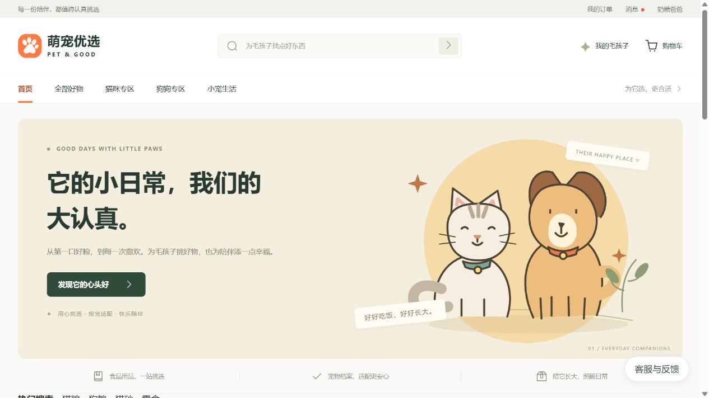

# 2026-10-27 本地模拟换机验收

基线为 `master@406cdf5`。分别验证干净源码部署和仓库内 `docs/05-交付包/pet-mall-v2.3.0.zip` 的运行包部署，两种方式均能完成启动与接口验收。

本次在同一台 Windows 电脑上隔离进程、配置、缓存和数据，模拟首次拿到仓库后的部署；没有在另一台真实电脑、虚拟机或云主机上执行，也没有验证跨设备网络访问。

## 测试输入与隔离方式

- 用 `git archive HEAD` 导出源码，再从该快照解压仓库已提交的交付 ZIP；未复制原项目真实配置、数据库、既有依赖或本机旧构建。
- 源码部署从空 npm/Maven 缓存安装依赖、编译打包。Maven 使用空用户/全局设置，避免依赖本机已有镜像配置或缓存。
- 运行时使用已安装的 Node 24.21.0、npm 11.19.0、JDK 17.0.20.1、Maven 3.9.9、MySQL 8.0.43、Redis 7.4.11。这不是操作系统或运行时安装器的隔离验收。
- 从仓库模板生成测试配置和独立凭据，按 RUNBOOK 为管理端生产构建设置 `VITE_APP_ENV=production`、`VITE_APP_BASE_API=/prod-api`。
- 新建独立 MySQL 数据目录（端口 13306）和 Redis 实例（端口 16379），使用仓库 `setup/init-db.ps1` 把空 `shop` 库从 0 张表初始化为 48 张表。
- 源码后端/用户端/管理端使用 18080/18181/18180；运行包使用 18081/18182/18183。二者连接同一个全新测试库和缓存，不连接原项目的 3306/6379 实例。
- 核对源码副本的 1049 个受版本控制文件：按 Git 换行规则归一化后内容差异为 0，其中 915 个文件只有导出换行差异。

## 验收结果

- 源码用户端：5 项单测通过；静态检查覆盖 19 个页面、59 个 Vue 文件；生产构建成功。
- 源码管理端：静态检查覆盖 10 个页面、20 个 SFC；按文档生成生产配置后构建成功。
- 源码后端：从空 Maven 缓存构建成功。使用了 `-DskipTests`，未执行 Java 单元测试。
- 两种部署均经仓库 `setup/start-mall.ps1 -NoBrowser -UserPort <测试端口>` 成功启动；运行包无需安装前端 `node_modules`。
- 通过各自管理端 `/prod-api` 代理执行原有 `setup/smoke-test.ps1`：源码和运行包分别 `PASS=30 FAIL=0 SKIP=0 TOTAL=30`，共 60 项检查。
- 用户端首页、登录页、商品列表、商品详情、深层路由、健康与商品接口、入口资源及缺失资源状态共 22 项 HTTP 检查通过。
- `db/verify_runtime.sql` 的 10 项数据库只读一致性校验全部通过。
- 浏览器实际打开运行包首页并显示种子商品；源码用户端使用仓库演示会员 `member1` 登录成功；源码管理端登录页正常显示。
- 未执行文件上传。测试结束后停止所有隔离服务，保留本机测试数据；原项目健康接口仍正常。

## 证据文件

- [结构化回执](test-receipt.json)：隔离条件、构建结果、检查数量和收尾状态。
- [源码冒烟结果](source-smoke.txt)、[运行包冒烟结果](release-smoke.txt)：保留逐项 PASS/FAIL 与汇总，移除原始请求/响应和会话 Token。
- [HTTP 检查结果](http-results.json)：22 项路径和响应状态。
- [数据库校验](runtime-db.txt)：10 项规则的结果。
- [浏览器登录截图](source-login.jpg)：只包含本地测试页面与种子演示账号；原始截图字节为 JPEG，以 `.jpg` 归档，未重绘或修改图像内容。

## 复现入口与边界

先按仓库 [RUNBOOK](../../RUNBOOK.md) 安装运行环境、从配置模板生成本地配置，并明确指向独立测试实例；然后执行数据库初始化、源码依赖安装与构建、`setup/start-mall.ps1`、`setup/smoke-test.ps1` 和 `db/verify_runtime.sql`。运行包使用相同配置与初始化流程，可直接使用包内已有构建。

新电脑仍需提供自己的数据库连接信息，不能只复制源码后省略配置。管理端不能把模板默认的 `/dev-api` 直接用于本仓库生产运行服务。

服务沿用仓库 `127.0.0.1` 监听方式，因此本结果只证明满足前置条件时可以在部署电脑本地运行；不证明其他设备能连接这台电脑。文件上传、真实支付、真实异机兼容性和跨设备网络访问均不属于本次已验收范围。

本目录仅归档脱敏验收证据；不包含真实环境变量、凭据、原始会话日志、数据库文件/备份、运行时安装包、依赖缓存或临时完整源码副本。
